Comparing sequences (homology) is very powerful: differences tell us what they might do. Co-variants, for example, might be dependent on each other.

Interested in **coevolution**. Evolution is important (even for bioengineers thinking about the future). Sequences are all related; evolution tells us how.

How do we model this (what?): PSSM (position-specific scoring matrix), MG, AE, Potts/MRF (Markov random field), pLM (protein language model), AlphaFold/RoseTTAFold. They are all super different.

All models are input → output sequences: linear, transformers, etc. (the parameterization in the middle).

- About 70% is explained by protein structure (covariance).
- ML: stochastic statistical inferences (they don’t understand the protein physics).
- Large vs. small models have different uses (grouping, subdividing/averaging, etc.).

Want to model conservation and coevolution. Colors become 1s and 0s, then undergo weights (plus a bias term), and then we get an output.

## GREMLIN

**GREMLIN**: Generative REgularized ModeLs of proteINs. GREMLIN, plmDCA and EVcouplings are the same model: a Potts model, i.e. a Markov random field.

AI will sometimes just use the identity matrix to cheat (so we learn nothing). Solution: remove the original input.

$$
\text{loss} = -x\cdot\log x' + \lambda b^2 + \lambda w^2
$$

- Proteins: a $20\times 20$ matrix.
- DNA: a $4\times 4$ matrix.

Contact maps / crystal structure. Represent the protein as a contact map.
<!-- page 9: the notes leave a placeholder here ("contact map goes here"); no contact map was inserted. -->

## Pseudolikelihood and masked language modeling

Pseudolikelihood vs. masked language modeling:

$$
\mathcal{L}_{\mathrm{PL}}(\theta; x) = \sum_{i=1}^{L} \log p_\theta(x_i \mid x_{\setminus i})
\qquad
\mathcal{L}_{\mathrm{MLM}}(\theta; x, M) = \sum_{i\in M} \log p_\theta(x_i \mid x_{\setminus M})
$$

Mask about 15%.

Train the model on a single protein and you get something like a contact map (and GREMLIN).

A protein language model is essentially a decomposition of the model. In practice many, many layers are used.

**Orphan proteins**: proteins without neighbors. (You can alter the neighborhood radius of an orphan protein to make it no longer an orphan.)

Protein language models learn a library of GREMLIN models, but are capable of doing better due to shared parameters.

## Circular permutations

Circular permutations of proteins. Want to find circular permutations.
