:::definition
$$\text{Avg. rate of change} = \frac{f(b) - f(a)}{b - a}$$
:::

:::note
The avg. R.O.C. is really just **slope**.
:::

:::example
$f(x) = x^2 - 2x$. Find the avg. R.O.C. from $x = 3$ to $x = 5$.

:::solution
We need $(3,\,?)$ and $(5,\,?)$, so plug into $f(x)$:

$$(3)^2 - 2(3) = 9 - 6 = 3, \qquad (5)^2 - 2(5) = 25 - 10 = 15.$$

This gives $(3,3)$ and $(5,15)$, with $a = 3$, $f(a) = 3$, $b = 5$, $f(b) = 15$. Then

$$\text{Avg. R.O.C.} = \frac{(15) - (3)}{(5) - (3)} = \frac{12}{2} = \boxed{6}.$$

Thus the avg. rate of change is $6$ $\left(\dfrac{\text{distance}}{\text{time}}\right)$.

Additionally, with $y - y_1 = m(x - x_1)$:

$$y - 3 = 6(x - 3) \;\to\; y = 6x - 15.$$
:::
:::
