Setting both angles equal in the angle addition identities gives the double-angle identities, and solving those for the smaller angle gives the half-angle identities.

## Double angles

:::problem
Find $\sin(2x)$ and $\cos(2x)$. Test your identities with $\sin 120^\circ$ and $\cos 120^\circ$.

:::solution
$$\sin 2x = \sin(x+x) = 2\sin x\cos x$$
and
$$\cos 2x = \cos(x+x) = \cos^2 x - \sin^2 x.$$
Testing with $120^\circ = 2(60^\circ)$: $\sin(120^\circ) = \frac{\sqrt3}{2}$ and
$$2\sin(60^\circ)\cos(60^\circ) = 2\cdot\frac{\sqrt3}{2}\left(\frac12\right) = \frac{\sqrt3}{2}.$$
For $\cos$: $\cos(120^\circ) = -\frac12$, and
$$\cos^2(60^\circ) - \sin^2(60^\circ) = \left(\frac12\right)^2 - \left(\frac{\sqrt3}{2}\right)^2 = \frac14 - \frac34 = -\frac24 = -\frac12.$$
:::
:::

:::problem
Find $\tan 2x$ in terms of $x$.

:::solution
$$\tan 2x = \tan(x+x) = \frac{\tan x + \tan x}{1 - \tan^2 x} = \frac{2\tan x}{1 - \tan^2 x}.$$
:::
:::

## Half angles

:::problem
Use the double-angle identities for sine and cosine with $\cos^2 x + \sin^2 x = 1$ to find $\cos\left(\frac x2\right)$ and $\sin\left(\frac x2\right)$ in terms of $\cos x$. Test with $x = 240^\circ$.

:::solution
From $\sin 2\theta = 2\sin\theta\cos\theta$ we get $\sin x = 2\sin\frac x2\cos\frac x2$. And
$$\cos 2\theta = \cos^2\theta - \sin^2\theta = \cos^2\theta - 1 + \cos^2\theta = 2\cos^2\theta - 1 \implies \cos x = 2\cos^2\left(\frac x2\right) - 1,$$
so
$$\cos^2\frac x2 = \frac{1+\cos x}{2} \implies \cos\frac x2 = \pm\sqrt{\frac{1+\cos x}{2}}.$$
If $\frac x2$ is an angle in quadrant I, it is positive; for cosine we can say it is negative (by “it” I mean our $\pm$) iff $\frac x2$ is in quadrant II or III.
So
$$\cos\frac{240^\circ}{2} = \cos 120^\circ = -\frac12$$
OR
$$\cos\left(\frac{240^\circ}{2}\right) = -\sqrt{\frac{1 + \left(-\frac12\right)}{2}} = -\sqrt{\frac14} = -\frac{1}{\sqrt4} = -\frac12.$$
Using $\sin\frac x2 = \pm\sqrt{\frac{1-\cos x}{2}}$ we get similar ($\sin 120^\circ = \frac{\sqrt3}{2}$).
:::
:::

:::problem
$$\cos(15^\circ) = \cos\left(\frac{\pi/6}{2}\right) = \sqrt{\frac{1 + \frac{\sqrt3}{2}}{2}} = \sqrt{\frac{\frac{\sqrt3+2}{2}}{2}} = \sqrt{\frac{\sqrt3+2}{4}}$$
$\to$ it’s weird.
:::

:::problem
Show that $\tan\frac x2 = \dfrac{\sin x}{1+\cos x} = \dfrac{1-\cos x}{\sin x}$.

:::solution
Well,
$$\tan\left(\frac x2\right) = \frac{\sin\left(\frac x2\right)}{\cos\left(\frac x2\right)} = \frac{\sqrt{1-\cos x}}{\sqrt{1+\cos x}} = \pm\frac{\sqrt{1-\cos^2 x}}{1+\cos x} = \pm\frac{\sqrt{\sin^2 x}}{1+\cos x} = \pm\frac{\sin x}{1+\cos x}.$$
If instead
$$\frac{\sqrt{1-\cos x}\,\sqrt{1-\cos x}}{\sqrt{1+\cos x}\,\sqrt{1-\cos x}} = \frac{1-\cos x}{\sqrt{1-\cos^2 x}} = \pm\frac{1-\cos x}{\sin x}.$$
$\leftarrow$ idk why we drop $\pm$?
:::
:::

## Using double and half angles

:::example
Prove that $\arctan 1 + \arctan 2 + \arctan 3 = \pi$ by using three well-chosen triangles on the Cartesian plane.

:::solution

:::
:::

:::problem
Compute the number of degrees in the smallest positive angle $x$ that satisfies the equation $8\sin x\cos^5 x - 8\sin^5 x\cos x = 1$.

:::solution
$x \in (0, 2\pi]$ (I think?).
$$8(\sin x\cos^5 x - \sin^5 x\cos x) = 1$$
Wait, no: pull out $8\sin x\cos x$. So
$$\begin{aligned}
8\sin x\cos x\,(\cos^4 x - \sin^4 x) &= 1\\
(\cos^2 x - \sin^2 x)(\cos^2 x + \sin^2 x)\,8\sin x\cos x &= 1\\
(\cos^2 x - \sin^2 x)\,8\sin x\cos x &= 1,
\end{aligned}$$
and
$$\cos^2 x - (1 - \cos^2 x) = \cos^2 x - 1 + \cos^2 x = 2\cos^2 x - 1 = \cos(2x).$$
So
$$\cos(2x)\,8\sin x\cos x = 4\cos(2x)\sin(2x) = (\sin 4x)\,2,$$
and $2\sin 4x = 1 \to \sin 4x = \frac12 \to 4x = 30^\circ$, $2x = 15^\circ$, so $\boxed{x = 7.5^\circ}$.
:::
:::

:::problem
Find $\cos(20^\circ)\cos(40^\circ)\cos(80^\circ)$.

:::solution
In radians this is $\cos\left(\frac\pi9\right)\cos\left(\frac{2\pi}9\right)\cos\left(\frac{4\pi}9\right)$, with
$$\cos\left(2\cdot\frac\pi9\right) = \cos^2\left(\frac\pi9\right) - \sin^2\left(\frac\pi9\right),$$
and $\frac\pi9 = \frac13\cdot\frac\pi3$.

Using $\cos 40^\circ = 2\cos^2 20^\circ - 1$ and $\cos 80^\circ = 2\cos^2 40^\circ - 1$:
$$\cos 20^\circ\,(2\cos^2 20^\circ - 1)(2\cos^2 40^\circ - 1).$$

Instead: $\cos 20^\circ = \dfrac{\sin 40^\circ}{2\sin 20^\circ}$, so $\cos 20^\circ\cos 40^\circ\cos 80^\circ = \dfrac18$.
:::
:::

## Exercises

:::exercise
$$\sin 22.5^\circ = \sin\left(\frac{45^\circ}{2}\right) = \sqrt{\frac{1 - \cos(45^\circ)}{2}} = \sqrt{\frac{1 - \frac{\sqrt2}{2}}{2}} = \sqrt{\frac{2-\sqrt2}{4}} = \boxed{\frac{\sqrt{2-\sqrt2}}{2}}$$

:::

:::exercise
If $\sin\theta = \frac14$, then what is $\cos 2\theta$?

:::solution
$$\cos 2\theta = \cos^2\theta - \sin^2\theta = 1 - 2\sin^2\theta = 1 - \frac{2}{16} = 1 - \frac18 = \boxed{\frac78}$$

:::
:::

:::exercise
Compute $\cos\left(2\arcsin\frac35\right)$.
:::

:::exercise
Use the angle addition and double-angle identities with $\sin\theta = \frac{6}{10}$ and $\cos\theta = \frac{8}{10}$.

:::solution

$$2\left(\frac{8}{10}\right)\left(\frac{6}{10}\right) = \frac{48}{50} = \frac{24}{25}, \qquad\text{and also}\qquad \left(\frac45 + \frac35\right)^2 - 1 = \frac{49}{25} - \frac{25}{25} = \frac{24}{25}.$$
$$\sin\theta\cos 60^\circ - \cos\theta\sin 60^\circ = \frac{6}{10}\left(\frac12\right) - \frac{8}{10}\left(\frac{\sqrt3}{2}\right) = \frac{3}{10} - \frac{4\sqrt3}{10} = \frac{3}{10} - \frac25\sqrt3,$$
$$\frac{8}{10}\left(\frac12\right) + \frac{\sqrt3}{2}\left(\frac{6}{10}\right) = \frac{8}{20} + \frac{6\sqrt3}{20} = \frac25 + \frac{3\sqrt3}{10}.$$

:::
:::

:::exercise
Prove that $\sin 2x = \dfrac{2\tan x}{1+\tan^2 x}$ for all $x$ for which $\tan$ is defined.

:::solution
Multiply top and bottom by $\cos^2 x$:
$$\frac{2\tan x}{1+\tan^2 x} = \frac{2\,\frac{\sin x}{\cos x}}{1 + \frac{\sin^2 x}{\cos^2 x}} = \frac{2\sin x\cos x}{\cos^2 x + \sin^2 x} = \frac{2\sin x\cos x}{1} = \sin 2x. \qquad\square$$
:::
:::

:::exercise
Show that $\tan x + \cot x = 2\csc 2x$.

:::solution
$$\begin{aligned}
\frac{\sin x}{\cos x} + \frac{\cos x}{\sin x} &= 2\cdot\frac{1}{\sin(2x)}\\
\frac{\sin^2 x + \cos^2 x}{\cos x\sin x} &= \frac{2}{2\cos x\sin x}\\
\frac{1}{\cos x\sin x} &= \frac{1}{\cos x\sin x}. \qquad\square
\end{aligned}$$
:::
:::

:::exercise
If $-\frac\pi2 < A < \frac\pi2$ and $A \ne -\frac\pi4$, then prove that
$$\frac{\sin 2A - \cos 2A + 1}{\sin 2A + \cos 2A + 1} = \tan A.$$

:::solution
$$\begin{aligned}
&\frac{2\sin A\cos A - (\cos^2 A - \sin^2 A) + 1}{2\sin A\cos A + (\cos^2 A - \sin^2 A) + 1}\\
&= \frac{2\sin A\cos A - \cos^2 A + \sin^2 A + \sin^2 A + \cos^2 A}{2\sin A\cos A + \cos^2 A - \sin^2 A + \sin^2 A + \cos^2 A}\\
&= \frac{2\sin A\cos A + 2\sin^2 A}{2\sin A\cos A + 2\cos^2 A}\\
&= \frac{2\sin A\,(\cos A + \sin A)}{2\cos A\,(\sin A + \cos A)} = \tan A. \qquad\square
\end{aligned}$$
:::
:::

:::exercise
If $\sin 2\theta = \frac{21}{25}$ and $\cos\theta > \sin\theta$, then compute $\cos\theta - \sin\theta$.

:::solution
$\sin 2\theta = 2\sin\theta\cos\theta$, and
$$\cos^2\theta + \sin^2\theta - 2\sin\theta\cos\theta = 1 - 2\sin\theta\cos\theta = 1 - \frac{21}{25} = \frac{4}{25},$$
so
$$(\cos\theta - \sin\theta)^2 = \frac{4}{25}, \qquad \cos\theta - \sin\theta = \pm\sqrt{\frac{4}{25}}, \qquad \cos\theta - \sin\theta = +\boxed{\frac25}.$$
:::
:::

:::exercise
Solve the equation $\cos\theta + \sin\theta = \sqrt{\frac32}$ for $0 \le \theta \le 2\pi$.

:::solution
Squaring:
$$\cos^2\theta + \sin^2\theta + 2\sin\theta\cos\theta = \frac32 \quad\to\quad 1 + 2\cos\theta\sin\theta = \frac32,$$
so $2\cos\theta\sin\theta = \frac32 - \frac22 = \frac12$, that is,
$$\sin(2\theta) = \frac12 \to 2\theta = \frac\pi6 \to \theta = \frac{\pi}{12}.$$
Check:
$$\cos\left(\frac{\pi}{12}\right) + \sin\left(\frac{\pi}{12}\right) = \frac{\sqrt6+\sqrt2}{4} + \frac{\sqrt6-\sqrt2}{4} = \frac{2\sqrt6}{4} = \frac{\sqrt6}{2} = \sqrt{\frac32}.$$
$$\boxed{\theta = \frac{\pi}{12},\ \frac{5\pi}{12}}$$
:::
:::

:::exercise
(a) Prove that $\cos 3\theta = 4\cos^3\theta - 3\cos\theta$.

:::solution
$$\begin{aligned}
\cos(\theta + (\theta+\theta)) &= \cos\theta\cos(2\theta) - \sin\theta\sin 2\theta\\
&= \cos\theta(\cos^2\theta - \sin^2\theta) - \sin\theta(2\sin\theta\cos\theta)\\
&= \cos^3\theta - \cos\theta\sin^2\theta - 2\sin^2\theta\cos\theta\\
&= \cos^3\theta - 3\sin^2\theta\cos\theta\\
&= \cos\theta(\cos^2\theta - 3\sin^2\theta)\\
&= \cos\theta\left(\cos^2\theta - 3(1 - \cos^2\theta)\right)\\
&= \cos\theta(4\cos^2\theta - 3) = \boxed{4\cos^3\theta - 3\cos\theta}
\end{aligned}$$
:::

(b) Do the same for $\sin 3\theta$.

:::solution
$$\begin{aligned}
\sin 3\theta &= \sin\theta\cos 2\theta + \sin 2\theta\cos\theta\\
&= \sin\theta(\cos^2\theta - \sin^2\theta) + \cos\theta(2\sin\theta\cos\theta)\\
&= \sin\theta\cos^2\theta - \sin^3\theta + 2\cos^2\theta\sin\theta\\
&= 3\cos^2\theta\sin\theta - \sin^3\theta = \sin\theta(3\cos^2\theta - \sin^2\theta)\\
\Rightarrow\ &\sin\theta\left(3(1 - \sin^2\theta) - \sin^2\theta\right) = \sin\theta(3 - 3\sin^2\theta - \sin^2\theta)\\
&= \boxed{3\sin\theta - 4\sin^3\theta}
\end{aligned}$$
:::

(c) Suppose $\dfrac{\cos 3x}{\cos x} = \dfrac13$ for some angle $x$, with $0 \le x \le \frac\pi2$. Determine $\dfrac{\sin 3x}{\sin x}$.

:::solution
$$4\cos^3\theta - 3\cos\theta = \frac{\cos\theta}{3}$$

$$\frac{4\cos^3\theta - 3\cos\theta}{\cos\theta} = \frac13 \quad\to\quad \frac{\cos\theta\,(4\cos^2\theta - 3)}{\cos\theta} = \frac13,$$
so
$$4\cos^2\theta - 3 = \frac13, \qquad 4\cos^2\theta = \frac13 + \frac93 = \frac{10}{3}, \qquad \cos^2\theta = \frac{10}{12}.$$

Let’s start again:
$$\frac{\cos 3x}{\cos x} = \frac13 \qquad\left(\hookrightarrow\ \frac{\cos^2 3x}{\cos^2 x} = \frac19,\quad \frac{\sin^2 3x}{\sin^2 x}\,?\right)$$
$$\frac{4\cos^3 x - 3\cos x}{\cos x} = \frac{\cos x\,(4\cos^2 x - 3)}{\cos x} = 4\cos^2 x - 3 = \frac13,$$
$$\frac{\sin 3x}{\sin x} = \frac{3\sin x - 4\sin^3 x}{\sin x} = \frac{\sin x\,(3 - 4\sin^2 x)}{\sin x} = 3 - 4\sin^2 x.$$
Using $\sin^2 x + \cos^2 x = 1$: $4\cos^2 x - 3 = 4(1 - \sin^2 x) - 3 = 4 - 4\sin^2 x - 3$ (and the other way round, $3 - 4\sin^2 x = 3 - 4 + 4\cos^2 x = 4\cos^2 x - 1$). So
$$\begin{aligned}
4 - 4\sin^2 x - 3 &= \frac13\\
1 - 4\sin^2 x = \frac13 \ \to\ \frac33 - \frac13 &= 4\sin^2 x\\
\frac23 &= 4\sin^2 x\\
\frac{2}{12} &= \sin^2 x\\
\frac{\sqrt2}{\sqrt{12}} = \frac{\sqrt2}{2\sqrt3} = \frac{2\sqrt6}{4\cdot 3} = \frac{2\sqrt6}{12} = \frac{\sqrt6}{6} &= \sin x,
\end{aligned}$$
so $x = \arcsin\left(\frac{\sqrt6}{6}\right)$, and
$$\frac{\sin 3x}{\sin x} = 3 - 4\sin^2 x = 3 - 4\left(\frac{\sqrt6}{6}\right)^2 = 3 - \frac{6}{36}(4) = 3 - \frac{24}{36} = 3 - \frac23 = -\frac23 + \frac93 = \boxed{\frac73}.$$
:::
:::
