A parameter lets us describe a curve by giving $x$ and $y$ separately as functions of a third variable, which we can think of as time.

## Parameterization

:::definition
A **parametric equation** relates $x$ and $y$ using an intermediary called a **parameter**. We accomplish this by writing $x$ and $y$ as functions of the parameter $t$: $x = f(t)$ and $y = g(t)$. Think of $t$ like time, and of $x$ and $y$ as the coordinates of a 2D particle on the Cartesian plane. The equations $x = f(t)$, $y = g(t)$ are called **parametric equations**. Graphically, we plot all points $(x,y)$ for which there is a $t \in \RR$ such that $x = f(t)$, $y = g(t)$. If the possible values of $t$ are not specified, we assume all real values.
:::

:::example
$$x = 2 - 3t, \qquad y = 1 + 2t.$$

:::solution
Observe: at $t = 0$ we get $x = 2$ and $y = 1$. Therefore at “time” $t = 0$ the particle is at $(2,1)$.
:::
:::

## Graphing parametric equations

:::problem
Let $x = 2 - 3t$, $y = 1 + 2t$.

(a) Compute many values for $t$ and plot them on a graph.

(b) Eliminate $t$ from the parametric equations to find a new equation in which only $x$ and $y$ are variables. Show that for every pair $(x_1, y_1)$ that satisfies our new equation, we can find a value of $t$ in the parametric equations such that $(x,y) = (x_1, y_1)$.

(c) Suppose we limit $t$ to $[4,8]$. How does this affect the graph?

:::solution
(a)

| $t$ | $x$ | $y$ |
|---|---|---|
| $-3$ | $11$ | $-5$ |
| $-2$ | $8$ | $-3$ |
| $-1$ | $5$ | $-1$ |
| $0$ | $2$ | $1$ |
| $1$ | $-1$ | $3$ |
| $2$ | $-4$ | $5$ |
| $3$ | $-7$ | $7$ |
| $4$ | $-10$ | $9$ |
| $5$ | $-13$ | $11$ |
| $6$ | $-16$ | $13$ |

(b) From $x = 2 - 3t$ we get $t = \frac{x-2}{-3}$, so
$$y = 1 + 2\left(\frac{x-2}{-3}\right) \implies y = 1 + \frac{-2x+4}{3} = 1 + \frac43 - \frac23 x \implies y = \frac73 - \frac23 x.$$
Let $x_1 = 2$: then $\frac73 - \frac23(2) = \frac73 - \frac43 = \frac33 = 1$.

Since $t = \frac{2-x}{3}$ and $t = \frac{y-1}{2}$, saying $t = t$ is equivalent to saying
$$\frac{2-x}{3} = \frac{y-1}{2} \implies \frac43 + 1 - \frac23 x = y,$$
which shows that for all such $x, y$, $t$ is defined (or: for all $t$, $x$ and $y$ are defined?).
:::
:::

:::problem
Graph the parametric equations $x = 1 - t$, $y = 2t^2 - t$.

:::solution
The points are $(1-t,\ 2t^2 - t)$. It is an upward-opening ($\cup$) parabola.
:::
:::

:::problem
Find the graph of the parametric equations $x = 3 + 2\cos t$, $y = 4 + 2\sin t$ for $0 \le t < 2\pi$.

:::solution
Plotting the points for $t = 0, \frac{\pi}{4}, \frac{\pi}{2}, \dots, \frac{7\pi}{4}$:

Guessing it’s supposed to be a circle.
:::
:::

:::problem
Graph $x = \sin\theta$, $y = 3 - 2\cos\theta$.

:::solution
| $\theta$ | $x$ | $y$ |
|---|---|---|
| $0$ | $0$ | $1$ |
| $\frac{\pi}{4}$ | $\frac{\sqrt2}{2}$ | $3 - \sqrt2$ |
| $\frac{\pi}{2}$ | $1$ | $3$ |
| $\frac{3\pi}{4}$ | $\frac{\sqrt2}{2}$ | $3 + \sqrt2$ |
| $\pi$ | $0$ | $5$ |
| $\frac{5\pi}{4}$ | $-\frac{\sqrt2}{2}$ | $3 + \sqrt2$ |
| $\frac{3\pi}{2}$ | $-1$ | $3$ |
| $\frac{7\pi}{4}$ | $-\frac{\sqrt2}{2}$ | $3 - \sqrt2$ |
| $2\pi$ | $0$ | $1$ |

:::
:::

## Finding parametric equations

:::problem
(a) Find parametric equations for $x, y$ such that the graph of the parametric equations is the same as the graph of $x^2 + y^2 = 1$.

(b) Is your answer unique? Are there any other parametric equations which produce the same graph?

(c) Suppose a particle starts at the point $(0,2)$ and moves at a constant speed clockwise around the origin along $x^2 + y^2 = 4$. If the particle completes a full revolution in $4$ seconds, find the parametric equations for the location of the particle in terms of $t$, where $t$ is time.

:::solution
(a) Well, famously $\cos^2 t + \sin^2 t = 1$, so let $x = \cos t$, $y = \sin t$.

(b) I mean, only if you consider things like $x = \frac{\sin t}{\tan t}$, $y = \tan t\cos t$ different equations, but they are the same as $x = \cos t$, $y = \sin t$.

Genuinely different parameterizations do produce the same graph, though: for example $x = \sin t$, $y = \cos t$ (clockwise from $(0,1)$), or $x = \cos 2t$, $y = \sin 2t$, $0 \le t < \pi$. So the answer is not unique.

(c) So we have $t \in [0,4]$ covering one revolution, $[0, 2\pi)$, so $\frac{\pi}{2}$ of rotation takes $1$ sec. Starting at the top, $(0,2)$, and going clockwise, the angle at time $t$ is $\frac{\pi}{2} - \frac{\pi}{2}t$. Therefore we have
$$x = 2\cos\left(\frac{\pi}{2} - \frac{\pi t}{2}\right) = 2\sin\frac{\pi t}{2}, \qquad y = 2\sin\left(\frac{\pi}{2} - \frac{\pi t}{2}\right) = 2\cos\frac{\pi t}{2}, \qquad 0 \le t \le 4.$$

:::
:::

:::problem
Find parametric equations for $x, y$ such that $x^2 - 3y^2 = 1$.

:::solution
Rewrite as $x^2 = 1 + 3y^2$, i.e. $x = \pm\sqrt{1 + 3y^2}$. This looks like $\tan^2\theta + 1 = \sec^2\theta$.

First try: $\sec\theta = \sqrt3\,y$, giving $x = \tan\theta$, $y = \frac{\sqrt3\sec\theta}{3} = \frac{\sec\theta}{\sqrt3}$. But that has $x$ and $y$ the wrong way round: it gives $3y^2 - x^2 = 1$, the up–down (blue) hyperbola below. So instead take $\tan\theta = \sqrt3\,y$:
$$\boxed{\,x = \sec\theta, \qquad y = \frac{\sqrt3\tan\theta}{3}\,}$$
Check: $x^2 - 3y^2 = \sec^2\theta - \tan^2\theta = 1$.

:::
:::

:::problem
I’m riding my bike at a constant speed of $20$ mph on flat land when I ride over a dot of fresh yellow paint, thereby getting a yellow spot on my front wheel, which is $2$ ft in diameter. I continue riding my bike in a straight line at $20$ mph. When $t$ seconds have passed since running over the dot, how many ft is the yellow spot on my tire from the yellow dot I ran over?

:::solution
Units first:
$$20\ \text{mph} = \frac{20}{60\cdot 60}\ \text{mi/sec} = \frac{2}{360} = \frac{1}{180}\ \text{mi/sec}, \qquad 2\ \text{ft} \approx 0.000379\ \text{mi} = 3.79\times 10^{-4}\ \text{mi},$$
so the bike moves $\frac{1}{180}$ mi/sec $\approx 29.33$ ft/sec.

Let $x(t)$ be the distance forward the spot has moved in $t$ seconds, and $y(t)$ how far off the ground it is after $t$ sec. The distance is then
$$\sqrt{x(t)^2 + y(t)^2}.$$

The wheel has radius $r = 1$ ft. The spot starts at the bottom of the wheel (angle $\frac{3\pi}{2}$ measured from the center), and as the wheel rolls forward it turns clockwise, so after turning through $\theta$ the spot is at angle $\frac{3\pi}{2} - \theta$ from the center. A full rotation is $2\pi$ radians, the bike covers $29.33$ ft each second, and since $r = 1$ the wheel turns through $\theta = 29.33t$ radians in $t$ seconds.

$$x(t) \approx 29.33t + \cos\left(\frac{3\pi}{2} - \theta\right), \qquad y(t) \approx 1 + \sin\left(\frac{3\pi}{2} - \theta\right), \qquad \theta = 29.33t \text{ since } r = 1.$$
So:
$$x(t) = 29.33t - \sin 29.33t, \qquad y(t) = 1 - \cos 29.33t.$$
So we have
$$\sqrt{(1 - \cos 29.33t)^2 + (29.33t - \sin 29.33t)^2}.$$
Expanding,
$$(29.33t)^2 + \sin^2 29.33t - 2(29.33t)\sin 29.33t + 1 + \cos^2 29.33t - 2\cos 29.33t,$$
and pairing $\sin^2 29.33t + \cos^2 29.33t = 1$, the distance is
$$\sqrt{2 + 860.25t^2 - 2\cos 29.33t - 58.66t\sin 29.33t}.$$
:::
:::

## Exercises

:::exercise
Slope of $x = 3t + 7$, $y = 8t - 5$?

:::solution
$\frac83$.
:::
:::

:::exercise
Graph $x = 3\cos 2t$, $y = -3\sin 2t$.

:::solution

:::
:::

:::exercise
Graph $x = -3 + \cos\theta$, $y = 2 + 5\sin\theta$.

:::solution
An ellipse centered at $(-3,2)$: it reaches $5$ above and below the center (from $y = -3$ to $y = 7$) and has width $2$.

:::
:::

:::exercise
Graph $x = 4\cos 2t$, $y = 1 + \cos^2 2t$.

:::solution
Let $u = \cos 2t$, which runs over $[-1,1]$. Then $x = 4u$ and $y = 1 + u^2 = 1 + \frac{x^2}{16}$, so the graph is the arc of a parabola from $(-4,2)$ through $(0,1)$ to $(4,2)$.

:::
:::

:::exercise
Find parametric equations for $4x^2 + 9y^2 = 144$.

:::solution
$$\frac{x^2}{36} + \frac{y^2}{16} = 1 \;\to\; \frac{x^2}{6^2} + \frac{y^2}{4^2} = 1 \;\to\; x = 6\cos t, \quad y = 4\sin t.$$
:::
:::

:::exercise
A particle starts at $(1,5)$ and travels at a constant speed in a circle around the point $(4,5)$. Find parametric equations to describe the location of the particle at $t$ sec when it moves counterclockwise and takes $8\pi$ sec for a full revolution.

:::solution
(A quarter of the circle takes $2\pi$ sec.)

Start with $x = \cos t$, $y = \sin t$. Use $3\cos t$, $3\sin t$ for the radius, then change the centering: $4 + 3\cos t$, $5 + 3\sin t$. Next we need to do a phase shift, $4 + 3\cos(t + \pi)$ and $5 + 3\sin(t + \pi)$, where $\cos(t+\pi) = -\cos t$ and $\sin(t+\pi) = -\sin t$, since $4 + 3\cos 0 = 7$ but $4 + 3\cos\pi = 1$. Finally we increase the period from $2\pi$ to $8\pi$ by using $\frac t4$:
$$x(t) = 4 - 3\cos\frac t4, \qquad y(t) = 5 - 3\sin\frac t4, \qquad 0 \le t \le 8\pi.$$
:::
:::

:::exercise
Graph $x = \dfrac{4}{1+t^2}$, $y = \dfrac{4t}{1+t^2}$ parametrically.

:::solution
A circle of radius $2$ centered at $(2,0)$, passing through $(2,2)$.

:::
:::
