## Parameterization

:::definition
A **parametric equation** relates $x$ and $y$ using an intermediary called a **parameter**. We accomplish this by writing $x$ and $y$ as functions of the parameter $t$: $x = f(t)$ and $y = g(t)$. Think of $t$ like time, and of $x$ and $y$ as the coordinates of a 2D particle on the Cartesian plane. The equations $x = f(t)$, $y = g(t)$ are called **parametric equations**. Graphically, we plot all points $(x,y)$ for which there is a $t \in \RR$ such that $x = f(t)$, $y = g(t)$. If the possible values of $t$ are not specified, we assume all real values.
:::

:::example
$$x = 2 - 3t, \qquad y = 1 + 2t.$$

:::solution
Observe: at $t = 0$ we get $x = 2$ and $y = 1$. Therefore at “time” $t = 0$ the particle is at $(2,1)$.
:::
:::

### Problems

:::problem{5.1}
Let $x = 2 - 3t$, $y = 1 + 2t$.

(a) Compute many values for $t$ and plot them on a graph.

(b) Eliminate $t$ from the parametric equations to find a new equation in which only $x$ and $y$ are variables. Show that for every pair $(x_1, y_1)$ that satisfies our new equation, we can find a value of $t$ in the parametric equations such that $(x,y) = (x_1, y_1)$.

(c) Suppose we limit $t$ to $[4,8]$. How does this affect the graph?

:::solution
(a)

| $t$ | $x$ | $y$ |
|---|---|---|
| $-3$ | $11$ | $-5$ |
| $-2$ | $8$ | $-3$ |
| $-1$ | $5$ | $-1$ |
| $0$ | $2$ | $1$ |
| $1$ | $-1$ | $3$ |
| $2$ | $-4$ | $5$ |
| $3$ | $-7$ | $7$ |
| $4$ | $-10$ | $9$ |
| $5$ | $-13$ | $11$ |
| $6$ | $-16$ | $13$ |


(b) From $x = 2 - 3t$ we get $t = \frac{x-2}{-3}$, so
$$y = 1 + 2\left(\frac{x-2}{-3}\right) \implies y = 1 + \frac{-2x+4}{3} = 1 + \frac43 - \frac23 x \implies y = \frac73 - \frac23 x.$$
Let $x_1 = 2$: then $\frac73 - \frac23(2) = \frac73 - \frac43 = \frac33 = 1$.

Since $t = \frac{2-x}{3}$ and $t = \frac{y-1}{2}$, saying $t = t$ is equivalent to saying
$$\frac{2-x}{3} = \frac{y-1}{2} \implies \frac43 + 1 - \frac23 x = y,$$
which shows that for all such $x, y$, $t$ is defined (or: for all $t$, $x$ and $y$ are defined?).
:::
:::

:::problem{5.2}
Graph the parametric equations $x = 1 - t$, $y = 2t^2 - t$.

:::solution
The points are $(1-t,\ 2t^2 - t)$. It is an upward-opening ($\cup$) parabola.
:::
:::

:::problem{5.3}
Find the graph of the parametric equations $x = 3 + 2\cos t$, $y = 4 + 2\sin t$ for $0 \le t < 2\pi$.

:::solution
Plotting the points for $t = 0, \frac{\pi}{4}, \frac{\pi}{2}, \dots, \frac{7\pi}{4}$:


Guessing it’s supposed to be a circle.
:::
:::

:::problem{5.4}
Graph $x = \sin\theta$, $y = 3 - 2\cos\theta$.

:::solution
| $\theta$ | $x$ | $y$ |
|---|---|---|
| $0$ | $0$ | $1$ |
| $\frac{\pi}{4}$ | $\frac{\sqrt2}{2}$ | $3 - \sqrt2$ |
| $\frac{\pi}{2}$ | $1$ | $3$ |
| $\frac{3\pi}{4}$ | $\frac{\sqrt2}{2}$ | $3 + \sqrt2$ |
| $\pi$ | $0$ | $5$ |
| $\frac{5\pi}{4}$ | $-\frac{\sqrt2}{2}$ | $3 + \sqrt2$ |
| $\frac{3\pi}{2}$ | $-1$ | $3$ |
| $\frac{7\pi}{4}$ | $-\frac{\sqrt2}{2}$ | $3 - \sqrt2$ |
| $2\pi$ | $0$ | $1$ |

:::
:::

:::problem{5.5}
(a) Find parametric equations for $x, y$ such that the graph of the parametric equations is the same as the graph of $x^2 + y^2 = 1$.

(b) Is your answer unique? Are there any other parametric equations which produce the same graph?

(c) Suppose a particle starts at the point $(0,2)$ and moves at a constant speed clockwise around the origin along $x^2 + y^2 = 4$. If the particle completes a full revolution in $4$ seconds, find the parametric equations for the location of the particle in terms of $t$, where $t$ is time.

:::solution
(a) Well, famously $\cos^2 t + \sin^2 t = 1$, so let $x = \cos t$, $y = \sin t$.

(b) I mean, only if you consider things like $x = \frac{\sin t}{\tan t}$, $y = \tan t\cos t$ different equations, but they are the same as $x = \cos t$, $y = \sin t$.

Genuinely different parameterizations do produce the same graph, though: for example $x = \sin t$, $y = \cos t$ (clockwise from $(0,1)$), or $x = \cos 2t$, $y = \sin 2t$, $0 \le t < \pi$. So the answer is not unique.

(c) So we have $t \in [0,4]$ covering one revolution, $[0, 2\pi)$, so $\frac{\pi}{2}$ of rotation takes $1$ sec. Starting at the top, $(0,2)$, and going clockwise, the angle at time $t$ is $\frac{\pi}{2} - \frac{\pi}{2}t$. Therefore we have
$$x = 2\cos\left(\frac{\pi}{2} - \frac{\pi t}{2}\right) = 2\sin\frac{\pi t}{2}, \qquad y = 2\sin\left(\frac{\pi}{2} - \frac{\pi t}{2}\right) = 2\cos\frac{\pi t}{2}, \qquad 0 \le t \le 4.$$

:::
:::

:::problem{5.6}
Find parametric equations for $x, y$ such that $x^2 - 3y^2 = 1$.

:::solution
Rewrite as $x^2 = 1 + 3y^2$, i.e. $x = \pm\sqrt{1 + 3y^2}$. This looks like $\tan^2\theta + 1 = \sec^2\theta$.

First try: $\sec\theta = \sqrt3\,y$, giving $x = \tan\theta$, $y = \frac{\sqrt3\sec\theta}{3} = \frac{\sec\theta}{\sqrt3}$. But that has $x$ and $y$ the wrong way round: it gives $3y^2 - x^2 = 1$, the up–down (blue) hyperbola below. So instead take $\tan\theta = \sqrt3\,y$:
$$\boxed{\,x = \sec\theta, \qquad y = \frac{\sqrt3\tan\theta}{3}\,}$$
Check: $x^2 - 3y^2 = \sec^2\theta - \tan^2\theta = 1$.

:::
:::

:::problem{5.7}
I’m riding my bike at a constant speed of $20$ mph on flat land when I ride over a dot of fresh yellow paint, thereby getting a yellow spot on my front wheel, which is $2$ ft in diameter. I continue riding my bike in a straight line at $20$ mph. When $t$ seconds have passed since running over the dot, how many ft is the yellow spot on my tire from the yellow dot I ran over?

:::solution
Units first:
$$20\ \text{mph} = \frac{20}{60\cdot 60}\ \text{mi/sec} = \frac{2}{360} = \frac{1}{180}\ \text{mi/sec}, \qquad 2\ \text{ft} \approx 0.000379\ \text{mi} = 3.79\times 10^{-4}\ \text{mi},$$
so the bike moves $\frac{1}{180}$ mi/sec $\approx 29.33$ ft/sec.

Let $x(t)$ be the distance forward the spot has moved in $t$ seconds, and $y(t)$ how far off the ground it is after $t$ sec. The distance is then
$$\sqrt{x(t)^2 + y(t)^2}.$$


The wheel has radius $r = 1$ ft. The spot starts at the bottom of the wheel (angle $\frac{3\pi}{2}$ measured from the center), and as the wheel rolls forward it turns clockwise, so after turning through $\theta$ the spot is at angle $\frac{3\pi}{2} - \theta$ from the center. A full rotation is $2\pi$ radians, the bike covers $29.33$ ft each second, and since $r = 1$ the wheel turns through $\theta = 29.33t$ radians in $t$ seconds.

$$x(t) \approx 29.33t + \cos\left(\frac{3\pi}{2} - \theta\right), \qquad y(t) \approx 1 + \sin\left(\frac{3\pi}{2} - \theta\right), \qquad \theta = 29.33t \text{ since } r = 1.$$
So:
$$x(t) = 29.33t - \sin 29.33t, \qquad y(t) = 1 - \cos 29.33t.$$
So we have
$$\sqrt{(1 - \cos 29.33t)^2 + (29.33t - \sin 29.33t)^2}.$$
Expanding,
$$(29.33t)^2 + \sin^2 29.33t - 2(29.33t)\sin 29.33t + 1 + \cos^2 29.33t - 2\cos 29.33t,$$
and pairing $\sin^2 29.33t + \cos^2 29.33t = 1$, the distance is
$$\sqrt{2 + 860.25t^2 - 2\cos 29.33t - 58.66t\sin 29.33t}.$$
:::
:::

### Exercises

:::exercise{5.1.1}
Slope of $x = 3t + 7$, $y = 8t - 5$?

:::solution
$\frac83$.
:::
:::

:::exercise{5.1.2}
Graph $x = 3\cos 2t$, $y = -3\sin 2t$.

:::solution
:::
:::

:::exercise{5.1.3}
Graph $x = -3 + \cos\theta$, $y = 2 + 5\sin\theta$.

:::solution
An ellipse centered at $(-3,2)$: it reaches $5$ above and below the center (from $y = -3$ to $y = 7$) and has width $2$.

:::
:::

:::exercise{5.1.4}
Graph $x = 4\cos 2t$, $y = 1 + \cos^2 2t$.

:::solution
Let $u = \cos 2t$, which runs over $[-1,1]$. Then $x = 4u$ and $y = 1 + u^2 = 1 + \frac{x^2}{16}$, so the graph is the arc of a parabola from $(-4,2)$ through $(0,1)$ to $(4,2)$.


:::
:::

:::exercise{5.1.5}
Find parametric equations for $4x^2 + 9y^2 = 144$.

:::solution
$$\frac{x^2}{36} + \frac{y^2}{16} = 1 \;\to\; \frac{x^2}{6^2} + \frac{y^2}{4^2} = 1 \;\to\; x = 6\cos t, \quad y = 4\sin t.$$
:::
:::

:::exercise{5.1.6}
A particle starts at $(1,5)$ and travels at a constant speed in a circle around the point $(4,5)$. Find parametric equations to describe the location of the particle at $t$ sec when it moves counterclockwise and takes $8\pi$ sec for a full revolution.

:::solution
(A quarter of the circle takes $2\pi$ sec.)

Start with $x = \cos t$, $y = \sin t$. Use $3\cos t$, $3\sin t$ for the radius, then change the centering: $4 + 3\cos t$, $5 + 3\sin t$. Next we need to do a phase shift, $4 + 3\cos(t + \pi)$ and $5 + 3\sin(t + \pi)$, where $\cos(t+\pi) = -\cos t$ and $\sin(t+\pi) = -\sin t$, since $4 + 3\cos 0 = 7$ but $4 + 3\cos\pi = 1$. Finally we increase the period from $2\pi$ to $8\pi$ by using $\frac t4$:
$$x(t) = 4 - 3\cos\frac t4, \qquad y(t) = 5 - 3\sin\frac t4, \qquad 0 \le t \le 8\pi.$$
:::
:::

:::exercise{5.1.7}
Graph $x = \dfrac{4}{1+t^2}$, $y = \dfrac{4t}{1+t^2}$ parametrically.

:::solution
A circle of radius $2$ centered at $(2,0)$, passing through $(2,2)$.


:::
:::

## Polar Coordinates

:::definition
In **polar coordinates** a point is written $(r, \theta)$, where $r$, the **radial coordinate**, is the distance from the origin, and $\theta$, the **angular coordinate**, is the angle the segment from the origin makes with the positive $x$-axis.
:::


### Problems

:::problem{5.8}
Convert to polar:

(a) $(0,-3)$ (b) $(5,5)$ (c) $(-2\sqrt3, -6)$

:::solution
(a) $(0,-3) = (3, 270^\circ)$.

(b) $(5,5) = (5\sqrt2, 45^\circ)$.

(c) $(-2\sqrt3, -6) = (4\sqrt3, 240^\circ)$. The legs of the triangle are $2\sqrt3$ and $6$ and the hypotenuse is $4\sqrt3$. Since $2(2\sqrt3) = 4\sqrt3$, it is a $60^\circ$–$90^\circ$–$30^\circ$ triangle with the $60^\circ$ angle at the origin, and the point is in the third quadrant: $180^\circ + 60^\circ = 240^\circ$.
:::
:::

:::problem{5.9}
Convert to rectangular:

(a) $(8, 60^\circ)$ (b) $\left(12, -\frac{2\pi}{3}\right)$ (c) $(4\sqrt2, 315^\circ)$

:::solution
(a) Drop a perpendicular: a right triangle with hypotenuse $8$, angles $60^\circ$, $30^\circ$, $90^\circ$, leg $c$ along the $x$-axis and leg $b$ opposite the $60^\circ$ angle. By the law of sines,
$$\frac{\sin 90^\circ}{8} = \frac{\sin 60^\circ}{b} = \frac{\sin 30^\circ}{c} \implies \frac18 = \frac{\sqrt3}{2b} = \frac{1}{2c},$$
so $b = \frac{8\sqrt3}{2} = 4\sqrt3$ and $c = \frac82 = 4$. Thus $(8, 60^\circ) = (4, 4\sqrt3)$.

(b) $-\frac{2\pi}{3}$ points the same way as $240^\circ$. With $\frac{1}{12} = \frac{\sqrt3}{2b}$ we get $b = 6\sqrt3$, $c = 6$, so $\left(12, -\frac{2\pi}{3}\right) = (-6, -6\sqrt3)$.

(c) $\frac{4\sqrt2\cdot\sqrt2}{2} = 4$, and since the triangle is $45$–$45$–$90$, it’s the same for both legs, so
$$(4\sqrt2, 315^\circ) = (4, -4).$$
:::
:::

:::problem{5.10}
(a) What are the rectangular coordinates of the point with polar coordinates $(1, \theta)$?

(b) What about $(r, \theta)$, assuming $r > 0$?

(c) Suppose point $P$ is $(x,y)$ in rectangular coordinates and $(r,\theta)$ in polar coordinates, $r > 0$. Find $r$ in terms of $x$ and $y$. How must we modify our answer if we remove the restriction $r > 0$? How is $\tan\theta$ related to $x$ and $y$?

:::solution
(a) $(1,\theta) = (\cos\theta, \sin\theta)$.

(b) The point is $r$ times as far out along the same ray, so
$$(r, \theta) = (r\cos\theta,\ r\sin\theta).$$
Since $\cos^2\theta + \sin^2\theta = 1$, we have $r\cos^2\theta + r\sin^2\theta = r$. Check with $(4\sqrt2, 315^\circ)$ from 5.9(c): $4\sqrt2\cos 315^\circ = 4\sqrt2\cdot\frac{\sqrt2}{2} = 4$ and $4\sqrt2\sin 315^\circ = 4\sqrt2\left(-\frac{\sqrt2}{2}\right) = -4$, giving $(4,-4)$.

(c) If we have $x = r\cos\theta$ and $y = r\sin\theta$, then $x^2 + y^2 = r^2(\cos^2\theta + \sin^2\theta) = r^2$, so we can calculate:
$$\underbrace{\sqrt{x^2 + y^2} = r}_{\text{if } r > 0} \implies \underbrace{r^2 = x^2 + y^2}_{\text{if } r \in \RR}.$$
As for how $\tan\theta$ is related to $x, y$? Well,
$$\tan\theta = \frac{\sin\theta}{\cos\theta} = \frac yx.$$
:::
:::

:::problem{5.11}
What is the graph of $r = 5$? Of $\theta = 20^\circ$? (In polar.)

:::solution
$r = 5$ is the circle of radius $5$ about the origin, and $\theta = 20^\circ$ is the line through the origin at angle $20^\circ$.

:::
:::

:::problem{5.12}
(a) Graph $r = 6\sin\theta$ in polar and use the graph to guess the rectangular form of this equation.

:::solution
(a)

| $\theta$ | $(r, \theta)$ |
|---|---|
| $0^\circ$ | $(0, 0)$ |
| $30^\circ$ | $(3, 30^\circ)$ |
| $60^\circ$ | $(3\sqrt3, 60^\circ)$ |
| $90^\circ$ | $(6, 90^\circ)$ |
| $120^\circ$ | $(3\sqrt3, 120^\circ)$ |
| $150^\circ$ | $(3, 150^\circ)$ |


A circle with radius $3$, so $x^2 + (y-3)^2 = 9$.

(b) So $x^2 + (y-3)^2 = 9$ and $r = 6\sin\theta$ is what we have. Recall $r^2 = x^2 + y^2$, $x = r\cos\theta$, $y = r\sin\theta$, $\tan\theta = \frac yx$. So
$$\begin{aligned}
(r\cos\theta)^2 + (r\sin\theta - 3)^2 = 9 &\implies r^2\cos^2\theta + r^2\sin^2\theta + 9 - 6r\sin\theta = 9 \\
&\implies r^2(\cos^2\theta + \sin^2\theta) - 6r\sin\theta = 0 \\
&\implies \frac{r^2}{r} = \frac{6r\sin\theta}{r} \implies r = 6\sin\theta.
\end{aligned}$$
:::
:::

:::problem{5.13}
In rectangular form, the general form of an equation whose graph is the circle with center $(h,k)$ and radius $t$ is $(x-h)^2 + (y-k)^2 = t^2$. Find the polar form of this equation. That is, find the general form of the equation whose graph is the circle with center $(r_0, \alpha)$ (in polar) and radius $t$.

:::solution
First try: $(x-h)^2 + (y-k)^2 = t^2 \implies (r\cos\theta - r_0)^2 + (r\sin\theta - \alpha)^2 = t^2$, which expands to
$$r^2 + r_0^2 + \alpha^2 - 2rr_0\cos\theta - 2r\alpha\sin\theta, \quad\text{i.e.}\quad r(-2r_0\cos\theta - 2\alpha\sin\theta + r) + r_0^2 + \alpha^2 \ldots$$
wait, no: $k = r_0\sin\alpha$ (and $h = r_0\cos\alpha$). So
$$\begin{aligned}
(r\cos\theta - r_0\cos\alpha)^2 + (r\sin\theta - r_0\sin\alpha)^2 &= t^2 \\
r^2\cos^2\theta - 2rr_0\cos\theta\cos\alpha + r_0^2\cos^2\alpha + r^2\sin^2\theta - 2rr_0\sin\theta\sin\alpha + r_0^2\sin^2\alpha &= t^2 \\
r^2 + r_0^2 - 2rr_0\cos\theta\cos\alpha - 2rr_0\sin\theta\sin\alpha &= t^2 \\
r^2 + r_0^2 - 2rr_0\cos(\theta - \alpha) &= t^2.
\end{aligned}$$
So as an equation we have: given $(x-h)^2 + (y-k)^2 = t^2$ centered at $(h,k)$, the polar equation centered at $(r_0, \alpha)$ that corresponds to our rectangular form is
$$\boxed{\,r^2 + r_0^2 - 2rr_0\cos(\theta - \alpha) = t^2\,}$$
:::
:::

:::problem{5.14}
(a) What are the rectangular coordinates of the point that results when $(5\sqrt2, 5\sqrt6)$ is rotated $\frac{2\pi}{3}$ counterclockwise about the origin?

(b) Show that if the point $(x,y)$ is rotated $\theta$ counterclockwise about the origin, the result has rectangular coordinates $(x\cos\theta - y\sin\theta,\ y\cos\theta + x\sin\theta)$.

:::solution
(a) $r^2 = 25(2) + 25(6) = 50 + 150 = 200$, so $r = \sqrt{200} = \sqrt{10^2\cdot 2} = 10\sqrt2$. The triangle with legs $5\sqrt2$ and $5\sqrt6$ has a $60^\circ$ angle at the origin: indeed $10\sqrt2\cos 60^\circ = 5\sqrt2$ and $10\sqrt2\sin 60^\circ = 5\sqrt6$. Rotating adds the angles, $\frac{\pi}{3} + \frac{2\pi}{3} = \pi$, so
$$10\sqrt2\cos 180^\circ = -10\sqrt2 = x_{\text{new}}, \qquad 10\sqrt2\sin 180^\circ = 0 = y_{\text{new}}.$$
So $(5\sqrt2, 5\sqrt6)$ rotated $\frac{2\pi}{3}$ counterclockwise is $(-10\sqrt2, 0)$.

(b) We know that $x = r\cos\theta$ and $y = r\sin\theta$, so rotation (let’s call it $\phi$ to avoid confusion) by $\phi$ about the origin can be given by $(r\cos(\theta + \phi),\ r\sin(\theta+\phi))$. It is, however, known that
$$\cos(\theta + \phi) = \cos\theta\cos\phi - \sin\theta\sin\phi \quad\text{and}\quad \sin(\theta+\phi) = \sin\theta\cos\phi + \sin\phi\cos\theta,$$
so we have new coordinates of
$$(r\cos\theta\cos\phi - r\sin\theta\sin\phi,\ r\sin\theta\cos\phi + r\sin\phi\cos\theta).$$
But wait! We know $x = r\cos\theta$, and likewise for $y$, so substituting in we have
$$(x\cos\phi - y\sin\phi,\ y\cos\phi + x\sin\phi),$$
as desired.
:::
:::

:::remark Scratch for 5.14
Let $(r, \alpha)$ be polar coordinates for $(x,y)$; then the rotation result is $(r, \alpha + \theta)$, i.e. $(r\cos(\alpha+\theta), r\sin(\alpha+\theta))$. OHH.

Checking the formula against (a), with $\cos 120^\circ = -\frac12$ and $\sin 120^\circ = \frac{\sqrt3}{2}$:
$$5\sqrt2\cos 120^\circ - 5\sqrt6\sin 120^\circ = -\frac{5\sqrt2}{2} - \frac{15\sqrt2}{2} = -\frac{20\sqrt2}{2} = -10\sqrt2.$$
:::

:::problem{5.15}
Let $h, k$ be constants and $a, b$ positive constants with $a > b$. The graph of an equation of the form
$$\frac{(x-h)^2}{a^2} + \frac{(y-k)^2}{b^2} = 1$$
is an ellipse whose major axis has length $2a$, and every ellipse in the Cartesian plane with a horizontal major axis is of this form. Find the length of the major axis of the following ellipse:
$$7x^2 - 6\sqrt3\,xy + 13y^2 = 64.$$

:::solution
Try to factor it like a square: $(\sqrt7 x \ \cdots\ \sqrt{13}y)(\sqrt7 x\ \cdots\ \sqrt{13}y)$, with $7x^2 - 6\sqrt3\,xy$ and $-6\sqrt3 = 2(-3\sqrt3)$… yikes.

The $xy$ term means the ellipse is tilted, so rotate it to make the major axis horizontal. Dividing by $64$:
$$\frac{7x^2}{64} - \frac{6\sqrt3\,xy}{64} + \frac{13y^2}{64} = 1.$$
:::
:::

### Khan Academy interlude: ellipses

The **standard form** of an ellipse centered at the origin is
$$\frac{x^2}{a^2} + \frac{y^2}{b^2} = 1,$$
where $a$ is the $x$-radius and $b$ is the $y$-radius. With $a > b$ (as drawn), $a$ is the **major radius** or **semi-major axis** and $b$ is the **minor radius** or **semi-minor axis**.


- **Minor axis:** the short side.
- **Major axis:** the long side.

The semi-minor axis is $b$ since the minor axis is $2b$ (the whole axis in the ellipse).

:::example
$$\frac{x^2}{9} + \frac{y^2}{25} = 1 \iff \frac{x^2}{3^2} + \frac{y^2}{5^2} = 1.$$

:::solution
So the major axis is $10$, with radius $5$, and is vertical; the minor axis is $6$, with radius $3$, for the horizontal.

:::
:::

A circle fits the same pattern: $x^2 + y^2 = r^2 \iff \frac{x^2}{r^2} + \frac{y^2}{r^2} = 1$. Shifting: $(x-5)^2$ moves the graph right $5$, and $(y+2)^2$ moves it down $2$.

**Foci.** Say $a > b$ for $\frac{x^2}{a^2} + \frac{y^2}{b^2} = 1$, so the major axis is horizontal. For any point on the ellipse, the sum of its distances to the two foci $f_1, f_2$ is $2a$: in the picture, $d_1 + d_2 = 2a$, $d_3 + d_4 = 2a$, and so on for every point.


The gaps $m$ (from the left end to $f_2$) and $n$ (from $f_1$ to the right end) are equal, since the ellipse is symmetric about its center. Taking the point at the right end of the major axis: its distance to $f_1$ is $n$, and its distance to $f_2$ is the stretch $c$ from the left end to $f_1$ (since $m = n$), so $c + n = 2a$, which is the whole major axis.

Now take the point at the top, $(0, b)$. There $d_1 = d_2$, so $d_1 = d_2 \implies d_1 = a = d_2$. With $q$ the distance from the center to each focus, the right triangle with legs $b$ and $q$ and hypotenuse $a$ gives
$$b^2 + q^2 = a^2 \implies q = \sqrt{a^2 - b^2}.$$

:::example
$\frac{x^2}{25} + \frac{y^2}{16} = 1 \implies a = 5$, $b = 4$, $q = \sqrt{25 - 16} = \sqrt9$, so $q = 3 \implies f_1 = (3,0)$ and $f_2 = (-3, 0)$.

Say you have $(1,-2)$ as center and $q = \sqrt5$; then $f_1 = (1 + \sqrt5, -2)$, $f_2 = (1 - \sqrt5, -2)$.
:::

### Problem 5.15, continued

:::solution
$$7x^2 - 6\sqrt3\,xy + 13y^2 = 64, \qquad r^2 = x^2 + y^2.$$
In polar:
$$\begin{aligned}
&7(r\cos\theta)^2 - 6\sqrt3\,r\cos\theta\, r\sin\theta + 13(r\sin\theta)^2 \\
&= 7r^2\cos^2\theta - 3\sqrt3\,r^2\sin 2\theta + 13r^2\sin^2\theta \\
&= 7r^2(1 - \sin^2\theta) + 13r^2\sin^2\theta - 3\sqrt3\,r^2\sin 2\theta \\
&= 7r^2 - 7r^2\sin^2\theta + 13r^2\sin^2\theta - 3\sqrt3\,r^2\sin 2\theta,
\end{aligned}$$
so
$$7r^2 + 6r^2\sin^2\theta - 3\sqrt3\,r^2\sin 2\theta = 64.$$
✗ (Dead end.)

Rotate instead:
$$x = x'\cos\theta - y'\sin\theta, \qquad y = x'\sin\theta + y'\cos\theta.$$
Then $a = 4 \implies 2a = 8$: the major axis has length $8$.
:::
