## Cosets (recap)

Last time we discussed equivalence relations.

:::definition Cosets
Given a subgroup $K$ of a group $G$:

- $aK = \{ ak \mid k \in K \} \subset G$ is called the **(left) coset** of $K \subset G$ containing $a$.
- The relation $a \sim b \Leftrightarrow a^{-1}b \in K$ is an equivalence relation on $G$, whose equivalence classes are the left cosets.
- The quotient (the set of left cosets) is denoted by $G/K$. We have a partition
$$
G = \bigsqcup_{aK \in G/K} aK.
$$
:::

:::proof
- $a^{-1}a = e \in K$, so $a \sim a$ for all $a \in G$.
- If $a \sim b$, then $a^{-1}b \in K$, hence $(a^{-1}b)^{-1} = b^{-1}a \in K$, hence $b \sim a$.
- If $a \sim b$ and $b \sim c$, then $a^{-1}b \in K$ and $b^{-1}c \in K$, so $(a^{-1}b)(b^{-1}c) \in K$, i.e. $a \sim c$.

Also, $b \in aK \iff \exists k \in K$ such that $b = ak$ $\iff \exists k \in K$ such that $a^{-1}b = k$ $\iff a^{-1}b \in K \iff a \sim b$. $\square$
:::

:::example
The cosets of $n\ZZ \subset \ZZ$ are $[a] = a + n\ZZ$ = congruence classes mod $n$ ($a \sim b \Leftrightarrow -a + b \in n\ZZ \Leftrightarrow a \equiv b \bmod n$). So
$$
\ZZ/n\ZZ = \{\text{congruence classes mod } n\} \cong \ZZ/n.
$$
:::

## Lagrange’s theorem

:::definition
The **index** of the subgroup $K$ is the number of cosets, $(G : K) = |G/K|$.
:::

When $G$ is a finite group, since each coset has $|aK| = |K|$ (bijection $K \xrightarrow{\sim} aK$, $k \mapsto ak$), the partition $G = \bigsqcup_{aK \in G/K} aK$ implies

:::theorem Lagrange’s theorem
$$
|G| = |G/K| \cdot |K|.
$$
:::

:::corollary
If $K$ is a subgroup of a finite group $G$, then $|K|$ divides $|G|$.
:::

:::corollary
For all $a \in G$ a finite group, the order of $a$ divides $|G|$.

(Recall the order of $a$ is the smallest $n > 0$ such that $a^n = e$, and also the order of the subgroup $\langle a \rangle$.)
:::

:::corollary
If $|G| = p$ is prime, then $G \cong \ZZ/p$.

(Indeed, take $a \in G$ such that $a \neq e$; then $a$ has order $p$, hence $\langle a \rangle = G$, $G = \{ e, a, \dots, a^{p-1} \}$, and $G \xrightarrow{\sim} \ZZ/p$ by mapping $a^k \mapsto k \bmod p$.)
:::

## Quotient groups

In the case of $n\ZZ \subset \ZZ$, the equivalence relation $\sim$ is compatible with addition, so $\ZZ/n\ZZ$ inherits a group structure, given by addition of cosets:
$$
(a + n\ZZ) + (b + n\ZZ) = (a + b) + n\ZZ
$$
(the same coset no matter how we choose $a, b$ within their cosets).

In general, trying to define a group structure on $G/K$ by setting $(aK) \cdot (bK) = abK$ might not work. The obstacle to this is: assume $a \sim a'$ ($\Leftrightarrow aK = a'K \Leftrightarrow a^{-1}a' \in K$) and $b \sim b'$ ($\Leftrightarrow bK = b'K \Leftrightarrow b^{-1}b' \in K$). Does it follow that $ab \sim a'b'$ ($\Leftrightarrow abK = a'b'K$)? If not, our operation isn’t well defined.

This works fine whenever $K$ is the kernel of a homomorphism. Let $\varphi : G \to H$ be a homomorphism with $\ker(\varphi) = K$. Recall
$$
\varphi(a) = \varphi(b) \iff \varphi(a^{-1}b) = e_H \iff a^{-1}b \in K \iff a \sim b.
$$
Now, if $a \sim a'$ and $b \sim b'$, then $\varphi(a'b') = \varphi(a')\varphi(b') = \varphi(a)\varphi(b) = \varphi(ab)$, so $ab \sim a'b'$ ✓. We can define multiplication of cosets by $(aK) \cdot (bK) = abK$.

In fact, we have a bijection
$$
G/K \cong \operatorname{Im}(\varphi) \subset H, \qquad aK \mapsto \varphi(a),
$$
and this bijection is a *group isomorphism*! (Because $(aK) \cdot (bK) = abK \mapsto \varphi(ab) = \varphi(a)\varphi(b)$.)

But it fails for general subgroups.

:::example
$G = D_4$ = symmetries of the square, $H = \{e, h\}$ where $h$ = horizontal flip. Then $e \sim h$ (the coset $eH = hH = \{e, h\}$). But setting $r$ = rotation by $90^\circ$, $h \circ r$ is the reflection across one diagonal, while the coset of $e \circ r = r$ is $\{ r,\ r \circ h \}$, where $r \circ h$ is the reflection across the other diagonal.

So $h \circ r \not\sim e \circ r$, even though $h \sim e$ (and $r \sim r$).
:::

## Normal subgroups

**Right cosets vs. left cosets:** similarly to the left cosets $aK = \{ ak \mid k \in K \}$ ($a \sim b \Leftrightarrow a^{-1}b \in K$), we define **right cosets** $Ka = \{ ka \mid k \in K \}$, which correspond to $a \sim b \Leftrightarrow ba^{-1} \in K$.

:::remark
None of these are subgroups of $G$ (except for $K$ itself)! (They don’t contain $e$!)

Also denote $aKa^{-1} = \{ aka^{-1} \mid k \in K \}$ (this one *is* a subgroup).
:::

:::definition
$K \subset G$ is a **normal subgroup** if $\forall a \in G$, $aK = Ka$ (“left cosets = right cosets”; this means the two equivalence relations above agree), or equivalently, $\forall a \in G$, $aKa^{-1} = K$ ($K$ is closed under conjugation by elements of $G$).
:::

:::example
- Any subgroup of an abelian group is normal ($a + K = K + a$ ✓).
- In $D_4$, the subgroup $H = \{e, h\}$ ($h$ = horizontal reflection) is not normal: $rH = \{r, rh\} \neq Hr = \{r, hr\}$.
:::

:::theorem
Given a group $G$ and a subgroup $K \subset G$, the following are equivalent:

1. there exists a group homomorphism $\varphi : G \to H$ (some other group) with $\ker(\varphi) = K$;
2. $K$ is a normal subgroup;
3. $G/K$ has a group structure given by $(aK) \cdot (bK) = abK$.
:::

:::proof
**(1) ⇒ (2).** Suppose there exists a homomorphism $\varphi : G \to H$ with $\ker(\varphi) = K$. Then for all $a, b \in G$,
$$
\varphi(a) = \varphi(b) \iff \varphi(a)^{-1}\varphi(b) = e \iff \varphi(a^{-1}b) = e \iff a^{-1}b \in K \iff b \in aK,
$$
but also
$$
\varphi(a) = \varphi(b) \iff \varphi(b)\varphi(a)^{-1} = e \iff \varphi(ba^{-1}) = e \iff ba^{-1} \in K \iff b \in Ka.
$$
So $aK = Ka$ for all $a \in G$: $K$ is normal.

**(2) ⇒ (3).** Assume $K$ is normal, and define an operation on $G/K$ by $aK \cdot bK = abK$.

- We need to check that this is well-defined, i.e. $aK = a'K$ and $bK = b'K$ $\overset{?}{\Rightarrow}$ $abK = a'b'K$. Equivalently: $a^{-1}a' \in K$, $b^{-1}b' \in K$ $\overset{?}{\Rightarrow}$ $(ab)^{-1}(a'b') \in K$. Using that $K$ is normal, $b^{-1}Kb = K$, so
$$
(ab)^{-1}(a'b') = b^{-1}a^{-1}a'b' = \underbrace{b^{-1}\underbrace{a^{-1}a'}_{\in K}b}_{\in\, b^{-1}Kb \,=\, K}\ \underbrace{b^{-1}b'}_{\in K} \in K. \ \checkmark
$$
- It clearly satisfies the group axioms: $eK \cdot aK = eaK = aK$; similarly the other axioms follow from the definition of the operation and the fact that $G$ is a group.

**(3) ⇒ (1).** Now, $G \twoheadrightarrow G/K$, $a \mapsto aK$ is clearly a homomorphism with kernel $K$. $\square$
:::

:::remark
If $\varphi : G \to H$ is a group homomorphism, then $K = \ker(\varphi) \subset G$ is a normal subgroup, and $\varphi$ factors as
$$
G \overset{\text{quotient}}{\twoheadrightarrow} G/K \xrightarrow[\cong]{\ \bar\varphi\ } \operatorname{Im}\varphi \overset{\text{incl.}}{\hookrightarrow} H, \qquad a \mapsto aK \mapsto \varphi(a),
$$
where $\bar\varphi$ is an isomorphism, as seen above. Hence
$$
G/\ker(\varphi) \cong \operatorname{Im}(\varphi) \subset H
$$
(with the isomorphism given by $\bar\varphi$).
:::

## Example: $S_3$

$S_3$ = permutations of $\{1, 2, 3\}$ = symmetries of the triangle

It contains:

- $e$ = identity, which does nothing; order 1.
- three **transpositions**, which swap two elements: $(1\,2)$, $(2\,3)$, $(1\,3)$ $\leftrightarrow$ reflections of the triangle; order 2.
- two **3-cycles**, $(1\,2\,3)$ and $(1\,3\,2)$ $\leftrightarrow$ rotations by $\pm 120^\circ$. These have order 3.

(**Cycle notation:** $(a\,b\,c\,d)$ means $a \mapsto b \mapsto c \mapsto d \mapsto a$.)

**Subgroups of $S_3$.** They have order 1, 2, 3 or 6 (and those of order 2 or 3 are necessarily cyclic):

- $\{e\}$, trivial;
- $\{e, (1\,2)\}$ and two others ($\cong \ZZ/2$);
- $\{e, (1\,2\,3), (1\,3\,2)\}$, the subgroup of rotations ($\cong \ZZ/3$);
- all of $S_3$.

$\{e\}$ and $S_3$ are obviously normal subgroups.

$H = \{e, (1\,2)\}$ is *not* normal: its conjugate is
$$
(1\,2\,3)\, H\, (1\,2\,3)^{-1} = \{ e, (2\,3) \} \neq H
$$
(rotate clockwise, then swap $(1\,2)$, then rotate counterclockwise $\Leftrightarrow$ swap $(2\,3)$).

$K = \{ e, (1\,2\,3), (1\,3\,2) \} \cong \ZZ/3$ *is* normal. It’s the kernel of
$$
S_3 \overset{\text{sign}}{\twoheadrightarrow} \{\pm 1\} \cong \ZZ/2, \qquad \text{rotations} \mapsto +1, \quad \text{reflections} \mapsto -1.
$$

:::outline Notes not reached in this lecture, covered at the start of {{LINK:L05}}
:::definition
Say a group $G$ is **simple** if it has no normal subgroups other than $G$ and $\{e\}$.
:::

We use normal subgroups $K \subset G$ to view $G$ as built from hopefully simpler groups $K$ and $G/K$. Simple groups are then the basic building blocks.

**Exact sequences**

:::definition
A sequence of groups and homomorphisms
$$
\cdots \to G_{i-1} \xrightarrow{\varphi_{i-1}} G_i \xrightarrow{\varphi_i} G_{i+1} \to \cdots
$$
is an **exact sequence** if $\forall i$, $\operatorname{Im}(\varphi_{i-1}) = \ker(\varphi_i)$.
:::

This means $\varphi_i(x) = e \Leftrightarrow \exists a \in G_{i-1}$ such that $x = \varphi_{i-1}(a)$. In particular, $\varphi_i \circ \varphi_{i-1}$ = the trivial homomorphism ($x \mapsto e$ for all $x \in G_{i-1}$) ($\Leftrightarrow \operatorname{Im}(\varphi_{i-1}) \subset \ker(\varphi_i)$).

A **short exact sequence** is the simplest case,
$$
\{e\} \to A \xrightarrow{\varphi} B \xrightarrow{\psi} C \to \{e\}
$$
($\{e\}$ is often denoted $1$ for multiplicative groups, $0$ for additive ones). This means:

- $\varphi$ is an *injective* homomorphism;
- $\psi$ is a *surjective* homomorphism;
- $\operatorname{Im}\varphi = \ker\psi$.

:::proposition
Such an exact sequence exists iff $B$ contains a normal subgroup $K$ isomorphic to $A$ and such that the quotient group $B/K$ is isomorphic to $C$.
:::

(The prototype short exact sequence is $1 \to K \xrightarrow{\text{inclusion}} B \xrightarrow{\text{quotient}} B/K \to 1$.)

:::example
For any groups $A$ and $C$,
$$
\{e\} \to A \to A \times C \to C \to \{e\}, \qquad a \mapsto (a, e), \quad (a, c) \mapsto c.
$$
:::

:::example
$$
0 \to \ZZ/2 \to \ZZ/6 \to \ZZ/3 \to 0, \qquad n \mapsto 3n, \quad m \mapsto m \bmod 3,
$$
and
$$
0 \to \ZZ/3 \to \ZZ/6 \to \ZZ/2 \to 0, \qquad n \mapsto 2n, \quad m \mapsto m \bmod 2.
$$
:::

:::example
There exists an exact sequence
$$
\{e\} \to \ZZ/3 \to S_3 \xrightarrow{\text{sign}} \ZZ/2 \to \{e\}, \qquad n \mapsto (1\,2\,3)^n,
$$
but *not* $\{e\} \to \ZZ/2 \to S_3 \to \ZZ/3 \to \{e\}$ (there is no normal subgroup of order 2!).
:::
:::
