---
# Generated by scripts/book-to-notes.py from lecture_12.tex. Edit the TeX and run it again.
course: math-55a
chapter: 12
section: 12.2
title: Permutation Diagrams and Normal Forms in $S_n$
---

Throughout this section, $s_i = (i \;\, i\!+\!1)$ for $1 \leq i \leq n - 1$ denotes an adjacent transposition in $S_n$, and $\ell$ is the word length with respect to $s_1, \ldots, s_{n-1}$. Since $s_i^{-1} = s_i$, words in the $s_i^{\pm 1}$ are just words in the $s_i$.

## 12.2.1 Permutation Diagrams

:::definition{12.2.1} Permutation diagram
The ***diagram*** of $\sigma \in S_n$ consists of points $1, \ldots, n$ on a top line, points $1, \ldots, n$ on a bottom line, and for each $i$ a strand joining the top point $i$ to the bottom point $\sigma(i)$. The strands may be drawn as straight segments, or as any curves that move steadily downward; only which point is joined to which matters.
:::

The diagram of a product $\sigma\tau$ is obtained by placing the diagram of $\tau$ above the diagram of $\sigma$: the strand starting at $i$ reaches $\tau(i)$ in the middle and $\sigma(\tau(i))$ at the bottom. This matches our convention that $\sigma\tau$ applies $\tau$ first. The diagram of $s_i$ is a single crossing:

So writing $\sigma = s_{i_1} s_{i_2} \cdots s_{i_k}$ amounts to drawing a diagram of $\sigma$ in $k$ layers, each containing a single crossing, with $s_{i_k}$ at the top and $s_{i_1}$ at the bottom. For example, here is the permutation $\sigma$ with one-line notation $3142$ (so $\sigma(1) = 3$, $\sigma(2) = 1$, $\sigma(3) = 4$, $\sigma(4) = 2$; in cycle notation $\sigma = (1\,3\,4\,2)$), drawn with straight strands and in layers:

The layered diagram shows that $\sigma = s_2 s_3 s_1$. The straight diagram has three crossings, one for each pair of strands whose order is reversed.

## 12.2.2 Word Length Equals the Number of Inversions

Recall from Definition [3.4.10](/notes/math-55a/3-4-the-symmetric-group#definition-3-4-10) that an *inversion* of $\sigma \in S_n$ is a pair $(i, j)$ with $1 \leq i < j \leq n$ and $\sigma(i) > \sigma(j)$, that $\operatorname{inv}(\sigma)$ is the number of inversions, and that $\sgn(\sigma) = (-1)^{\operatorname{inv}(\sigma)}$. In the straight diagram of $\sigma$, the strands starting at $i < j$ cross exactly when $\sigma(i) > \sigma(j)$, so $\operatorname{inv}(\sigma)$ is the number of crossings.

:::lemma{12.2.2} Multiplying by $s_i$
Let $\sigma \in S_n$ and $1 \leq i \leq n - 1$. Then $$\operatorname{inv}(\sigma s_i) = \begin{cases} \operatorname{inv}(\sigma) + 1 & \text{if } \sigma(i) < \sigma(i+1), \\ \operatorname{inv}(\sigma) - 1 & \text{if } \sigma(i) > \sigma(i+1). \end{cases}$$
:::

:::proof
The permutation $\sigma s_i$ takes the same values as $\sigma$, except that the values in positions $i$ and $i + 1$ are swapped: $(\sigma s_i)(p) = \sigma(s_i(p))$. Let $p < q$ be positions with $(p, q) \neq (i, i+1)$. Since $s_i$ only exchanges the adjacent positions $i$ and $i + 1$, we still have $s_i(p) < s_i(q)$, and $(p, q)$ is an inversion of $\sigma s_i$ if and only if $(s_i(p), s_i(q))$ is an inversion of $\sigma$. The map $(p, q) \mapsto (s_i(p), s_i(q))$ is a bijection of the set of pairs other than $(i, i+1)$, so $\sigma$ and $\sigma s_i$ have the same number of inversions among these pairs. Finally, $(i, i+1)$ is an inversion of $\sigma s_i$ if and only if $\sigma(i+1) > \sigma(i)$, that is, if and only if it is not an inversion of $\sigma$.
:::

:::theorem{12.2.3} Word length in $S_n$
For every $\sigma \in S_n$, the word length of $\sigma$ with respect to $s_1, \ldots, s_{n-1}$ is $\ell(\sigma) = \operatorname{inv}(\sigma)$.
:::

:::proof
First, $\operatorname{inv}(\sigma) \leq k$ whenever $\sigma = s_{i_1} \cdots s_{i_k}$: by Lemma [12.2.2](/notes/math-55a/12-2-permutation-diagrams-and-normal-forms-in-s-n#lemma-12-2-2), each additional factor changes the number of inversions by $\pm 1$, and $\operatorname{inv}(e) = 0$.

Next we show by induction on $\operatorname{inv}(\sigma)$ that $\sigma$ is a product of $\operatorname{inv}(\sigma)$ generators. If $\operatorname{inv}(\sigma) = 0$, then $\sigma(1) < \sigma(2) < \cdots < \sigma(n)$, so $\sigma = e$, the empty product. If $\operatorname{inv}(\sigma) > 0$, then $\sigma(i) > \sigma(i+1)$ for some $i$, since otherwise $\sigma$ would be increasing. By Lemma [12.2.2](/notes/math-55a/12-2-permutation-diagrams-and-normal-forms-in-s-n#lemma-12-2-2), $\operatorname{inv}(\sigma s_i) = \operatorname{inv}(\sigma) - 1$, so by induction $\sigma s_i$ is a product of $\operatorname{inv}(\sigma) - 1$ generators, and $\sigma = (\sigma s_i) s_i$ is a product of $\operatorname{inv}(\sigma)$ of them.
:::

In the language of diagrams: every layered diagram of $\sigma$ has a crossing for each pair of strands whose order is reversed, and if the strands starting at adjacent points $i$ and $i + 1$ cross, we can draw that crossing first, as the top layer $s_i$, and continue with a diagram of $\sigma s_i$.

:::corollary{12.2.4} The longest element
The permutation $$w_0 = \begin{pmatrix} 1 & 2 & \cdots & n \\ n & n-1 & \cdots & 1 \end{pmatrix},$$ with $w_0(i) = n + 1 - i$, has word length $\binom{n}{2} = \tfrac{n(n-1)}{2}$, and every other element of $S_n$ has smaller word length.
:::

:::proof
Every pair $i < j$ is an inversion of $w_0$, so $\operatorname{inv}(w_0) = \binom{n}{2}$. Any $\sigma \neq w_0$ is not decreasing, so it has a pair $i < j$ with $\sigma(i) < \sigma(j)$, and $\operatorname{inv}(\sigma) < \binom{n}{2}$.
:::

:::proposition{12.2.5} Shortest words ending in $s_i$
Let $\sigma \in S_n$ and $1 \leq i \leq n - 1$. The following are equivalent:

<!-- list:paren-alpha -->

1. some shortest word for $\sigma$ ends with $s_i$;
2. $\ell(\sigma s_i) < \ell(\sigma)$;
3. $\sigma(i) > \sigma(i+1)$.

The set of such $i$ is the ***ending set*** of $\sigma$.
:::

:::proof
(a)$\Rightarrow$(b): if $\sigma = u s_i$ with $u$ a word of length $\ell(\sigma) - 1$, then $\sigma s_i = u$ has length at most $\ell(\sigma) - 1$. (b)$\Rightarrow$(a): by Lemma [12.2.2](/notes/math-55a/12-2-permutation-diagrams-and-normal-forms-in-s-n#lemma-12-2-2) and Theorem [12.2.3](/notes/math-55a/12-2-permutation-diagrams-and-normal-forms-in-s-n#theorem-12-2-3), $\ell(\sigma s_i) = \ell(\sigma) - 1$; a shortest word $u$ for $\sigma s_i$ followed by $s_i$ is a word for $\sigma$ of length $\ell(\sigma)$ ending with $s_i$. (b)$\Leftrightarrow$(c) is Lemma [12.2.2](/notes/math-55a/12-2-permutation-diagrams-and-normal-forms-in-s-n#lemma-12-2-2), since $\ell = \operatorname{inv}$.
:::

Similarly, some shortest word for $\sigma$ begins with $s_i$ if and only if $i$ is in the ending set of $\sigma^{-1}$ (reverse the word); these $i$ form the ***starting set*** of $\sigma$.

## 12.2.3 Diagrams and the Presentation of $S_n$

By Theorem [3.6.18](/notes/math-55a/3-6-free-groups-and-presentations#theorem-3-6-18), the map $s_i \mapsto (i \;\, i\!+\!1)$ induces an isomorphism $$\Bigl\langle s_1, \ldots, s_{n-1} \Bigm| s_i^2 = e, \ \ s_i s_j = s_j s_i \ (|i - j| \geq 2), \ \ s_i s_{i+1} s_i = s_{i+1} s_i s_{i+1} \Bigr\rangle \cong S_n.$$ In terms of diagrams, the three kinds of relations are three local moves:

two consecutive crossings of the same two strands cancel; crossings of strands far apart slide past each other; and a strand can be moved across the crossing of two others. The presentation says that every identity between words in the $s_i$ that holds in $S_n$ follows from these three moves.

## 12.2.4 A Normal Form for $S_n$

:::definition{12.2.6} Normal form
A ***normal form*** for a group $G = \langle S \mid R \rangle$ is a set of words in the letters $s^{\pm 1}$, $s \in S$, such that every element of $G$ is represented by exactly one of these words.
:::

If we have a normal form and an algorithm that rewrites any word as the normal-form word representing the same element, the word problem is solved: two words represent the same element if and only if they have the same normal form.

Proposition [12.2.5](/notes/math-55a/12-2-permutation-diagrams-and-normal-forms-in-s-n#proposition-12-2-5) lets us list all the shortest words for a permutation $\sigma$: for each $i$ in the ending set of $\sigma$, find the shortest words for $\sigma s_i$ and append $s_i$. Making the same choice every time singles out one of them.

:::definition{12.2.7} Normal form for $S_n$
For $\sigma \in S_n$, define a word $N(\sigma)$ in $s_1, \ldots, s_{n-1}$ recursively: $N(e)$ is the empty word, and for $\sigma \neq e$, $$N(\sigma) = N(\sigma s_i)\, s_i, \qquad \text{where } i \text{ is the smallest index with } \sigma(i) > \sigma(i+1).$$
:::

Since $\operatorname{inv}(\sigma s_i) = \operatorname{inv}(\sigma) - 1$ at each step, the recursion stops after $\operatorname{inv}(\sigma)$ steps, and $N(\sigma)$ is a word of length $\operatorname{inv}(\sigma) = \ell(\sigma)$ representing $\sigma$: a shortest word for $\sigma$. As $\sigma$ runs over $S_n$, the words $N(\sigma)$ form a normal form for $S_n$, with respect to the presentation of Theorem [3.6.18](/notes/math-55a/3-6-free-groups-and-presentations#theorem-3-6-18).

:::example{12.2.8} A normal form
Let $\sigma = 3142$ as above. Its ending set is $\{1, 3\}$, since $3 > 1$ and $4 > 2$. Following the smallest index each time: $$3142 \xrightarrow{\ s_1\ } 1342 \xrightarrow{\ s_3\ } 1324 \xrightarrow{\ s_2\ } 1234,$$ where each arrow multiplies on the right by $s_i$, that is, swaps the entries in positions $i$ and $i + 1$. So $N(\sigma) = s_2 s_3 s_1$, the word read off the layered diagram above. Following index $3$ first instead, $3142 \xrightarrow{s_3} 3124 \xrightarrow{s_1} 1324 \xrightarrow{s_2} 1234$ gives the other shortest word, $s_2 s_1 s_3$; since $1342$, $3124$ and $1324$ each have a single index in their ending sets, these two are the only shortest words for $\sigma$.
:::

For $S_n$, whose elements we can compute with directly, the word problem is easy anyway. The point is that the same method, describing an element by a preferred word built greedily from the end, also works in groups we cannot compute with so directly, such as the braid groups.
