---
# Generated by scripts/book-to-notes.py from lecture_12.tex. Edit the TeX and run it again.
course: math-55a
chapter: 12
section: 12.3
title: The Braid Group
---

## 12.3.1 Definition and Braid Diagrams

:::definition{12.3.1} Braid group
For $n \geq 1$, the ***braid group*** on $n$ strands is $$B_n = \Bigl\langle s_1, \ldots, s_{n-1} \Bigm| s_i s_j = s_j s_i \ (|i - j| \geq 2), \ \ s_i s_{i+1} s_i = s_{i+1} s_i s_{i+1} \Bigr\rangle.$$
:::

This is the presentation of $S_n$ in Theorem [3.6.18](/notes/math-55a/3-6-free-groups-and-presentations#theorem-3-6-18) without the relations $s_i^2 = e$. Two homomorphisms come straight from Proposition [3.6.14](/notes/math-55a/3-6-free-groups-and-presentations#proposition-3-6-14):

- $B_n \to S_n$, $s_i \mapsto (i \;\, i\!+\!1)$, which is surjective because the adjacent transpositions generate $S_n$. Its kernel is called the ***pure braid group*** $PB_n$.
- $B_n \to \ZZ$, $s_i \mapsto 1$: both sides of each relation have the same number of letters. It sends $s_1^k$ to $k$, so for $n \geq 2$ the generator $s_1$ has infinite order and $B_n$ is infinite. In particular $s_i^2 \neq e$ in $B_n$.

Braids are best understood as pictures. A braid on $n$ strands consists of $n$ strands in space joining $n$ points on a top line to $n$ points on a bottom line, each strand moving steadily downward; in a drawing, one strand passes over the other at each crossing. Two braids are the same if one can be deformed into the other without moving the endpoints and without strands passing through each other (an *isotopy*). The generator $s_i$ is the braid in which the strand at position $i$ crosses over the strand at position $i + 1$, and $s_i^{-1}$ is the one in which it crosses under:

As for permutations, the picture of a product $\beta\gamma$ is the picture of $\gamma$ placed above that of $\beta$. The relations of $B_n$ hold for pictures: $s_i s_i^{-1} = e$ because the two crossings can be pulled apart; $s_i s_j = s_j s_i$ for $|i - j| \geq 2$ because crossings of strands far apart slide past each other; and the braid relation $s_1 s_2 s_1 = s_2 s_1 s_2$ is the isotopy below, in which the middle strand slides across the crossing of the other two.

Conversely, one can show that every braid is isotopic to a product of the $s_i^{\pm 1}$, and that two products give isotopic braids only when they are equal in $B_n$; so $B_n$ is exactly the group of braids on $n$ strands. We will not prove this. The homomorphism $B_n \to S_n$ forgets which strand passes over which and records only where each strand ends, so $PB_n$ consists of the braids in which every strand ends where it started.

## 12.3.2 Closures of Braids

:::definition{12.3.2} Closure of a braid
The ***closure*** of a braid is obtained by joining each bottom endpoint to the top endpoint directly above it by an arc running around the right side of the picture, without creating new crossings.
:::

The closure of a braid is a collection of closed curves in space: a *knot* if it is a single curve, and a *link* otherwise. For example, the closure of $s_1^3 \in B_2$ is the trefoil knot:

:::note
Markov’s theorem connects braids to knot theory. Every knot or link in $\RR^3$ is isotopic to the closure of a braid, and two braids have isotopic closures if and only if they are related by a sequence of moves of two kinds: conjugation, which replaces $\beta \in B_n$ by $g\beta g^{-1}$ with $g \in B_n$; and stabilization, which replaces $\beta \in B_n$ by $\beta s_n^{\pm 1} \in B_{n+1}$, where $B_n$ sits inside $B_{n+1}$ as the braids in which the last strand runs straight down.
:::

## 12.3.3 Permutation Braids and the Garside Normal Form

$B_n$ is much larger than $S_n$, but its algorithmic questions can be approached by the method of Section [12.2](/notes/math-55a/12-2-permutation-diagrams-and-normal-forms-in-s-n). We describe the result without proofs.

A ***permutation braid*** is a braid in which any two strands cross at most once and every crossing is positive, that is, of the kind in $s_i$ rather than $s_i^{-1}$. For each $\sigma \in S_n$ there is exactly one permutation braid $P_\sigma$ whose strands end at the positions given by $\sigma$: it is the product of the generators $s_i$ along any shortest word for $\sigma$. So permutation braids are in bijection with $S_n$, and the starting and ending sets of $P_\sigma$ are defined to be those of $\sigma$.

Let $\Delta = P_{w_0}$ be the longest permutation braid, where $w_0$ is the longest element of $S_n$ (Corollary [12.2.4](/notes/math-55a/12-2-permutation-diagrams-and-normal-forms-in-s-n#corollary-12-2-4)); in $B_3$, $\Delta = s_1 s_2 s_1$, pictured above. Every $i$ lies in the starting set of $w_0$, so $\Delta = s_i P$ for some permutation braid $P$, and $s_i^{-1} \Delta = P$ is again a permutation braid. Hence each $s_i^{-1} = (s_i^{-1}\Delta)\Delta^{-1}$ is a permutation braid times $\Delta^{-1}$. Moreover $s_i \Delta = \Delta s_{n-i}$ for every $i$, so conjugation by $\Delta$ permutes the generators, and powers of $\Delta$ can be moved to the left of any word. Consequently every $g \in B_n$ can be written as $$g = \Delta^k P_1 P_2 \cdots P_r, \qquad k \in \ZZ, \quad P_1, \ldots, P_r \text{ permutation braids}.$$ Moving letters to the left whenever possible, we can arrange that for each $j$, the starting set of $P_{j+1}$ is contained in the ending set of $P_j$. Otherwise the first letter $s_i$ of some shortest word for $P_{j+1}$ could be moved to the end of $P_j$, and $P_j s_i$ would still be a permutation braid. With $k$ as large as possible and no $P_j$ trivial, this expression is unique. It is the ***Garside normal form*** (Garside, 1969; Thurston and Elrifai–Morton, early 1990s), and computing it solves the word problem in $B_n$.
