---
# Generated by scripts/book-to-notes.py from lecture_12.tex. Edit the TeX and run it again.
course: math-55a
chapter: 12
section: 12.4
title: $\SL_2(\ZZ)$ and $\PSL_2(\ZZ)$
---

## 12.4.1 Generators

:::definition{12.4.1} $\SL_2(\ZZ)$ and $\PSL_2(\ZZ)$
The group $$\SL_2(\ZZ) = \left\{\begin{pmatrix} a & b \\ c & d \end{pmatrix} : a, b, c, d \in \ZZ, \ ad - bc = 1\right\}$$ consists of the $2 \times 2$ integer matrices with determinant 1, under matrix multiplication. (It is closed under products since the determinant is multiplicative, and the inverse $\begin{psmallmatrix} d & -b \\ -c & a \end{psmallmatrix}$ has integer entries.) The subgroup $\{\pm I\}$ is normal, since $\pm I$ commutes with every matrix, and the quotient $$\PSL_2(\ZZ) = \SL_2(\ZZ) / \{\pm I\}$$ is the ***modular group***. We denote the image of a matrix $M$ in $\PSL_2(\ZZ)$ again by $M$; thus $M = -M$ in $\PSL_2(\ZZ)$.
:::

:::proposition{12.4.2} Generators of $\SL_2(\ZZ)$
$\SL_2(\ZZ)$ is generated by $$S = \begin{pmatrix} 0 & -1 \\ 1 & 0 \end{pmatrix} \quad \text{and} \quad T = \begin{pmatrix} 1 & 1 \\ 0 & 1 \end{pmatrix}.$$ Consequently, $\PSL_2(\ZZ)$ is generated by the images of $S$ and $T$.
:::

:::proof
Let $H$ be the subgroup generated by $S$ and $T$. We show that every $M = \begin{psmallmatrix} a & b \\ c & d \end{psmallmatrix} \in \SL_2(\ZZ)$ lies in $H$, by induction on $|c|$; the idea is to run the Euclidean algorithm on the first column.

If $c = 0$, then $ad = 1$, so $a = d = \pm 1$. Thus $M = \begin{psmallmatrix} 1 & b \\ 0 & 1 \end{psmallmatrix} = T^b$ or $M = \begin{psmallmatrix} -1 & b \\ 0 & -1 \end{psmallmatrix} = S^2 T^{-b}$, since $S^2 = -I$. Either way $M \in H$.

If $c \neq 0$, write $a = qc + r$ with $0 \leq r < |c|$. Then $$\begin{aligned}
T^{-q} M &= \begin{pmatrix} 1 & -q \\ 0 & 1 \end{pmatrix} \begin{pmatrix} a & b \\ c & d \end{pmatrix} = \begin{pmatrix} r & b - qd \\ c & d \end{pmatrix}, \\
S^{-1} T^{-q} M &= \begin{pmatrix} 0 & 1 \\ -1 & 0 \end{pmatrix} \begin{pmatrix} r & b - qd \\ c & d \end{pmatrix} = \begin{pmatrix} c & d \\ -r & qd - b \end{pmatrix}.
\end{aligned}$$ The lower left entry of $S^{-1} T^{-q} M$ is $-r$, and $|r| < |c|$, so by induction $S^{-1} T^{-q} M \in H$. Hence $M = T^q S (S^{-1} T^{-q} M) \in H$. Since $\SL_2(\ZZ) \to \PSL_2(\ZZ)$ is surjective, the images of $S$ and $T$ generate $\PSL_2(\ZZ)$.
:::

Two other pairs of generators are useful.

- $S$ and $R = ST = \begin{psmallmatrix} 0 & -1 \\ 1 & 1 \end{psmallmatrix}$, which have finite order: $S^2 = R^3 = -I$, so $S^4 = R^6 = I$ (Exercise [12.4](/notes/math-55a/12-4-sl-2-z-and-psl-2-z)(3)), and in $\PSL_2(\ZZ)$ they have orders 2 and 3. They generate, since $T = S^{-1}R$.
- $T$ and $T' = \begin{psmallmatrix} 1 & 0 \\ -1 & 1 \end{psmallmatrix} = (TST)^{-1} = STS^{-1}$, which are conjugate. A computation gives $TT' = \begin{psmallmatrix} 0 & 1 \\ -1 & 1 \end{psmallmatrix}$, $(TT')^3 = -I$, and $TT'T = T'TT' = \begin{psmallmatrix} 0 & 1 \\ -1 & 0 \end{psmallmatrix} = -S$. So $S = (TT')^3 \, TT'T$, and $T, T'$ generate $\SL_2(\ZZ)$.

## 12.4.2 Presentations of $\PSL_2(\ZZ)$ and $\SL_2(\ZZ)$

:::theorem{12.4.3} Presentation of $\PSL_2(\ZZ)$
The map $s \mapsto S$, $r \mapsto R$ induces an isomorphism $$\langle s, r \mid s^2, r^3 \rangle \cong \PSL_2(\ZZ).$$
:::

:::proof
Let $G = \langle s, r \mid s^2, r^3 \rangle$. Since $S^2 = R^3 = -I$, which is the identity of $\PSL_2(\ZZ)$, Proposition [3.6.14](/notes/math-55a/3-6-free-groups-and-presentations#proposition-3-6-14) gives a homomorphism $\pi : G \to \PSL_2(\ZZ)$ with $\pi(s) = S$ and $\pi(r) = R$, and it is surjective because $S$ and $R$ generate $\PSL_2(\ZZ)$. We must show that $\pi$ is injective.

Since $s^{-1} = s$ and $r^{-1} = r^2$, every element of $G$ is a product of the letters $s$, $r$, $r^{-1}$. In such a product we may cancel $ss$ and $rr^{-1}$, $r^{-1}r$, and replace $rr$ by $r^{-1}$ and $r^{-1}r^{-1}$ by $r$; each step shortens the word. So every element of $G$ is represented by an ***alternating word***: a word in $s$, $r$, $r^{-1}$ in which $s$ alternates with $r^{\pm 1}$. It suffices to show that $\pi(w) \neq e$ for every nonempty alternating word $w$.

Suppose not, and let $w$ be a nonempty alternating word with $\pi(w) = e$, of the smallest possible length. Note that $\pi(gwg^{-1}) = e$ whenever $\pi(w) = e$.

- $w$ has length at least 2, because $S$, $R$, and $R^{-1}$ are not $\pm I$.
- $w$ does not begin and end with $s$: otherwise $w = sus$ with $u$ nonempty, and $u = s^{-1}ws^{-1}$ would be a shorter alternating word with $\pi(u) = e$.
- $w$ does not begin and end with letters $r^{\varepsilon}$ and $r^{\delta}$ ($\varepsilon, \delta = \pm 1$): otherwise $w = r^\varepsilon u r^\delta$ with $u$ beginning and ending with $s$, and $r^{-\varepsilon} w r^{\varepsilon} = u r^{\delta + \varepsilon}$ is either $u$ (if $\delta = -\varepsilon$) or $u r^{\mp 1}$ (if $\delta = \varepsilon = \pm 1$, since $r^2 = r^{-1}$ and $r^{-2} = r$). Both are alternating words, shorter than $w$, on which $\pi$ is trivial.
- If $w$ begins with $r^\varepsilon$ and ends with $s$, then $w = r^\varepsilon u$ and $r^{-\varepsilon} w r^{\varepsilon} = u r^\varepsilon$ is an alternating word of the same length that begins with $s$ and ends with $r^{\varepsilon}$.

Replacing $w$ by such a conjugate, we may therefore assume $w = s r^{\varepsilon_1} s r^{\varepsilon_2} \cdots s r^{\varepsilon_k}$ with $k \geq 1$ and each $\varepsilon_j = \pm 1$. Now compute in $\SL_2(\ZZ)$: $$SR = \begin{pmatrix} -1 & -1 \\ 0 & -1 \end{pmatrix} = -\begin{pmatrix} 1 & 1 \\ 0 & 1 \end{pmatrix}, \qquad SR^{-1} = \begin{pmatrix} 1 & 0 \\ 1 & 1 \end{pmatrix}.$$ So the matrix $SR^{\varepsilon_1} \cdots SR^{\varepsilon_k}$ is $\pm$ a product of $k$ matrices, each equal to $A = \begin{psmallmatrix} 1 & 1 \\ 0 & 1 \end{psmallmatrix}$ or $B = \begin{psmallmatrix} 1 & 0 \\ 1 & 1 \end{psmallmatrix}$. Let $M = \begin{psmallmatrix} p & q \\ x & y \end{psmallmatrix}$ have entries $\geq 0$ and determinant 1, so that neither column of $M$ is zero. Then $$MA = \begin{pmatrix} p & p + q \\ x & x + y \end{pmatrix}, \qquad MB = \begin{pmatrix} p + q & q \\ x + y & y \end{pmatrix}$$ again have entries $\geq 0$ and determinant 1, and their entry sums exceed that of $M$ by $p + x \geq 1$ and $q + y \geq 1$ respectively. Starting from $I$, whose entry sum is 2, a product of $k \geq 1$ factors $A$ or $B$ therefore has nonnegative entries with sum at least $2 + k \geq 3$. It is not $I$ (entry sum 2) and not $-I$ (negative entries). So $\pi(w) \neq e$, a contradiction.
:::

:::note
If $G_1 = \langle S_1 \mid R_1 \rangle$ and $G_2 = \langle S_2 \mid R_2 \rangle$ with $S_1$ and $S_2$ disjoint, the group $\langle S_1 \cup S_2 \mid R_1 \cup R_2 \rangle$ is called the ***free product*** $G_1 * G_2$. Theorem [12.4.3](/notes/math-55a/12-4-sl-2-z-and-psl-2-z#theorem-12-4-3) says that $\PSL_2(\ZZ) \cong \ZZ/2 * \ZZ/3$.
:::

The presentation can be rewritten in terms of the other generators.

:::corollary{12.4.4} Other presentations
With each generator sent to the matrix of the same name:

<!-- list:paren-alpha -->

1. $\PSL_2(\ZZ) \cong \langle S, T \mid S^2, (ST)^3 \rangle$;
2. $\PSL_2(\ZZ) \cong \langle T, T' \mid (TT')^3, \ TT'T = T'TT' \rangle$;
3. $\SL_2(\ZZ) \cong \langle T, T' \mid (TT')^6, \ TT'T = T'TT' \rangle$.
:::

:::proof
We write $s, r, t, u$ for the abstract generators and $G_1 = \langle s, r \mid s^2, r^3 \rangle$, $G_2 = \langle s, t \mid s^2, (st)^3 \rangle$, $G_3 = \langle t, u \mid (tu)^3, tut = utu \rangle$, $G_4 = \langle t, u \mid (tu)^6, tut = utu \rangle$. Each time, we define homomorphisms in both directions with Proposition [3.6.14](/notes/math-55a/3-6-free-groups-and-presentations#proposition-3-6-14) and check that both composites fix the generators, so that they are inverse isomorphisms.

(a) The assignments $s \mapsto s$, $r \mapsto st$ define $\alpha : G_1 \to G_2$, since $s^2 \mapsto s^2 = e$ and $r^3 \mapsto (st)^3 = e$. The assignments $s \mapsto s$, $t \mapsto s^{-1}r$ define $\beta : G_2 \to G_1$, since $(s \cdot s^{-1}r)^3 = r^3 = e$. Then $\beta\alpha(r) = s s^{-1} r = r$ and $\alpha\beta(t) = s^{-1} s t = t$, so $G_1 \cong G_2$. Composing with Theorem [12.4.3](/notes/math-55a/12-4-sl-2-z-and-psl-2-z#theorem-12-4-3), $t \mapsto S^{-1}R = T$.

(b) In $G_3$, let $\Delta = tut = utu$. Then $u\Delta = (utu)t = \Delta t$ and $t\Delta = (tut)u = \Delta u$, and $\Delta^2 = (tut)(utu) = (tu)^3 = e$. Define $\gamma : G_2 \to G_3$ by $s \mapsto \Delta$, $t \mapsto t$. The relations hold: $\Delta^2 = e$, and $$(\Delta t)^3 = \Delta t \Delta \, t \Delta t = \Delta (\Delta u)(\Delta u) t = \Delta^2 u \Delta u t = \Delta^2 \Delta t u t = \Delta^2 \Delta \Delta = \Delta^4 = e,$$ using $t\Delta = \Delta u$ twice and $u\Delta = \Delta t$ once. Define $\delta : G_3 \to G_2$ by $t \mapsto t$, $u \mapsto sts^{-1} = sts$. In $G_2$, the relation $(st)^3 = e$ gives $tst = s^{-1}t^{-1}s^{-1} = st^{-1}s$, hence $tsts = st^{-1}$ and $tstst = s$. The relations of $G_3$ hold: $(t \cdot sts)^3 = (st^{-1})^3 = \bigl((ts)^3\bigr)^{-1} = \bigl(s^{-1}(st)^3 s\bigr)^{-1} = e$, and $t(sts)t = tstst = s$ while $(sts)t(sts) = (st)^3 s = s$. Finally $\delta\gamma(s) = \delta(tut) = tstst = s$, and $\gamma\delta(u) = \Delta t \Delta^{-1} = u\Delta\Delta^{-1} = u$. So $G_2 \cong G_3$, and under the isomorphism with $\PSL_2(\ZZ)$, $u = \delta(u) \mapsto STS^{-1} = T'$.

(c) The matrices satisfy the relations of $G_4$ (see the list of generators above), so Proposition [3.6.14](/notes/math-55a/3-6-free-groups-and-presentations#proposition-3-6-14) gives a homomorphism $\varphi : G_4 \to \SL_2(\ZZ)$, $t \mapsto T$, $u \mapsto T'$, which is surjective because $T$ and $T'$ generate. Let $z = (tu)^3 \in G_4$. As in (b), $\Delta = tut$ satisfies $\Delta t = u\Delta$, $\Delta u = t\Delta$, and $\Delta^2 = (tu)^3 = z$; so $z$ commutes with $t$ and $u$, hence is central, and $z^2 = (tu)^6 = e$. The subgroup $\langle z \rangle = \{e, z\}$ is therefore normal. The homomorphism $\psi : G_4 \to G_3$, $t \mapsto t$, $u \mapsto u$, kills $z$, so it induces $\bar\psi : G_4 / \langle z \rangle \to G_3$; and $t \mapsto t\langle z \rangle$, $u \mapsto u\langle z \rangle$ defines an inverse $G_3 \to G_4 / \langle z \rangle$, since $(tu)^3 \langle z \rangle = z\langle z \rangle$ is trivial. So $\ker\psi = \langle z \rangle$. Now if $\varphi(g) = I$, then the image of $g$ in $\PSL_2(\ZZ)$ is trivial, and by (b) this image is the image of $\psi(g)$ under the isomorphism $G_3 \cong \PSL_2(\ZZ)$; so $\psi(g) = e$ and $g \in \{e, z\}$. Since $\varphi(z) = (TT')^3 = -I \neq I$, we get $g = e$. So $\varphi$ is injective.
:::

## 12.4.3 The Action on the Upper Half-Plane

:::note
Proposition [12.4.2](/notes/math-55a/12-4-sl-2-z-and-psl-2-z#proposition-12-4-2) can also be seen geometrically. $\SL_2(\ZZ)$ acts on the upper half-plane $\mathbb{H} = \{z \in \CC : \operatorname{Im}(z) > 0\}$ by Möbius transformations, $$\begin{pmatrix} a & b \\ c & d \end{pmatrix} \cdot z = \frac{az + b}{cz + d},$$ which preserve $\mathbb{H}$ because $\operatorname{Im}\frac{az + b}{cz + d} = \frac{\operatorname{Im}(z)}{|cz + d|^2}$. Since $M$ and $-M$ act in the same way, this is an action of $\PSL_2(\ZZ)$. Here $S$ acts by $z \mapsto -1/z$ and $T$ by $z \mapsto z + 1$.

The region $\mathcal{F} = \{z \in \mathbb{H} : |z| \geq 1, \ |\operatorname{Re}(z)| \leq \tfrac{1}{2}\}$ is a *fundamental domain* for this action: its images under $\PSL_2(\ZZ)$ tile $\mathbb{H}$, overlapping only along their edges. The figure shows $\mathcal{F}$ (shaded) and the edges of its images near it.

The tiles sharing an edge with $\mathcal{F}$ are $T\mathcal{F}$, $T^{-1}\mathcal{F}$, and $S\mathcal{F}$, so the tiles sharing an edge with $g\mathcal{F}$ are $gT\mathcal{F}$, $gT^{-1}\mathcal{F}$, and $gS\mathcal{F}$. Joining adjacent tiles therefore reproduces the Cayley graph of $\PSL_2(\ZZ)$ with respect to $S$ and $T$ (with an undirected edge for $S = S^{-1}$), and the fact that every tile can be reached from $\mathcal{F}$ by crossing finitely many edges is equivalent to $S$ and $T$ generating $\PSL_2(\ZZ)$.
:::

## 12.4.4 Braids and the Modular Group

The braid relation $TT'T = T'TT'$ connects the two halves of this chapter.

:::proposition{12.4.5} $B_3$ and $\PSL_2(\ZZ)$
The assignment $s_1 \mapsto T$, $s_2 \mapsto T'$ defines a surjective homomorphism $B_3 \to \PSL_2(\ZZ)$. Its kernel is generated by $$\Delta^2 = (s_1 s_2 s_1)^2 = (s_1 s_2)^3,$$ which has infinite order, and this kernel is the center $Z(B_3)$. So there is an exact sequence $$1 \to Z(B_3) \cong \ZZ \to B_3 \to \PSL_2(\ZZ) \to 1.$$
:::

:::proof
The relation $TT'T = T'TT'$ holds, so Proposition [3.6.14](/notes/math-55a/3-6-free-groups-and-presentations#proposition-3-6-14) gives the homomorphism, and it is surjective because $T$ and $T'$ generate. Since $B_3 = \langle s_1, s_2 \mid s_1 s_2 s_1 = s_2 s_1 s_2 \rangle$, the computations of part (b) of the proof of Corollary [12.4.4](/notes/math-55a/12-4-sl-2-z-and-psl-2-z#corollary-12-4-4), which used only the braid relation, apply with $t = s_1$, $u = s_2$: $\Delta = s_1 s_2 s_1$ satisfies $\Delta s_1 = s_2 \Delta$, $\Delta s_2 = s_1 \Delta$, and $\Delta^2 = (s_1 s_2)^3$. Hence $\Delta^2$ commutes with $s_1$ and $s_2$, and $K = \langle \Delta^2 \rangle$ is a central, hence normal, subgroup. The homomorphism $B_3 \to \ZZ$, $s_i \mapsto 1$, sends $\Delta^2$ to 6, so $\Delta^2$ has infinite order and $K \cong \ZZ$.

*The kernel is $K$.* As in part (c) of that proof, the homomorphism $\psi : B_3 \to G_3 = \langle t, u \mid (tu)^3, tut = utu \rangle$, $s_1 \mapsto t$, $s_2 \mapsto u$, kills $\Delta^2$, and $t \mapsto s_1 K$, $u \mapsto s_2 K$ defines an inverse of the induced map $B_3 / K \to G_3$; so $\ker\psi = K$. Our homomorphism is $\psi$ followed by the isomorphism $G_3 \cong \PSL_2(\ZZ)$ of Corollary [12.4.4](/notes/math-55a/12-4-sl-2-z-and-psl-2-z#corollary-12-4-4)(b), so its kernel is $K$.

*The kernel is the center.* We have seen $K \subseteq Z(B_3)$. Conversely, a surjective homomorphism maps central elements to central elements, so it suffices to show that $\PSL_2(\ZZ)$ has trivial center. Suppose $M = \begin{psmallmatrix} a & b \\ c & d \end{psmallmatrix} \in \SL_2(\ZZ)$ satisfies $MT = \pm TM$ and $MS = \pm SM$. Comparing $$MT = \begin{pmatrix} a & a + b \\ c & c + d \end{pmatrix} \quad \text{and} \quad TM = \begin{pmatrix} a + c & b + d \\ c & d \end{pmatrix}:$$ the sign $-$ would force $c = -c$ and $a = -a - c$, so $a = c = 0$, contradicting $ad - bc = 1$; and the sign $+$ forces $c = 0$ and $a = d$. So $M = \pm T^m$ for some $m$. Then $ST^mS^{-1} = \begin{psmallmatrix} 1 & 0 \\ -m & 1 \end{psmallmatrix}$ must equal $\pm T^m$, which forces $m = 0$. So $M = \pm I$, and the center of $\PSL_2(\ZZ)$ is trivial. Hence $Z(B_3) \subseteq K$.
:::

:::exercise{12.4.6} Generators, presentations, and Cayley graphs
<!-- list:paren-decimal -->

1. Draw the Cayley graph of $S_3$ with respect to the generators $a = (1\,2\,3)$ and $b = (1\,2)$, with undirected $b$-edges since $b = b^{-1}$. Find a closed path through $e$ that expresses the relation $bab^{-1} = a^{-1}$.
2. Show that $B_2 \cong \ZZ$, and that $B_n$ is not abelian for $n \geq 3$.
3. Compute $S^2$, $S^4$, $R^2$, $R^3$, and $R^6$ in $\SL_2(\ZZ)$, where $R = ST$. Deduce that $S$ and $R$ have orders 4 and 6 in $\SL_2(\ZZ)$, and orders 2 and 3 in $\PSL_2(\ZZ)$.
4. Express $M = \begin{pmatrix} 3 & 5 \\ 1 & 2 \end{pmatrix}$ as a word in $S$ and $T$, following the proof of Proposition [12.4.2](/notes/math-55a/12-4-sl-2-z-and-psl-2-z#proposition-12-4-2).
5. Let $\sigma \in S_4$ have one-line notation $2431$. Find $\operatorname{inv}(\sigma)$, all the shortest words for $\sigma$ in $s_1, s_2, s_3$, and the normal form $N(\sigma)$.

:::solution
**(1)** The elements are $e$, $a = (1\,2\,3)$, $a^2 = (1\,3\,2)$, $b = (1\,2)$, $ba = (2\,3)$, and $ba^2 = (1\,3)$. The $a$-edges $g \to ga$ form two directed triangles, $e \to a \to a^2 \to e$ and $b \to ba \to ba^2 \to b$. The $b$-edges join $g$ to $gb$: since $ab = (1\,3) = ba^2$ and $a^2 b = (2\,3) = ba$, they join $e$ to $b$, $a$ to $ba^2$, and $a^2$ to $ba$. So the Cayley graph is a triangular prism whose two triangles are traversed in opposite directions:

Here the $a$-edges are blue arrows and the $b$-edges are red. Starting at $e$ and following the edges labeled $b, a, b, a$ visits $e, b, ba, bab = a^2, a^3 = e$: a closed path around one of the square faces. It expresses $baba = e$, that is, $bab^{-1} = a^{-1}$ (as $b^{-1} = b$). The two triangles express $a^3 = e$.

**(2)** For $n = 2$ there is one generator $s_1$ and no relations (there are no indices with $|i - j| \geq 2$, and no braid relations, which need $i \leq n - 2 = 0$). So $B_2 = \langle s_1 \mid \ \rangle$ is the free group on one generator, which is isomorphic to $\ZZ$ (Section [3.6](/notes/math-55a/3-6-free-groups-and-presentations)). For $n \geq 3$, the surjection $B_n \to S_n$ sends $s_1 s_2$ and $s_2 s_1$ to $(1\,2\,3)$ and $(1\,3\,2)$, which are different; so $s_1 s_2 \neq s_2 s_1$ in $B_n$.

**(3)** $S^2 = \begin{pmatrix} 0 & -1 \\ 1 & 0 \end{pmatrix}^2 = \begin{pmatrix} -1 & 0 \\ 0 & -1 \end{pmatrix} = -I$, so $S^4 = I$. With $R = ST = \begin{pmatrix} 0 & -1 \\ 1 & 1 \end{pmatrix}$, $$R^2 = \begin{pmatrix} -1 & -1 \\ 1 & 0 \end{pmatrix}, \qquad R^3 = R \cdot R^2 = \begin{pmatrix} -1 & 0 \\ 0 & -1 \end{pmatrix} = -I, \qquad R^6 = I.$$ Since $S, S^2, S^3 = -S$ are not $I$, $S$ has order 4; since $R, R^2, R^3 = -I, R^4 = -R, R^5 = -R^2$ are not $I$, $R$ has order 6. In $\PSL_2(\ZZ)$, $S^2 = R^3 = -I$ is the identity while $S$, $R$, $R^2$ are not $\pm I$, so the orders are 2 and 3.

**(4)** Here $c = 1 \neq 0$. Dividing, $a = 3 = 3 \cdot 1 + 0$, so $q = 3$ and $r = 0$: $$\begin{aligned}
T^{-3} M &= \begin{pmatrix} 1 & -3 \\ 0 & 1 \end{pmatrix} \begin{pmatrix} 3 & 5 \\ 1 & 2 \end{pmatrix} = \begin{pmatrix} 0 & -1 \\ 1 & 2 \end{pmatrix}, \\
S^{-1} T^{-3} M &= \begin{pmatrix} 0 & 1 \\ -1 & 0 \end{pmatrix} \begin{pmatrix} 0 & -1 \\ 1 & 2 \end{pmatrix} = \begin{pmatrix} 1 & 2 \\ 0 & 1 \end{pmatrix} = T^2.
\end{aligned}$$ So $M = T^3 S T^2$. Check: $$T^3 S T^2 = \begin{pmatrix} 1 & 3 \\ 0 & 1 \end{pmatrix} \begin{pmatrix} 0 & -1 \\ 1 & 0 \end{pmatrix} \begin{pmatrix} 1 & 2 \\ 0 & 1 \end{pmatrix} = \begin{pmatrix} 1 & 3 \\ 0 & 1 \end{pmatrix} \begin{pmatrix} 0 & -1 \\ 1 & 2 \end{pmatrix} = \begin{pmatrix} 3 & 5 \\ 1 & 2 \end{pmatrix}.$$

**(5)** The inversions of $\sigma = 2431$ are the pairs of positions $(1, 4)$, $(2, 3)$, $(2, 4)$, $(3, 4)$, so $\operatorname{inv}(\sigma) = \ell(\sigma) = 4$. We use Proposition [12.2.5](/notes/math-55a/12-2-permutation-diagrams-and-normal-forms-in-s-n#proposition-12-2-5) repeatedly, writing each permutation in one-line notation and recording its ending set:

- $2431$ has ending set $\{2, 3\}$;
- $2431 \cdot s_2 = 2341$ has ending set $\{3\}$; then $2314$ has $\{2\}$, then $2134$ has $\{1\}$, then $1234$;
- $2431 \cdot s_3 = 2413$ has ending set $\{2\}$; then $2143$ has $\{1, 3\}$; both $2143 \cdot s_1 = 1243$ and $2143 \cdot s_3 = 2134$ are single generators ($s_3$ and $s_1$).

Reading the words from the right, the shortest words for $\sigma$ are $$s_1 s_2 s_3 s_2, \qquad s_3 s_1 s_2 s_3, \qquad s_1 s_3 s_2 s_3.$$ They are related by the relations of Theorem [3.6.18](/notes/math-55a/3-6-free-groups-and-presentations#theorem-3-6-18): $s_2 s_3 s_2 = s_3 s_2 s_3$ and $s_1 s_3 = s_3 s_1$. The normal form takes the smallest index at each step, $2431 \to 2341 \to 2314 \to 2134 \to 1234$ via $s_2, s_3, s_2, s_1$, so $N(\sigma) = s_1 s_2 s_3 s_2$. (In cycle notation $\sigma = (1\,2\,4)$, an even permutation, as $(-1)^4 = 1$ predicts.)
:::
:::
