---
# Generated by scripts/book-to-notes.py from lecture_15.tex. Edit the TeX and run it again.
course: math-55a
chapter: 15
section: 15.2
title: Induced Representations
---

Suppose $V$ is a representation of $G$ and $W \subset V$ is a subspace invariant under $H$, so that $W$ is a subrepresentation of $\Res^G_H V$, but not necessarily invariant under all of $G$. For $g \in G$, the subspace $gW \subset V$ depends only on the coset $gH$, since $ghW = g(hW) = gW$ for $h \in H$. Moreover, $gW$ is invariant under the conjugate subgroup $gHg^{-1}$: for $h \in H$ and $w \in W$, $$(ghg^{-1})(gw) = g(hw) \in gW.$$ In other words, conjugation $c_g : H \to gHg^{-1}$, $h \mapsto ghg^{-1}$, and the linear isomorphism $W \to gW$, $w \mapsto gw$, carry the action of $H$ on $W$ to the action of $gHg^{-1}$ on $gW$. With $\rho$ and $\rho'$ denoting these two actions, the square

commutes.

The simplest situation is when $V$ is the direct sum of these translates, $$V = \bigoplus_{\sigma \in G/H} \sigma W,$$ where $\sigma$ runs over a set of representatives of the cosets of $H$. Then $\dim V = [G:H] \cdot \dim W$, and, as we show below, the representation $W$ of $H$ determines the whole representation $V$ of $G$. In general there is no reason for this to happen; when it does, we say that $V$ is induced from $W$.

:::definition{15.2.1} Induced representation
Let $W$ be a representation of $H$. A representation $V$ of $G$, together with an $H$-invariant subspace $W \subset V$ (so that $W$ is a subrepresentation of $\Res^G_H V$), is ***induced by*** $W$ if, as a vector space, $$V = \bigoplus_{\sigma \in G/H} \sigma W.$$ We then write $V = \Ind^G_H W$, or $\Ind W$.
:::

Concretely, fix representatives $\sigma_1, \ldots, \sigma_k$ of the cosets of $H$, where $k = [G:H]$; we always take $\sigma_1 = e$. Every $v \in V$ can be written uniquely as $v = \sigma_1 w_1 + \cdots + \sigma_k w_k$ with $w_i \in W$. For $g \in G$ and each $i$, there are a unique index $j$ and a unique $h \in H$ with $g\sigma_i = \sigma_j h$: the coset $\sigma_j H$ is the one containing $g\sigma_i$, and $h = \sigma_j^{-1} g \sigma_i$. Then $$
g(\sigma_i w) = (g\sigma_i) w = (\sigma_j h) w = \sigma_j (hw).
\tag{15.1}$$ So $g$ permutes the summands $\sigma_i W$ in the same way as it permutes the cosets in $G/H$, and it maps $\sigma_i W$ to $\sigma_j W$ through the action of an element of $H$ on $W$.

:::theorem{15.2.2} Existence and uniqueness of induced representations
Let $W$ be a representation of $H$. There is a representation of $G$ induced by $W$, and it is unique up to isomorphism: if $V$ and $V'$ are both induced by $W$, there is an isomorphism of representations $V \to V'$ that is the identity on $W$.
:::

:::proof
*Uniqueness.* Let $V$ and $V'$ be induced by $W$, and fix coset representatives $\sigma_1 = e, \sigma_2, \ldots, \sigma_k$. Define a linear map $\Phi : V \to V'$ by $\Phi(\sigma_i w) = \sigma_i w$ for $w \in W$, where on the left $\sigma_i$ acts in $V$ and on the right in $V'$. It is a linear isomorphism, because $V$ and $V'$ are the direct sums of the subspaces $\sigma_i W$, each isomorphic to $W$ via $w \mapsto \sigma_i w$. If $g\sigma_i = \sigma_j h$ with $h \in H$, then ([15.1](/notes/math-55a/15-2-induced-representations)) holds in both $V$ and $V'$, so $$\Phi\bigl(g(\sigma_i w)\bigr) = \Phi\bigl(\sigma_j(hw)\bigr) = \sigma_j(hw) = g(\sigma_i w) = g\,\Phi(\sigma_i w).$$ Hence $\Phi$ is $G$-equivariant, and it is the identity on $W = \sigma_1 W$.

*Existence.* Let $V = W^{\oplus k}$, and write $\sigma_i w$ for the vector with $w$ in the $i$th place and $0$ elsewhere, so that $V = \bigoplus_i \sigma_i W$ with $\sigma_i$ a formal symbol. For $g \in G$, define a linear map $\rho(g) : V \to V$ summand by summand, following ([15.1](/notes/math-55a/15-2-induced-representations)): $\rho(g)(\sigma_i w) = \sigma_j(hw)$, where $g\sigma_i = \sigma_j h$. Then $\rho(e) = \id$, since $e\sigma_i = \sigma_i e$. If $g\sigma_i = \sigma_j h$ and $g'\sigma_j = \sigma_l h'$, then $g'g\sigma_i = g'\sigma_j h = \sigma_l (h'h)$, so $$\rho(g'g)(\sigma_i w) = \sigma_l(h'hw) = \rho(g')\bigl(\sigma_j(hw)\bigr) = \rho(g')\rho(g)(\sigma_i w).$$ Thus $\rho(g'g) = \rho(g')\rho(g)$; in particular $\rho(g)$ is invertible with inverse $\rho(g^{-1})$, and $\rho : G \to \GL(V)$ is a representation. The subspace $W = \sigma_1 W$ is $H$-invariant: for $h \in H$ we have $h\sigma_1 = \sigma_1 h$, so $\rho(h)(\sigma_1 w) = \sigma_1(hw)$, and $H$ acts on it as on $W$. Finally $\rho(\sigma_i)(\sigma_1 w) = \sigma_i w$, because $\sigma_i \sigma_1 = \sigma_i e$; so the summand $\sigma_i W$ is the translate of $W$ by $\sigma_i$, and $V = \bigoplus_i \sigma_i W$ is induced by $W$.
:::

The construction in the proof depends on the choice of the $\sigma_i$, but by uniqueness different choices give isomorphic representations. In every case $$\dim \Ind^G_H W = [G:H] \cdot \dim W.$$

## 15.2.1 Examples

We write $U_G$ and $U_H$ for the trivial 1-dimensional representations of $G$ and $H$.

:::example{15.2.3} Permutation representations are induced
Let ${\CC}[G/H]$ be the permutation representation of $G$ on the set $G/H$ of left cosets: it has basis $\{e_{\sigma H}\}_{\sigma H \in G/H}$, and $g \cdot e_{\sigma H} = e_{g\sigma H}$. The vector $e_H$ is fixed by $H$, so $W = \operatorname{span}(e_H)$ is an $H$-invariant line on which $H$ acts trivially, and $gW = \operatorname{span}(e_{gH})$. Hence ${\CC}[G/H] = \bigoplus_{gH \in G/H} gW$, that is, $${\CC}[G/H] \cong \Ind^G_H U_H.$$
:::

:::example{15.2.4} The regular representation is induced
Let $R_G = {\CC}[G]$ be the regular representation of $G$, with basis $\{e_g\}_{g \in G}$, and let $W = \operatorname{span}\{e_h : h \in H\}$. Then $W$ is $H$-invariant and isomorphic to the regular representation $R_H$ of $H$, and $\sigma W = \operatorname{span}\{e_g : g \in \sigma H\}$. Since $G$ is the disjoint union of the cosets of $H$, we get ${\CC}[G] = \bigoplus_{\sigma \in G/H} \sigma W$, so $R_G \cong \Ind^G_H R_H$. Taking $H = \{e\}$ gives $R_G \cong \Ind^G_{\{e\}} \CC$.
:::

## 15.2.2 Properties of Induction

:::proposition{15.2.5} Basic properties of induction
Let $W, W'$ be representations of $H$ and $V$ a representation of $G$.

<!-- list:paren-roman -->

1. $\Ind^G_H(W \oplus W') \cong \Ind^G_H W \oplus \Ind^G_H W'$.
2. $\Ind^G_H\bigl(\Res^G_H V \otimes W\bigr) \cong V \otimes \Ind^G_H W$.
3. $\Ind^G_H \Res^G_H V \cong V \otimes {\CC}[G/H]$, where ${\CC}[G/H]$ is the permutation representation on $G/H$.
:::

:::proof
(i) In $X = \Ind W \oplus \Ind W'$, the subspace $W \oplus W'$ is $H$-invariant, and $\sigma(W \oplus W') = \sigma W \oplus \sigma W'$. So $X = \bigoplus_{\sigma \in G/H} \sigma(W \oplus W')$ is induced by $W \oplus W'$, and Theorem [15.2.2](/notes/math-55a/15-2-induced-representations#theorem-15-2-2) gives the isomorphism.

(ii) Write $\Ind W = \bigoplus_{\sigma \in G/H} \sigma W$. Tensor products distribute over direct sums, so $$V \otimes \Ind W = \bigoplus_{\sigma \in G/H} (V \otimes \sigma W).$$ Since $\sigma(u \otimes w) = \sigma u \otimes \sigma w$ and $\sigma$ acts bijectively on $V$, we have $V \otimes \sigma W = \sigma(V \otimes W)$. The subspace $V \otimes W$ is $H$-invariant, and as a representation of $H$ it is $\Res V \otimes W$. So $V \otimes \Ind W$ is induced by $\Res V \otimes W$.

(iii) Take $W = U_H$ in (ii): $\Res V \otimes U_H \cong \Res V$, and $\Ind U_H \cong {\CC}[G/H]$ by Example [15.2.3](/notes/math-55a/15-2-induced-representations#example-15-2-3).
:::

:::note
Induction does not commute with tensor products. If $H \neq G$ and $W, W' \neq 0$, then $\dim \Ind(W \otimes W') = [G:H] \dim W \dim W'$, while $\dim(\Ind W \otimes \Ind W') = [G:H]^2 \dim W \dim W'$, so $\Ind(W \otimes W') \not\cong \Ind W \otimes \Ind W'$.
:::

## 15.2.3 The Character of an Induced Representation

:::proposition{15.2.6} Character formula for induction
Let $W$ be a representation of $H$, and let $\sigma_1, \ldots, \sigma_k$ be representatives of the cosets of $H$ in $G$. For $g \in G$, $$\chi_{\Ind W}(g) = \sum_{\substack{1 \leq i \leq k \\ \sigma_i^{-1} g \sigma_i \in H}} \chi_W(\sigma_i^{-1} g \sigma_i) = \frac{1}{|H|} \sum_{\substack{s \in G \\ s^{-1} g s \in H}} \chi_W(s^{-1} g s).$$
:::

:::proof
By ([15.1](/notes/math-55a/15-2-induced-representations)), $g$ maps $\sigma_i W$ to $\sigma_j W$, where $g\sigma_i \in \sigma_j H$. In a basis of $\Ind W$ made of bases of the summands $\sigma_i W$, the matrix of $g$ is a block matrix, and the blocks with $j \neq i$ lie off the diagonal, so they contribute nothing to the trace. If $j = i$, then $h = \sigma_i^{-1} g \sigma_i \in H$ and $g(\sigma_i w) = \sigma_i(hw)$. So under the isomorphism $W \to \sigma_i W$, $w \mapsto \sigma_i w$, the restriction of $g$ to $\sigma_i W$ corresponds to $h$ acting on $W$, and its trace is $\chi_W(h)$. Since $g\sigma_i \in \sigma_i H$ if and only if $\sigma_i^{-1} g \sigma_i \in H$, summing over $i$ gives the first formula.

For the second, every $s \in G$ can be written uniquely as $s = \sigma_i h'$ with $h' \in H$, and then $s^{-1} g s = h'^{-1}(\sigma_i^{-1} g \sigma_i) h'$. This lies in $H$ if and only if $\sigma_i^{-1} g \sigma_i$ does, and in that case $\chi_W(s^{-1} g s) = \chi_W(\sigma_i^{-1} g \sigma_i)$, because $\chi_W$ is a class function on $H$. So each coset $\sigma_i H$ contributes either nothing or $|H|$ copies of the term $\chi_W(\sigma_i^{-1} g \sigma_i)$ to the second sum.
:::

In particular $\chi_{\Ind W}(e) = [G:H] \dim W$, and $\chi_{\Ind W}(g) = 0$ whenever $g$ is not conjugate in $G$ to an element of $H$.

:::example{15.2.7} Inducing from $A_3$ to $S_3$
With the notation of Example [15.1.2](/notes/math-55a/15-1-restriction#example-15-1-2), take $G = S_3$, $H = A_3$, and coset representatives $\sigma_1 = e$, $\sigma_2 = (12)$. Let us compute $\chi = \chi_{\Ind \chi_\omega}$.

- $\chi(e) = [S_3 : A_3] \cdot 1 = 2$.
- A transposition is not conjugate to any element of $A_3$, so $\chi((12)) = 0$.
- For $g = (123)$, both conjugates $\sigma_1^{-1} g \sigma_1 = (123)$ and $\sigma_2^{-1} g \sigma_2 = (12)(123)(12) = (132)$ lie in $A_3$, so $\chi((123)) = \omega + \omega^2 = -1$.

So $\chi = (2, 0, -1)$ on the classes of $e, (12), (123)$. This is the character of the standard representation $V$ of $S_3$, and since a representation is determined by its character (Corollary [13.5.6](/notes/math-55a/13-5-orthogonality-of-characters#corollary-13-5-6)), $\Ind^{S_3}_{A_3} \chi_\omega \cong V$.
:::
