---
# Generated by scripts/book-to-notes.py from lecture_03.tex. Edit the TeX and run it again.
course: math-55a
chapter: 3
section: 3.1
title: Cosets and Quotient Groups
---

:::lede
Chapter 2 introduced groups, subgroups, and homomorphisms. In this chapter we learn to divide a group by a subgroup. The cosets of a subgroup $H \le G$ cut $G$ into pieces of equal size, which gives Lagrange’s theorem, and when $H$ is normal the cosets themselves form a group $G/H$. Quotient groups lead to the isomorphism theorems, which describe how quotients, subgroups, and homomorphisms fit together. Along the way we study groups acting on sets, the symmetric group $S_n$ in some detail, and exact sequences; the chapter ends with free groups and presentations, which describe a group by generators and relations.
:::

Consider $\ZZ/n$. Congruence mod $n$ is an equivalence relation on $\ZZ$, and we may regard $\ZZ/n$ as its quotient set, whose elements are the classes $a + n\ZZ$. Addition is compatible with congruence: if $a \equiv a'$ and $b \equiv b' \pmod n$, then $a + b \equiv a' + b' \pmod n$. So the rule $(a + n\ZZ) + (b + n\ZZ) = (a+b) + n\ZZ$ does not depend on the representatives chosen (this is the criterion of Proposition [1.6.4](/notes/math-55a/1-6-quotient-sets-and-fibers#proposition-1-6-4) for a map to descend to a quotient set). It makes the set of classes a group, and the quotient map $\ZZ \to \ZZ/n$, $a \mapsto a + n\ZZ$, is a homomorphism with kernel $n\ZZ$.

Why stop at the integers? Given a group $G$ and a subgroup $H \le G$, we can define congruence mod $H$ and form the set of equivalence classes. When does the operation of $G$ descend to these classes, so that the quotient map is a homomorphism? The answer, *normality*, is one of the foundational ideas of group theory.

## 3.1.1 Congruence Mod $H$ and Cosets

Let $H \le G$. For $a, b \in G$ define $a \sim b$ if and only if $a^{-1}b \in H$. This is an equivalence relation. We have $a \sim a$ since $a^{-1}a = e \in H$. If $a \sim b$, then $a^{-1}b \in H$, so $b^{-1}a = (a^{-1}b)^{-1} \in H$ and $b \sim a$. Finally, if $a \sim b$ and $b \sim c$, then $a^{-1}b$ and $b^{-1}c$ are both in $H$, so $a^{-1}c = (a^{-1}b)(b^{-1}c) \in H$ since $H$ is closed under the group operation; thus $a \sim c$. We call $\sim$ ***congruence mod $H$***.

:::definition{3.1.1} Cosets and index
Let $H \le G$ and $a \in G$. The ***left coset*** of $H$ containing $a$ is $aH = \{ah \mid h \in H\}$, and the ***right coset*** is $Ha = \{ha \mid h \in H\}$. The set of left cosets is denoted $G/H$. The ***index*** of $H$ in $G$, written $[G:H]$, is the number of left cosets of $H$ in $G$ (possibly infinite).
:::

In additive notation the cosets are written $a + H$. For instance, the cosets of $n\ZZ$ in $\ZZ$ are the congruence classes $a + n\ZZ$, and $[\ZZ : n\ZZ] = n$.

:::proposition{3.1.2} Cosets partition $G$
Let $H \le G$. For $a, b \in G$ we have $b \in aH$ if and only if $a \sim b$. Hence the left cosets of $H$ are exactly the equivalence classes of congruence mod $H$: they form a partition of $G$, every $g \in G$ lies in exactly one left coset, namely $gH$, and $aH = bH$ if and only if $a^{-1}b \in H$.
:::

:::proof
We have $b \in aH$ if and only if $b = ah$ for some $h \in H$, that is, if and only if $a^{-1}b \in H$, which is $a \sim b$. So $aH$ is the equivalence class of $a$. The equivalence classes of an equivalence relation partition the set (Proposition [1.2.8](/notes/math-55a/1-2-relations#proposition-1-2-8)), and two classes are equal exactly when their representatives are equivalent (Lemma [1.2.5](/notes/math-55a/1-2-relations#lemma-1-2-5)).
:::

Here is the key observation that makes quotient theory work: all cosets have the same size.

:::proposition{3.1.3} Cosets are equinumerous
For any $a \in G$, the map $\lambda_a : H \to aH$ given by $h \mapsto ah$ is a bijection. In particular, $|aH| = |H|$ for all $a \in G$.
:::

:::proof
Surjectivity is immediate from the definition of $aH$. For injectivity, suppose $ah_1 = ah_2$. Left-multiplying by $a^{-1}$ gives $h_1 = h_2$. (This is left translation, which is always a bijection in a group; we will meet it again in Section [3.2](/notes/math-55a/3-2-group-actions).)
:::

:::theorem{3.1.4} Lagrange’s Theorem
Let $G$ be a finite group and $H \le G$ a subgroup. Then $$|G| = [G:H] \cdot |H|.$$ In particular, $|H|$ divides $|G|$, and $[G:H] = |G|/|H|$.
:::

:::proof
By Proposition [3.1.2](/notes/math-55a/3-1-cosets-and-quotient-groups#proposition-3-1-2), the $[G:H]$ left cosets of $H$ partition $G$, and each has $|H|$ elements. Hence $|G| = [G:H] \cdot |H|$.
:::

:::corollary{3.1.5} Consequences of Lagrange’s theorem
Let $G$ be a finite group.

<!-- list:paren-alpha -->

1. The order of every element $a \in G$ divides $|G|$.
2. $a^{|G|} = e$ for every $a \in G$.
3. If $|G| = p$ is prime, then $G$ is cyclic, generated by any element $a \neq e$, and $G \cong \ZZ/p$.
:::

:::proof
(a) The order of $a$ equals $|\langle a \rangle|$ (Proposition [2.6.1](/notes/math-55a/2-6-orders-of-elements-and-cyclic-groups#proposition-2-6-1)), and $\langle a \rangle$ is a subgroup of $G$, so its order divides $|G|$ by Lagrange’s theorem.

(b) By (a), $|G| = m \cdot \ord(a)$ for some integer $m$, so $a^{|G|} = (a^{\ord(a)})^m = e$.

(c) Let $a \neq e$. Then $\ord(a)$ divides $p$ and is not $1$, so $\ord(a) = p$. Thus $\langle a \rangle$ has $p = |G|$ elements and equals $G$. A cyclic group of order $p$ is isomorphic to $\ZZ/p$ (Theorem [2.6.2](/notes/math-55a/2-6-orders-of-elements-and-cyclic-groups#theorem-2-6-2)).
:::

:::note
The converse of Lagrange’s theorem is false: a divisor of $|G|$ need not be the order of any subgroup. The alternating group $A_4$, of order $12$, has no subgroup of order $6$; we prove this in Example [3.4.17](/notes/math-55a/3-4-the-symmetric-group#example-3-4-17) once $A_4$ has been defined. Partial converses do hold. For a finite abelian group every divisor of $|G|$ is the order of a subgroup, as the classification of finite abelian groups shows (Theorem [10.2.1](/notes/math-55a/10-2-classification-of-finitely-generated-abelian-groups#theorem-10-2-1)). For an arbitrary finite group, the Sylow theorems of Chapter 11 (Theorem [11.5.3](/notes/math-55a/11-5-the-sylow-theorems#theorem-11-5-3)) give, for each prime $p$, a subgroup whose order is the largest power of $p$ dividing $|G|$.
:::

:::example{3.1.6} Subgroups of $S_3$
The group $S_3$ has order 6 and is non-abelian; in particular $S_3 \not\cong \ZZ/6$. Write $\rho = (1\,2\,3)$ and $\mu = (1\,2)$. Composing right to left, $\rho\mu = (1\,3)$ and $\rho^2\mu = (2\,3)$, so $$S_3 = \{e, \rho, \rho^2, \mu, \rho\mu, \rho^2\mu\} = \{e, (1\,2\,3), (1\,3\,2), (1\,2), (1\,3), (2\,3)\}.$$ By Lagrange’s theorem a subgroup of $S_3$ has order 1, 2, 3, or 6. A subgroup of order 2 or 3 has prime order, so by Corollary [3.1.5](/notes/math-55a/3-1-cosets-and-quotient-groups#corollary-3-1-5) it is generated by an element of order 2 or 3, respectively. The elements of order 2 are the three transpositions, and the elements of order 3 are $\rho$ and $\rho^2 = \rho^{-1}$, which generate the same subgroup. So the subgroups of $S_3$ are:

- the trivial subgroup $\{e\}$ and $S_3$ itself;
- one subgroup of order 3, $\langle \rho \rangle = \{e, \rho, \rho^2\} \cong \ZZ/3$, the rotations of the triangle;
- three subgroups of order 2, $\langle \mu \rangle$, $\langle \rho\mu \rangle$, and $\langle \rho^2\mu \rangle$, each generated by a reflection of the triangle.

In the diagram below (the ***subgroup lattice***), a line joins two subgroups when the lower one is contained in the upper one with no subgroup strictly between them.

:::

Now we ask when $G/H$ is a group. The natural candidate operation is $(aH)(bH) = abH$. For this to make sense it must be well defined: if $aH = a'H$ and $bH = b'H$, we need $abH = a'b'H$. This does *not* always hold.

:::example{3.1.7} Coset multiplication can fail
Let $G = S_3$ and $H = \{e, (1\,2)\}$, composing right to left (so $(\sigma\tau)(x) = \sigma(\tau(x))$). The three left cosets are $H = \{e, (1\,2)\}$, $(1\,3)H = \{(1\,3), (1\,2\,3)\}$, and $(2\,3)H = \{(2\,3), (1\,3\,2)\}$. Fix $a = (1\,3)$ and take two representatives $b = (2\,3)$ and $b' = (1\,3\,2)$ of the coset $(2\,3)H$. We compute: $$\begin{aligned}
ab &= (1\,3)(2\,3) = (1\,3\,2), \quad \text{so } abH = (1\,3\,2)H = (2\,3)H, \\
ab' &= (1\,3)(1\,3\,2) = (2\,3), \quad \text{so } ab'H = (2\,3)H.
\end{aligned}$$ So far the answer does not depend on the representative. Now vary $a$ instead: take $a = (1\,3)$ and $a' = (1\,2\,3)$, which lie in the same coset, with $b = (2\,3)$: $$\begin{aligned}
ab &= (1\,3)(2\,3) = (1\,3\,2), \quad \text{so } abH = (1\,3\,2)H = (2\,3)H, \\
a'b &= (1\,2\,3)(2\,3) = (1\,2), \quad \text{so } a'bH = (1\,2)H = H.
\end{aligned}$$ Since $(2\,3)H \neq H$, coset multiplication is not well defined for this $H$.
:::

What went wrong? The subgroup $H = \{e, (1\,2)\}$ is not “symmetric” enough: its left cosets and right cosets differ. For instance, $(1\,3)H = \{(1\,3), (1\,2\,3)\}$ but $H(1\,3) = \{(1\,3), (1\,3\,2)\}$.

## 3.1.2 Normal Subgroups and Quotient Groups

For $N \le G$ and $g \in G$, write $gNg^{-1} = \{gng^{-1} \mid n \in N\}$.

:::definition{3.1.8} Normal subgroup
A subgroup $N \le G$ is ***normal***, written $N \trianglelefteq G$, if $gNg^{-1} = N$ for all $g \in G$; that is, $N$ is closed under conjugation by elements of $G$.
:::

:::proposition{3.1.9} Equivalent conditions for normality
For a subgroup $N \le G$, the following are equivalent:

<!-- list:paren-alpha -->

1. $gNg^{-1} = N$ for all $g \in G$;
2. $gN = Ng$ for all $g \in G$ (left cosets equal right cosets);
3. $gNg^{-1} \subseteq N$ for all $g \in G$ (one inclusion suffices).
:::

:::proof
(a) $\Rightarrow$ (b): Each element $gn$ of $gN$ equals $(gng^{-1})g$, so $gN = (gNg^{-1})g = Ng$.

(b) $\Rightarrow$ (c): If $gN = Ng$, then for $n \in N$ we have $gn \in gN = Ng$, so $gn = n'g$ for some $n' \in N$, giving $gng^{-1} = n' \in N$.

(c) $\Rightarrow$ (a): We have $gNg^{-1} \subseteq N$ by assumption. For the reverse inclusion, take $n \in N$. Applying (c) to $g^{-1}$ gives $g^{-1}ng \in N$, so $n = g(g^{-1}ng)g^{-1} \in gNg^{-1}$.
:::

Every subgroup of an abelian group is normal, since there $gng^{-1} = n$. In any group, $\{e\}$ and $G$ are normal.

:::theorem{3.1.10} Quotient groups exist exactly for normal subgroups
Let $K$ be a subgroup of a group $G$. The following are equivalent:

<!-- list:paren-alpha -->

1. $K = \ker\varphi$ for some homomorphism $\varphi : G \to H$ to some group $H$;
2. $K$ is normal in $G$;
3. the rule $(aK)(bK) = abK$ is a well-defined operation on $G/K$; that is, $aK = a'K$ and $bK = b'K$ imply $abK = a'b'K$.

When these hold, $G/K$ is a group under this operation, called the ***quotient group*** of $G$ by $K$, and the map $\pi : G \to G/K$, $\pi(a) = aK$, is a surjective homomorphism with $\ker\pi = K$, called the ***canonical projection*** (or ***quotient map***).
:::

:::proof
(a) $\Rightarrow$ (b): If $K = \ker\varphi$, then for $k \in K$ and $g \in G$, $$\varphi(gkg^{-1}) = \varphi(g)\varphi(k)\varphi(g)^{-1} = \varphi(g)\varphi(g)^{-1} = e,$$ so $gKg^{-1} \subseteq K$ for all $g$, and $K$ is normal by Proposition [3.1.9](/notes/math-55a/3-1-cosets-and-quotient-groups#proposition-3-1-9).

(b) $\Rightarrow$ (c): Suppose $aK = a'K$ and $bK = b'K$, that is, $a^{-1}a' \in K$ and $b^{-1}b' \in K$. Then $$(ab)^{-1}(a'b') = b^{-1}a^{-1}a'b' = \big(b^{-1}(a^{-1}a')b\big)\big(b^{-1}b'\big).$$ The first factor lies in $b^{-1}Kb = K$ because $K$ is normal, and the second lies in $K$. So $(ab)^{-1}(a'b') \in K$, which says $abK = a'b'K$.

Now suppose (c) holds. The group axioms for $G/K$ follow from those of $G$: $(aK \cdot bK)\cdot cK = (ab)cK = a(bc)K = aK \cdot (bK \cdot cK)$; the coset $eK = K$ is an identity, since $K \cdot aK = aK = aK \cdot K$; and $a^{-1}K$ is inverse to $aK$. The map $\pi$ is surjective, and it is a homomorphism because $\pi(ab) = abK = aK \cdot bK = \pi(a)\pi(b)$. Its kernel is $\{a \in G \mid aK = K\} = \{a \in G \mid a \in K\} = K$ by Proposition [3.1.2](/notes/math-55a/3-1-cosets-and-quotient-groups#proposition-3-1-2).

(c) $\Rightarrow$ (a): We have just seen that $K = \ker\pi$.
:::

In particular, *$G/H$ is a group under $(aH)(bH) = abH$ if and only if $H$ is normal*, and the normal subgroups of $G$ are exactly the kernels of homomorphisms out of $G$. The direction (c) $\Rightarrow$ (b) can also be seen directly: if the operation is well defined, then for $h \in H$ and $g \in G$ we have $hH = eH$, so $ghg^{-1}H = (gH)(hH)(g^{-1}H) = (gH)(eH)(g^{-1}H) = H$, that is, $ghg^{-1} \in H$. In additive notation the operation on $G/H$ is $(a + H) + (b + H) = (a + b) + H$; for $H = n\ZZ \le \ZZ$ this recovers $\ZZ/n\ZZ = \ZZ/n$.

:::proposition{3.1.11} Subgroups of index two are normal
If $H \le G$ and $[G:H] = 2$, then $H \trianglelefteq G$.
:::

:::proof
If $g \in H$, then $gH = H = Hg$. Let $g \notin H$. The two left cosets are $H$ and $gH$, and they partition $G$, so $gH = G \setminus H$. The right coset $Hg$ is disjoint from $H$: if $hg = h'$ with $h, h' \in H$, then $g = h^{-1}h' \in H$. Hence $Hg \subseteq G \setminus H = gH$. The same argument applied to $g^{-1} \notin H$ gives $Hg^{-1} \subseteq g^{-1}H$, and taking inverses of all elements turns this into $gH \subseteq Hg$. So $gH = Hg$.
:::

:::example{3.1.12} Normal and non-normal subgroups of $S_3$
In $S_3$, the subgroup $A_3 = \langle (1\,2\,3) \rangle = \{e, (1\,2\,3), (1\,3\,2)\}$ has index 2, so it is normal and $S_3/A_3$ is a group of order 2. The subgroup $H = \{e, (1\,2)\}$ is not normal: $(1\,2\,3)(1\,2)(1\,2\,3)^{-1} = (2\,3)$, so $(1\,2\,3)H(1\,2\,3)^{-1} = \{e, (2\,3)\} \neq H$. Similarly, conjugation by $(1\,2\,3)$ carries $\langle (1\,3) \rangle$ to $\langle (1\,2) \rangle$ and $\langle (2\,3) \rangle$ to $\langle (1\,3) \rangle$, so none of the three subgroups of order 2 is normal. Hence the normal subgroups of $S_3$ are $\{e\}$, $A_3$, and $S_3$.
:::

:::definition{3.1.13} Center
The ***center*** of a group $G$ is $Z(G) = \{z \in G \mid zg = gz \text{ for all } g \in G\}$.
:::

:::proposition{3.1.14} The center
$Z(G)$ is an abelian normal subgroup of $G$, and $G$ is abelian if and only if $Z(G) = G$.
:::

:::proof
Clearly $e \in Z(G)$. If $z, z' \in Z(G)$, then $zz'g = zgz' = gzz'$ for all $g$, so $zz' \in Z(G)$; multiplying $zg = gz$ by $z^{-1}$ on both sides gives $gz^{-1} = z^{-1}g$, so $z^{-1} \in Z(G)$. Elements of $Z(G)$ commute with everything, in particular with each other, so $Z(G)$ is abelian. For $z \in Z(G)$ and $g \in G$, $gzg^{-1} = zgg^{-1} = z$, so $gZ(G)g^{-1} \subseteq Z(G)$ and $Z(G)$ is normal. Finally, $Z(G) = G$ says exactly that all elements commute.
:::

:::question{3.1.15}
Let $G$ be a group.

<!-- list:paren-alpha -->

1. Prove that if $G/Z(G)$ is cyclic, then $G$ is abelian.
2. Find $Z(D_4)$ and describe $D_4/Z(D_4)$.

:::solution
**(a)** Write $Z = Z(G)$ and suppose $G/Z = \langle aZ \rangle$. Every coset is then $(aZ)^k = a^kZ$ for some $k \in \ZZ$, so every element of $G$ has the form $a^k z$ with $k \in \ZZ$ and $z \in Z$. Take $g = a^i z_1$ and $h = a^j z_2$. Since $z_1$ and $z_2$ commute with everything, $$gh = a^i z_1 a^j z_2 = a^{i+j} z_1 z_2 \quad\text{and}\quad hg = a^j z_2 a^i z_1 = a^{i+j} z_2 z_1 = a^{i+j} z_1 z_2.$$ Thus $gh = hg$, and $G$ is abelian. (So in fact $G/Z(G)$ is cyclic only when it is trivial.)

**(b)** Recall (Proposition [2.2.15](/notes/math-55a/2-2-fundamental-examples#proposition-2-2-15)) that $D_4 = \{e, r, r^2, r^3, s, sr, sr^2, sr^3\}$ with $r^4 = s^2 = e$ and $srs^{-1} = r^{-1}$. From $sr = r^{-1}s$ we get $sr^k = r^{-k}s$ for all $k$ by induction. An element $z$ is central if and only if it commutes with the generators $r$ and $s$, because the elements commuting with $z$ form a subgroup.

For rotations: $r^k$ commutes with $s$ if and only if $r^{-k}s = r^ks$, that is, $r^{2k} = e$, so $k \in \{0, 2\}$. Thus $e$ and $r^2$ are the central rotations.

For reflections: $sr^j$ commutes with $r$ if and only if $r \cdot sr^j = sr^j \cdot r$. Now $r s r^j = r \cdot r^{-j}s = r^{1-j}s$, while $sr^{j+1} = r^{-j-1}s$. Equality would give $r^{1-j} = r^{-j-1}$, so $r^2 = e$, which is false since $r$ has order 4. No reflection is central.

Therefore $Z(D_4) = \{e, r^2\} \cong \ZZ/2$. The quotient $D_4/Z(D_4)$ has order $8/2 = 4$, with cosets $\{e, r^2\}$, $\{r, r^3\}$, $\{s, sr^2\}$, $\{sr, sr^3\}$. Every non-identity element of the quotient has order 2 (since $r^2$, $s^2$, and $(sr)^2$ lie in $Z(D_4)$), so $D_4/Z(D_4) \cong \ZZ/2 \times \ZZ/2$, the Klein four-group, and not $\ZZ/4$.
:::
:::

Normal subgroups let us view a group $G$ as built from two pieces, a normal subgroup $N$ and the quotient $G/N$. The groups that cannot be broken up this way are the basic building blocks.

:::definition{3.1.16} Simple groups
A group $G \neq \{e\}$ is ***simple*** if its only normal subgroups are $\{e\}$ and $G$.
:::

By Lagrange’s theorem, a group of prime order has no subgroups other than $\{e\}$ and itself, so $\ZZ/p$ is simple for every prime $p$. The alternating groups $A_n$ with $n \ge 5$ (Section [3.4](/notes/math-55a/3-4-the-symmetric-group)) are simple as well; this is proved in Chapter 11 (Theorem [11.4.9](/notes/math-55a/11-4-conjugacy-in-s-n-and-a-n#theorem-11-4-9)).

:::question{3.1.17}
Let $G$ be a group of order $2p$, where $p$ is an odd prime.

<!-- list:paren-alpha -->

1. Prove that $G$ has a unique subgroup of order $p$, which is therefore normal.
2. Conclude that $G \cong \ZZ/2p$ or $G \cong D_p$, the dihedral group of order $2p$.

:::solution
**(a)** *Existence.* By Corollary [3.1.5](/notes/math-55a/3-1-cosets-and-quotient-groups#corollary-3-1-5), the order of every element divides $2p$, so it is $1$, $2$, $p$, or $2p$. If some $g$ has order $2p$, then $g^2$ has order $p$. Suppose no element has order $p$ or $2p$. Then $g^2 = e$ for every $g \in G$, which forces $G$ to be abelian: $ab = (ab)^{-1} = b^{-1}a^{-1} = ba$. Choose distinct non-identity elements $a, b$ (possible since $|G| \ge 6$). Then $\{e, a, b, ab\}$ is closed under multiplication and inverses, so it is a subgroup of order 4. But $4$ does not divide $2p$, contradicting Lagrange’s theorem. Hence some $a \in G$ has order $p$, and $H = \langle a \rangle$ is a subgroup of order $p$. It has index 2, so it is normal by Proposition [3.1.11](/notes/math-55a/3-1-cosets-and-quotient-groups#proposition-3-1-11).

*Uniqueness.* Suppose $K$ is a subgroup of order $p$ with $K \neq H$. Then $H \cap K$ is a subgroup of $H$ (Proposition [2.4.4](/notes/math-55a/2-4-subgroups#proposition-2-4-4)) whose order divides $p$ and is not $p$, so $H \cap K = \{e\}$. The map $H \times K \to G$, $(h, k) \mapsto hk$, is injective: if $hk = h'k'$, then $h'^{-1}h = k'k^{-1} \in H \cap K = \{e\}$, so $h = h'$ and $k = k'$. Hence $|G| \ge |H||K| = p^2 > 2p$, a contradiction.

**(b)** Let $H = \langle a \rangle$ be the unique subgroup of order $p$, and pick $b \in G \setminus H$. The order of $b$ is not $1$, and it is not $p$, for then $\langle b \rangle$ would be a second subgroup of order $p$. If $b$ has order $2p$, then $G = \langle b \rangle$ is cyclic and $G \cong \ZZ/2p$. It remains to treat the case $\ord(b) = 2$.

Since $H$ is normal, $bab^{-1} \in H$, say $bab^{-1} = a^k$. Conjugation by $b$ is a homomorphism, since $(bxb^{-1})(byb^{-1}) = bxyb^{-1}$; using this and $b^2 = e$, $$a = b^2ab^{-2} = b(bab^{-1})b^{-1} = ba^kb^{-1} = (bab^{-1})^k = a^{k^2},$$ so $p$ divides $k^2 - 1 = (k-1)(k+1)$, and by Euclid’s lemma $k \equiv \pm 1 \pmod p$. As $b \notin H$, the two cosets of $H$ are $H$ and $bH$, so every element of $G$ is uniquely $a^i$ or $a^i b$ with $0 \le i < p$.

If $k \equiv 1$, then $ab = ba$, so $G$ is abelian. Then $(ab)^m = a^mb^m$ equals $e$ if and only if $a^m = b^{-m} \in H \cap \langle b \rangle = \{e\}$, that is, if and only if both $p$ and $2$ divide $m$. So $ab$ has order $2p$, and $G \cong \ZZ/2p$.

If $k \equiv -1$, then $bab^{-1} = a^{-1}$, so $ba^j = a^{-j}b$ for all $j$, and $$(a^ib^{\varepsilon})(a^jb^{\delta}) = a^{i + (-1)^{\varepsilon}j}\, b^{\varepsilon + \delta} \qquad (\varepsilon, \delta \in \{0, 1\}).$$ The dihedral group $D_p$ consists of the elements $r^is^{\varepsilon}$ ($0 \le i < p$, $\varepsilon \in \{0,1\}$) with $r^p = s^2 = e$ and $srs^{-1} = r^{-1}$ (Proposition [2.2.15](/notes/math-55a/2-2-fundamental-examples#proposition-2-2-15)), so its elements multiply by the same rule. Hence $a^ib^{\varepsilon} \mapsto r^is^{\varepsilon}$ is a bijective homomorphism, and $G \cong D_p$.
:::
:::
