---
# Generated by scripts/book-to-notes.py from lecture_03.tex. Edit the TeX and run it again.
course: math-55a
chapter: 3
section: 3.3
title: The Isomorphism Theorems
---

The isomorphism theorems describe how quotients, subgroups, and homomorphisms interact. They reappear essentially unchanged for rings, vector spaces, and modules; Chapter 8 develops a language in which this common pattern can be stated once.

## 3.3.1 The First Isomorphism Theorem

Recall the kernel and image of a homomorphism $\varphi : G \to H$ (Definition [2.5.5](/notes/math-55a/2-5-homomorphisms#definition-2-5-5)): $\ker\varphi$ is a subgroup of $G$, $\Img\varphi$ is a subgroup of $H$, and $\varphi$ is injective if and only if $\ker\varphi = \{e\}$ (Proposition [2.5.6](/notes/math-55a/2-5-homomorphisms#proposition-2-5-6)). By Theorem [3.1.10](/notes/math-55a/3-1-cosets-and-quotient-groups#theorem-3-1-10), $\ker\varphi$ is moreover a normal subgroup, so $G/\ker\varphi$ is a group.

:::lemma{3.3.1} Fibers of a homomorphism
Let $\varphi : G \to H$ be a homomorphism and $a, b \in G$. Then $$\varphi(a) = \varphi(b) \iff a^{-1}b \in \ker\varphi \iff a\ker\varphi = b\ker\varphi.$$
:::

:::proof
$\varphi(a) = \varphi(b) \iff \varphi(a)^{-1}\varphi(b) = e \iff \varphi(a^{-1}b) = e \iff a^{-1}b \in \ker\varphi$. The last equivalence is Proposition [3.1.2](/notes/math-55a/3-1-cosets-and-quotient-groups#proposition-3-1-2).
:::

When does a homomorphism out of $G$ induce a homomorphism out of a quotient $G/K$? Exactly when it kills $K$.

:::theorem{3.3.2} Factoring through a quotient
Let $\varphi : G \to H$ be a homomorphism, let $K \trianglelefteq G$, and let $\pi : G \to G/K$ be the canonical projection. There exists a map $\bar\varphi : G/K \to H$ with $\varphi = \bar\varphi \circ \pi$ if and only if $K \subseteq \ker\varphi$.

In that case $\bar\varphi$ is unique, given by $\bar\varphi(aK) = \varphi(a)$; it is a homomorphism; $\Img\bar\varphi = \Img\varphi$; and $\ker\bar\varphi = \pi(\ker\varphi) = (\ker\varphi)/K$.
:::

:::proof
If $\bar\varphi$ exists, then for $k \in K$ we have $\varphi(k) = \bar\varphi(kK) = \bar\varphi(eK) = \varphi(e) = e$, so $K \subseteq \ker\varphi$.

Conversely, suppose $K \subseteq \ker\varphi$. If $aK = bK$, then $a^{-1}b \in K \subseteq \ker\varphi$, so $\varphi(a) = \varphi(b)$ by Lemma [3.3.1](/notes/math-55a/3-3-the-isomorphism-theorems#lemma-3-3-1). Thus $\varphi$ is constant on each coset of $K$, and $\bar\varphi(aK) = \varphi(a)$ is well defined (Proposition [1.6.4](/notes/math-55a/1-6-quotient-sets-and-fibers#proposition-1-6-4)); by construction $\varphi = \bar\varphi \circ \pi$. Any $\bar\varphi$ with $\varphi = \bar\varphi \circ \pi$ must be given by this formula, because $\pi$ is surjective. It is a homomorphism: $$\bar\varphi(aK \cdot bK) = \bar\varphi(abK) = \varphi(ab) = \varphi(a)\varphi(b) = \bar\varphi(aK)\,\bar\varphi(bK).$$ Its image is $\{\varphi(a) \mid a \in G\} = \Img\varphi$. Finally, $\bar\varphi(aK) = e$ if and only if $a \in \ker\varphi$, so $\ker\bar\varphi = \{aK \mid a \in \ker\varphi\} = \pi(\ker\varphi)$.
:::

:::theorem{3.3.3} First Isomorphism Theorem
Let $\varphi : G \to H$ be a homomorphism. Then $\ker\varphi \trianglelefteq G$, and the map $$\bar\varphi : G/\ker\varphi \to \Img\varphi, \qquad a\ker\varphi \mapsto \varphi(a),$$ is an isomorphism. In particular, if $\varphi$ is surjective, then $G/\ker\varphi \cong H$.
:::

:::proof
Normality of $\ker\varphi$ is Theorem [3.1.10](/notes/math-55a/3-1-cosets-and-quotient-groups#theorem-3-1-10). Apply Theorem [3.3.2](/notes/math-55a/3-3-the-isomorphism-theorems#theorem-3-3-2) with $K = \ker\varphi$: the map $\bar\varphi$ is a homomorphism with image $\Img\varphi$ and kernel $\pi(\ker\varphi) = \{\ker\varphi\}$, the identity element of $G/\ker\varphi$. So $\bar\varphi$ is injective (Proposition [2.5.6](/notes/math-55a/2-5-homomorphisms#proposition-2-5-6)) and surjective onto $\Img\varphi$.
:::

In slogan form: *the image of a homomorphism is isomorphic to the domain modulo the kernel.*

:::note
The First Isomorphism Theorem is sometimes called the “fundamental theorem of homomorphisms.” It says that every homomorphism $\varphi : G \to H$ factors as $$G \surjto G/\ker\varphi \xrightarrow{\ \sim\ } \Img\varphi \injto H,$$ a surjection, followed by an isomorphism, followed by an inclusion.
:::

:::example{3.3.4} The First Isomorphism Theorem at work
<!-- list:paren-alpha -->

1. Reduction mod $n$ (Example [2.5.7](/notes/math-55a/2-5-homomorphisms#example-2-5-7)) is a surjective homomorphism from $\ZZ$ onto the group $\{0, 1, \ldots, n-1\}$ with addition mod $n$ of Example [2.2.3](/notes/math-55a/2-2-fundamental-examples#example-2-2-3), with kernel $n\ZZ$. So the quotient group $\ZZ/n\ZZ$ is isomorphic to that group, and the two descriptions of $\ZZ/n$ agree.
2. The map $t \mapsto e^{2\pi i t}$ is a surjective homomorphism from $(\RR, +)$ onto the circle group $S^1 = \{z \in \CC \mid |z| = 1\}$ under multiplication, with kernel $\ZZ$. Hence $\RR/\ZZ \cong S^1$. Each coset $t + \ZZ$ contains exactly one number in $[0,1)$, namely the fractional part of $t$, so $\RR/\ZZ$ is the group $[0,1)$ with addition mod 1 of Example [2.2.4](/notes/math-55a/2-2-fundamental-examples#example-2-2-4).
3. The determinant (Section [5.4](/notes/math-55a/5-4-determinants)) is a homomorphism $\det : \GL_n(\RR) \to \RR^\times$. It is surjective, since $\det\operatorname{diag}(t, 1, \ldots, 1) = t$, and its kernel is $\SL_n(\RR)$. Hence $\GL_n(\RR)/\SL_n(\RR) \cong \RR^\times$.
4. The conjugation homomorphism $c : G \to \Aut(G)$ of Section [3.2.3](/notes/math-55a/3-2-group-actions) has image $\Inn(G)$ and kernel $Z(G)$ (Proposition [3.2.13](/notes/math-55a/3-2-group-actions#proposition-3-2-13)). Hence $G/Z(G) \cong \Inn(G)$.
:::

## 3.3.2 The Second and Third Isomorphism Theorems

For subsets $A, B \subseteq G$ we write $AB = \{ab \mid a \in A, b \in B\}$.

:::theorem{3.3.5} Second Isomorphism Theorem
Let $G$ be a group, $H \le G$ a subgroup, and $N \trianglelefteq G$ a normal subgroup. Then:

<!-- list:paren-alpha -->

1. $HN$ is a subgroup of $G$, and $N \trianglelefteq HN$;
2. $H \cap N \trianglelefteq H$;
3. $H / (H \cap N) \cong HN / N$, via $h(H \cap N) \mapsto hN$.
:::

:::proof
**(a)** We have $e = e \cdot e \in HN$. For closure, $(h_1n_1)(h_2n_2) = h_1h_2(h_2^{-1}n_1h_2)n_2 \in HN$, since $h_2^{-1}n_1h_2 \in N$ by normality. For inverses, $(hn)^{-1} = n^{-1}h^{-1} = h^{-1}(hn^{-1}h^{-1}) \in HN$, since $hn^{-1}h^{-1} \in N$. Since $N$ is closed under conjugation by all of $G$, it is in particular normal in $HN$.

**(b)** $H \cap N$ is a subgroup of $H$ (Proposition [2.4.4](/notes/math-55a/2-4-subgroups#proposition-2-4-4)). If $x \in H \cap N$ and $h \in H$, then $hxh^{-1} \in H$ because $H$ is a subgroup, and $hxh^{-1} \in N$ because $N \trianglelefteq G$; so $hxh^{-1} \in H \cap N$.

**(c)** Define $\varphi : H \to HN/N$ by $\varphi(h) = hN$. This is a homomorphism, being the restriction to $H$ of the canonical projection $HN \to HN/N$. It is surjective: every element of $HN/N$ has the form $hnN = hN = \varphi(h)$. Its kernel is $\{h \in H \mid hN = N\} = \{h \in H \mid h \in N\} = H \cap N$. By the First Isomorphism Theorem, $H/(H \cap N) \cong HN/N$.
:::

:::note
The name “Diamond Theorem” sometimes used for the Second Isomorphism Theorem comes from the picture of the four subgroups involved:

The theorem identifies the quotient along the lower-left edge, $H/(H \cap N)$, with the quotient along the opposite, upper-right edge, $HN/N$. (The other two edges are not paired in general: $N/(H \cap N)$ need not even be a group, since $H \cap N$ need not be normal in $N$.) For finite groups, comparing orders gives $|HN| = |H|\,|N|/|H \cap N|$.
:::

:::theorem{3.3.6} Third Isomorphism Theorem
Let $G$ be a group and let $N \subseteq M$ be normal subgroups of $G$. Then:

<!-- list:paren-alpha -->

1. $M/N$ is a normal subgroup of $G/N$;
2. $(G/N) / (M/N) \cong G/M$, via $gN(M/N) \mapsto gM$.
:::

:::proof
Define $\psi : G/N \to G/M$ by $\psi(gN) = gM$. This is well defined by Theorem [3.3.2](/notes/math-55a/3-3-the-isomorphism-theorems#theorem-3-3-2) applied to the projection $G \to G/M$, whose kernel $M$ contains $N$; and it is a surjective homomorphism, since $G \to G/M$ is. Its kernel is $\{gN \mid gM = M\} = \{gN \mid g \in M\} = M/N$. So $M/N$ is a kernel, hence normal in $G/N$, and by the First Isomorphism Theorem $(G/N)/(M/N) \cong \Img\psi = G/M$.
:::

:::note
The Third Isomorphism Theorem says “quotients of quotients are quotients”: $(G/N)/(M/N) \cong G/M$, as if the $N$’s cancelled. This is exactly what one would hope for, and it is a sign that quotient groups are a natural and well-behaved construction.
:::

## 3.3.3 The Correspondence Theorem

The last structural theorem describes the subgroups of a quotient in terms of the subgroups of the original group.

:::theorem{3.3.7} Correspondence Theorem
Let $N \trianglelefteq G$ and let $\pi : G \to G/N$ be the canonical projection. There is a bijection $$\{\text{subgroups } H \text{ of } G \text{ with } N \subseteq H\} \longleftrightarrow \{\text{subgroups of } G/N\}$$ given by $H \mapsto H/N = \pi(H)$, with inverse $\bar H \mapsto \pi^{-1}(\bar H)$. Moreover, for subgroups $H, H_1, H_2$ containing $N$:

<!-- list:paren-alpha -->

1. $H_1 \subseteq H_2$ if and only if $H_1/N \subseteq H_2/N$, and in that case $[H_2 : H_1] = [H_2/N : H_1/N]$;
2. $H \trianglelefteq G$ if and only if $H/N \trianglelefteq G/N$.
:::

:::proof
The image of a subgroup under a homomorphism is a subgroup, and so is the preimage (Proposition [2.5.2](/notes/math-55a/2-5-homomorphisms#proposition-2-5-2)). So $\pi(H)$ is a subgroup of $G/N$, and $\pi^{-1}(\bar H)$ is a subgroup of $G$ containing $\pi^{-1}(\{eN\}) = N$.

These operations are inverse to each other. Given $H \supseteq N$, an element $g$ lies in $\pi^{-1}(\pi(H))$ if and only if $gN = hN$ for some $h \in H$, that is, $g \in hN$ for some $h \in H$; since $hN \subseteq H$, this gives $\pi^{-1}(\pi(H)) = H$. Given $\bar H \le G/N$, we have $\pi(\pi^{-1}(\bar H)) = \bar H$ because $\pi$ is surjective.

**(a)** If $H_1 \subseteq H_2$, then $\pi(H_1) \subseteq \pi(H_2)$; conversely, if $\pi(H_1) \subseteq \pi(H_2)$, then $H_1 = \pi^{-1}(\pi(H_1)) \subseteq \pi^{-1}(\pi(H_2)) = H_2$. For the index, consider the map from left cosets of $H_1$ in $H_2$ to left cosets of $H_1/N$ in $H_2/N$, $$hH_1 \mapsto \pi(h)\,(H_1/N) = \pi(hH_1).$$ It is well defined and clearly surjective. It is injective: if $\pi(h)(H_1/N) = \pi(h')(H_1/N)$, then $\pi(h^{-1}h') \in H_1/N$, so $h^{-1}h' \in \pi^{-1}(H_1/N) = H_1$ and $hH_1 = h'H_1$. Hence the two indices are equal.

**(b)** If $H \trianglelefteq G$, then for $gN \in G/N$ and $hN \in H/N$ we have $(gN)(hN)(gN)^{-1} = ghg^{-1}N \in H/N$, since $ghg^{-1} \in H$. Conversely, if $H/N \trianglelefteq G/N$, then for $g \in G$ and $h \in H$, $\pi(ghg^{-1}) = (gN)(hN)(gN)^{-1} \in H/N$, so $ghg^{-1} \in \pi^{-1}(H/N) = H$.
:::

:::question{3.3.8}
Let $G = \ZZ$ and $N = 12\ZZ$.

<!-- list:paren-alpha -->

1. List all subgroups of $G/N = \ZZ/12$.
2. For each, find the corresponding subgroup of $\ZZ$ containing $12\ZZ$.
3. Which of these are normal in $\ZZ$? (Trick question!)
4. Verify the Third Isomorphism Theorem by checking directly that $(\ZZ/12\ZZ)/(4\ZZ/12\ZZ) \cong \ZZ/4\ZZ$.

:::solution
**(a)** $\ZZ/12$ is cyclic of order 12, so its subgroups are the $\langle \bar d \rangle$ for the divisors $d$ of 12 (Proposition [2.6.7](/notes/math-55a/2-6-orders-of-elements-and-cyclic-groups#proposition-2-6-7)): $\langle \bar{0} \rangle, \langle \bar{6} \rangle, \langle \bar{4} \rangle, \langle \bar{3} \rangle, \langle \bar{2} \rangle, \langle \bar{1} \rangle$, of orders 1, 2, 3, 4, 6, 12 respectively.

**(b)** For $d \mid 12$, an integer $g$ satisfies $\bar g \in \langle \bar d \rangle$ if and only if $g \equiv kd \pmod{12}$ for some $k$, which (since $d \mid 12$) holds if and only if $d \mid g$. So $\pi^{-1}(\langle \bar d \rangle) = d\ZZ$, and the correspondence is $$\begin{aligned}
\langle \bar{0} \rangle &\leftrightarrow 12\ZZ, & \langle \bar{6} \rangle &\leftrightarrow 6\ZZ, & \langle \bar{4} \rangle &\leftrightarrow 4\ZZ, \\
\langle \bar{3} \rangle &\leftrightarrow 3\ZZ, & \langle \bar{2} \rangle &\leftrightarrow 2\ZZ, & \langle \bar{1} \rangle &\leftrightarrow \ZZ.
\end{aligned}$$

**(c)** All of them: every subgroup of the abelian group $\ZZ$ is normal.

**(d)** We have $4\ZZ/12\ZZ = \{\bar{0}, \bar{4}, \bar{8}\} \cong \ZZ/3$, so the quotient $(\ZZ/12\ZZ)/(4\ZZ/12\ZZ)$ has order $12/3 = 4$. Explicitly, its elements are the cosets $\{\bar{0}, \bar{4}, \bar{8}\}$, $\{\bar{1}, \bar{5}, \bar{9}\}$, $\{\bar{2}, \bar{6}, \bar{10}\}$, $\{\bar{3}, \bar{7}, \bar{11}\}$. This group is cyclic of order 4, generated by the coset of $\bar 1$, hence isomorphic to $\ZZ/4\ZZ$, as the Third Isomorphism Theorem predicts.
:::
:::

## 3.3.4 The Commutator Subgroup and Abelianization

Two constructions measure how far a group is from being abelian. The center $Z(G)$ (Definition [3.1.13](/notes/math-55a/3-1-cosets-and-quotient-groups#definition-3-1-13)) collects the elements that commute with everything; it is all of $G$ exactly when $G$ is abelian. The second construction goes the other way: it is the smallest normal subgroup whose quotient is abelian.

:::definition{3.3.9} Commutator subgroup and abelianization
The ***commutator*** of $a, b \in G$ is $[a, b] = aba^{-1}b^{-1}$; it equals $e$ if and only if $ab = ba$. The ***commutator subgroup*** $[G,G]$ is the subgroup generated by all commutators. Since $[a,b]^{-1} = bab^{-1}a^{-1} = [b,a]$, it consists of all finite products $$[a_1, b_1][a_2, b_2] \cdots [a_k, b_k], \qquad k \ge 0,\ a_i, b_i \in G.$$ The quotient $G^{\mathrm{ab}} = G/[G,G]$ is the ***abelianization*** of $G$.
:::

:::proposition{3.3.10} Properties of the commutator subgroup
Let $G$ be a group.

<!-- list:paren-alpha -->

1. $[G,G]$ is a normal subgroup of $G$.
2. For $N \trianglelefteq G$, the quotient $G/N$ is abelian if and only if $[G,G] \subseteq N$. In particular $G^{\mathrm{ab}}$ is abelian, and $G$ is abelian if and only if $[G,G] = \{e\}$.
3. Every homomorphism $\varphi : G \to A$ to an abelian group $A$ factors uniquely as $\varphi = \bar\varphi \circ \pi$, where $\pi : G \to G^{\mathrm{ab}}$ is the canonical projection and $\bar\varphi : G^{\mathrm{ab}} \to A$ is a homomorphism.
:::

:::proof
**(a)** For $g \in G$, $$g[a,b]g^{-1} = (gag^{-1})(gbg^{-1})(gag^{-1})^{-1}(gbg^{-1})^{-1} = [gag^{-1}, gbg^{-1}],$$ as one sees by expanding the right side. Hence the conjugate $g\big(\prod_i [a_i,b_i]\big)g^{-1} = \prod_i g[a_i,b_i]g^{-1}$ of a product of commutators is again a product of commutators, so $g[G,G]g^{-1} \subseteq [G,G]$.

**(b)** In $G/N$, $[aN, bN] = [a,b]N$. So $G/N$ is abelian if and only if $[a,b] \in N$ for all $a, b \in G$, which holds if and only if $N$ contains the subgroup generated by the commutators.

**(c)** Since $A$ is abelian, $\varphi([a,b]) = [\varphi(a), \varphi(b)] = e$, so every commutator lies in $\ker\varphi$, and therefore $[G,G] \subseteq \ker\varphi$. Now apply Theorem [3.3.2](/notes/math-55a/3-3-the-isomorphism-theorems#theorem-3-3-2).
:::

So $G^{\mathrm{ab}}$ is the largest abelian quotient of $G$: if $G/N$ is abelian, then $[G,G] \subseteq N$, and by the Third Isomorphism Theorem $G/N \cong G^{\mathrm{ab}}/(N/[G,G])$ is a quotient of $G^{\mathrm{ab}}$. For an abelian group, $G^{\mathrm{ab}} = G$. We compute the commutator subgroup of $S_n$ in Example [3.4.18](/notes/math-55a/3-4-the-symmetric-group#example-3-4-18), and the abelianization of a free group in Proposition [3.6.17](/notes/math-55a/3-6-free-groups-and-presentations#proposition-3-6-17).
