## Last time

- Characters $\chi_V(g) = \operatorname{tr}(g)$ are class functions $G \to \CC$.
- Let
$$H(\alpha,\beta) = \frac{1}{|G|}\sum_{g\in G} \overline{\alpha(g)}\,\beta(g),$$
a Hermitian inner product on the space of class functions $G \to \CC$. Then $\dim \Hom_G(V,W) = H(\chi_V,\chi_W)$.
- Characters of irreducible representations $V_i$ are orthonormal:
$$H(\chi_{V_i},\chi_{V_j}) = \begin{cases} 1 & i=j \\ 0 & i\neq j.\end{cases}$$
- Every $W \simeq \bigoplus V_i^{\oplus a_i}$, with $a_i = H(\chi_{V_i},\chi_W)$, and $H(\chi_W,\chi_W) = \sum a_i^2$. Applying this to the regular representation $R \simeq \bigoplus V_i^{\oplus \dim V_i}$, we got $\sum (\dim V_i)^2 = |G|$.
- We used this to find the character tables of $S_4$ and $A_4$.

## Characters of irreducibles form a basis of class functions

Last time we said but didn’t prove: the characters of irreducible representations are actually an **orthonormal basis** (for $H$) of the space of class functions $G\to\CC$.

The proof uses a more general averaging/projection formula. Last time we saw that
$$\varphi_V = \frac{1}{|G|}\sum_{g\in G} g : V \to V$$
is the projection onto the invariant subspace $V^G$ ($=$ the trivial summands in $V$).

:::proposition
Given any class function $\alpha : G\to\CC$ and any representation $V$ of $G$, let
$$\varphi_{\alpha,V} = \frac{1}{|G|}\sum_{g\in G}\alpha(g)\, g : V \to V.$$
Then $\varphi_{\alpha,V} : V\to V$ is $G$-linear (equivariant).
:::

:::proof
$$\begin{aligned}
\varphi_{\alpha,V}(hv) &= \frac{1}{|G|}\sum_{g\in G}\alpha(g)\, gh\,v \\
&= \frac{1}{|G|}\sum_{g'\in G}\alpha(hg'h^{-1})\,(hg'h^{-1})\,h\,v \qquad \text{(relabel the sum: } g = hg'h^{-1}\text{)}\\
&= \frac{1}{|G|}\sum_{g'\in G}\alpha(g')\, hg'v \\
&= h\Big(\frac{1}{|G|}\sum_{g'\in G}\alpha(g')\,g'v\Big) = h\cdot\varphi_{\alpha,V}(v).
\end{aligned}$$
:::

:::theorem
The characters of the irreducible representations of $G$ form an orthonormal basis (for $H$) of the space of class functions $G\to\CC$, and
$$\#\{\text{irreducible reps}\} = \#\{\text{conjugacy classes}\}.$$
:::

:::proof
To show that the characters $\chi_1,\dots,\chi_m$ of the irreducible representations span all class functions, it suffices to show: $H(\bar\alpha,\chi_i) = 0$ for all $i$ implies $\alpha = 0$.

Given any class function $\alpha$ and an irreducible representation $V$, consider $\varphi_{\alpha,V} : V\to V$ as above. Then by Schur’s lemma, $\varphi_{\alpha,V} = \lambda\cdot\id_V$, where $\lambda = \frac1n\operatorname{tr}(\varphi_{\alpha,V})$, $n = \dim V$. So
$$\lambda = \frac1n \operatorname{tr}(\varphi_{\alpha,V}) = \frac1n\,\frac{1}{|G|}\sum_{g\in G}\alpha(g)\operatorname{tr}(g) = \frac1n\,\frac1{|G|}\sum_{g\in G}\alpha(g)\chi_V(g) = \frac1n H(\bar\alpha,\chi_V).$$

So if $H(\bar\alpha,\chi_{V_i}) = 0$ for all irreducible $V_i$, then $\varphi_{\alpha,V_i} = 0$ for all $V_i$; hence, by considering direct sums, $\varphi_{\alpha,V} = 0$ for all representations of $G$. In particular this holds for the regular representation $R$ of $G$ (the permutation representation for left multiplication on $G$). So for the regular representation,
$$\varphi_{\alpha,R}(e_1) = \frac{1}{|G|}\sum_{g\in G}\alpha(g)\,e_g = 0.$$
Since the $e_g$ are linearly independent, this implies $\alpha(g) = 0$ for all $g\in G$, i.e. $\alpha = 0$.
:::

Along the way, we found the following. For $V_i, V_j$ irreducible, look at $\varphi_{\alpha,V_j} : V_j\to V_j$ for $\alpha = \overline{\chi_{V_i}}$. Then $\varphi_{\alpha,V_j} = \lambda\cdot\id_{V_j}$, where
$$\lambda = \frac{1}{\dim V_j}\operatorname{tr}(\varphi_{\alpha,V_j}) = \frac{1}{\dim V_j}H(\chi_{V_i},\chi_{V_j}) = \begin{cases}\dfrac{1}{\dim V_j} & i=j\\[1ex] 0 & i\neq j.\end{cases}$$

:::proposition
If $V$ is any representation of $G$ and $V = \bigoplus V_i^{\oplus a_i}$ is its decomposition into irreducibles, then
$$\varphi_{V_i} = \frac{\dim V_i}{|G|}\sum_{g\in G}\overline{\chi_{V_i}(g)}\; g : V\to V$$
is the projection onto the summand $V_i^{\oplus a_i}$ (i.e. the identity on that summand, $0$ on the others).
:::

(The case of the trivial representation is our previous projection formula for $V^G$.)

## The representation ring of $G$

(Or: what are general class functions “the characters of”?)

Fix a group $G$ and consider the set of (finite-dimensional, over $\CC$) representations of $G$ up to isomorphism. There are two operations, $\oplus$ and $\otimes$, which are commutative, associative, and distributive: $(U\oplus V)\otimes W = (U\otimes W)\oplus(V\otimes W)$. So this is a ring?… Almost! We’re missing additive inverses. We’ll just add them!

Let
$$\hat R = \Big\{\sum_{\text{finite}} a_i[V_i] \;\Big|\; a_i\in\ZZ,\ V_i \text{ reps of } G\Big\},$$
the formal linear combinations with integer coefficients of representations of $G$, and consider the additive subgroup generated by all $[V] + [W] - [V\oplus W]$. Let $R(G)$ be the quotient of $\hat R$ by this subgroup. (So in $R(G)$, $[V]+[W] = [V\oplus W]$, but we can subtract representations!)

:::definition
$(R(G),\oplus,\otimes)$ is now a ring: the **representation ring** of $G$. (We extend the operations $\oplus$, $\otimes$ to formal sums/differences of representations by linearity!)
:::

As a set,
$$R(G) = \Big\{\sum_{i=1}^k a_iV_i \;\Big|\; a_i\in\ZZ\Big\},$$
where the $V_i$ are the irreducible representations of $G$ (by complete reducibility and uniqueness of the decomposition into irreducibles). That is, $(R(G),+)$ is a free abelian group ($\simeq \ZZ^k$, $k = \#$ irreducibles). General elements ($a_i\in\ZZ$) are called **virtual representations**; actual representations, i.e. elements such that $a_i\geq 0$ for all $i$, form a cone inside it (i.e. a subset closed under addition).

Next: the character, $V\mapsto\chi_V$, can be extended by linearity to a map
$$R(G)\longrightarrow \CC_{\text{class}}(G) \quad(\text{class functions}).$$
This is a ring homomorphism! ($\chi_{U\oplus V} = \chi_U+\chi_V$, $\chi_{U\otimes V} = \chi_U\chi_V$.)

The image of this map is the set of **virtual characters** ($=\{\sum a_i\chi_{V_i},\ a_i\in\ZZ\}$).

Passing to complex linear combinations instead of integer ones, our results about irreducible characters forming a basis say:
$$\begin{aligned}
R(G)_\CC &\xrightarrow{\ \simeq\ } \CC_{\text{class}}(G) \quad\text{is an isomorphism,}\\
\sum_{i=1}^k a_i[V_i] &\longmapsto \chi_{\sum a_iV_i} = \sum a_i\chi_{V_i} \qquad (a_i\in\CC \text{ now}).
\end{aligned}$$

:::remark
There are theorems of Artin and Brauer that describe the lattice of virtual characters $\Lambda = \{\sum a_i\chi_{V_i},\ a_i\in\ZZ\}$ inside $\CC_{\text{class}}(G)$.
:::

## Representations of $S_5$

Next we’ll look at representations of $S_5$ and $A_5$, for extra practice with characters, and to motivate the discussion of restriction and induction of representations between $G$ and its subgroups.

One can start building the character table of $S_5$ the usual way: start with known representations. First we have $U$ (trivial) and $U'$ (alternating), and $V$ (the standard representation, dimension 4). Use: $V\oplus U\simeq$ the permutation representation $\CC^5$, so
$$\chi_{V\oplus U}(\sigma) = \#\{i \mid \sigma(i) = i\},\qquad \chi_V = \chi_{U\oplus V} - 1.$$

| | $e$ | $(12)$ | $(123)$ | $(1234)$ | $(12345)$ | $(12)(34)$ | $(123)(45)$ |
|---|---|---|---|---|---|---|---|
| (class size) | 1 | 10 | 20 | 30 | 24 | 15 | 20 |
| $U$ | 1 | 1 | 1 | 1 | 1 | 1 | 1 |
| $U'$ | 1 | $-1$ | 1 | $-1$ | 1 | 1 | $-1$ |
| $V$ | 4 | 2 | 1 | 0 | $-1$ | 0 | $-1$ |
| $V' = V\otimes U'$ | 4 | $-2$ | 1 | 0 | $-1$ | 0 | 1 |

Then we need more. Since $|S_5| = 120 = \sum \dim^2$, we’re still missing 3 irreducibles with $\sum\dim^2 = 86$. The most effective way to find them is to keep building tensor products: namely, look at $V\otimes V$ (dimension 16), or rather its two pieces $\operatorname{Sym}^2V$ (dimension 10) and $\Lambda^2V$ (dimension 6).

:::note Observe
If $g : V\to V$ has eigenvalues $\lambda_i$ ($gv_i = \lambda_iv_i$, $1\leq i\leq r$), then the corresponding map on
- $\operatorname{Sym}^2V$ has eigenvalues $\lambda_i\lambda_j$, $1\leq i\leq j\leq r$ (recall: $(v_i)$ basis of $V$ $\Rightarrow$ $(v_iv_j)$ basis of $\operatorname{Sym}^2V$);
- $\Lambda^2V$ has eigenvalues $\lambda_i\lambda_j$, $1\leq i<j\leq r$ (recall: $(v_i\wedge v_j)$ basis of $\Lambda^2V$).

Now
$$\begin{aligned}
\sum_{i<j}\lambda_i\lambda_j &= \tfrac12\Big(\big(\textstyle\sum\lambda_i\big)^2 - \sum\lambda_i^2\Big),\\
\sum_{i\leq j}\lambda_i\lambda_j &= \tfrac12\Big(\big(\textstyle\sum\lambda_i\big)^2 + \sum\lambda_i^2\Big),
\end{aligned}$$
so
$$\begin{aligned}
\chi_{\Lambda^2V}(g) &= \tfrac12\big(\chi_V(g)^2 - \chi_V(g^2)\big),\\
\chi_{\operatorname{Sym}^2V}(g) &= \tfrac12\big(\chi_V(g)^2 + \chi_V(g^2)\big).
\end{aligned}$$
(This is true for any representation.)
:::

This formula lets us calculate $\chi_{\Lambda^2V}$ and $\chi_{\operatorname{Sym}^2V}$ for the standard representation of $S_5$.

| | $e$ | $(12)$ | $(123)$ | $(1234)$ | $(12345)$ | $(12)(34)$ | $(123)(45)$ |
|---|---|---|---|---|---|---|---|
| (class size) | 1 | 10 | 20 | 30 | 24 | 15 | 20 |
| $V$ | 4 | 2 | 1 | 0 | $-1$ | 0 | $-1$ |
| $\Lambda^2V$ | 6 | 0 | 0 | 0 | 1 | $-2$ | 0 |
| $\operatorname{Sym}^2V$ | 10 | 4 | 1 | 0 | 0 | 2 | 1 |

Observe:
$$H(\chi_{\Lambda^2V},\chi_{\Lambda^2V}) = \frac{1}{120}\big(6^2 + 24 + 15\cdot 2^2\big) = 1,$$
so $\Lambda^2V$ is irreducible! Whereas
$$H(\chi_{\operatorname{Sym}^2V},\chi_{\operatorname{Sym}^2V}) = \frac{1}{120}\big(\underbrace{10^2 + 10\cdot 4^2 + 20 + 15\cdot 2^2 + 20}_{360}\big) = 3,$$
so $\operatorname{Sym}^2V$ splits into 3 irreducible summands. And
$$H(\chi_U,\chi_{\operatorname{Sym}^2V}) = \frac{1}{120}\big(10 + 10\cdot 4 + 20 + 15\cdot 2 + 20\big) = 1 \;\Rightarrow\; \text{one copy of } U.$$
Similar calculations show that $\operatorname{Sym}^2V$ also contains $V$ with multiplicity 1, and does not contain $U'$ or $V'$. Hence
$$\operatorname{Sym}^2V = U\oplus V\oplus W$$
for some irreducible 5-dimensional representation $W$. Subtracting, we find $\chi_W$, and one more, $W' = W\otimes U'$, which completes the list (see the table below).

:::remark
The standard representation $V$ and its exterior powers $\Lambda^2V$, $\Lambda^3V\simeq V'$, and $\Lambda^4V\simeq U'$ are all irreducible! This is in fact a general property: for all $0\leq k\leq n-1$, the exterior powers $\Lambda^kV$ of the standard representation of $S_n$ are all irreducible (see Fulton–Harris, *Representation Theory: A First Course*, §3.2).
:::

**Character table of $S_5$:**

| | $e$ | $(12)$ | $(123)$ | $(1234)$ | $(12345)$ | $(12)(34)$ | $(123)(45)$ |
|---|---|---|---|---|---|---|---|
| (class size) | 1 | 10 | 20 | 30 | 24 | 15 | 20 |
| $U$ | 1 | 1 | 1 | 1 | 1 | 1 | 1 |
| $U'$ | 1 | $-1$ | 1 | $-1$ | 1 | 1 | $-1$ |
| $V$ | 4 | 2 | 1 | 0 | $-1$ | 0 | $-1$ |
| $V' = V\otimes U'$ | 4 | $-2$ | 1 | 0 | $-1$ | 0 | 1 |
| $\Lambda^2V$ | 6 | 0 | 0 | 0 | 1 | $-2$ | 0 |
| ($U\oplus V\oplus W = \operatorname{Sym}^2V$) | (10) | (4) | (1) | (0) | (0) | (2) | (1) |
| $W$ | 5 | 1 | $-1$ | $-1$ | 0 | 1 | 1 |
| $W' = W\otimes U'$ | 5 | $-1$ | $-1$ | 1 | 0 | 1 | $-1$ |

:::outline Notes not reached in this lecture, covered at the start of [Lecture 36](/notes/math-55a/36-restriction-induction-and-frobenius-reciprocity)
**Representations of $A_5$**

Next, move on to $A_5$. The starting point is to restrict the irreducible representations of $S_5$ to $A_5$ and see which ones remain irreducible or decompose. Of course, different irreducible representations of $S_5$ can become isomorphic after restriction: namely, elements of $A_5$ act by $\id$ on $U'$, so $U'$ becomes trivial, and the restrictions of $V$ and $V' = V\otimes U'$ become isomorphic; similarly for $W$. The character table of $S_5$ gives, after restriction:

| | $e$ | $(123)$ | $(12345)$ | $(12354)$ | $(12)(34)$ |
|---|---|---|---|---|---|
| (class size) | 1 | 20 | 12 | 12 | 15 |
| $U$ | 1 | 1 | 1 | 1 | 1 |
| $V$ | 4 | 1 | $-1$ | $-1$ | 0 |
| $W$ | 5 | $-1$ | 0 | 0 | 1 |
| $\Lambda^2V$ | 6 | 0 | 1 | 1 | $-2$ |

Calculating $H(\chi,\chi)$, we find that $U$, $V$, $W$ are irreducible, while $H(\chi_{\Lambda^2V},\chi_{\Lambda^2V}) = 2$, so $\Lambda^2V$ breaks into the direct sum of 2 distinct irreducibles. Also $\Lambda^2V$ doesn’t contain $U$, $V$ or $W$, so $\Lambda^2V = Y\oplus Z$, the last two irreducible representations of $A_5$.

From $\sum\dim^2 = |A_5| = 60$ we find $\dim Y = \dim Z = 3$. How do we find $\chi_Y$ and $\chi_Z$? Using orthogonality: $\chi_Y+\chi_Z = \chi_{\Lambda^2V}$, so
$$\chi_Y - \chi_Z\in\operatorname{span}(\chi_U,\chi_V,\chi_W,\chi_{\Lambda^2V})^\perp.$$
Hence $\chi_Y - \chi_Z = (0,0,a,-a,0)$, where
$$H(\chi_Y-\chi_Z,\chi_Y-\chi_Z) = 2 \;\Rightarrow\; 24|a|^2 = 120,\quad |a| = \sqrt5.$$

:::remark
In fact, either
- $Y^*\simeq Y$ and $Z^*\simeq Z$ $\Rightarrow$ $\chi_Y,\chi_Z\in\RR$ $\Rightarrow$ $a = \pm\sqrt5$; or
- $Y^*\simeq Z$ and $Z^*\simeq Y$ $\Rightarrow$ $\chi_Y = \overline{\chi_Z}$ $\Rightarrow$ $a\in i\RR$, $a = \pm i\sqrt5$.

The existence of a real 3-dimensional representation (see below) implies it’s $a = \pm\sqrt5$.
:::

Thus:

| | $e$ | $(123)$ | $(12345)$ | $(12354)$ | $(12)(34)$ |
|---|---|---|---|---|---|
| (class size) | 1 | 20 | 12 | 12 | 15 |
| $U$ | 1 | 1 | 1 | 1 | 1 |
| $V$ | 4 | 1 | $-1$ | $-1$ | 0 |
| $W$ | 5 | $-1$ | 0 | 0 | 1 |
| $Y$ | 3 | 0 | $\frac{1+\sqrt5}{2}$ | $\frac{1-\sqrt5}{2}$ | $-1$ |
| $Z$ | 3 | 0 | $\frac{1-\sqrt5}{2}$ | $\frac{1+\sqrt5}{2}$ | $-1$ |
:::
