:::readings Review sessions and handouts
- Diego Luca Gonzalez Gauss and Enrico Yao-Bate, [Review: homotopies and the fundamental group](/notes/math-55b/readings/review-homotopies-and-the-fundamental-group.pdf)
:::

**Recall:** a homotopy is a notion of continuous deformation, parametrized by $I=[0,1]$ (Munkres §51).

:::definition Homotopy
- Let $f,g:X\to Y$ be two continuous maps. A **homotopy** between $f$ and $g$ is a continuous map $H:X\times I\to Y$ such that $H(x,0)=f(x)$ and $H(x,1)=g(x)$ for all $x\in X$. If this exists, then we say $f$ and $g$ are **homotopic** and write $f\simeq g$.
- If $f$ is homotopic to a constant map, we say it is **nullhomotopic**.
- For paths $f,g:I\to X$ with fixed endpoints $x_0,x_1$, we study **path-homotopies** with fixed endpoints: $H(0,t)=x_0$, $H(1,t)=x_1$ for all $t$.
:::

**Homotopy theory** is the study of maps to/from a given space $X$ up to homotopy. We’ll mostly study loops (paths from $x_0$ to itself in $X$).

Homeomorphic spaces are identical from the viewpoint of homotopy theory, but in fact there is a much more general notion of equivalence under which homotopy-theoretic invariants are preserved:

:::definition Homotopy equivalence
Spaces $X,Y$ are **homotopy equivalent** if there exist $f:X\to Y$ and $g:Y\to X$ such that $f\circ g\simeq \id_Y$ and $g\circ f\simeq \id_X$.
:::

Note that these are only *homotopic* to the identities (vs. exact inverses, which would make $f$ a homeomorphism). (Check: this is an equivalence relation.)

Then:

- We can compose with $f$ to take maps $Z\to X$ to maps $Z\to Y$ ($h\rightsquigarrow f\circ h$), and homotopies $H:h_0\simeq h_1$ to $f\circ H: f\circ h_0\simeq f\circ h_1$.
- Similarly in the opposite direction: $g\circ\cdots$ turns maps to $Y$ and homotopies in $Y$ into maps to $X$ and homotopies in $X$.
- $g\circ f\simeq \id_X$ implies $g\circ(f\circ h)\simeq h$, and likewise for $f\circ g$. So these constructions are inverses to each other up to homotopy.

Many of the simplest examples of homotopy equivalences arise from deformation retractions:

:::definition Retraction, deformation retraction
- Given $A\subset X$, a **retraction** is a map $r:X\to A$ such that $r|_A=\id_A$, or equivalently, denoting by $i:A\hookrightarrow X$ the inclusion, $r\circ i=\id_A$.
- Say $r:X\to A$ is a **deformation retraction** if additionally $i\circ r:X\to A\hookrightarrow X$ is homotopic to $\id_X$ by a homotopy that fixes $A$.
:::

It then follows that $A \underset{r}{\overset{i}{\rightleftarrows}} X$ is a homotopy equivalence.

:::example
$\RR^n$ (or a convex subset of $\RR^n$ containing $0$) deformation retracts onto $\{0\}$, via $i:\{0\}\hookrightarrow\RR^n$ and $r:x\mapsto 0$. Check: $i\circ r=$ zero map is homotopic to $\id_{\RR^n}$ by $H(x,t)=tx$. (We say $\RR^n$ is **contractible**.)
:::

:::example
$\RR^2-\{0\}$ is not contractible, but deformation retracts to $S^1$ by $i:S^1\hookrightarrow\RR^2-\{0\}$, $r:x\mapsto \frac{x}{|x|}$. (In this case, $i\circ r(x)=\frac{x}{|x|}\simeq \id$ by the straight-line homotopy.)

:::

By the same argument, the cylinder $S^1\times I$ and the Möbius band deformation retract onto the “middle” $S^1$, by sliding points of $[0,1]$ to the midpoint. (Check: this is consistent with the twisted gluing of $I\times I$, $(0,y)\sim(1,1-y)$.) Hence they are homotopy equivalent to $S^1$ (and to each other, and to $\RR^2-\{0\}$).


:::example
$\RR^2-\{p,q\}$ deformation retracts onto the wedge of two $S^1$‘s, $S^1\vee S^1$ (the “figure 8” space), or also onto the “theta graph” (which is homotopy equivalent to $\infty$, but not homeomorphic to it!).

:::

## Composition of paths

We now focus on paths and path-homotopy as a way to define an algebraic invariant of topological spaces (up to homotopy equivalence): the **fundamental group**. A group needs a multiplication?

:::definition Product of paths
If $f$ is a path from $x$ to $y$ and $g$ is a path from $y$ to $z$, define a path $f*g$ from $x$ to $z$ by running through first $f$, then $g$ (twice as fast):
$$(f*g)(s)=\begin{cases} f(2s) & \text{if } s\in[0,\tfrac12]\\ g(2s-1) & \text{if } s\in[\tfrac12,1].\end{cases}$$
:::


This product is well-defined on path-homotopy classes, as long as $f(1)=g(0)$: if $f\simeq_p f'$ and $g\simeq_p g'$, then $f*g\simeq_p f'*g'$, using the homotopy
$$(F*G)(s,t)=\begin{cases} F(2s,t) & s\le\tfrac12\\ G(2s-1,t) & s\ge \tfrac12.\end{cases}$$


So we define $[f]*[g]=[f*g]$.

:::proposition Claim
This operation is **associative**, and has **identity** and **inverses**.
:::

This gives the **fundamental groupoid** of $X$: the category with objects $=$ points of $X$ and morphisms $\Mor(x,y)=\{\text{path-homotopy classes of paths } x\to y\}$. Composition of morphisms:
$$\begin{aligned}\Mor(x,y)\times\Mor(y,z)&\longrightarrow \Mor(x,z)\\ ([f],[g])&\longmapsto [f]*[g]=[f*g].\end{aligned}$$

We need to prove:

- **category**: composition is associative, and there exist identity morphisms $x\to x$;
- **groupoid**: all morphisms have inverses.

### Identity

Given $x\in X$, consider the constant path $e_x:I\to X$, $e_x(s)=x$ for all $s$, and let $\id_x=[e_x]$. We claim that if $f$ is any path from $x$ to $y$, then $[f]*\id_y=\id_x*[f]=[f]$.

Indeed, there are explicit homotopies $f\simeq_p (f*e_y)$, and similarly $(e_x*f)\simeq_p f$:
$$F(s,t)=\begin{cases} f\!\left(\dfrac{s}{1-t/2}\right) & s\in[0,1-\tfrac t2]\\[2mm] y & s\in[1-\tfrac t2,1].\end{cases}$$


### Inverse

Given a path $f$ from $x$ to $y$, define the reverse path $\bar f(s)=f(1-s)$ from $y$ to $x$. Then $[\bar f]$ is inverse to $[f]$, namely $e_x\simeq_p f*\bar f$ and $e_y\simeq_p \bar f*f$. Indeed:
$$F(s,t)=\begin{cases} f(2ts) & s\in[0,\tfrac12]\\ f(2t(1-s)) & s\in[\tfrac12,1].\end{cases}$$
For a given $t$ this runs forward along $f$ from $f(0)=x$ to $f(t)$ at $s=\tfrac12$, then backwards to $f(0)=x$ at $s=1$. For $t=0$ we get $e_x$; for $t=1$ we get $f*\bar f$. (Similarly for $e_y\simeq_p\bar f*f$.)


### Associativity

Given paths $f,g,h$ with $f(1)=g(0)$ and $g(1)=h(0)$, we claim $(f*g)*h\simeq_p f*(g*h)$. Both run along $f$, then $g$, then $h$, but with different parametrizations. The homotopy comes from adjusting for this. Let
$$F(s,t)=\begin{cases} f\!\left(\dfrac{4s}{1+t}\right) & s\in\left[0,\frac{1+t}{4}\right]\\[2mm] g\big(4s-(1+t)\big) & s\in\left[\frac{1+t}{4},\frac{2+t}{4}\right]\\[2mm] h\!\left(\dfrac{4s-(2+t)}{2-t}\right) & s\in\left[\frac{2+t}{4},1\right].\end{cases}$$


## The fundamental group

Groups are much easier to study than groupoids! We want to be able to multiply always, without worrying whether endpoints match. Thus we fix a **base point** $x_0\in X$ and only consider paths from $x_0$ to itself, i.e. **loops** (based at $x_0$).

:::outline Notes not reached in this lecture, covered at the start of [Lecture 14](/notes/math-55b/14-the-fundamental-group)
:::definition Fundamental group
The set of path-homotopy classes of loops based at $x_0$, with the operation $*$ (concatenation), is called the **fundamental group** of $X$, denoted $\pi_1(X,x_0)$.
:::

:::example
In $\RR^n$ (or a convex domain in $\RR^n$), every loop at $x_0$ is path-homotopic to the identity (i.e. the constant path at $x_0$) by the straight-line homotopy
$$F(s,t)=(1-t)f(s)+t\,x_0.$$
So $\pi_1(\RR^n,x_0)=\{\id\}$.

:::

:::definition Simply connected
$X$ is **simply connected** if $X\neq\emptyset$ is path-connected, and for $x_0\in X$, $\pi_1(X,x_0)=\{1\}$.
:::

:::example
We’ll see at some point: $\pi_1(S^1,x_0)\cong\ZZ$ (“number of turns of a loop around the circle”).
:::

**Dependence on the base point**

If $x_0,x_1$ are in the same path-component of $X$, let $\alpha$ be a path from $x_0$ to $x_1$. Then for any loop $f$ based at $x_0$, we get a loop at $x_1$ by taking $\bar\alpha*f*\alpha$,


and so we get a map
$$\begin{aligned}\hat\alpha:\pi_1(X,x_0)&\longrightarrow\pi_1(X,x_1)\\ [f]&\longmapsto[\bar\alpha*f*\alpha]=[\bar\alpha]*[f]*[\alpha].\end{aligned}$$

:::proposition
$\hat\alpha:\pi_1(X,x_0)\to\pi_1(X,x_1)$ is a **group isomorphism**.
:::

:::proof
- If $a,b\in\pi_1(X,x_0)$, then
$$\begin{aligned}\hat\alpha(a*b)&=[\bar\alpha]*(a*b)*[\alpha]\\ &=[\bar\alpha]*a*[\alpha]*[\bar\alpha]*b*[\alpha]\qquad\text{(using associativity and inverses)}\\ &=\hat\alpha(a)*\hat\alpha(b).\end{aligned}$$

So $\hat\alpha$ is a group homomorphism.
- Let $\beta=\bar\alpha$, the reverse path from $x_1$ to $x_0$. Then $\hat\beta:\pi_1(X,x_1)\to\pi_1(X,x_0)$. We claim $\hat\beta$ and $\hat\alpha$ are inverses of each other. Indeed, for $a\in\pi_1(X,x_0)$,
$$\begin{aligned}\hat\beta(\hat\alpha(a))=\hat\beta\big([\bar\alpha]*a*[\alpha]\big)&=[\bar\beta]*[\bar\alpha]*a*[\alpha]*[\beta]\\ &=[\alpha]*[\bar\alpha]*a*[\alpha]*[\bar\alpha]=a.\end{aligned}$$
Hence $\hat\beta\circ\hat\alpha=\id$ (and similarly $\hat\alpha\circ\hat\beta=\id$ as well), so $\hat\alpha$ is an isomorphism.
:::

:::corollary
If $X$ is path-connected, then $\pi_1(X,x_0)$ is independent of $x_0$ up to isomorphism.
:::

:::remark
When $\alpha$ is a loop at $x_0$, we get an **automorphism** $\hat\alpha$ of $\pi_1(X,x_0)$. This is in fact an inner automorphism, namely conjugation by $[\alpha]$: $a\mapsto[\alpha]^{-1}*a*[\alpha]$.
:::

**Induced homomorphisms**

:::definition Induced homomorphism (Definition/Proposition)
A continuous map $h:(X,x_0)\to(Y,y_0)$ induces a **group homomorphism**
$$h_*:\pi_1(X,x_0)\to\pi_1(Y,y_0)\quad\text{defined by}\quad h_*([f])=[h\circ f].$$
:::

$$\begin{CD} I @>{f}>> X @>{h}>> Y\end{CD}\qquad\text{(the composite is } h\circ f\text{)}$$


Check:

- If $f\simeq_p f'$ via $F$, then $h\circ f\simeq_p h\circ f'$ via $h\circ F$. So $h_*$ is well-defined.
- $h\circ(f*g)=(h\circ f)*(h\circ g)$ (composition with $h$ is compatible with concatenation). So $h_*$ is a group homomorphism: $h_*([f]*[g])=h_*([f])*h_*([g])$.

**$\pi_1$ as a functor**

Consider the category of **pointed topological spaces**:

- objects $=$ a topological space plus a choice of base point, $(X,x_0)$;
- morphisms $=$ continuous maps preserving base points: $f:(X,x_0)\to(Y,y_0)$ means $f:X\to Y$ is continuous and such that $f(x_0)=y_0$.

A **functor** from this category to that of groups is an assignment of a group to each pointed topological space, and a group homomorphism to each map of pointed spaces, compatible with composition.

:::proposition
Given $(X,x_0)\xrightarrow{h}(Y,y_0)\xrightarrow{k}(Z,z_0)$,
$$(k\circ h)_*=k_*\circ h_*:\pi_1(X,x_0)\to\pi_1(Z,z_0).$$
Hence $\pi_1$ is a **functor** (it maps the composition $k\circ h$ to the composition $k_*\circ h_*$).
:::

(This is just $(k\circ h)\circ f=k\circ(h\circ f)$.)

This implies:

:::corollary
If $h:(X,x_0)\to(Y,y_0)$ is a homeomorphism, then $h_*$ is an isomorphism.
:::

But we can do better!

**Recall:**

- A **retraction** of $X$ onto a subset $A\overset{i}{\hookrightarrow}X$ is $r:X\to A$ such that $r|_A=\id_A$, i.e. $r\circ i=\id_A$. Then, taking a base point $a_0\in A$,
$$\pi_1(A,a_0)\underset{r_*}{\overset{i_*}{\rightleftarrows}}\pi_1(X,a_0),\qquad r_*\circ i_*=\id\implies \ker(i_*)=\{1\},$$
i.e. $i_*$ is **injective**.
- A **deformation retraction**: assume moreover that $i\circ r:X\to X$ is homotopic to $\id_X$ by a homotopy that fixes $A$. Then we claim $i_*,r_*$ are inverse isomorphisms $\pi_1(A,a_0)\cong\pi_1(X,a_0)$.

:::example

- Retractions with $i\circ r\not\simeq\id_X$: $S^1\to p$ (the constant map), and $S^2\to S^2_+$, $(x,y,z)\mapsto(x,y,|z|)$.
- Deformation retractions: $\RR^2-\{0\}\to S^1$, $x\mapsto x/|x|$, and Möbius band $\to S^1$.
:::

More generally, recall a **homotopy equivalence** is $X\underset{g}{\overset{f}{\rightleftarrows}}Y$ such that $f\circ g\simeq\id_Y$ and $g\circ f\simeq\id_X$.

:::theorem
Homotopy equivalences induce isomorphisms $f_*:\pi_1(X,x_0)\xrightarrow{\ \sim\ }\pi_1(Y,f(x_0))$.
:::
:::
