At some point we’d like to show $\pi_1(S^1)\cong\ZZ$. We’ll do this by introducing a key tool for the study of $\pi_1$: the notion of **covering spaces**.

## Covering spaces

:::definition Evenly covered
Let $p:E\to B$ be a continuous surjective map. We say $p$ **evenly covers** an open subset $U\subset B$ if
$$p^{-1}(U)=\bigcup_{\alpha\in A}V_\alpha,$$
where the $V_\alpha\subset E$ are disjoint open subsets, and for each $\alpha\in A$, $p|_{V_\alpha}:V_\alpha\to U$ is a homeomorphism. The $V_\alpha$ are called **slices**.
:::


(Equivalently: there is a homeomorphism $\varphi:p^{-1}(U)\xrightarrow{\ \sim\ }U\times A$, with $A$ given the discrete topology, such that $p|_{p^{-1}(U)}=\mathrm{pr}_1\circ\varphi$:
$$\begin{CD} p^{-1}(U) @>{\varphi}>{\simeq}> U\times A\\ @V{p}VV @VV{\mathrm{pr}_1}V\\ U @= U\end{CD}$$
We say the diagram of maps **commutes**.)

:::definition Covering space
If every point of $B$ has a neighborhood which is evenly covered by $p$, we say $E$ is a **covering space** of $B$ and $p$ is a **covering map**. $B$ is called the **base** of the covering.
:::

:::example
If $X$ is any topological space and $A$ a set with the discrete topology, then $p_1:X\times A\to X$ is a covering map.

:::

:::example
$p:\RR\to S^1$, $p(t)=(\cos t,\sin t)$, is a covering map! E.g. take $U=\{(x,y)\in S^1\mid x>0\}$ (or any arc of the circle). Then
$$p^{-1}(U)=\bigsqcup_{n\in\ZZ}\left(2\pi n-\frac\pi2,\,2\pi n+\frac\pi2\right),$$
and $p$ is a homeomorphism on each slice.

:::

:::example
Consider $S^1=\{z\in\CC \mid |z|=1\}$. Then $p:S^1\to S^1$, $z\mapsto z^n$ (so $e^{i\theta}\mapsto e^{in\theta}$), is an $n$-fold covering.

:::

:::theorem
If $p:E\to B$ and $q:E'\to B'$ are covering maps, then $p\times q:E\times E'\to B\times B'$ is a covering map.
:::

:::proof
Given $(b,b')\in B\times B'$, let $U\ni b$ and $U'\ni b'$ be neighborhoods such that $p^{-1}(U)=\bigsqcup V_\alpha$ and $q^{-1}(U')=\bigsqcup V'_\beta$ (slices). Then
$$(p\times q)^{-1}(U\times U')=p^{-1}(U)\times q^{-1}(U')=\bigsqcup_{\alpha,\beta}V_\alpha\times V'_\beta,$$
a union of open slices homeomorphic to $U\times U'$.
:::

:::example
Consider the torus $S^1\times S^1$: since $\RR$ covers $S^1$, $\RR^2$ covers $S^1\times S^1$.

:::

If $p:E\to B$ is a covering and $B_0\subset B$ a subspace, then by restriction we get a covering $p^{-1}(B_0)\to B_0$.

:::example
Let $b\in S^1$ be a base point on the circle, and let $B_0=(b\times S^1)\cup(S^1\times b)\subset S^1\times S^1$. Then $B_0$ is the “figure eight space” $S^1\vee S^1$.


Then we have a covering $(p\times p)^{-1}(B_0)\to B_0$, where
$$(p\times p)^{-1}(B_0)=(\RR\times 2\pi\ZZ)\cup(2\pi\ZZ\times\RR)\subset\RR^2.$$
The horizontal lines map to one circle and the vertical lines map to the other.

:::

## Lifting

:::definition Lifting
Given a continuous map $p:E\to B$, a **lifting** of a continuous map $f:X\to B$ is a map $\tilde f:X\to E$ such that $p\circ\tilde f=f$, i.e. the diagram


commutes.
:::

If $p:E\to B$ is a covering map, then we can locally lift: namely, if $f(X)\subset U\subset B$ and $U$ is evenly covered, then we can lift $f$ to one of the sheets.

**Key point:** if $p:E\to B$ is a covering, then paths and path homotopies in $B$ *always* lift.

:::example
Consider $p:\RR\to S^1$, $p(x)=(\cos x,\sin x)$, and the path $f(s)=(\cos\pi s,\sin\pi s)$, $f:I\to S^1$. This has infinitely many possible lifts to paths in $\RR$, depending on where $0$ gets lifted to.

![The upper half-circle path in S^1 and its lifts to the segments [-2pi,-pi], [0,pi], [2pi,3pi] of the real line](/notes/math-55b/figures/a4-half-circle-lift.svg)
:::

:::theorem Path lifting
Let $p:E\to B$ be a covering map, $f:[0,1]\to B$ a path starting at $f(0)=b$, and $e\in p^{-1}(b)$. Then there exists a **unique** lift $\tilde f:[0,1]\to E$ such that $\tilde f(0)=e$.
:::

:::proof
Cover $B$ by open sets $U_\alpha$ which are evenly covered by $p$. Then the preimages $f^{-1}(U_\alpha)$ are an open cover of $[0,1]$, which is compact, so there exists a Lebesgue number $\delta>0$ such that for all $x$, $(x,x+\delta)\subset f^{-1}(U_\alpha)$ for some $\alpha$. Hence we can find a finite subdivision $0=s_0<s_1<\dots<s_n=1$ such that each $f([s_i,s_{i+1}])$ lies inside one of the $U_\alpha$.

Define $\tilde f(0)=e$. Assume we have defined $\tilde f(s)$ for $s\in[0,s_i]$. Then we define $\tilde f(s)$ for $s\in[s_i,s_{i+1}]$ as follows. Recall $f([s_i,s_{i+1}])\subset U$ for some $U$ which is evenly covered by $p$, $p^{-1}(U)=\bigsqcup$ slices. Let $V$ be the slice which contains $\tilde f(s_i)$. The map $p|_V:V\to U$ is a homeomorphism, so it has a continuous inverse, and we can define
$$\tilde f(s)=p|_V^{-1}(f(s))\quad\text{for } s\in[s_i,s_{i+1}],$$
which extends $\tilde f$ continuously over $[s_i,s_{i+1}]$. Repeating the process, we obtain a continuous lift $\tilde f:[0,1]\to E$.

$\tilde f$ is unique since for each $s_i$ there was a unique slice containing $\tilde f(s_i)$ and a unique way to lift $f|_{[s_i,s_{i+1}]}$ into it.
:::

:::theorem Homotopy lifting
Let $F:I\times I\to B$ be continuous with $F(0,0)=b$, $p:E\to B$ a covering map, and $e\in p^{-1}(b)$. Then there exists a unique lift $\tilde F:I\times I\to E$ such that $\tilde F(0,0)=e$.
:::

:::proof
The proof is exactly the same: subdivide $I\times I$ into squares of side length $<\delta$ which map into open subsets of $B$ that are evenly covered; then construct the lift $\tilde F$ one square at a time.
:::

:::proposition Observation
If $F$ is a path-homotopy from $f$ to $g$ (in $B$), then $\tilde F$ is a path homotopy (in $E$) from $\tilde f$ to $\tilde g$.
:::

Indeed, if $F(0,t)=b$ for all $t$, then $\tilde F(0,t)\in p^{-1}(b)$, which is a discrete subset of $E$ (one point in each slice), so we must have $\tilde F(0,t)=e$ for all $t$ (always the same point). Similarly for the other endpoint $\tilde F(1,t)$.

On the other hand, **loops don’t always lift to loops!**

:::example
A loop $f:I\to S^1$ going once around the circle from $b_0$ lifts to a path in $\RR$ starting at $e_0=0$ and ending at $2\pi$, which is not a loop.

:::

But since path lifting is unique, given a starting point $e_0\in p^{-1}(b_0)$, the endpoint is uniquely determined. This leads to a key notion:

:::outline Notes not reached in this lecture, covered at the start of [Lecture 16](/notes/math-55b/16-the-fundamental-group-of-the-circle-and-its-applications)
**The lifting correspondence**

:::definition Lifting correspondence
For a covering $p:(E,e_0)\to(B,b_0)$, the **lifting correspondence**
$$\varphi:\pi_1(B,b_0)\longrightarrow p^{-1}(b_0)$$
is defined by $\varphi([f])=\tilde f(1)$, where $\tilde f$ is the lift of $f$ such that $\tilde f(0)=e_0$.
:::

:::question
Why is $\varphi$ well-defined? (I.e. independent of the choice of $f$ in its homotopy class?)

:::solution
If $F$ is a path homotopy $f\simeq_p g$, then its lift $\tilde F$ starting at $e_0$ is a path homotopy between $\tilde f$ and $\tilde g$, so $\tilde f(1)=\tilde g(1)$.
:::
:::

:::example
For the covering $p:\RR\to S^1$, taking $b_0=(1,0)$ and $e_0=0\in\RR$: if $f$ loops around the circle $k$ times (counting counterclockwise), then its lift $\tilde f$ ends at $\varphi([f])=\tilde f(1)=2\pi k$. This gives a map $\pi_1(S^1,(1,0))\to 2\pi\ZZ$ (surjective).

Now we know, at last, that $S^1$ isn’t simply connected!
:::

:::proposition
If $E$ is path connected, then $\varphi:\pi_1(B,b_0)\to p^{-1}(b_0)$ is surjective.
:::

:::proof
Let $e\in p^{-1}(b_0)$, and $g:I\to E$ a path from $e_0$ to $e$. Then $f=p\circ g:I\to B$ is a loop at $b_0$ whose lift starting at $e_0$ is $\tilde f=g$. So $\varphi([f])=e$.
:::

Recall:

:::proposition
If $X$ is simply connected, then any two paths $f,g$ from $x_0$ to $x_1$ are path-homotopic.
:::

:::proof
$f*\bar g$ is a loop at $x_0$, so $f*\bar g\simeq_p e_{x_0}$ ($X$ simply connected). Then
$$f\simeq_p f*(\bar g*g)\simeq_p (f*\bar g)*g\simeq_p e_{x_0}*g\simeq_p g.$$
:::

So:

:::theorem
If $p:E\to B$ is a covering and $E$ is simply connected, then $\varphi:\pi_1(B,b_0)\to p^{-1}(b_0)$ is a bijection.
:::

:::proof
By the above, $\varphi$ is surjective. If $\varphi([f])=\varphi([g])$, then $\tilde f,\tilde g$ are paths in $E$ starting at $e_0$ and ending at the same point $e_1$. Since $E$ is simply connected, $\tilde f\simeq_p\tilde g$. Hence $p\circ\tilde f\simeq_p p\circ\tilde g$, i.e. $f\simeq_p g$, so $[f]=[g]$. So $\varphi$ is injective.
:::

**$\pi_1(S^1)\cong\ZZ$**

:::theorem
$\pi_1(S^1)\cong\ZZ$.
:::

:::proof
Consider the covering map $p:(\RR,0)\to(S^1,(1,0))$, $p(x)=(\cos 2\pi x,\sin 2\pi x)$. Since $\RR$ is simply connected, by the above theorem the lifting correspondence
$$\varphi:\pi_1(S^1,(1,0))\longrightarrow p^{-1}((1,0))=\ZZ$$
is a bijection. We just need to show it is a group homomorphism.

Let $[f],[g]\in\pi_1(S^1)$ and let $\varphi([f])=n$, $\varphi([g])=m$; i.e. the lifts $\tilde f$ and $\tilde g$ starting at $0$ end at $n$ and $m$. Define a new path $h:I\to\RR$ by $h(s)=n+\tilde g(s)$: this is the lift of $g$ starting at $n=\tilde f(1)$. Then $\tilde f*h$ is a well-defined path in $\RR$ from $0$ to $n+m$, and it is the lift of $f*g$ starting at $0$. So
$$\varphi([f*g])=n+m=\varphi([f])+\varphi([g]).$$
:::

(One can show similarly that for the torus, $\pi_1(S^1\times S^1)\cong\ZZ\times\ZZ$, using the covering $p\times p:\RR^2\to S^1\times S^1$.)

**The Brouwer fixed point theorem**

Next we study applications of $\pi_1(S^1)\cong\ZZ$.

Let $B^n$ denote the **closed** ball of radius $1$ in $\RR^n$, with boundary the unit sphere $S^{n-1}$. Recall that if $A\subset X$, a **retraction** $r:X\to A$ is a continuous map such that $r(a)=a$ for all $a\in A$.

:::theorem
There is no retraction of $B^2$ onto $S^1$.
:::


:::proof
If $r:B^2\to S^1$ is a retraction, then $r\circ i=\id_{S^1}$, so
$$\underbrace{\pi_1(S^1,x_0)}_{\cong\,\ZZ}\xrightarrow{\ i_*\ }\underbrace{\pi_1(B^2,x_0)}_{\cong\,\{1\}}\xrightarrow{\ r_*\ }\underbrace{\pi_1(S^1,x_0)}_{\cong\,\ZZ},$$
where $\pi_1(B^2,x_0)=\{1\}$ because $B^2$ is convex in $\RR^2$ (straight-line homotopy). Then $r_*\circ i_*$ is the trivial homomorphism, which is $\neq\id:\ZZ\to\ZZ$. Contradiction.
:::

(A more elementary way to say this: given a nontrivial loop $f$ in $S^1$, $i\circ f$ is nullhomotopic in $B^2$, via some homotopy $H$ from $f$ to $e_{x_0}$. Then $r\circ H$ is a path-homotopy $f\rightsquigarrow e_{x_0}$ in $S^1$, contradiction.)

[With more algebraic topology, similarly there is no retraction $B^n\to S^{n-1}$ for all $n$.]

This implies:

:::theorem Brouwer fixed point theorem
If $f:B^2\to B^2$ is continuous, then there exists $x\in B^2$ such that $f(x)=x$.
:::

[With more algebraic topology, the same holds for continuous maps $B^n\to B^n$ for all $n$. The case $n=1$ follows from the intermediate value theorem, cf. HW2.]

:::proof
Assume $f:B^2\to B^2$ is continuous and $f(x)\neq x$ for all $x\in B^2$. Then define $h:B^2\to S^1$ by mapping each $p\in B^2$ to the point where the ray from $f(p)$ to $p$ hits $\partial B^2=S^1$.


(Formula: $h(p)=p+t\,(p-f(p))$, where $t\ge 0$ is such that $\|h(p)\|^2=1$. We can solve for $t$ by the quadratic formula, so $t$ does depend continuously on $p$.)

This gives a continuous map $h:B^2\to S^1$; moreover, if $p\in S^1$ then $h(p)=p$, so we get a retraction $B^2\to S^1$. Contradiction.
:::
:::
