:::readings Review sessions and handouts
- Christoph von Pezold, [Week 6 review: homotopy on the circle and covering spaces](/notes/math-55b/readings/review-week-6-the-circle-and-covering-spaces.pdf)
:::

**Last time:** $p\colon E\to B$ a covering map.

**Path lifting:** if $f\colon I\to B$ is a path starting at $f(0)=b_0$, then given $e_0\in p^{-1}(b_0)$ there exists a unique lift of $f$ to a path $\tilde f\colon I\to E$ with $\tilde f(0)=e_0$ and $p\circ\tilde f=f$. Moreover, path-homotopic paths have path-homotopic lifts: $f\simeq_p g\Rightarrow \tilde f\simeq_p\tilde g$.

However, loops don’t always lift to loops!

:::definition Lifting correspondence
The **lifting correspondence** $\varphi\colon\pi_1(B,b_0)\to p^{-1}(b_0)$ for a covering $p\colon(E,e_0)\to(B,b_0)$ is defined by $\varphi([f])=\tilde f(1)$, where $\tilde f$ is the lift of $f$ such that $\tilde f(0)=e_0$.
:::

If $f\simeq_p g$ then $\tilde f\simeq_p\tilde g$, so $\tilde f(1)=\tilde g(1)$ only depends on the equivalence class $[f]\in\pi_1(B,b_0)$. ✓

:::proposition
1. If $E$ is path connected then $\varphi\colon\pi_1(B,b_0)\to p^{-1}(b_0)$ is surjective.
2. If $E$ is simply connected then $\varphi$ is a bijection.
:::

:::proof
1. Let $e\in p^{-1}(b_0)$ and let $g\colon I\to E$ be a path from $e_0$ to $e$. Then $f=p\circ g\colon I\to B$ is a loop at $b_0$ whose lift starting at $e_0$ is $\tilde f=g$. So $\varphi([f])=e$. ✓
2. By part 1, $\varphi$ is surjective. If $\varphi([f])=\varphi([g])$ then $\tilde f,\tilde g$ are paths in $E$ starting at $e_0$ and ending at the same point $e_1$. Since $E$ is simply connected, $\tilde f\simeq_p\tilde g$. Hence $p\circ\tilde f\simeq_p p\circ\tilde g$, i.e. $f\simeq_p g$, so $[f]=[g]$. So $\varphi$ is injective.
:::

:::theorem
$\pi_1(S^1)\cong\ZZ$.
:::

:::proof
Consider the covering map $p\colon(\RR,0)\to(S^1,(1,0))$, $p(x)=(\cos 2\pi x,\sin 2\pi x)$. Since $\RR$ is simply connected, by the above theorem the lifting correspondence
$$\varphi\colon\pi_1(S^1,(1,0))\longrightarrow p^{-1}((1,0))=\ZZ$$
is a bijection.

We just need to show it is a group homomorphism. Let $[f],[g]\in\pi_1(S^1)$ and let $\varphi([f])=n$, $\varphi([g])=m$, i.e. the lifts $\tilde f$ and $\tilde g$ starting at $0$ end at $n$ and $m$. Define a new path $h\colon I\to\RR$ by $h(s)=n+\tilde g(s)$: this is the lift of $g$ starting at $n=\tilde f(1)$. Then $\tilde f\ast h$ is a well-defined path in $\RR$, from $0$ to $n+m$, and it is the lift of $f\ast g$ starting at $0$. So $\varphi([f\ast g])=n+m=\varphi([f])+\varphi([g])$.
:::

(Can show similarly: for the torus, $\pi_1(S^1\times S^1)\cong\ZZ\times\ZZ$, using the covering $p\times p\colon\RR^2\to S^1\times S^1$.)

Next we study applications of $\pi_1(S^1)\cong\ZZ$.

## The Brouwer fixed point theorem

Let $B^n$ denote the **closed** ball of radius 1 in $\RR^n$, with boundary the unit sphere $S^{n-1}$. Recall that, if $A\subset X$, a **retraction** $r\colon X\to A$ is a continuous map such that $r(a)=a$ for all $a\in A$.

:::theorem
There is no retraction of $B^2$ onto $S^1$.
:::

:::proof
If $r\colon B^2\to S^1$ is a retraction, then $r\circ i=\id_{S^1}$, so
$$\pi_1(S^1,x_0)\xrightarrow{\ i_\ast\ }\pi_1(B^2,x_0)\xrightarrow{\ r_\ast\ }\pi_1(S^1,x_0),$$
where $\pi_1(S^1,x_0)\cong\ZZ$ and $\pi_1(B^2,x_0)=\{1\}$ ($B^2$ is convex $\subset\RR^2$: straight line homotopy). So $r_\ast\circ i_\ast=$ trivial homomorphism $\neq\id\colon\ZZ\to\ZZ$. Contradiction.
:::

(More elementary way to say this: given a nontrivial loop $f$ in $S^1$, $i\circ f$ is nullhomotopic in $B^2$, via some homotopy $H$ from $f$ to $e_{x_0}$. Then $r\circ H$ is a path-homotopy $f\rightsquigarrow e_{x_0}$ in $S^1$, contradiction.)

[With more algebraic topology, similarly there is no retraction $B^n\to S^{n-1}$, for all $n$.]

This implies:

:::theorem Brouwer fixed point theorem
If $f\colon B^2\to B^2$ is continuous, then there exists $x\in B^2$ such that $f(x)=x$.
:::

(The case $n=1$ follows from the intermediate value theorem, cf. HW2.) [With more algebraic topology, the same holds for continuous maps $B^n\to B^n$, for all $n$.]

:::proof
Assume $f\colon B^2\to B^2$ is continuous and $f(x)\neq x$ for all $x\in B^2$. Then define $h\colon B^2\to S^1$ by mapping each $p\in B^2$ to the point where the ray from $f(p)$ to $p$ hits $\partial B^2=S^1$.

(Formula: $h(p)=p+t\,(p-f(p))$ where $t\geq 0$ is such that $\|h(p)\|^2=1$; can solve by the quadratic formula, so $t$ does depend continuously on $p$.)

This gives a continuous map $h\colon B^2\to S^1$; moreover if $p\in S^1$ then $h(p)=p$, so we get a retraction $B^2\to S^1$. Contradiction.
:::

## Maps from the circle

A loop in $(X,x_0)$ is defined as a map $I\to X$ such that $\{0,1\}\mapsto\{x_0\}$, but since $I/0\sim1$ is homeomorphic to $S^1$, we can also think of it as a map $(S^1,p_0)\xrightarrow{f}(X,x_0)$. So $\pi_1(X,x_0)$ tells us about homotopy classes of maps $(S^1,p_0)\to(X,x_0)$… but also $S^1\to X$.

:::lemma
Let $h\colon S^1\to X$ be continuous. Then the following are equivalent:
1. $h$ is nullhomotopic.
2. $h$ extends to a continuous map $k\colon B^2\to X$ (i.e. $k|_{\partial B^2=S^1}=h$).
3. $h_\ast\colon\pi_1(S^1)\to\pi_1(X)$ is the trivial homomorphism.
:::

:::proof
**(1) ⇒ (2).** Key observation:
$$P\colon S^1\times I\to B^2,\qquad (x,t)\mapsto t\cdot x$$
is a quotient map, i.e. $B^2\cong S^1\times I/\big((x,0)\sim(x',0)\ \forall x,x'\big)$.

So: given a homotopy $H\colon S^1\times I\to X$ between a constant map and $h\colon S^1\to X$, we have $H(x,0)=H(x',0)$ for all $x,x'\in S^1$, so $H$ factors through the quotient:
$$S^1\times I\xrightarrow{\ P\ }B^2\xrightarrow{\ \exists k\ }X,\qquad H=k\circ P.$$
In other terms: we can define $k\colon B^2\to X$ by $k(t\cdot x)=H(x,t)$, despite the angular coordinate $x$ not being well-defined at $t=0$, and $k$ is continuous. By construction $k|_{S^1}=h$.

**(2) ⇒ (3).** If $h=k|_{S^1}$ then we can write $h=k\circ i$ where $i\colon S^1\to B^2$ is the inclusion. By functoriality of $\pi_1$, $h_\ast=k_\ast\circ i_\ast$:
$$\pi_1(S^1)\xrightarrow{\ i_\ast\ }\pi_1(B^2)\xrightarrow{\ k_\ast\ }\pi_1(X),$$
but $\pi_1(B^2)=\{1\}$, so $k_\ast$ is trivial and so is $h_\ast$.

**(3) ⇒ (1).** $h_\ast\colon\pi_1(S^1)\to\pi_1(X)$ trivial implies that the loop $f\colon I\to X$, $s\mapsto h(e^{2\pi is})$ ($=h\circ$ (standard loop going around $S^1$)) represents the trivial element of $\pi_1(X,x_0)$ (where $x_0=h(1)$). Hence there exists a path-homotopy $F\colon I\times I\to X$ from $f$ to the constant loop at $x_0$; note that $F(0,t)=F(1,t)=x_0$ for all $t\in I$. This implies $F$ factors through the quotient $I\times I/\big((0,t)\sim(1,t)\ \forall t\big)$, which is homeomorphic to $S^1\times I$:
$$I\times I\xrightarrow{\ P\ }S^1\times I\xrightarrow{\ \exists H\ }X,\qquad F=H\circ P.$$

$H$ gives a homotopy from $h$ to a constant map.
:::

:::example
The inclusion $S^1\hookrightarrow\RR^2-\{0\}$ and the identity map $S^1\to S^1$ aren’t nullhomotopic and don’t extend to maps defined over $B^2$, using the lemma + $i_\ast$ nontrivial on $\pi_1$.
:::

## Another application: the fundamental theorem of algebra

:::theorem Fundamental theorem of algebra
If $f(z)=z^d+a_{d-1}z^{d-1}+\dots+a_0$ is a complex polynomial of degree $d>0$, then there exists $z_0\in\CC$ such that $f(z_0)=0$.
:::

:::proof
For $|z|=R\gg0$, the term $z^d$ dominates (as soon as $R^k>d\,|a_{d-k}|$ for all $1\leq k\leq d$, so that $|a_{d-k}z^{d-k}|<\frac1d R^d$), so the straight line segment from $f(z)$ to $z^d$ doesn’t cross $0$. Therefore
$$F(z,t)=(1-t)f(z)+tz^d$$
has no zeros on $\{|z|=R\}\times I$.

Hence the maps $S^1\to\CC^\ast$ defined by $e^{i\theta}\mapsto f(Re^{i\theta})$ and $e^{i\theta}\mapsto R^de^{di\theta}$ are homotopic via $(e^{i\theta},t)\mapsto F(Re^{i\theta},t)$, hence they induce the same homomorphism $\pi_1(S^1)\,(\cong\ZZ)\to\pi_1(\CC-\{0\})\,(\cong\ZZ)$, which is seen to be nontrivial by considering the latter one (it maps the generator $1\in\ZZ$ to $d\in\ZZ_{>0}$). Thus $e^{i\theta}\mapsto f(Re^{i\theta})$ doesn’t extend to a map $B^2\to\CC-\{0\}$. But if $f$ had no roots, $z\mapsto f(Rz)$ would be such an extension.
:::

:::outline Notes not reached in this lecture, covered at the start of [Lecture 17](/notes/math-55b/17-the-lifting-lemma-and-the-classification-of-covering-spaces)
**More about covering spaces**

(Munkres §60 and §79 = §74 in the international edition.)

**Recall:** $p\colon(E,e_0)\to(B,b_0)$ a covering map implies that a path/loop $f\colon I\to B$ starting at $b_0$ lifts uniquely to a path $\tilde f\colon I\to E$ starting at $e_0$, and $f\simeq_p g\Rightarrow\tilde f\simeq_p\tilde g$. Considering lifts of loops in $(B,b_0)$ and considering the end point of the lifted path, we get the **lifting correspondence** $\varphi\colon\pi_1(B,b_0)\to p^{-1}(b_0)$.

We’ve seen:
- if $E$ is path connected then $\varphi$ is surjective (can go from $e_0$ to any point of $p^{-1}(b_0)$!);
- if $E$ is simply connected then $\varphi$ is a bijection.

:::example
$p\colon\RR\to S^1$ gave $\pi_1(S^1)\cong\ZZ$.
:::

:::example
Recall from HW4: the quotient of $S^n$ by $x\sim -x$, $p\colon S^n\to S^n/\!\sim\ \cong\RR\PP^n$, is a degree 2 covering map.

$p^{-1}(V)=U\sqcup(-U)$ ✓

We’ll see next time: for $n\geq2$, $S^n$ is simply connected. Hence $\pi_1(\RR\PP^n,b_0)\to p^{-1}(b_0)=\{2\text{ points}\}$ is bijective. So, for $n\geq2$, $\pi_1(\RR\PP^n,b_0)\cong\ZZ/2$ (the only group of order 2!).
:::

:::example
Can use covering maps to show that $\pi_1$ of the figure eight (with loops $a$, $b$ around the two circles) is non-abelian: $a\ast b\neq b\ast a$. Cf. Munkres 60.5 (on HW6).
:::

:::theorem
$p_\ast\colon\pi_1(E,e_0)\to\pi_1(B,b_0)$ is an injective homomorphism.
:::

:::proof
If $\tilde h$ is a loop at $e_0$ and $p_\ast([\tilde h])=\id$, then there exists a path-homotopy $H\colon I\times I\to B$ from $h=p\circ\tilde h$ to the constant loop at $b_0$. Its lift $\tilde H\colon I\times I\to E$ starting at $e_0$ is then a path-homotopy from $\tilde h$ to the constant loop, so $[\tilde h]=\id$.
:::

Hence the covering $p\colon E\to B$ gives a subgroup $H=\operatorname{Im}(p_\ast)\subset\pi_1(B,b_0)$, with $\pi_1(E,e_0)\xrightarrow[p_\ast]{\ \sim\ }H$.

It turns out that:
1. The subgroup $H\subset\pi_1(B,b_0)$ determines the covering $p$ (Munkres §79).
2. Assuming $B$ is path-connected and “sufficiently nice” (“semi-locally simply connected”), for each subgroup $H$ of $\pi_1(B,b_0)$ there exists a covering $p\colon E\to B$ such that $p_\ast(\pi_1(E))=H$. (§82, won’t do.)

The main tool to prove this is a general lifting lemma. First step: the **lifting lemma for loops**.

:::theorem Lifting lemma for loops
A loop $f$ in $(B,b_0)$ lifts to a loop in $(E,e_0)$ if and only if $[f]\in p_\ast(\pi_1(E,e_0))\subset\pi_1(B,b_0)$.
:::

:::proof
- If the lift $\tilde f$ of $f$ at $e_0$ is a loop in $E$, then $[f]=[p\circ\tilde f]=p_\ast([\tilde f])\in p_\ast(\pi_1(E))$.
- If $[f]=p_\ast([\tilde g])$ for some loop $\tilde g$ in $(E,e_0)$, then $p\circ\tilde g$ is path-homotopic to $f$. Lifting this path-homotopy to $E$, we get a path-homotopy in $E$ between $\tilde g$ and the lift $\tilde f$ of $f$. Since $\tilde g$ is a loop, so is $\tilde f$.
:::

:::corollary
$f,g$ lift to paths with the same end point $\iff$ $[f],[g]$ are in the same (right) coset of $\operatorname{Im}(p_\ast)$. So the lifting correspondence gives $p^{-1}(b_0)\cong\pi_1(B)/\operatorname{Im}p_\ast$.
:::

**General lifting lemma**

:::theorem General lifting lemma
Let $p\colon E\to B$ be a covering map, $p(e_0)=b_0$. Let $Y$ be path-connected and locally path-connected, and $f\colon Y\to B$ a continuous map such that $f(y_0)=b_0$. Then $f$ can be lifted to $\tilde f\colon Y\to E$ with $\tilde f(y_0)=e_0$ if and only if
$$f_\ast(\pi_1(Y,y_0))\subset p_\ast(\pi_1(E,e_0)).$$
If it exists, the lift is unique.
:::

:::definition
$X$ is **locally path-connected** if for all $x\in X$ and every neighborhood $U\ni x$, there exists $V\subset U$ a path connected neighborhood of $x$.
:::

:::example Counterexample
$\big(\{\tfrac1n,\ n\geq1\}\cup\{0\}\big)\times\RR\ \cup\ \RR\times\{0\}$ in $\RR^2$ is path connected but not locally path-connected.

:::

:::proof
- If $f$ lifts to $\tilde f$, then $f=p\circ\tilde f$, so $f_\ast(\pi_1(Y,y_0))=p_\ast\big(\tilde f_\ast(\pi_1(Y,y_0))\big)\subset p_\ast(\pi_1(E,e_0))$. ✓
- Conversely, assume the condition holds, and let $y_1\in Y$. Choose a path $\alpha$ from $y_0$ to $y_1$ in $Y$. Lift $f\circ\alpha\colon I\to B$ to a path in $E$ starting at $e_0$. Define $\tilde f(y_1)=$ the end point of this path. (This is the only possibility for $\tilde f(y_1)$ if a continuous lift $\tilde f$ exists, since the unique lift of $f\circ\alpha$ will then be $\tilde f\circ\alpha$.) Need to check $\tilde f$ is well-defined and continuous!
- **Well-defined?** Let $\beta$ be another path in $Y$ from $y_0$ to $y_1$. Then $\alpha\ast\bar\beta$ is a loop in $(Y,y_0)$, so $f\circ(\alpha\ast\bar\beta)$ is a loop in $(B,b_0)$, representing $f_\ast([\alpha\ast\bar\beta])\in\operatorname{Im}f_\ast\subset p_\ast(\pi_1(E,e_0))$, so it lifts to a loop in $E$ (by the previous theorem). So: $f\circ\alpha$ lifts to a path from $e_0$ to $\tilde f(y_1)$ as defined above, and $\overline{f\circ\beta}$ lifts to a path from $\tilde f(y_1)$ back to $e_0$; hence $f\circ\beta$ lifts to a path from $e_0$ to $\tilde f(y_1)$. Thus $\tilde f(y_1)$ is independent of the choice of path $y_0\rightsquigarrow y_1$.

  

- **Continuity of $\tilde f$:** enough to check on a neighborhood of $y_1$. Let $V\subset B$ be an evenly covered neighborhood of $f(y_1)$; using local path-connectedness of $Y$, we can find $U\subset f^{-1}(V)$ a path connected neighborhood of $y_1$ in $Y$. Let $W\subset p^{-1}(V)\subset E$ be the slice containing $\tilde f(y_1)$; $p|_W=\pi\colon W\xrightarrow{\sim}V$ is a homeomorphism. For $y\in U$, there exists a path $\gamma$ in $U$ from $y_1$ to $y$, and $\pi^{-1}\circ f\circ\gamma$ is a lift of $f\circ\gamma$ to $W\subset E$ starting at $\tilde f(y_1)$. So the lift of $f\circ(\alpha\ast\gamma)$ to $E$ starting at $e_0$ is the composition of $\widetilde{f\circ\alpha}$ (from $e_0$ to $\tilde f(y_1)$) and $\pi^{-1}\circ f\circ\gamma$ (from $\tilde f(y_1)=\pi^{-1}(f(y_1))$ to $\pi^{-1}(f(y))$). Hence $\tilde f(y)=\pi^{-1}(f(y))$. So $\tilde f|_U=\pi^{-1}\circ f|_U$ is continuous, and hence $\tilde f$ is continuous.

  
:::
:::
