## More about covering spaces

(Munkres §60 and §79 = §74 in the international edition.)

**Recall:** $p\colon(E,e_0)\to(B,b_0)$ a covering map implies that a path/loop $f\colon I\to B$ starting at $b_0$ lifts uniquely to a path $\tilde f\colon I\to E$ starting at $e_0$, and $f\simeq_p g\Rightarrow\tilde f\simeq_p\tilde g$.

:::theorem
$p_\ast\colon\pi_1(E,e_0)\to\pi_1(B,b_0)$ is an injective homomorphism.
:::

:::proof
If $\tilde h$ is a loop at $e_0$ and $p_\ast([\tilde h])=\id$, then there exists a path-homotopy $H\colon I\times I\to B$ from $h=p\circ\tilde h$ to the constant loop at $b_0$. Its lift $\tilde H\colon I\times I\to E$ starting at $e_0$ is then a path-homotopy from $\tilde h$ to the constant loop, so $[\tilde h]=\id$.
:::

Hence the covering $p\colon E\to B$ gives a subgroup $H=\operatorname{Im}(p_\ast)\subset\pi_1(B,b_0)$, with $\pi_1(E,e_0)\xrightarrow[p_\ast]{\ \sim\ }H$.

It turns out that:
1. The subgroup $H\subset\pi_1(B,b_0)$ determines the covering $p$ (Munkres §79).
2. Assuming $B$ is path-connected and “sufficiently nice” (“semi-locally simply connected”), for each subgroup $H$ of $\pi_1(B,b_0)$ there exists a covering $p\colon E\to B$ such that $p_\ast(\pi_1(E))=H$. (§82, won’t do.)

The main tool to prove this is a general lifting lemma. First step: the **lifting lemma for loops**.

:::theorem Lifting lemma for loops
A loop $f$ in $(B,b_0)$ lifts to a loop in $(E,e_0)$ if and only if $[f]\in p_\ast(\pi_1(E,e_0))\subset\pi_1(B,b_0)$.
:::

:::proof
- If the lift $\tilde f$ of $f$ at $e_0$ is a loop in $E$, then $[f]=[p\circ\tilde f]=p_\ast([\tilde f])\in p_\ast(\pi_1(E))$.
- If $[f]=p_\ast([\tilde g])$ for some loop $\tilde g$ in $(E,e_0)$, then $p\circ\tilde g$ is path-homotopic to $f$. Lifting this path-homotopy to $E$, we get a path-homotopy in $E$ between $\tilde g$ and the lift $\tilde f$ of $f$. Since $\tilde g$ is a loop, so is $\tilde f$.
:::

:::corollary
$f,g$ lift to paths with the same end point $\iff$ $[f],[g]$ are in the same (right) coset of $\operatorname{Im}(p_\ast)$. So the lifting correspondence gives $p^{-1}(b_0)\cong\pi_1(B)/\operatorname{Im}p_\ast$.
:::

## General lifting lemma

:::theorem General lifting lemma
Let $p\colon E\to B$ be a covering map, $p(e_0)=b_0$. Let $Y$ be path-connected and locally path-connected, and $f\colon Y\to B$ a continuous map such that $f(y_0)=b_0$. Then $f$ can be lifted to $\tilde f\colon Y\to E$ with $\tilde f(y_0)=e_0$ if and only if
$$f_\ast(\pi_1(Y,y_0))\subset p_\ast(\pi_1(E,e_0)).$$
If it exists, the lift is unique.
:::


:::definition
$X$ is **locally path-connected** if for all $x\in X$ and every neighborhood $U\ni x$, there exists $V\subset U$ a path connected neighborhood of $x$.
:::

:::example Counterexample
$\big(\{\tfrac1n,\ n\geq1\}\cup\{0\}\big)\times\RR\ \cup\ \RR\times\{0\}$ in $\RR^2$ is path connected but not locally path-connected.

:::

:::proof
- If $f$ lifts to $\tilde f$, then $f=p\circ\tilde f$, so $f_\ast(\pi_1(Y,y_0))=p_\ast\big(\tilde f_\ast(\pi_1(Y,y_0))\big)\subset p_\ast(\pi_1(E,e_0))$. ✓
- Conversely, assume the condition holds, and let $y_1\in Y$. Choose a path $\alpha$ from $y_0$ to $y_1$ in $Y$. Lift $f\circ\alpha\colon I\to B$ to a path in $E$ starting at $e_0$. Define $\tilde f(y_1)=$ the end point of this path. (This is the only possibility for $\tilde f(y_1)$ if a continuous lift $\tilde f$ exists, since the unique lift of $f\circ\alpha$ will then be $\tilde f\circ\alpha$.) Need to check $\tilde f$ is well-defined and continuous!
- **Well-defined?** Let $\beta$ be another path in $Y$ from $y_0$ to $y_1$. Then $\alpha\ast\bar\beta$ is a loop in $(Y,y_0)$, so $f\circ(\alpha\ast\bar\beta)$ is a loop in $(B,b_0)$, representing $f_\ast([\alpha\ast\bar\beta])\in\operatorname{Im}f_\ast\subset p_\ast(\pi_1(E,e_0))$, so it lifts to a loop in $E$ (by the previous theorem). So: $f\circ\alpha$ lifts to a path from $e_0$ to $\tilde f(y_1)$ as defined above, and $\overline{f\circ\beta}$ lifts to a path from $\tilde f(y_1)$ back to $e_0$; hence $f\circ\beta$ lifts to a path from $e_0$ to $\tilde f(y_1)$. Thus $\tilde f(y_1)$ is independent of the choice of path $y_0\rightsquigarrow y_1$.

  

- **Continuity of $\tilde f$:** enough to check on a neighborhood of $y_1$. Let $V\subset B$ be an evenly covered neighborhood of $f(y_1)$; using local path-connectedness of $Y$, we can find $U\subset f^{-1}(V)$ a path connected neighborhood of $y_1$ in $Y$. Let $W\subset p^{-1}(V)\subset E$ be the slice containing $\tilde f(y_1)$; $p|_W=\pi\colon W\xrightarrow{\sim}V$ is a homeomorphism. For $y\in U$, there exists a path $\gamma$ in $U$ from $y_1$ to $y$, and $\pi^{-1}\circ f\circ\gamma$ is a lift of $f\circ\gamma$ to $W\subset E$ starting at $\tilde f(y_1)$. So the lift of $f\circ(\alpha\ast\gamma)$ to $E$ starting at $e_0$ is the composition of $\widetilde{f\circ\alpha}$ (from $e_0$ to $\tilde f(y_1)$) and $\pi^{-1}\circ f\circ\gamma$ (from $\tilde f(y_1)=\pi^{-1}(f(y_1))$ to $\pi^{-1}(f(y))$). Hence $\tilde f(y)=\pi^{-1}(f(y))$. So $\tilde f|_U=\pi^{-1}\circ f|_U$ is continuous, and hence $\tilde f$ is continuous.

  
:::

## Equivalence of coverings

Now we show that the covering space $p\colon E\to B$ is uniquely determined by $\operatorname{Im}(p_\ast)\subset\pi_1(B,b_0)$.

:::definition
Let $p\colon E\to B$ and $p'\colon E'\to B$ be coverings. $p$ and $p'$ are **equivalent** if there exists a homeomorphism $h\colon E\to E'$ such that $p=p'\circ h$. Say $h$ is an **equivalence of coverings**.

:::

**Assume:** $E$, $E'$, $B$ are path-connected, and $B$ is locally path-connected.

:::theorem
Let $p\colon E\to B$, $p'\colon E'\to B$ be covering maps with $p(e_0)=p'(e_0')=b_0$. There is an equivalence $h\colon E\xrightarrow{\sim}E'$ such that $h(e_0)=e_0'$ if and only if the subgroups $H=p_\ast(\pi_1(E,e_0))$ and $H'=p'_\ast(\pi_1(E',e_0'))$ are equal (the same subgroup of $\pi_1(B,b_0)$). Moreover, if $h$ exists it is unique.
:::

:::proof
(⇒) If $h\colon E\to E'$ is an equivalence with $h(e_0)=e_0'$, then $h_\ast(\pi_1(E,e_0))=\pi_1(E',e_0')$. The conclusion then follows from $p'_\ast\circ h_\ast=p_\ast$.

(⇐) Assume $H=H'$. Then by the lifting lemma, there exist unique base point preserving lifts $h$ and $h'$:


So $p'\circ h=p$ and $p\circ h'=p'$.

Now $p\circ h'\circ h=p'\circ h=p$, so $h'\circ h\colon E\to E$ is a lifting (of $p$ under $p$):


But so is $\id_E$. By uniqueness of lifting we get $h'\circ h=\id_E$. Similarly $h\circ h'=\id_{E'}$. So $h$ is a homeomorphism such that $p'\circ h=p$, hence an equivalence of coverings.

:::

:::example
- $p_k\colon S^1\to S^1$, $z\mapsto z^k$ ($k\geq1$): $(p_k)_\ast\colon\pi_1(S^1,b_0)\cong\ZZ\to\pi_1(S^1,b_0)\cong\ZZ$ is multiplication by $k$, so $H=k\ZZ\subset\ZZ$.
- $p_0\colon\RR\to S^1$, $x\mapsto(\cos x,\sin x)$: $(p_0)_\ast(\pi_1(\RR))=\{0\}$.

These are all the subgroups of $\ZZ$, so every connected covering of $S^1$ is equivalent to exactly one of these!
:::

What if we consider equivalences $h\colon E\to E'$ that don’t map $e_0$ to $e_0'$? Then the corresponding subgroups of $\pi_1(B,b_0)$ are **conjugate**.

- Indeed, suppose we change the base point for $E$ (path-connected): if $e_0,e_1\in p^{-1}(b_0)$ and $\tilde\alpha$ is a path from $e_0$ to $e_1$, recall that $\pi_1(E,e_0)\xrightarrow{\sim}\pi_1(E,e_1)$ by $[h]\mapsto[\tilde\alpha^{-1}\ast h\ast\tilde\alpha]$. Then $\alpha=p\circ\tilde\alpha$ is a loop in $(B,b_0)$, so
  $$[p\circ h]=p_\ast([h])\in H_0=p_\ast(\pi_1(E,e_0))\iff[\alpha]^{-1}\ast[p\circ h]\ast[\alpha]\in H_1=p_\ast(\pi_1(E,e_1)).$$
  So $[\alpha]^{-1}H_0[\alpha]=H_1$: conjugate subgroups.

  

- Conversely, if $H_0,H_1$ are conjugate subgroups of $\pi_1(B,b_0)$, i.e. there exists $[\alpha]$ such that $H_1=[\alpha]^{-1}H_0[\alpha]$, and $H_0=p_\ast(\pi_1(E,e_0))$, then let $\tilde\alpha$ be the lift of $\alpha$ to a path in $E$ starting at $e_0$, and let $e_1=\tilde\alpha(1)$. Then $H_1=p_\ast(\pi_1(E,e_1))$.

This gives:

:::theorem
Let $p\colon E\to B$, $p'\colon E'\to B$ be covering maps, $p(e_0)=p'(e_0')=b_0$. Then $p$ and $p'$ are equivalent $\iff$ $H=p_\ast(\pi_1(E,e_0))$ and $H'=p'_\ast(\pi_1(E',e_0'))$ are conjugate subgroups of $\pi_1(B,b_0)$.
:::

:::outline Notes not reached in this lecture, covered at the start of [Lecture 18](/notes/math-55b/18-the-seifert-van-kampen-theorem)
**Universal covering space**

:::definition
If $p_0\colon E_0\to B$ is a covering and $E_0$ is simply connected, say $E_0$ is a **universal covering** of $B$.
:::

:::note
This corresponds to the trivial subgroup $p_{0\ast}(\pi_1(E_0))=\{1\}\subset\pi_1(B)$; it is unique up to equivalence by the above.
:::

:::example
- $p\colon\RR\to S^1$; $p\times p\colon\RR^2\to S^1\times S^1=$ torus.
- An infinite tree covering the figure eight (horizontal edges $\to a$, vertical edges $\to b$):

:::

:::theorem
Let $p_0\colon E_0\to B$ be a universal covering and $p'\colon E'\to B$ any path-connected covering. Then there exists a covering map $q_0\colon E_0\to E'$ such that $p'\circ q_0=p_0$; and $q_0$ is a universal covering of $E'$.
:::

$q_0$ is constructed by lifting:


(it exists since $p_{0\ast}(\pi_1(E_0))=\{1\}\subset p'_\ast(\pi_1(E'))$), and one can show it’s a covering map as well.

So, in fact, if $B$ has a universal covering, all other coverings can then be obtained as quotients!

Some spaces have no universal covering!

:::example Hawaiian earrings
The “Hawaiian earrings” $=\bigcup_{n\geq1}C_n$, where $C_n$ is the circle of radius $\frac1n$ centered at $(\frac1n,0)$, inside $\RR^2$.


Any covering space must evenly cover a neighborhood of the origin, which prevents it from being simply connected (for $n$ sufficiently large, the loop around $C_n$ lifts to a loop).
:::

If one avoids such pathological examples (assuming $B$ is (semi-)locally simply connected), one can build the universal cover as a space of pairs $(b,\gamma)$ where $b\in B$ and $\gamma$ is a homotopy class of paths $b_0\to b$. This has a preferred topology for which any simply connected neighborhood $U\ni b$ is evenly covered: if $b'\in U$, adding a path $b\rightsquigarrow b'$ inside $U$ (or its inverse) gives a preferred bijection
$$\{\text{htpy classes of paths }b_0\to b\}\longleftrightarrow\{\text{htpy classes of paths }b_0\to b'\},$$
independent of the choice of path $b\to b'$ inside $U$ since $U$ is simply connected.

**Towards Seifert–Van Kampen**

:::question
Assume $X=U\cup V$, with $U$ and $V$ open subsets, and we know $\pi_1(U)$ and $\pi_1(V)$. Can we find $\pi_1(X)$?
:::

:::example
- $S^2=U\cup V$, with $\pi_1(U)$ and $\pi_1(V)$ trivial.

  

- Figure 8 $=U\cup V$, where each of $U$ and $V$ has the homotopy type of $S^1$.

  
:::

The Seifert–Van Kampen theorem gives a general way to calculate $\pi_1(X)$ in this situation. First we state and prove a weaker (and easier) result: every loop in $(X,x_0)$ is path-homotopic to a composition of loops entirely contained in either $U$ or $V$.

:::theorem
Suppose $X=U\cup V$, $U$ and $V$ open, $U\cap V$ path-connected, $x_0\in U\cap V$. Let $i\colon U\hookrightarrow X$ and $j\colon V\hookrightarrow X$ be the inclusion maps. Then the images of $i_\ast\colon\pi_1(U,x_0)\to\pi_1(X,x_0)$ and $j_\ast\colon\pi_1(V,x_0)\to\pi_1(X,x_0)$ generate $\pi_1(X,x_0)$.
:::

:::proof
Let $f\colon I\to X$ be a loop based at $x_0$. $[0,1]=f^{-1}(U)\cup f^{-1}(V)$ is an open cover and $[0,1]$ is compact, so using the Lebesgue number lemma, we can subdivide $[0,1]$ into $0=a_0<a_1<\dots<a_n=1$ such that $f([a_{i-1},a_i])$ is contained in either $U$ or $V$. Eliminating unnecessary $a_i$ from the list, we can assume $U$ and $V$ alternate along the way, and in particular $f(a_i)\in U\cap V$ for all $i$.


Let $f_i=f|_{[a_{i-1},a_i]}$, so that $[f]=[f_1]\ast\dots\ast[f_n]$. For each $i$, choose a path $\alpha_i$ in $U\cap V$ from $x_0$ to $f(a_i)$ (take $\alpha_0=\alpha_n=$ constant path at $x_0$). Then
$$[f]=[\alpha_0\ast f_1\ast\alpha_1^{-1}]\ast[\alpha_1\ast f_2\ast\alpha_2^{-1}]\ast\dots\ast[\alpha_{n-1}\ast f_n\ast\alpha_n^{-1}],$$
where each factor is a loop at $x_0$ entirely contained in $U$ or in $V$.
:::

:::corollary
If $X=U\cup V$ with $U$ and $V$ open and simply-connected, and $U\cap V$ path-connected, then $X$ is simply-connected.
:::

**Beware:** $U\cap V$ path-connected is crucial. Otherwise, $S^1=$ (arc) $\cup$ (arc) is a counterexample.


:::example
Let $X=S^n$, $n\geq2$, and $U=S^n-\{(0,0,\dots,0,1)\}$ ($N$: north pole), $V=S^n-\{(0,\dots,0,-1)\}$ ($S$: south pole).

Then $U$ and $V$ are homeomorphic to $\RR^n$ via **stereographic projection** $f\colon U\to\RR^n$, mapping each point $x\in U$ to the point where the line in $\RR^{n+1}$ through $N$ and $x$ intersects the equatorial plane $\RR^n\times\{0\}$.


I.e.
$$f(x)=\frac{1}{1-x_{n+1}}\,(x_1,\dots,x_n)$$
(exercise: check this is a homeomorphism). Change the sign to $+$ in the denominator for $V\xrightarrow{\sim}\RR^n$.

Hence: $U$ and $V$, homeomorphic to $\RR^n$, are simply connected; $U\cap V$, homeomorphic to $\RR^n-\{\text{point}\}$, is path-connected ($n\geq2$!).
:::

:::corollary
$S^n$ is simply connected for $n\geq2$.
:::
:::
