## Universal covering space

(Left over from last lecture on the classification of covering spaces.)

:::definition
If $p_0\colon E_0\to B$ is a covering and $E_0$ is simply connected, say $E_0$ is a **universal covering** of $B$.
:::

:::note
This corresponds to the trivial subgroup $p_{0\ast}(\pi_1(E_0))=\{1\}\subset\pi_1(B)$; it is unique up to equivalence by the classification theorem.
:::

:::example
- $p\colon\RR\to S^1$; $p\times p\colon\RR^2\to S^1\times S^1=$ torus.
- An infinite tree covering the figure eight (horizontal edges $\to a$, vertical edges $\to b$):

:::

*(The following theorem and its discussion were skipped in class.)*

:::theorem
Let $p_0\colon E_0\to B$ be a universal covering and $p'\colon E'\to B$ any path-connected covering. Then there exists a covering map $q_0\colon E_0\to E'$ such that $p'\circ q_0=p_0$; and $q_0$ is a universal covering of $E'$.
:::

$q_0$ is constructed by lifting:


(it exists since $p_{0\ast}(\pi_1(E_0))=\{1\}\subset p'_\ast(\pi_1(E'))$), and one can show it’s a covering map as well.

So, in fact, if $B$ has a universal covering, all other coverings can then be obtained as quotients!

Some spaces have no universal covering!

:::example Hawaiian earrings
The “Hawaiian earrings” $=\bigcup_{n\geq1}C_n$, where $C_n$ is the circle of radius $\frac1n$ centered at $(\frac1n,0)$, inside $\RR^2$.


Any covering space must evenly cover a neighborhood of the origin, which prevents it from being simply connected (for $n$ sufficiently large, the loop around $C_n$ lifts to a loop).
:::

If one avoids such pathological examples (assuming $B$ is (semi-)locally simply connected), one can build the universal cover as a space of pairs $(b,[\gamma])$ where $b\in B$ and $[\gamma]$ is a homotopy class of paths $b_0\to b$. This has a preferred topology for which any simply connected neighborhood $U\ni b$ is evenly covered: if $b'\in U$, adding a path $b\rightsquigarrow b'$ inside $U$ (or its inverse) gives a preferred bijection
$$\{\text{htpy classes of paths }b_0\to b\}\longleftrightarrow\{\text{htpy classes of paths }b_0\to b'\},$$
independent of the choice of path $b\to b'$ inside $U$ since $U$ is simply connected.

## Seifert–Van Kampen

:::question
Assume $X=U\cup V$, with $U$ and $V$ open subsets, and we know $\pi_1(U)$ and $\pi_1(V)$. Can we find $\pi_1(X)$?
:::

:::example
- $S^2=U\cup V$, with $\pi_1(U)$ and $\pi_1(V)$ trivial.

  

- Figure 8 $=U\cup V$, where each of $U$ and $V$ has the homotopy type of $S^1$.

  
:::

The Seifert–Van Kampen theorem gives a general way to calculate $\pi_1(X)$ in this situation. First we state and prove a weaker (and easier) result.

:::theorem
Suppose $X=U\cup V$, $U$ and $V$ open, $U\cap V$ path-connected, $x_0\in U\cap V$. Let $i\colon U\hookrightarrow X$ and $j\colon V\hookrightarrow X$ be the inclusion maps. Then the images of $i_\ast\colon\pi_1(U,x_0)\to\pi_1(X,x_0)$ and $j_\ast\colon\pi_1(V,x_0)\to\pi_1(X,x_0)$ generate $\pi_1(X,x_0)$.
:::

I.e. every element of $\pi_1(X,x_0)$ can be expressed as a product of elements in $\operatorname{Im}(i_\ast)$ and $\operatorname{Im}(j_\ast)$; i.e. every loop in $(X,x_0)$ is path-homotopic to a composition of loops entirely contained in either $U$ or $V$.

:::proof
Let $f\colon I\to X$ be a loop based at $x_0$. $[0,1]=f^{-1}(U)\cup f^{-1}(V)$ is an open cover and $[0,1]$ is compact, so using the Lebesgue number lemma, we can subdivide $[0,1]$ into $0=a_0<a_1<\dots<a_n=1$ such that $f([a_{i-1},a_i])$ is contained in either $U$ or $V$. Eliminating unnecessary $a_i$ from the list, we can assume $U$ and $V$ alternate along the way, and in particular $f(a_i)\in U\cap V$ for all $i$.


Let $f_i=f|_{[a_{i-1},a_i]}$, so that $[f]=[f_1]\ast\dots\ast[f_n]$. For each $i$, choose a path $\alpha_i$ in $U\cap V$ from $x_0$ to $f(a_i)$ (take $\alpha_0=\alpha_n=$ constant path at $x_0$). Then
$$[f]=[\alpha_0\ast f_1\ast\alpha_1^{-1}]\ast[\alpha_1\ast f_2\ast\alpha_2^{-1}]\ast\dots\ast[\alpha_{n-1}\ast f_n\ast\alpha_n^{-1}],$$
where each factor is a loop at $x_0$ entirely contained in $U$ or in $V$.
:::

:::corollary
If $X=U\cup V$ with $U$ and $V$ open and simply-connected, and $U\cap V$ path-connected, then $X$ is simply-connected.
:::

**Beware:** $U\cap V$ path-connected is crucial. Otherwise, $S^1=$ (arc) $\cup$ (arc) is a counterexample.


:::example
Let $X=S^n$, $n\geq2$, and $U=S^n-\{(0,0,\dots,0,1)\}$ ($N$: north pole), $V=S^n-\{(0,\dots,0,-1)\}$ ($S$: south pole).

Then $U$ and $V$ are homeomorphic to $\RR^n$ via **stereographic projection** $f\colon U\to\RR^n$, mapping each point $x\in U$ to the point where the line in $\RR^{n+1}$ through $N$ and $x$ intersects the equatorial plane $\RR^n\times\{0\}$.


I.e.
$$f(x)=\frac{1}{1-x_{n+1}}\,(x_1,\dots,x_n)$$
(exercise: check this is a homeomorphism). Change the sign to $+$ in the denominator for $V\xrightarrow{\sim}\RR^n$.

Hence: $U$ and $V$, homeomorphic to $\RR^n$, are simply connected; $U\cap V$, homeomorphic to $\RR^n-\{\text{point}\}$, is path-connected ($n\geq2$!).
:::

:::corollary
$S^n$ is simply connected for $n\geq2$.
:::

:::corollary
An open subset of $\RR^n$, $n\geq3$, cannot be homeomorphic to an open subset of $\RR^2$.
:::

:::proof
Let $U\subset\RR^n$ be open and $p\in U$. Then there exists an open ball $p\in B_r(p)\subset U$, and $B_r(p)-\{p\}$ deformation retracts onto a sphere, so $B_r(p)-\{p\}$ is simply connected. Whereas if $q\in V\subset\RR^2$ with $V$ open, then for every open $N$ with $q\in N\subset V$, $N-\{q\}$ can’t be simply connected (it retracts to a circle).

(The argument for $\RR^{n\geq2}$ vs. $\RR$ is easier: it only uses connectedness.)
:::

:::example
Let $X=$ the figure 8 space, with loops $a$ and $b$ around the two circles.


We can cover $X$ by open sets $U,V$ which have deformation retractions to $S^1$, with $U\cap V$ a small cross-shaped neighborhood of the crossing point (connected). By the theorem, $\pi_1(X)$ is generated by the images of two maps from $\ZZ$, i.e. we can express every loop in terms of powers of $[a]$ and $[b]$ ($a,b$ loops around each $S^1$, generators of $\pi_1(U)$, $\pi_1(V)$), i.e. every element is a product of $[a]^{\pm1}$’s and $[b]^{\pm1}$’s. But we don’t know the relations between $[a]$ and $[b]$.

One can show that $[a]$ and $[b]$ don’t commute: $[a]\ast[b]\neq[b]\ast[a]$. In fact, $\pi_1(X)=$ free group on 2 generators.
:::

## Free products of groups

To formulate SvK, we need to discuss the notion of **free product of groups**.

Given groups $G_1,\dots,G_n$, consider **words** $(x_1\in G_{i_1},\dots,x_m\in G_{i_m})$ ($m\geq0$; finite). Say $(x_1,\dots,x_m)$ is a **reduced word** if
1. no $x_j=e_{G_{i_j}}$ (else delete it from the list);
2. consecutive elements aren’t in the same $G_i$ (else rewrite $(\dots,x_j,x_{j+1},\dots)$ to $(\dots,x_jx_{j+1},\dots)$).

Define the product $(x_1,\dots,x_m)\cdot(y_1,\dots,y_\ell)=$ rewrite $(x_1,\dots,x_m,y_1,\dots,y_\ell)$ to a reduced word; the inverse $(x_1,\dots,x_m)^{-1}=(x_m^{-1},\dots,x_1^{-1})$; identity $=$ the empty word.

:::definition
The **free product** $G=G_1\ast\dots\ast G_n$ is the set of reduced words, with this operation.
:::

:::example
$$\ZZ\ast\ZZ\cong\{a^k\mid k\in\ZZ\}\ast\{b^\ell\mid\ell\in\ZZ\}=\{\text{reduced words }a^{k_1}b^{\ell_1}a^{k_2}b^{\ell_2}\cdots\},$$
which start and end with either $a$ or $b$.
:::

More generally, the **free group** on generators $\{a_i\}$ is defined to be the free product of the cyclic groups $G_i=\{a_i^k\mid k\in\ZZ\}\ (\cong\ZZ)$ (so its elements are all the reduced words $a_{i_1}^{k_1}\cdots a_{i_n}^{k_n}$).

**Observe:** $G=G_1\ast\dots\ast G_n$ contains subgroups $\cong G_1,\dots,G_n$ (words of length 1; also denoted $G_i$) such that $G_i\cap G_j=\{e\}$, $G_1,\dots,G_n$ generate $G$, and there are “no relations among elements of these subgroups”.

**In particular:** if $G,G'$ have presentations
$$G=\langle g_1,\dots,g_k\mid r_1,\dots,r_m\rangle,\qquad G'=\langle g_1',\dots,g_\ell'\mid r_1',\dots,r_n'\rangle$$
(generators | relations, which are words in the generators; i.e. $G\cong$ the quotient of the free group on $g_1,\dots,g_k$ by the smallest normal subgroup containing the $r_i$’s), then
$$G\ast G'\cong\langle g_1,\dots,g_k,g_1',\dots,g_\ell'\mid r_1,\dots,r_m,r_1',\dots,r_n'\rangle,$$
where $r_1,\dots,r_m$ only involve the $g_i$ and $r_1',\dots,r_n'$ only involve the $g_i'$.

**Alternative characterization** (★): for any group $H$ and any homomorphisms $h_j\colon G_j\to H$, there exists a unique homomorphism $h\colon G\to H$ such that


commutes for all $j$. Indeed: expressing elements of $G$ as reduced words, we must have $h(x_1\cdots x_m)=h_{i_1}(x_1)\cdots h_{i_m}(x_m)$ (each $x_j\in G_{i_j}$).

## The Seifert–Van Kampen theorem

Let $X=U\cup V$, with $U$ and $V$ open in $X$, and $U\cap V$ path-connected, $\ni x_0$. The inclusions
$$\begin{CD} U\cap V @>{i_1}>> U\\ @V{i_2}VV @VV{j_1}V\\ V @>{j_2}>> X\end{CD}$$
induce homomorphisms on $\pi_1$. By the universal property of the free product, there exists a unique homomorphism $h$ such that


commutes. (Define $h$ on words in elements of $\pi_1(U,x_0)$ and $\pi_1(V,x_0)$ using $j_{1\ast}$ and $j_{2\ast}$ on each component of the word!)

The above theorem (every element of $\pi_1(X,x_0)$ can be written as a product of elements in $\operatorname{Im}j_{1\ast}$, $\operatorname{Im}j_{2\ast}$) implies that $h$ is surjective.

:::theorem Seifert–Van Kampen
The homomorphism $h$ defined above is surjective, and its kernel $N$ is the smallest normal subgroup of $\pi_1(U,x_0)\ast\pi_1(V,x_0)$ which contains all elements of the form $i_{1\ast}(g)^{-1}\,i_{2\ast}(g)$ for $g\in\pi_1(U\cap V,x_0)$. I.e.
$$\pi_1(X,x_0)\cong\pi_1(U,x_0)\ast\pi_1(V,x_0)/N.$$
:::

:::corollary
If $U\cap V$ is simply connected then $\pi_1(X,x_0)\cong\pi_1(U,x_0)\ast\pi_1(V,x_0)$.
:::

:::corollary
If $V$ is simply connected then $\pi_1(X,x_0)\cong\pi_1(U,x_0)/N$, where $N$ is the smallest normal subgroup containing the image of $i_{1\ast}\colon\pi_1(U\cap V,x_0)\to\pi_1(U,x_0)$.
:::

:::example Figure 8 (using Corollary 1)

$U,V$ deformation retract onto circles, and $U\cap V$ is contractible. Hence $\pi_1(X,x_0)\cong\pi_1(U,x_0)\ast\pi_1(V,x_0)\cong\ZZ\ast\ZZ$, the free group generated by loops around the two circles.
:::

:::example Wedge of circles
By induction, for a wedge of $n$ circles, $X=\bigcup_{i=1}^nS_i$, with $S_i$ homeomorphic to $S^1$ for all $i$ and $S_i\cap S_j=\{x_0\}$:


$\pi_1(X,x_0)=$ the free group on $n$ generators $a_i=$ loops generating $\pi_1(S_i,x_0)$. (Similarly for a finite graph with $n$ loops.)
:::

## Fundamental groups of surfaces

Fundamental groups of surfaces can also be calculated using Van Kampen!

:::example Torus
We can now calculate $\pi_1$ of the torus in a different way (the easiest is still the universal cover $\RR^2\xrightarrow{p\times p}T$).


$T\cong I\times I/\!\sim$, where $(x,0)\sim(x,1)$ for all $x$ and $(0,y)\sim(1,y)$ for all $y$. Let $U=T-\{p\}$ and $V=$ the open ball of radius $<\frac12$ around $p$.

- $U$ deformation retracts onto a wedge of two circles:

  

- $V$ is simply connected.
- $U\cap V\cong D^2-\text{pt}$ has the homotopy type of $S^1$.

Using Corollary 2 above: $\pi_1(T)\cong\pi_1(U)/N$, where $N$ is normally generated by the image of the loop $f$ which generates $\pi_1(U\cap V)$ (i.e. generated by it and its conjugates).


$\pi_1(U)$ is a free group on generators $a,b$, and the image of $[f]$ under the inclusion $U\cap V\hookrightarrow U$ is $aba^{-1}b^{-1}$.

[The “obvious” picture (push $f$ out to the boundary of the square, where it becomes the loop $aba^{-1}b^{-1}$ around the edges, based at a corner) needs to be corrected slightly: the base point should be fixed $\in U\cap V$!]

So we set $aba^{-1}b^{-1}=1$, i.e. $ab=(aba^{-1}b^{-1})ba=ba$, and get an abelian group $\cong\ZZ^2$:
$$\pi_1(T)\cong\langle\underbrace{a,b}_{\text{generators}}\mid\underbrace{ab=ba}_{\text{relations}}\rangle\cong\ZZ\times\ZZ.$$
:::

*(The following computation for $\RR\PP^2$ was skipped in class.)*

:::example Projective plane
Similarly for $\pi_1(\RR\PP^2)$, using $\RR\PP^2\cong S^2/(x\sim-x)\cong B^2/(x\sim-x\ \ \forall x\in S^1=\partial B^2)$.


Now write $\RR\PP^2=U\cup V$, with $U=\RR\PP^2-\{p\}$ and $V=$ a disc centered at $p$.


- $U$ deformation retracts onto the boundary $S^1/(x\sim-x)\xrightarrow[z\mapsto z^2]{\ \sim\ }S^1$, so $\pi_1(U)\cong\ZZ$ with generator $c$.
- $V$ is simply connected.
- $U\cap V\cong D^2-\text{pt}$ has the homotopy type of $S^1$.

$\pi_1(\RR\PP^2)\cong\pi_1(U)/N$, where $N$ is the normal subgroup generated by the image of the generator $[f]\in\pi_1(U\cap V)$ under inclusion, which is $c^2$. So
$$\pi_1(\RR\PP^2)=\langle c\mid c^2=1\rangle\cong\ZZ/2\ZZ.$$
:::

:::example Klein bottle
Recall $K=I\times I/\!\sim$, where $(x,0)\sim(x,1)$ and $(0,y)\sim(1,1-y)$.


Again write $K=U\cup V$, with $U=K-\{p\}$ and $V=$ a disc centered at $p$; then $\pi_1(K)\cong\pi_1(U)/N$.

$U$ retracts onto the boundary $\cong$ figure 8 space (with loops $a$ and $b$), so $\pi_1(U)\cong$ the free group $\langle a,b\rangle$. $U\cap V$ has the homotopy type of $S^1$; the generator $[f]\in\pi_1(U\cap V)\cong\ZZ$ maps to $aba^{-1}b$ under inclusion. So
$$\pi_1(K)\cong\langle a,b\mid aba^{-1}b=1\rangle,$$
which is not abelian: $ab=b^{-1}a$, not $ba$! I.e. $aba^{-1}=b^{-1}$: $b$ is conjugate to its inverse!

But this contains an index 2 subgroup $H$ generated by $a^2$ and $b$, which commute! ($aba^{-1}=b^{-1}$; taking inverses, $ab^{-1}a^{-1}=b$, so
$$a^2ba^{-2}=a(aba^{-1})a^{-1}=ab^{-1}a^{-1}=b.$$
So $a^2b=ba^2$ ✓.) (So the subgroup $H\cong\ZZ^2$.)

(One can show, by rearranging letters via $ab=b^{-1}a$, that this subgroup contains all words with an even number of $a$’s, so it is an index 2 subgroup.)

This subgroup corresponds to a degree 2 covering map by the torus, $T\to K$!


It is the quotient by $(x,y)\sim(x+\frac12,1-y)$. I.e. map $(x,y)\in I\times I/\!\sim_T$ to
$$\begin{cases}(2x,\,y) & \text{if } x\leq\frac12,\\ (2x-1,\,1-y) & \text{if } x\geq\frac12\end{cases}\qquad\text{in } I\times I/\!\sim_K.$$
:::

**Cool fact** that this relates to: if you coat a Klein bottle in paint all over, the paint forms a torus.
