## Iterated and Riemann integrals in several variables

$f$ a continuous function on an $n$-cell $D = [a_1,b_1]\times\dots\times[a_n,b_n]\subset\RR^n$ $\Rightarrow$ we can define

$$
\int_Df = \int_Df\,dx_1\dots dx_n = \int_Df\,|dx|
$$

(why $|dx|$? clearer after differential forms) either

1. as an iterated integral:
   $$
   \int_{a_1}^{b_1}\left(\int_{a_2}^{b_2}\cdots\left(\int_{a_n}^{b_n}f(x_1,\dots,x_n)\,dx_n\right)\cdots dx_2\right)dx_1,
   $$
   or in any order;
2. as a Riemann integral: split $D$ into small cubes $Q_i$, and bound $f$ between the piecewise constant functions $s = s_i = \min f(Q_i)$ on $\mathrm{int}(Q_i)$ and $S = S_i = \max f(Q_i)$ on $\mathrm{int}(Q_i)$, giving the estimate
   $$
   \sum s_i\,\mathrm{vol}(Q_i)\le\int_Df\,|dx|\le\sum S_i\,\mathrm{vol}(Q_i).
   $$
   If $f$ is continuous, hence uniformly continuous, then $\sup|S-s|\to0$ as $\diam(Q_i)\to0$, so this defines the integral uniquely.

**Fubini’s theorem** says: for continuous $f$, the iterated integrals for different orders of integration are all equal.

If $f$ is only piecewise continuous, integrability still holds if the regions of $D$ where $f$ is continuous are sufficiently regular—e.g. delimited by smooth hypersurfaces. Specifically: when decomposing $D$ into small cubes $Q_i$, we want

$$
\sum_{f|_{Q_i}\text{ not }C^0}\mathrm{vol}(Q_i)\longrightarrow0
$$

as one subdivides further. Over such cubes, $(S_i-s_i)$ doesn’t $\to0$ as the step size $\to0$, but if vol $\to0$ we still have $\int_D(S-s)\,|dx| = \sum(S_i-s_i)\,\mathrm{vol}(Q_i)\to0$.

Thus we can define integrals over regions of $\RR^n$ delimited by hypersurfaces, either by

- extending $f$ by $0$ outside of the given region, and integrating the resulting piecewise continuous function, or
- using changes of coordinates (via the implicit function theorem) to make the region of integration an $n$-cell. This requires change of variables…

:::theorem Change of variables
$\varphi:U\to V$ a diffeomorphism, $f$ continuous on $V$; then

$$
\int_Vf(y)\,|dy| = \int_Uf(\varphi(x))\,|\det D\varphi(x)|\,|dx|.
$$
:::

(Won’t prove. The geometric input is that if $Q_i$ is a small cube $\ni x$, then $\varphi(Q_i)\approx$ a small parallelepiped $\ni\varphi(x)$, with $\mathrm{vol}(\varphi(Q_i))\sim|\det D\varphi(x)|\cdot\mathrm{vol}(Q_i)$.)

## Path integrals

We also want to consider path integrals such as the following: given a path $\gamma\in C^1([0,1],\RR^2)$, $\gamma(t) = (x(t),y(t))$, and a **differential** (1-form) $\omega = p(x,y)\,dx+q(x,y)\,dy$ ($p,q$ $C^0$), the path integral is

$$
\int_\gamma\omega = \int_\gamma p\,dx+q\,dy = \int_0^1\Big(p(\gamma(t))\,x'(t)+q(\gamma(t))\,y'(t)\Big)\,dt.
$$

- This is independent of the parametrization of the path, by change of variable + chain rule.
- If we reverse the path, $(-\gamma)(t) = \gamma(1-t)$, then $\int_{-\gamma}\omega = -\int_\gamma\omega$.
- Given $f\in C^1(\RR^2,\RR)$, define $df = \frac{\partial f}{\partial x}dx+\frac{\partial f}{\partial y}dy$; then $\int_\gamma df = f(\gamma(1))-f(\gamma(0))$.

## Differential forms

This generalizes to arbitrary dimensions, using the language of **differential forms**.

On $\RR^n$, the symbols $dx_1,\dots,dx_n$ can be viewed as the differentials of the coordinate functions $x_1,\dots,x_n$; they form a basis of $T^* = \Hom(\RR^n,\RR)$, the linear forms on the space of tangent vectors $T = \RR^n$ ($dx_i(v) = v_i$, the $i$th component). Differential 1-forms are therefore functions with values in $T^*$.

We now consider the **exterior powers** $\Lambda^kT^*$ = the vector space with basis $\{dx_{i_1}\wedge\dots\wedge dx_{i_k} \mid i_1<\dots<i_k\}$, which are parts of the exterior algebra generated by $T^*$, i.e. the quotient of the tensor algebra by setting $dx_i\wedge dx_j = -dx_j\wedge dx_i$. (NB: $\Lambda^0 = \RR$.) ($\Rightarrow\alpha\wedge\beta = -\beta\wedge\alpha$ and $\alpha\wedge\alpha = 0$ for all 1-forms.)

:::definition
A **$k$-form** on an open subset $U\subset\RR^n$ is a function with values in $\Lambda^kT^*$:

$$
\omega(x) = \sum_{i_1<\dots<i_k}p_{i_1\dots i_k}(x)\,dx_{i_1}\wedge\dots\wedge dx_{i_k}\qquad\Big(\text{also denoted }\sum_{|I|=k}p_I\,dx_I\Big).
$$
:::

We can evaluate it on $k$ vectors $v_1,\dots,v_k\in\RR^n$, $v_j = (v_{ij})_{i=1,\dots,n}$:

$$
\omega(x)(v_1,\dots,v_k) = \sum_{i_1<\dots<i_k}p_{i_1\dots i_k}(x)\,\det\Big((v_{ij})_{i\in\{i_1,\dots,i_k\},\ j\in\{1,\dots,k\}}\Big)\in\RR
$$

(an alternating multilinear form).

The space of $C^\infty$ $k$-forms on $U\subset\RR^n$ is usually denoted $\Omega^k(U)$ ($=C^\infty(U,\Lambda^kT^*)$). We can multiply $k$-forms by functions, or take exterior products ($\wedge:\Omega^k\times\Omega^\ell\to\Omega^{k+\ell}$):

$$
(f\,dx_{i_1}\wedge\dots\wedge dx_{i_k})\wedge(g\,dx_{j_1}\wedge\dots\wedge dx_{j_\ell}) = (fg)\,dx_{i_1}\wedge\dots\wedge dx_{i_k}\wedge dx_{j_1}\wedge\dots\wedge dx_{j_\ell}
$$

($=0$ if $I\cap J\ne\emptyset$, and $=\pm(fg)\,dx_{I\cup J}$ if $I\cap J = \emptyset$).

The **exterior derivative** $d:\Omega^k\to\Omega^{k+1}$ is

$$
d\Big(\sum_Ip_I\,dx_I\Big) = \sum_{I,j}\frac{\partial p_I}{\partial x_j}\,dx_j\wedge dx_I.
$$

:::example
$\Omega^0\to\Omega^1$: $df = \sum\frac{\partial f}{\partial x_i}dx_i$.

$\Omega^1(\RR^2)\to\Omega^2(\RR^2)$: $d(p\,dx+q\,dy) = \left(-\frac{\partial p}{\partial y}+\frac{\partial q}{\partial x}\right)dx\wedge dy$.
:::

:::proposition
$d^2 = 0$, i.e. $\forall\omega\in\Omega^k$, $d(d\omega) = 0$.
:::

(This follows from $\frac{\partial^2p_I}{\partial x_j\partial x_k} = \frac{\partial^2p_I}{\partial x_k\partial x_j}$ and $dx_j\wedge dx_k+dx_k\wedge dx_j = 0$.)

Say $\omega$ is **closed** if $d\omega = 0$, and **exact** if $\omega = d\alpha$ for some $\alpha\in\Omega^{k-1}$. The above says: exact $\Rightarrow$ closed.

:::theorem Poincaré lemma
For $U\subset\RR^n$ convex open and $1\le k\le n$, $\omega\in\Omega^k$ is exact iff $\omega$ is closed.
:::

:::remark
This leads to **de Rham cohomology**, a key invariant in differential topology!

$$
H^k_{dR}(U) := \ker\big(d:\Omega^k(U)\to\Omega^{k+1}(U)\big)\big/\operatorname{Im}\big(d:\Omega^{k-1}(U)\to\Omega^k(U)\big) = \{\text{closed }k\text{-forms}\}/\{\text{exact}\}.
$$

The Poincaré lemma says $H^k_{dR}(U) = 0$ for $U\subset\RR^n$ convex and $k\ge1$, while $H^1_{dR}(\RR^2-\{0\})\ne0$ detects that $\RR^2-\{0\}$ isn’t simply connected.
:::

### Pullback of differential forms

If $\varphi:U\to V$ is a smooth map ($U\subset\RR^n$, $V\subset\RR^m$), then we have a map $\varphi^*:\Omega^k(V)\to\Omega^k(U)$ defined by

$$
(\varphi^*\omega)(\underbrace{x}_{\in U})(\underbrace{v_1,\dots,v_k}_{\in\RR^n}) = \omega(\underbrace{\varphi(x)}_{\in V})(\underbrace{D\varphi(x)v_1,\dots,D\varphi(x)v_k}_{\in\RR^m}).
$$

Basic properties:

1. for functions ($k = 0$), $\varphi^*(f) = f\circ\varphi$;
2. $\varphi^*(\alpha\wedge\beta) = \varphi^*\alpha\wedge\varphi^*\beta$;
3. $\varphi^*(d\alpha) = d(\varphi^*\alpha)$ (follows from the chain rule).

Concretely, denoting by $(x_i)$ coordinates on $U$ and $(y_j)$ on $V$: $\varphi^*(dy_j) = d(y_j\circ\varphi) = \sum_i\frac{\partial\varphi_j}{\partial x_i}dx_i$ ($=d\varphi_j$), and

$$
\varphi^*\Big(\sum_Jp_J(y)\,dy_{j_1}\wedge\dots\wedge dy_{j_k}\Big) = \sum_Jp_J(\varphi(x))\,d\varphi_{j_1}\wedge\dots\wedge d\varphi_{j_k},
$$

where

$$
d\varphi_{j_1}\wedge\dots\wedge d\varphi_{j_k} = \sum_I\det\left(\frac{\partial(\varphi_{j_1},\dots,\varphi_{j_k})}{\partial(x_{i_1},\dots,x_{i_k})}\right)dx_I.
$$

Especially: for $\varphi:\RR^n\to\RR^n$ and $k = n$,

$$
\varphi^*(dy_1\wedge\dots\wedge dy_n) = (\det D\varphi)\,dx_1\wedge\dots\wedge dx_n.
$$

## Integration of differential forms

Given $\omega = \sum_Ip_I(x)\,dx_I\in\Omega^k(U)$, we can integrate $\omega$ over a $k$-dimensional submanifold $M\subset U$ parametrized by a smooth map from a $k$-cell $D\subset\RR^k$ to $U\subset\RR^n$ (or any other nice enough domain for integration), $\varphi:D\hookrightarrow U$, $M = \varphi(D)$:

$$
\int_M\omega = \lim\sum_i\omega(x_i)(v_1,\dots,v_k),
$$

splitting $M$ into small grid parallelepipeds:

i.e.

$$
\boxed{\int_M\omega = \int_D\omega(\varphi(t))\left(\frac{\partial\varphi}{\partial t_1},\dots,\frac{\partial\varphi}{\partial t_k}\right)dt_1\dots dt_k = \int_D\varphi^*\omega}
$$

Explicitly in components, writing $\varphi(t) = (\varphi_1(t),\dots,\varphi_n(t))$, if $\omega = \sum_{|I|=k}p_I(x)\,dx_I$:

$$
\int_M\omega = \int_D\sum_Ip_I(\varphi(t))\,\det\left(\left(\frac{\partial\varphi_i}{\partial t_j}\right)_{i\in I,\ 1\le j\le k}\right)|dt|.
$$

**Check:** for 1-forms this agrees with the path integral formula $\int_\gamma p_i\,dx_i = \int p_i(\gamma(t))\,\frac{dx_i}{dt}\,dt$.

What this formula means is:

- for $n$-forms on $D\subset U\subset\RR^n$, $\int_Df\,dx_1\wedge\dots\wedge dx_n = \int_Df\,|dx|$;
- for general $\varphi:D^k\to U\subset\RR^n$, $\int_{\varphi(D)}\omega = \int_D\varphi^*\omega$, where $\varphi^*\omega$ is a $k$-form on $D\subset\RR^k$ $\Rightarrow$ a usual integral.

We can similarly integrate $k$-forms over $M$ = a finite union of parametrized pieces.

:::theorem Pullback formula
Given a smooth map $\varphi:U\subset\RR^m\to V\subset\RR^n$, $\omega\in\Omega^k(V)$, and a $k$-dimensional $M\subset U$:

$$
\boxed{\int_{\varphi(M)}\omega = \int_M\varphi^*\omega}
$$
:::

This is basically equivalent to the change of variables formula for the usual $\int_Df\,|dx|$, and implies that $\int_M\omega$ is independent of the manner in which we parametrize $M$ as the image of a map $\varphi:D\to U$ (or union of pieces), as long as all reparametrizations are **orientation-preserving** (i.e. we compose $\varphi:D\to U$ with a diffeomorphism $g:D'\to D$, $D',D\subset\RR^k$, such that $\det(Dg)>0$ everywhere).

:::example
$\omega = \dfrac{x\,dy-y\,dx}{x^2+y^2}$ on $\RR^2-\{0\}$; $C_r$ = the circle of radius $r$, oriented counterclockwise (as a path $(r,0)\to(r,0)$).

:::solution
Pulling back via $\varphi:(r,\theta)\mapsto(r\cos\theta,r\sin\theta)$ (polar coordinates),

$$
\varphi^*\omega = \frac{(r\cos\theta)(r\cos\theta\,d\theta)-(r\sin\theta)(-r\sin\theta\,d\theta)}{r^2} = d\theta.
$$

So

$$
\int_{C_r}\omega = \int_{\{r\}\times[0,2\pi]}\varphi^*\omega = \int_0^{2\pi}d\theta = 2\pi\qquad(\text{independent of }r).
$$

**Note:** $d\omega = 0$ (by direct calculation, or using $\varphi^*(d\omega) = d(\varphi^*\omega) = d(d\theta) = 0$), i.e. $\omega$ is closed; but it is not exact! If $\exists f(x,y)$ on $\RR^2-\{0\}$ such that $df = \omega$, then the path integral would be $\int_{C_r}\omega = \int_{C_r}df = f(r,0)-f(r,0) = 0$. So $H^1_{dR}(\RR^2-0)\ne0$.

But… the path integral is independent of the radius $r$, or in fact the same for any closed curve going once around the origin. This is a consequence of **Stokes’ theorem** (next time).
:::
:::
