## Recall: differential forms

:::definition
A **$k$-form** on an open subset $U\subset\RR^n$ is a function with values in $\Lambda^kT^*$:

$$
\omega = \sum_{i_1<\dots<i_k}p_{i_1\dots i_k}(x)\,dx_{i_1}\wedge\dots\wedge dx_{i_k}\qquad\Big(\text{also denoted }\sum_{|I|=k}p_I\,dx_I\Big).
$$
:::

Given $x\in U$ and $v_1,\dots,v_k\in\RR^n$, this gives

$$
\omega(x)(v_1,\dots,v_k) = \sum_Ip_I(x)\,\det\Big((v_{ij})_{i\in I,\ 1\le j\le k}\Big).
$$

The space of $C^\infty$ $k$-forms on $U\subset\RR^n$: $\Omega^k(U) = C^\infty(U,\Lambda^kT^*)$.

- **Exterior product:** $(f\,dx_I)\wedge(g\,dx_J) = (fg)\,dx_I\wedge dx_J = \begin{cases}0&\text{if }I\cap J\ne\emptyset,\\\pm(fg)\,dx_{I\cup J}&\text{if }I\cap J = \emptyset,\end{cases}$ with $dx_i\wedge dx_j = -dx_j\wedge dx_i$.
- The **exterior derivative** $d:\Omega^k\to\Omega^{k+1}$ is $d\big(\sum_Ip_I\,dx_I\big) = \sum_{I,j}\frac{\partial p_I}{\partial x_j}\,dx_j\wedge dx_I$. On a convex domain in $\RR^n$, $d\omega = 0\iff\exists\alpha$ such that $\omega = d\alpha$ (**Poincaré lemma**).
- **Pullback:** if $\varphi:U\to V$ is a smooth map ($U\subset\RR^n$, $V\subset\RR^m$), then we have a map $\varphi^*:\Omega^k(V)\to\Omega^k(U)$ defined by

$$
(\varphi^*\omega)(\underbrace{x}_{\in U})(\underbrace{v_1,\dots,v_k}_{\in\RR^n}) = \omega(\underbrace{\varphi(x)}_{\in V})(\underbrace{D\varphi(x)v_1,\dots,D\varphi(x)v_k}_{\in\RR^m}).
$$

Concretely, denoting by $(x_i)$ coordinates on $U$ and $(y_j)$ on $V$: $\varphi^*(dy_j) = d\varphi_j = \sum_i\frac{\partial\varphi_j}{\partial x_i}dx_i$, and

$$
\varphi^*\Big(\sum_Jp_J(y)\,dy_{j_1}\wedge\dots\wedge dy_{j_k}\Big) = \sum_Jp_J(\varphi(x))\,d\varphi_{j_1}\wedge\dots\wedge d\varphi_{j_k}.
$$

E.g. for $\varphi:\RR^n\to\RR^n$ and $k = n$, $\varphi^*(dy_1\wedge\dots\wedge dy_n) = (\det D\varphi)\,dx_1\wedge\dots\wedge dx_n$.

### Integration of differential forms

Given $\omega = \sum_Ip_I(x)\,dx_I\in\Omega^k(U)$, we can integrate $\omega$ over a $k$-dimensional submanifold $M\subset U$ parametrized by a smooth map from a $k$-cell $D\subset\RR^k$ to $U\subset\RR^n$ (or any other nice enough domain for integration), $\varphi:D\hookrightarrow U$, $M = \varphi(D)$:

$$
\int_M\omega = \lim\sum_i\omega(x_i)(v_1,\dots,v_k),
$$

splitting $M$ into small grid parallelepipeds:

i.e.

$$
\boxed{\int_M\omega = \int_D\omega(\varphi(t))\left(\frac{\partial\varphi}{\partial t_1},\dots,\frac{\partial\varphi}{\partial t_k}\right)dt_1\dots dt_k = \int_D\varphi^*\omega}
$$

**Check:**

- for 1-forms this agrees with the path integral formula $\int_\gamma p_i\,dx_i = \int p_i(\gamma(t))\,\frac{dx_i}{dt}\,dt$ (similarly for $k>1$, e.g. surface integrals in $\RR^3$ reduce to ordinary $\iint$ by parametrizing the surface);
- for $n$-forms on $D\subset U\subset\RR^n$, $\int_Df\,dx_1\wedge\dots\wedge dx_n = \int_Df\,|dx|$.

:::theorem Pullback formula
Given a smooth map $\varphi:U\subset\RR^m\to V\subset\RR^n$, $\omega\in\Omega^k(V)$, and a $k$-dimensional $M\subset U$:

$$
\int_{\varphi(M)}\omega = \int_M\varphi^*\omega
$$

($\Leftrightarrow$ the change of variables formula).
:::

:::example
$\omega = \dfrac{x\,dy-y\,dx}{x^2+y^2}$ on $\RR^2-\{0\}$; $C_r$ = the circle of radius $r$, oriented counterclockwise (as a path $(r,0)\to(r,0)$).

:::solution
Pulling back via $\varphi:(r,\theta)\mapsto(r\cos\theta,r\sin\theta)$ (polar coordinates),

$$
\varphi^*\omega = \frac{(r\cos\theta)(r\cos\theta\,d\theta)-(r\sin\theta)(-r\sin\theta\,d\theta)}{r^2} = d\theta.
$$

So

$$
\int_{C_r}\omega = \int_{\{r\}\times[0,2\pi]}\varphi^*\omega = \int_0^{2\pi}d\theta = 2\pi
$$

(independent of $r$, or in fact the same along the image of any curve $(r_0,0)\to(r_0,2\pi)$ in the $(r,\theta)$-plane).

**Note:** $d\omega = 0$ (by direct calculation, or using $\varphi^*(d\omega) = d(\varphi^*\omega) = d(d\theta) = 0$), but $\nexists f(x,y)$ such that $df = \omega$ on $\RR^2-\{0\}$: if such an $f$ existed, then $\int_{C_r}\omega = \int_{C_r}df = f(r,0)-f(r,0) = 0$. This is the differential-topological way of seeing that $\RR^2-0$ isn’t simply connected (cohomology $H^1_{dR}\ne0$).
:::
:::

## Stokes’ theorem

For $M\subset\RR^n$ parametrized as $\varphi(D)$, $D\subset\RR^k$ a $k$-cell (or other nice domain), define $\partial M$ = the $(k-1)$-dimensional boundary $\varphi(\partial D)$ (for $D = \prod[a_i,b_i]$, this has $2k$ pieces!), with suitable orientation. (Most relevant to us:)

:::theorem Stokes’ theorem
$\forall\omega\in\Omega^{k-1}$,

$$
\int_Md\omega = \int_{\partial M}\omega.
$$
:::

**Application:** if $\omega$ is a closed 1-form on a simply connected $U\subset\RR^n$, the path integral $\int_\gamma\omega$ is independent of the choice of the path $\gamma$ from the base point $x_0$ to $x$.

Indeed, path-independence comes from Stokes for the surface $S$ traced by a path homotopy:

$$
d\omega = 0\implies0 = \int_Sd\omega = \int_{\partial S=\gamma-\gamma'}\omega = \int_\gamma\omega-\int_{\gamma'}\omega.
$$

So we can define $f(x) = \int_\gamma\omega$ for any path $\gamma:x_0\to x$. Stokes again ($=$ the fundamental theorem of calculus) gives

$$
\int_\gamma df = f(x)-f(x_0) = \int_\gamma\omega\quad\forall\text{ paths }\gamma,
$$

and we find that $\omega = df$ is exact. ($\Rightarrow$ Poincaré lemma.)

:::remark
Stokes’ theorem for differential forms in $\RR^2$ and $\RR^3$ specializes to all the theorems of multivariable calculus:

- $k = 0$: the fundamental theorem of calculus for path integrals;
- $k = 1$: Green’s theorem in $\RR^2$, the curl theorem in $\RR^3$;
- $k = 2$ in $\RR^3$: the Gauss/divergence theorem.
:::

The most useful case for complex analysis is: for a region $D\subset\RR^2$ with boundary curve $\partial D$,

$$
\int_{\partial D}p\,dx+q\,dy = \int_D\left(\frac{\partial q}{\partial x}-\frac{\partial p}{\partial y}\right)dx\wedge dy.
$$

:::proof Sketch proof (of Stokes’ theorem)
Both sides obey the pullback formula (using $\varphi^*d\omega = d(\varphi^*\omega)$, and $\partial\varphi(M) = \varphi(\partial M)$), so we can do changes of coordinates / pullback by the parametrization $D\xrightarrow{\ \varphi\ }M$.

We can decompose into pieces: either by writing $\omega$ as a sum of forms with support contained in subsets that have a single parametrization, or by observing that if $M = M_1\cup M_2$ with $M_1\cap M_2 = N\subset\partial M_i$,

then $\partial M_1$ and $\partial M_2$ contain $N$ with opposite orientations, and so

$$
\int_Md\omega = \int_{M_1}d\omega+\int_{M_2}d\omega\quad\text{and}\quad\int_{\partial M}\omega = \int_{\partial M_1}\omega+\int_{\partial M_2}\omega.
$$

By cutting + change of variables, we can reduce to the case $D$ = a $k$-cell in $\RR^k$.

Over a $k$-cell, consider each component of $\omega\in\Omega^{k-1}$ separately: e.g. $D = \prod_{i=1}^k[a_i,b_i] = D'\times[a_k,b_k]$ and

$$
\omega = f\,dx_1\wedge\dots\wedge dx_{k-1}\implies d\omega = (-1)^{k-1}\frac{\partial f}{\partial x_k}\,dx_1\wedge\dots\wedge dx_{k-1}\wedge dx_k.
$$

So

$$
\begin{aligned}
\int_Dd\omega &= \int_D(-1)^{k-1}\frac{\partial f}{\partial x_k}\,|dx| = \int_{D'}\left(\int_{a_k}^{b_k}(-1)^{k-1}\frac{\partial f}{\partial x_k}\,dx_k\right)dx_1\dots dx_{k-1}\qquad(\text{iterated }\textstyle\int)\\
&= (-1)^{k-1}\int_{D'}\Big(f(x_1,\dots,x_{k-1},b_k)-f(x_1,\dots,x_{k-1},a_k)\Big)\,dx_1\dots dx_{k-1}\qquad(\text{fund. thm. of calculus})\\
&= (-1)^{k-1}\left(\int_{D'\times\{b_k\}}\omega-\int_{D'\times\{a_k\}}\omega\right) = \int_{\partial D}\omega,
\end{aligned}
$$

using that $\int\omega$ vanishes on the other faces of $D$ ($\perp$ the $(x_1,\dots,x_{k-1})$-plane) and the orientation convention for $\partial D$ (which we didn’t state, but which is designed to make this work).

(Remark: the same calculation works for $D$ = the region between 2 graphs $x_k = g_i(x_1,\dots,x_{k-1})$ over $D'$, but this is not needed.)
:::

## Complex analysis

Our next topic: **complex analysis** (in 1 complex variable).

We’ll study functions $f:U\to\CC$, $U\subset\CC$ open, $z\mapsto f(z)$. Writing $z = x+iy$, these are instances of functions $\RR^2\to\RR^2$, and the notion of continuity is the same, but we introduce a different (more restrictive) notion of differentiability.

:::definition
The **(complex) derivative** of $f$ at $z\in U$ (if it exists) is

$$
f'(z) = \lim_{h\to0}\frac{f(z+h)-f(z)}{h}
$$

(i.e. $f(z+h) = f(z)+hf'(z)+o(|h|)$).
:::

The catch is: this limit has to hold for $h\to0$ *in $\CC$*…

:::definition
We say $f:U\to\CC$ is **analytic** (or **holomorphic**) if $f'(z)$ exists for all $z\in U$.
:::

:::example
Assume $f$ only takes real values, $f(z)\in\RR$ $\forall z\in\CC$… Then in the definition the numerator is always real, so taking $h\to0$ in $\RR$ we get $f'(z)\in\RR$, while taking $h$ imaginary we get $f'(z)\in i\RR$. So: the complex derivative of a function which takes real values either doesn’t exist or is equal to $0$…!
:::

### Complex vs. real differentiability

We can treat $f:U\to\CC$ as a function of 2 real variables, $x+iy$. If $f'(z)$ exists then, taking $h$ real, resp. imaginary, we find:

$$
\left.\begin{aligned}
f'(z) &= \lim_{\substack{h\to0\\h\in\RR}}\frac{f((x+h)+iy)-f(x+iy)}{h} = \frac{\partial f}{\partial x}\\
f'(z) &= \lim_{\substack{ih\to0\\ih\in i\RR}}\frac{f(x+i(y+h))-f(x+iy)}{ih} = -i\frac{\partial f}{\partial y}
\end{aligned}\right\}\implies\boxed{\frac{\partial f}{\partial x} = -i\frac{\partial f}{\partial y}}\quad\text{(Cauchy–Riemann equation)}
$$

Equivalently, writing $f = u+iv$ for real-valued functions $u = \mathrm{Re}\,f$, $v = \mathrm{Im}\,f$, this becomes

$$
\begin{cases}
\dfrac{\partial u}{\partial x} = \dfrac{\partial v}{\partial y}\\[2ex]
\dfrac{\partial v}{\partial x} = -\dfrac{\partial u}{\partial y}
\end{cases}
$$

i.e. $Df(z):\RR^2\to\RR^2$ is of the form $\begin{pmatrix}a&-b\\b&a\end{pmatrix}$. This is the matrix of complex multiplication by $f'(z) = a+ib$, viewed as an $\RR$-linear operator on $\RR\oplus i\RR\simeq\CC$.

In the language of differentials, $df$ ($=du+i\,dv$), a complex-valued 1-form on $U\subset\RR^2$, can be written in terms of $dz = dx+i\,dy$ and $d\bar z = dx-i\,dy$ as:

$$
\begin{aligned}
df = \frac{\partial f}{\partial x}dx+\frac{\partial f}{\partial y}dy &= \underbrace{\frac12\left(\frac{\partial f}{\partial x}-i\frac{\partial f}{\partial y}\right)}_{\partial f/\partial z\ (\text{def.})}(dx+i\,dy)+\underbrace{\frac12\left(\frac{\partial f}{\partial x}+i\frac{\partial f}{\partial y}\right)}_{\partial f/\partial\bar z}(dx-i\,dy)\\
&= \frac{\partial f}{\partial z}\,dz+\frac{\partial f}{\partial\bar z}\,d\bar z.\qquad(*)
\end{aligned}
$$

Then: if $f'(z)$ exists, then

$$
\begin{cases}
\dfrac{\partial f}{\partial\bar z} = \dfrac12\left(\dfrac{\partial f}{\partial x}+i\dfrac{\partial f}{\partial y}\right) = 0 & \text{(Cauchy–Riemann equation)}\\[2ex]
\dfrac{\partial f}{\partial z} = \dfrac12\left(\dfrac{\partial f}{\partial x}-i\dfrac{\partial f}{\partial y}\right) = f'(z).
\end{cases}
$$

Conversely! If $f$ is real differentiable at $z$, then $(*)$ gives

$$
f(z+h) = f(z)+Df(z)h+o(|h|) = f(z)+\frac{\partial f}{\partial z}h+\frac{\partial f}{\partial\bar z}\bar h+o(|h|),
$$

where $Df(z)$ is linear $\RR^2\to\RR^2$, $Df(z) = \frac{\partial f}{\partial z}dz+\frac{\partial f}{\partial\bar z}d\bar z$. $\Rightarrow$ The complex derivative exists iff $\frac{\partial f}{\partial\bar z} = 0$.

:::proposition
$f$ is analytic

$\iff$ $f$ is differentiable and $Df\in\left\{\begin{pmatrix}a&-b\\b&a\end{pmatrix},\ a,b\in\RR\right\} = \RR\cdot SO(2)\subset M_{2\times2}(\RR)$ (rescale + rotate: **conformal** transformations)

$\iff$ $\dfrac{\partial f}{\partial\bar z} = 0$

$\iff$ $\dfrac{\partial f}{\partial x}+i\dfrac{\partial f}{\partial y} = 0$ (Cauchy–Riemann equation).
:::

:::remark
Geometrically, conformal transformations of the plane preserve angles between vectors (and orientation). So: analytic functions in 1 complex variable are conformal mappings (differentiable, in 2 real variables). If you draw a square grid in the plane and map it by $f$, the resulting curves meet at right angles everywhere.
:::

:::example $z\mapsto z^2$
![A square grid on [-1,1]^2 and its image under z maps to z^2, a lens-shaped region filled with two families of parabolas crossing at right angles](/notes/math-55b/figures/a7-z-squared.svg)
:::

:::outline Notes not reached in this lecture, covered at the start of [Lecture 28](/notes/math-55b/28-analytic-functions-the-riemann-sphere-and-power-series)
**The miracle**

Even though analyticity only requires the existence of a complex derivative, it has many far-reaching consequences, which we’ll see and prove in the next few classes. Among these:

1. If $f:U\to\CC$ is analytic, then it has derivatives to all orders! (Unlike the real case, where e.g. $f(x) = x^{7/3}$ is only $C^2$, not $C^\infty$.)
2. The Taylor series expansion of $f$ at any point $z_0\in U$ is convergent and equal to $f$ over a disc $B_r(z_0)\subset U$; in particular $f(z_0+h)$ can be expressed as a power series in $h$! (Unlike: $f(x) = \exp(-\frac{1}{x^2})$ has all derivatives zero at $x = 0$, so its Taylor series converges to $0$, not $f$.)
3. Local determination: if $f,g:U\to\CC$ are analytic, $U$ is connected, and $f = g$ over any subset of $U$ that has a limit point (e.g. a small ball, or a small real interval, or…), then $f = g$ on all of $U$!!!

…and more! But first let’s see examples and work out basic properties.

:::example Polynomials
Polynomials $\CC[z]$: $P(z) = \sum_{k=0}^{n}a_kz^k = a_n\prod_{i=1}^{n}(z-\alpha_i)$ are analytic, and the complex derivative = the usual derivative (this follows from the usual rules of differentiation, which hold in the complex case too).

By contrast, a polynomial in 2 variables $P(x,y)$ can be rewritten as a polynomial in $z,\bar z$ (set $x = \frac{z+\bar z}{2}$, $y = \frac{z-\bar z}{2i}$): $\CC[x,y]\simeq\CC[z,\bar z]$. Check:

$$
\frac{\partial}{\partial z}(z^k\bar z^\ell) = kz^{k-1}\bar z^\ell,\qquad\frac{\partial}{\partial\bar z}(z^k\bar z^\ell) = \ell z^k\bar z^{\ell-1},
$$

so such a polynomial is analytic iff there are no $\bar z$’s in the expression.
:::

:::example Rational functions
Rational functions $\CC(z)$:

$$
f(z) = \frac{P(z)}{Q(z)} = c\,\frac{\prod(z-\alpha_i)}{\prod(z-\beta_j)}
$$

(removing common factors, we assume $\alpha_i\ne\beta_j$ $\forall i,j$). This function has **zeros** at the $\alpha_i$, and **poles** at the $\beta_j$. The **order** of a zero or pole is the multiplicity of the root $\alpha_i$ or $\beta_j$ in $P$ or $Q$. Rational functions are analytic on their domain of definition $=\CC-\{\text{poles}\}$.
:::
:::
