This is the first lecture of *Ma 191b: Geometry of Neuroscience* (Caltech, Winter 2026). It has two parts: a motivational introduction built around Misha Gromov’s idea of “ergosystems”, and a quick promenade through the kinds of mathematics that will come up during the course.

## About this class

The class is based on a course designed and taught jointly by Matilde Marcolli (mathematics) and Doris Tsao (neuroscience) in 2017, later taught by Marcolli at the University of Toronto in 2018. It is also the basis for an ongoing book project, *Geometry of Neuroscience*, with Doris Tsao (UC Berkeley).

The class will cover three parts.

1. **Structures in the Brain: Neurons, Networks, Codes**
    - Single neuron as a dynamical system
    - Hopfield equation and neural computation
    - Neural codes and homotopy types
    - Brain networks and random graphs
    - Directed algebraic topology and microcircuitry
    - Models of learning
    - Artificial and brain networks
    - Category theory of networks and resources
    - Integrated Information
2. **Vision: Visual Cortex, Segmentation/Tracking**
    - The Visual System and deep networks
    - Gabor frames and signal analysis
    - Conformal geometry of the visual cortex
    - Contact geometry of the visual cortex
    - Gabor frames and contact geometry, Gabor bundles
    - Segmentation and tracking: differential topology
    - Segmentation: variational analysis
    - Tracking: algebraic geometry
    - Pattern Theory
3. **Language: Syntax as Brain Structure**
    - Universal Grammar hypothesis
    - Merge and syntax
    - Syntax in the brain

## Gromov’s ergobrain

The motivational part of this lecture follows two long, provocative, programmatic papers by Misha Gromov about the goal of a mathematical understanding of learning and of *structures* in the biological brain:

- Misha Gromov, *Structures, Learning, and Ergosystems* (2011);
- Misha Gromov, *Ergostructures, Ergologic and the Universal Learning Problem* (2013).

Gromov conjectures the existence of a *mathematical* structure implementing the transformation of incoming signals into representations in the brain. He calls it the **ergobrain**. It is a dynamic entity, continuously built by the brain through (goal-free) structure learning, with constraints coming from the architecture of the network.

:::definition Gromov’s terminology
- The **neuro-brain** is a (mathematical) model of the physiology of the brain: chemical, electrical, connectivity, and so on.
- The **ergo-brain** is a “dynamical reduction” of the neuro-brain (a quotient of it).
- An **ergo-system** is like an ergobrain, but not necessarily derived from a neurobrain.
- The **ego-mind** consists of the mental processes and the interactions of organisms with the outside world.
- **Ergo-learning** is the spontaneous process of building structure.
:::

### Why “ergosystem”?

The name plays on Descartes’s *cogito ergo sum*, “I think, therefore I am”. The slide varies it:

- *I see therefore I am*
- *I envy therefore I am*
- *I love therefore I am*
- *I dream therefore I am*

and reads the “therefore” (*ergo*) as the hope of understanding consciousness through reasoning and mathematics.

:::definition Ergosystem
An **ergosystem** is a machine for extracting *structure* from incoming *signals*, through a process of *goal-free learning*. This is in contrast to reinforcement learning, where learning is driven by rewards for reaching a goal.
:::

### An analogy with the biology of cells

Gromov draws an analogy with the biology of cells, where there are different levels of understanding:

1. interaction with the environment (cytology);
2. selection of beneficial mutations (molecular genetics);
3. the biochemistry of proteins and cell structures.

An example of the third level is a protein interaction network, which carries both structure and information. The slide shows one: several dozen human proteins (nodes labelled with names such as TIP49a, H2AZ, ARP5 and PFDN2) joined by a dense web of dashed edges for detected interactions, clustering into groups labelled by the protein complexes Prefoldin, SRCAP, hINO80 and TRRAP/TIP60.

In neuroscience there are analogs of the first two levels:

1. psychology: observation of the output signals that follow interaction with input signals;
2. neurophysiology: the function of the nervous system, from molecules and cells to systems.

What is missing is the analog of the “biochemistry level” for cells: an understanding of *structures* and of the mechanisms that govern their formation and functionality. “Structures” is meant here in the mathematical sense, since mathematics is the study of structures. *Language* is an example of a structure in the human brain, but there are many open questions about how its computational and mathematical structure is realized in the physiology of the brain.

### Language and vision as model ergosystems

Gromov singles out language and vision as model ergosystems. He describes language as a model ergosystem as follows:

> Linguistic information entering the ergobrain does not much depend on the physical carrier of this information. This suggest a universal class of structures encoding this information; our main objective is describing these structures, which we call syntactic ergo-structures.
>
> Such a structure is a combinatorial object $X$, a kind of a network made of finitely many “atomic units = ergo-ideas”. This network structure generalizes/refines that of a graph, where some patterns are similar to those found in the mathematical theory of $n$-categories.
>
> The combinatorial structure is intertwined with a geometric one; both an individual network $X$ and the totality of these, say $\mathbf{X}$, carry natural distance-like geometries which are derived from combinatorics and, at the same time, are used for constructing combinatorial relations.
>
> The learning process is modeled by some transformation(s) $L$ in the space $\mathbf{X}$; the resulting “educated learner” appears as an attractive fixed point $x$ (or a class of points) under this transformation(s).
>
> The (ergo)learning process (transformation) $L$ starts from a space of signals and eventually compresses (folds) the information they carry by some coclustering algorithms into our $x$.

For vision: the input of the visual system amounts, roughly, to arrays of pixels changing over time. How does the brain segment groups of pixels into objects, and learn that these objects are invariant under $O(3)$ transformations (the rotations and reflections of three-dimensional space)? Gromov again:

> “The mathematics of building/identifying the $O(3)$-symmetry of the visual perception field is similar to but more complicated than how Alfred Sturtevant reconstructed in 1913 linearity of the gene arrangements on the basis of distributions of phenotype linkages long before the advent of the molecular biology and discovery of DNA.”

## The role of mathematics

There is a long history of very successful interactions between mathematics and physics.

- “The Unreasonable Effectiveness of Mathematics in the Natural Sciences” (Eugene Wigner, 1960) refers to the physical sciences, and to how mathematics can drive new advances in physics.
- In more recent years there has also been an “unreasonable effectiveness of physics in the mathematical sciences”, with new progress in mathematics driven by physics.
- There is also an ongoing “unreasonable effectiveness of mathematics in linguistics”, which suggests a broader role for mathematics in brain structures and ergosystems.

Biology has traditionally not put much emphasis on theoretical ideas as a guiding principle for progress in the field; interactions between mathematics and biology are recent and still largely underdeveloped.

Gromov’s speculation on mathematics and neuroscience is that “basic mental processes can be meaningfully described, if at all, only in a broader mathematical context and this mathematics does not exist at the present day”. Or does it?

## Example: symmetry

As an example of the mathematical viewpoint, consider symmetry.

- Several molecules occur with symmetries: the icosahedral symmetry of viruses, the helix and double helix symmetries of proteins and DNA, and so on.
- *Energy and symmetry.* Let $\mathcal{M}$ be a configuration space of molecules with an action of a group $G$, and let $E$ be a $G$-invariant energy functional. Typically, local minima of $E$ over the $G$-symmetric configurations are local minima over all configurations.
- *Information and symmetry.* A symmetric form is specified by fewer parameters, which makes it preferable from the viewpoint of Shannon information.

Symmetry constrains and simplifies the space of possibilities. Gromov uses viruses to ask what the architecture of the ergobrain might be (the bold marks the words highlighted in red on the slide):

> “In the end of the day, the symmetry of viruses depends on the structural constrains imposed by the geometry of the physical space which allows the existence of such improbable objects as icosahedra.
>
> Similarly, we expect that **the constrains of the mathematical space (which we have not defined yet) where ergosystems reside will have a strong structural imprint on a possible architecture of the ergobrain**. For example, we want to understand what in the (ergo)brain is responsible for the unreasonable power of our visual system which allowed a discovery of icosahedra by humans (at least) as early as −400.”

## Example: the Hardy–Weinberg principle

Algebra can constrain the behaviour of a system and reveal universal laws. A biology example is the **Hardy–Weinberg principle**: allele and genotype frequencies in a population would remain constant through the generations in the absence of other evolutionary influences (mutation, selection, etc.). Here an **allele** is one of the variant forms of a gene, and an individual’s **genotype** is the pair of alleles it carries.

Take two alleles $A$ and $a$ with frequencies
$$f_0(A) = p, \qquad f_0(a) = q, \qquad p + q = 1$$
(the case of $n$ alleles $a_i$ is similar). The expected genotype proportions in the next generation are
$$f_1(AA) = p^2, \quad f_1(aa) = q^2 \quad \text{(homozygotes)}, \qquad f_1(Aa) = 2pq \quad \text{(heterozygotes)}.$$
The Punnett square shows where these come from: an offspring receives one allele from each parent, each allele independently being $A$ with probability $p$ and $a$ with probability $q$.

These proportions still satisfy
$$f_1(AA) + f_1(aa) + f_1(Aa) = p^2 + q^2 + 2pq = 1,$$
which is fine since $q = 1-p$. As functions of $p$ they look as follows.

The new distribution of alleles depends on the distribution of genotypes: at the $k$-th generation,
$$f_k(A) = f_k(AA) + \tfrac12 f_k(Aa) \qquad\text{and}\qquad f_k(a) = f_k(aa) + \tfrac12 f_k(Aa).$$
So in the first new generation
$$f_1(A) = p^2 + pq = p = f_0(A) \qquad\text{and}\qquad f_1(a) = q^2 + pq = q = f_0(a),$$
$$f_1(AA) = p^2 = f_0(A)^2, \qquad f_1(aa) = q^2 = f_0(a)^2, \qquad f_1(Aa) = 2pq = 2f_0(A)f_0(a).$$

:::proposition Hardy–Weinberg
The genotype frequencies of generation $n+1$ depend only on the allele frequencies of generation $n$:
$$\big(f_{n+1}(AA),\, f_{n+1}(Aa),\, f_{n+1}(aa)\big) = \big(f_n(A)^2,\, 2f_n(A)f_n(a),\, f_n(a)^2\big).$$
Consequently, for all $n \ge 1$,
$$\big(f_n(AA),\, f_n(Aa),\, f_n(aa)\big) = \big(f_1(AA),\, f_1(Aa),\, f_1(aa)\big) = (p^2,\, 2pq,\, q^2).$$
:::

:::proof
To compute $(f_{n+1}(AA), f_{n+1}(Aa), f_{n+1}(aa))$, consider the possible combinations of parental genotypes. The probability of, say, the combination $AA$–$aa$ is $2f_n(AA)f_n(aa)$, and it always results in $Aa$; write this result as $(0,1,0)$. Doing the analogous count for all six possible combinations:

| parents | probability | offspring $(AA, Aa, aa)$ |
|---|---|---|
| $AA$–$AA$ | $f_n(AA)^2$ | $(1, 0, 0)$ |
| $AA$–$Aa$ | $2f_n(AA)f_n(Aa)$ | $(\tfrac12, \tfrac12, 0)$ |
| $AA$–$aa$ | $2f_n(AA)f_n(aa)$ | $(0, 1, 0)$ |
| $Aa$–$Aa$ | $f_n(Aa)^2$ | $(\tfrac14, \tfrac12, \tfrac14)$ |
| $Aa$–$aa$ | $2f_n(Aa)f_n(aa)$ | $(0, \tfrac12, \tfrac12)$ |
| $aa$–$aa$ | $f_n(aa)^2$ | $(0, 0, 1)$ |

and summing gives
$$\begin{aligned}
\big(f_{n+1}(AA), f_{n+1}(Aa), f_{n+1}(aa)\big)
&= \Big( \big(f_n(AA) + \tfrac12 f_n(Aa)\big)^2,\ 2\big(f_n(AA) + \tfrac12 f_n(Aa)\big)\big(f_n(aa) + \tfrac12 f_n(Aa)\big),\ \big(f_n(aa) + \tfrac12 f_n(Aa)\big)^2 \Big) \\
&= \big(f_n(A)^2,\ 2f_n(A)f_n(a),\ f_n(a)^2\big).
\end{aligned}$$
Now $(f_1(AA), f_1(Aa), f_1(aa))$ need not be the same as $(f_0(AA), f_0(Aa), f_0(aa))$. But since $(f_1(A), f_1(a)) = (f_0(A), f_0(a))$, and the same computation shows that the allele frequencies are preserved at every step, all later generations have
$$\big(f_n(AA), f_n(Aa), f_n(aa)\big) = \big(f_1(AA), f_1(Aa), f_1(aa)\big).$$
:::

Everything stabilizes by the second generation. So gene recombination alone is not sufficient to explain evolution, in the absence of additional phenomena like gene mutation.

## What kind of mathematics?

The general framework involves:

1. **Combinatorial** objects: from *graphs* to *$n$-categories* (networks and relations);
2. **Transformations** and symmetries: *groups* and their generalizations (groupoids, categories, Hopf algebras, operads, etc.);
3. **Probabilities** and information/entropy and complexity: algebraic structures with superimposed probabilistic and thermodynamical (statistical physics) structures;
4. **Topological and metric** structures: proximity, similarity, deformation, homotopy, distance, measurement, manifolds, shapes;
5. **Grammars**: formal languages, logic, types, compositional structures.

We will meet several of these along the way. For now, just a quick glimpse of some notions.

## Categories

The traditional setting of mathematics is based on set theory, and the first example of a category is Sets (or Finite Sets).

:::definition Category
A **category** $\mathcal{C}$ has **objects** $X, Y, \ldots \in \mathcal{O}(\mathcal{C})$ and, for any two objects, a set of **morphisms** $\Hom_{\mathcal{C}}(X,Y)$. Morphisms compose, and the composition is associative: for $X \xrightarrow{f} Y \xrightarrow{g} Z \xrightarrow{h} W$,
$$h \circ (g \circ f) = (h \circ g) \circ f.$$
Each object has an identity $1_X \in \Hom_{\mathcal{C}}(X,X)$, which is a unit for composition.
:::

Associativity says that the square
$$\begin{CD}
X @>{f}>> Y \\
@V{g \circ f}VV @VV{h \circ g}V \\
Z @>>{h}> W
\end{CD}$$
commutes: both ways around from $X$ to $W$ give the same morphism.

:::definition Functor
A **functor** $F : \mathcal{C} \to \mathcal{C}'$ acts on objects, $\mathcal{O}(\mathcal{C}) \ni X \mapsto F(X) \in \mathcal{O}(\mathcal{C}')$, and on morphisms, sending $f : X \to Y$ to $F(f) : F(X) \to F(Y)$, with
$$F(g \circ f) = F(g) \circ F(f) \qquad\text{and}\qquad F(1_X) = 1_{F(X)}.$$
This is a covariant functor. A contravariant functor reverses arrows, $F(f) : F(Y) \to F(X)$, so that $F(g \circ f) = F(f) \circ F(g)$.
:::

:::definition Natural transformation
Given functors $F, G : \mathcal{C} \to \mathcal{C}'$, a **natural transformation** $\eta : F \to G$ assigns to every object $X$ a morphism $\eta_X : F(X) \to G(X)$ such that $\eta_Y \circ F(f) = G(f) \circ \eta_X$ for every morphism $f : X \to Y$; that is, the square
$$\begin{CD}
F(X) @>{F(f)}>> F(Y) \\
@V{\eta_X}VV @VV{\eta_Y}V \\
G(X) @>>{G(f)}> G(Y)
\end{CD}$$
commutes.
:::

Other examples are the categories of vector spaces, topological spaces, smooth manifolds, groups, rings, etc. This is how category theory captures the concept of a **mathematical structure**.

:::example Directed graphs are functors

Let $\mathbf{2}$ be the category with two objects $V, E$ and two non-identity morphisms $s, t : E \to V$. A functor $G : \mathbf{2} \to \mathrm{Sets}$ consists of sets $V_G$ and $E_G$ (vertices and edges) and maps of sets $s_G, t_G : E_G \to V_G$, the source and target maps of the directed edges. So it is exactly a directed graph, such as the one pictured (loops and pairs of opposite edges are allowed).

A natural transformation $\eta : G \to G'$ is the usual notion of a map of directed graphs: maps
$$\eta_V : V_G \to V_{G'} \qquad\text{and}\qquad \eta_E : E_G \to E_{G'}$$
preserving the incidence relations
$$\eta_V \circ s_G = s_{G'} \circ \eta_E \qquad\text{and}\qquad \eta_V \circ t_G = t_{G'} \circ \eta_E.$$
:::

### Higher categorical structures

:::definition 2-category
A **2-category** is a category $\mathcal{C}$ in which the sets $\Hom_{\mathcal{C}}(X,Y)$ are themselves the objects of a category; that is, there are morphisms between morphisms, called **2-morphisms**.
:::

In a 2-category the objects are drawn as vertices, the morphisms as **1-cells** (arrows between vertices) and the 2-morphisms as **2-cells** (double arrows filling the region between two parallel 1-cells). 2-morphisms can be composed in two ways: vertically, along a common 1-cell (written $\circ_1$), and horizontally, along a common vertex (written $\circ_0$). The two compositions satisfy the **exchange relation**
$$(\alpha \circ_0 \beta) \circ_1 (\gamma \circ_0 \delta) = (\alpha \circ_1 \gamma) \circ_0 (\beta \circ_1 \delta),$$
which says that the pasting diagram in the middle of the picture can be evaluated either way.

:::remark Homotopy and higher category theory
In a 2-category, composition of 1-morphisms is associative; in a **bicategory** it is associative only up to 2-isomorphism.

Example: take as objects the points of an open set in the plane, as morphisms the oriented paths connecting points, and as 2-morphisms the homotopies of paths (continuous deformations of one path into another with the same endpoints). Composition of paths is associative only up to homotopy. One can also compose homotopies, up to homotopy, and so on. This leads to higher **$n$-categories**, with $n$ different levels of “isomorphism”: 0-isomorphism is equality, 1-isomorphism is realized by invertible 1-morphisms, 2-isomorphism by 2-morphisms, etc., and in the limit to **$\infty$-categories**.

The contemporary mathematical viewpoint is shifting more and more towards these higher (or $\infty$) structures and homotopy.
:::

## Groups, semigroups, groupoids and their algebras

Below, a **small category** is one whose objects and morphisms form sets.

:::definition Group and group algebra
A **group** is a small category with one object in which all morphisms are invertible (product, associativity, unit). Groups describe symmetries, acting by automorphisms.

For a discrete group $G$, the **group algebra** $\CC[G]$ consists of the finitely supported functions $f : G \to \CC$, with convolution product
$$(f_1 \star f_2)(g) = \sum_{g = g_1 g_2} f_1(g_1) f_2(g_2)$$
and involution $f^*(g) \equiv \overline{f(g^{-1})}$.
:::

:::definition Semigroup and semigroup algebra
A **semigroup** is a small category with one object, whose morphisms need not have inverses. Semigroups act by endomorphisms.

The **semigroup algebra** consists of functions $f : S \to \CC$ with convolution
$$(f_1 \star f_2)(s) = \sum_{s = s_1 s_2} f_1(s_1) f_2(s_2).$$
It is no longer necessarily involutive.
:::

:::definition Groupoid and groupoid algebra
A **groupoid** is a small category in which all morphisms are invertible. The product of two arrows is defined only when the target of the first arrow is the source of the second. Groupoids describe another type of symmetry.

Write a groupoid as $\mathcal{G} = (\mathcal{G}^{(0)}, \mathcal{G}^{(1)}, s, t)$: objects, morphisms, and the source and target maps. The **groupoid algebra** is the algebra of functions $f : \mathcal{G}^{(1)} \to \CC$ with convolution
$$(f_1 \star f_2)(\gamma) = \sum_{\gamma = \gamma_1 \circ \gamma_2} f_1(\gamma_1) f_2(\gamma_2)$$
and involution $f^*(\gamma) = \overline{f(\gamma^{-1})}$.
:::

:::definition Semigroupoid and semigroupoid algebra
A **semigroupoid** is a small category (an associative composition of morphisms, not necessarily invertible). The **semigroupoid algebra** consists of functions of the morphisms with convolution
$$(f_1 \star f_2)(\phi) = \sum_{\phi = \phi_1 \circ \phi_2} f_1(\phi_1) f_2(\phi_2).$$
:::

## Topology and invariants

Topology is the study of topological spaces and continuous functions: the study of shapes up to continuous deformations. **Invariants** are ways of distinguishing between topological spaces, and invariants are functors from the category $\mathcal{T}$ of topological spaces to another category (vector spaces, groups, rings, etc.).

:::definition Homology
**Homology** is a functor $H_* : \mathcal{T} \to \mathcal{V}_{\ZZ}$ to $\ZZ$-graded vector spaces, given by
$$H_n(X, \ZZ) = \frac{\ker\big(\partial_n : C_n(X,\ZZ) \to C_{n-1}(X,\ZZ)\big)}{\operatorname{Image}\big(\partial_{n+1} : C_{n+1}(X,\ZZ) \to C_n(X,\ZZ)\big)},$$
where $C_n(X,\ZZ)$ is the abelian group spanned by the $n$-simplices of a triangulation of $X$, and $\partial_n$ is the (oriented) boundary map.
:::

Homology is independent of the choice of triangulation. It measures “holes” and “connectivity” in various dimensions. The slide illustrates this with a triangulation of a surface of genus 3: a closed surface with three holes through it, covered by a fine mesh of small triangles.

## Metric spaces and Riemannian manifolds

Metric spaces are topological spaces with a quantitative measure of proximity: the topology is induced by a metric (the open sets are generated by the open balls of the metric).

:::definition Metric
A **distance function** (or **metric**) on $X$ is a function $d : X \times X \to \RR_+$ with

- $d(x,y) = d(y,x)$ for all $x, y \in X$;
- $d(x,y) = 0$ if and only if $x = y$;
- the triangle inequality $d(x,y) \le d(x,z) + d(z,y)$ for all $x, y, z \in X$.
:::

:::definition Smooth and Riemannian manifolds
A **smooth manifold** $M$ is covered by local charts homeomorphic to $\RR^n$, with $\mathcal{C}^\infty$ changes of coordinates where charts overlap. It has tangent spaces $T_xM$ at all points, which make up the tangent bundle $TM$.

A **Riemannian manifold** is a smooth manifold with a metric structure determined by a **metric tensor** $g = (g_{\mu\nu})$: a symmetric, positive section of $T^*M \otimes T^*M$.
:::

On a Riemannian manifold the length of a curve $\gamma$ is
$$L(\gamma) = \int g(\gamma'(t), \gamma'(t))^{1/2}\, dt,$$
and the **geodesic distance** is
$$d(x,y) = \inf_{\gamma} L(\gamma),$$
the infimum over curves $\gamma$ from $x$ to $y$.

## Probabilities and entropy

- Mathematical structures, especially algebraic structures, can be endowed with probabilities.
- This has been a successful approach in formal languages and generative grammars (systems of rules that generate the sentences of a language): **probabilistic grammars**, in which the generative rules are applied with certain probabilities.
- Other algebraic structures can be made probabilistic too: groups, semigroups, groupoids, semigroupoids. These are all like **directed graphs**: assign probabilities to each successive choice of the next oriented edge in a path, as in **Markov processes** (random processes whose next step depends only on the current state).
- One can also attach information measures (entropy) to algebraic structures, with the operations weighted by entropy functionals: **information algebras**.

:::remark The key idea
In applications to biology, all mathematical structures should be endowed with probabilistic weights and entropy/information weights.
:::

## Complexity and patterns

:::definition Kolmogorov complexity
The **Kolmogorov complexity** of a given output is the shortest length of a program required to compute it (theory of computation, Turing machines).
:::

:::definition Gell-Mann effective complexity
The **effective complexity** of an object, in the sense of Gell-Mann, is the description length of the “regularities” (*structured patterns*) contained in the object.
:::

## Ambiguity, Galois symmetry and category theory

Mathematics offers examples of an interplay between properties of categories and geometric symmetries or ambiguities.

- Symmetries describe ambiguities: up to isomorphism, up to invertible transformations, up to homotopy, etc.
- The categorical viewpoint on symmetry needs categories with good properties, very much like the category of vector spaces: **abelian** (kernels and cokernels), **tensor**, **rigid** (duality, internal Hom).
- One then needs a **fiber functor** $\omega : \mathcal{C} \to \mathcal{V}$ to vector spaces, preserving all these properties (tensor, etc.). The symmetries are $G = \Aut(\omega)$, the invertible natural transformations of the fiber functor.

:::definition Tannakian category
A pair $(\mathcal{C}, \omega)$ as above is a **Tannakian category**, with **Galois group** $G = \Aut(\omega)$.
:::

This includes usual Galois theory, motives, regular-singular differential systems, symmetries of quantum field theory, etc.

What interplay between categorical compositional structures and symmetries is there in neuroscience?

## Mathematical structures in neuroscience

### Structures in the brain

Mathematical tools have expanded and evolved as more levels of structure in the brain are studied, from small scales (single neurons, microcircuitry) to large scales (the connectome), and in modeling neural codes:

- **differential equations, dynamical systems**: the functioning of the single neuron, ion channels, synaptic connections;
- **topology**: random graphs, connectivity, directed algebraic topology, concurrent and distributed computing, simplicial complexes (activation complex, microcircuitry);
- **homotopy**: neural codes, patterns of brain activity and reconstruction of stimulus space;
- **category theory**: allocation of resources to networks, interactions between different types of resources;
- **information structures**: integrated information, quantitative approaches to consciousness.

### Visual system

Modeling the structure of the V1 visual cortex involves a novel interplay of different mathematical tools: signal analysis (Gabor frames), contact geometry (modeling the connectivity of the V1 cortex) and conformal geometry of the retinal map. The main problem of segmentation and tracking in vision also involves an interplay of very different areas of mathematics: differential topology, variational analysis, algebraic geometry.

- **signal analysis**: receptive fields of V1 neurons;
- **conformal geometry**: retinotopic mapping to the V1 cortex;
- **contact geometry**: connectivity of the V1 cortex;
- **differential topology**: segmentation and tracking;
- **variational analysis**: image segmentation;
- **algebraic geometry**: image tracking.

### Language system

A good mathematical model of language as a computational system can be obtained by algebraic methods. The problem of identifying neurocomputational mechanisms that realize this computational model is still developing, and involves an interplay of algebra, analysis and topology.

- **algebra**: Hopf algebras, magmas, semirings and operads play a role in modeling the syntax of human language;
- **topology**: semantic spaces rely on notions of proximity and similarity;
- **representations**: realizations of the algebra of syntax in neurocomputational settings.

## References

- Misha Gromov, *Structures, Learning and Ergosystems*, 2011.
- Misha Gromov, *Ergostructures, Ergologic and the Universal Learning Problem*, 2013.
- Eugene Wigner, “The Unreasonable Effectiveness of Mathematics in the Natural Sciences”, 1960.
- Alfred Sturtevant, 1913: the reconstruction of the linear order of genes from linkage data (mentioned in Gromov’s quotation on vision).
- Matilde Marcolli and Doris Tsao, *Geometry of Neuroscience*, book project in progress.
