General references for this lecture are the books of Fornito, Zalesky and Bullmore (*Fundamentals of Brain Network Analysis*), Sporns (*Networks of the Brain* and *Discovering the Human Connectome*), Chung and Lu (*Complex Graphs and Networks*) and Lovász (*Large Networks and Graph Limits*); full details are in the references at the end.

## Graphs

:::definition Graphs
A **graph** $G = (V, E, \partial)$ consists of

- a set $V = V(G)$ of **vertices** (nodes);
- a set $E = E(G)$ of **edges** (connections);
- a **boundary map** $\partial : E(G) \to V(G) \times V(G)$ giving the boundary vertices of each edge, $\partial(e) = \{v, v'\}$.

A **directed graph** (a graph with oriented edges) has source and target maps
$$
s : E(G) \to V(G), \qquad t : E(G) \to V(G), \qquad \partial(e) = \{s(e), t(e)\}.
$$
:::

A **looping edge** is an edge with $s(e) = t(e)$: it starts and ends at the same vertex. **Parallel edges** are edges $e \neq e'$ with $\partial(e) = \partial(e')$. A common simplifying assumption is to consider only graphs $G$ with no parallel edges and no looping edges (sometimes one assumes only one or the other).

A graph can carry additional data: **label functions** $f_V : V(G) \to L_V$ and $f_E : E(G) \to L_E$ to sets $L_V$ and $L_E$ of vertex and edge labels.

The slides show a gallery of twelve small named graphs: the $(9,3)$-configuration graph 2, the $(2,7)$-fan graph, the Frisch graph, the skeletons of the Johnson solids 3, 8, 10 and 63, the $(3,3)$-king’s tour graph, the prism graph $(3,3)$, the 9-quartic graph 5, the Soifer graph and the 9-wheel graph. Three of them:


### Network graphs

Large real-world networks are graphs too. The slides show an example from Facebook: about ten hub vertices, each joined to a large fan of vertices that have no other connections, with the hubs linked to each other (and to one very large central hub) by a sparser set of edges; the vertices are colored by type.

### Increasing randomness

Watts and Strogatz (1998) interpolate between a regular graph and a random graph. Start from a regular ring lattice, in which each vertex is joined to its nearest neighbors on each side. With probability $p$ (the **rewiring probability**) each edge is disconnected at one end and attached to a randomly chosen other vertex. At $p = 0$ the graph stays regular; at $p = 1$ it is random; for small $p > 0$ a few long-range edges appear and one obtains a **small-world** network.


## Brain networks

### Macroscopic scale: brain areas

At the macroscopic scale the vertices of a brain network are brain areas. The first figure shows how such a network is built. (A) Edges come from diffusion tensor imaging (DTI, an MRI technique that measures the diffusion of water along nerve fibers) and tractography (the reconstruction of fiber tracts from it). (B) Nodes come from a structural parcellation of an MRI scan into anatomical regions. (C) Together these give a structural network drawn on the brain, and (D) its connectivity matrix. (E) Network characteristics are then computed, as global or local measures: clustering coefficient (low or high clustering), path length (short or long), small-worldness (from regular to random), efficiency (inefficient or efficient) and modularity (fewer or more modules). (F) Another characteristic is the **rich club**: a set of high-degree nodes densely connected to each other, with rich-club connections between them, feeder connections from rich-club to non-rich-club nodes, and local connections among the others.

A second figure, from van den Heuvel and Sporns (2011), shows the same pipeline for a group of subjects: DTI data and a parcellation of a T1 anatomical (structural MRI) scan give an individual anatomical network for each subject; this gives individual connectivity matrices $M$, either unweighted or weighted (by number of fibers, by number of fibers corrected for the size of the region, or by fractional anisotropy, a DTI measure of how directional the diffusion is); these are averaged over the $n$ subjects into a group connectivity matrix $M_{\text{group}}$, on which one computes graph metrics, the rich club, modularity and $k$-cores. The resulting group network is drawn with nodes of varying size; the labeled (largest) nodes are the left and right superior frontal, putamen, hippocampus, thalamus, precuneus and superior parietal regions.

### Microscopic scale: individual neurons

At the microscopic scale the vertices are individual neurons. The slides show a rendering of the largest mapped network of individual cortical neurons as of 2016 (Clay Reid, Allen Institute; Wei-Chung Lee, Harvard Medical School; Sam Ingersoll, graphic artist): a dense tangle of neurites with the cell bodies shown as small spheres.

### Modeling brain networks with graphs

Several features of brain networks have to be built into the graph model:

1. **Spatial embeddings**: embedded graphs $G \subset S^3$, with their knotting and linking, and topological invariants of embedded graphs.
2. **Vertex labels** (heterogeneity of node types): distinguishing different kinds of neurons or different areas.
3. **Edge labels** (heterogeneity of edge types).
4. **Orientations** (directionality of connections): directed graphs.
5. **Weights** (connection strengths).
6. **Dynamical** changes of the network topology.

## Connectivity and adjacency matrices

:::definition Connectivity matrix
Let $N = \# V(G)$. The **connectivity matrix** is the $N \times N$ matrix $C = (C_{ij})$ with $C_{ij} \in \RR$ the connectivity strength of the oriented edge from $v_i$ to $v_j$.
:::

The sign of $C_{ij}$ records whether the connection is excitatory or inhibitory, and $C_{ij} = 0$ means there are no oriented edges from $v_i$ to $v_j$. In general $C_{ij} \neq C_{ji}$ for directed graphs, while $C_{ij} = C_{ji}$ for non-oriented graphs. One can use $C_{ij} \in \ZZ$ to count multiple parallel edges, and $C_{ii} = 0$ if there are no looping edges.

:::definition Adjacency matrix
The **adjacency matrix** $A = (A_{ij})$ is also $N \times N$, with $A_{ij} = 1$ if there is (at least) one edge from $v_i$ to $v_j$ and $A_{ij} = 0$ otherwise. Thus $A_{ij} = 1$ if $C_{ij} \neq 0$ and $A_{ij} = 0$ if $C_{ij} = 0$.
:::

If there are no parallel (oriented) edges, the graph $G$ can be reconstructed from its adjacency matrix $A = (A_{ij})$.

The slides illustrate this with EEG (electroencephalography, electrical recordings from sensors on the scalp). The EEG signals give an averaged matrix of couplings between the EEG sensors, which defines a weighted undirected network on the sensor positions over the head; thresholding this matrix gives a binary adjacency matrix and an unweighted undirected network. Either one describes the topology of the brain network.

### Filtering the connectivity matrix

There are various methods for filtering the connectivity matrix, for example pruning weaker connections: keep only the entries above a **threshold**. The slides show brain networks of about 30, 190 and 650 nodes drawn inside the brain, each with its binary adjacency matrix below it.

## Density, weight and degree

:::definition Connection density and total weight
The **connection density** is
$$
\kappa = \frac{\sum_{ij} A_{ij}}{N(N-1)},
$$
the density of edges over the choices of pairs of vertices. The **total weight** is $W^{\pm} = \frac{1}{2}\sum_{ij} w_{ij}^{\pm}$ (for instance with $w_{ij}^\pm$ the strength of the positive or negative connections $C_{ij}^\pm$).
:::

How connectivity varies across nodes is measured by the **valence of vertices** (node degree), and by the distribution of the values of the vertex valence over the graph. For example, most vertices may have few connections while a few hubs have many connections, as in airplane travel or math collaborations.

:::definition In-degree and out-degree
The **valence** of a vertex is $\iota(v) = \#\{e : v \in \partial(e)\}$. For an oriented graph, the **in-degree** is $\iota^+(v) = \#\{e : t(e) = v\}$ and the **out-degree** is $\iota^-(v) = \#\{e : s(e) = v\}$.
:::

Every edge has exactly one source and one target, so
$$
\# E = \sum_v \iota^+(v) = \sum_v \iota^-(v),
$$
and the **mean in-degree and out-degree** are equal:
$$
\langle \iota^+ \rangle = \frac{1}{N}\sum_v \iota^+(v) = \frac{\# E}{N} = \frac{1}{N}\sum_v \iota^-(v) = \langle \iota^- \rangle.
$$

## Degree distributions

The **degree distribution** $\mathbb{P}(\deg(v) = k)$ is the fraction of vertices (nodes) of valence (degree) $k$.

### Erdős–Rényi graphs

:::definition Erdős–Rényi graphs
**Erdős–Rényi graphs** are random graphs generated by connecting vertices randomly, each pair with the same probability $p$. All graphs with $N$ vertices and $M$ edges have the same probability
$$
p^M (1-p)^{\binom{N}{2} - M}.
$$
:::

For Erdős–Rényi graphs the degree distribution is binomial:
$$
\mathbb{P}(\deg(v) = k) = \binom{N-1}{k} p^k (1-p)^{N-1-k}.
$$
The second exponent $N - 1 - k$ counts the possible connections from a chosen vertex that remain (there are no looping edges) after a choice of $k$ edges has been removed. The probability $p$ is the connection density of the graph (network).

The slides show an Erdős–Rényi graph generated with $p = 0.001$: most vertices are isolated, many small components are paths of two to five vertices, and one larger tree-like component sits in the middle.

As $N \to \infty$ (with $Np = \lambda$ fixed) the Erdős–Rényi degree distribution satisfies
$$
\mathbb{P}(\deg(v) = k) = \binom{N-1}{k} p^k (1-p)^{N-1-k} \sim \frac{(Np)^k e^{-Np}}{k!},
$$
so for large $N$ the distribution is **Poisson**:
$$
\mathbb{P}(k) = \frac{\lambda^k e^{-\lambda}}{k!}.
$$


However, Erdős–Rényi graphs are *not* a good model for brain networks.

### Scale-free networks

:::definition Scale-free networks
A network is **scale-free** if its degree distribution follows a power law:
$$
\mathbb{P}(\deg(v) = k) \sim k^{-\gamma} \qquad \text{for some } \gamma > 0.
$$
:::

A power law decays more slowly than the binomial distribution: it has a **fat tail**, so highly connected nodes (large $k$) are more likely than in the Erdős–Rényi case. The Erdős–Rényi distribution has a peak, which gives a **characteristic scale** of the network. A power-law distribution has no peak and so no characteristic scale: it is **scale free**, which is typical behavior of self-similar and fractal systems.


(In this language, nodes are vertices, links are edges, and the number of links of a node is its valence.)


### Broad scale networks

**Broad scale networks** form an intermediate class, more realistic as models of brain networks. Their degree distribution is an **exponentially truncated power law**
$$
\mathbb{P}(\deg(v) = k) \sim k^{-\gamma} e^{-k/k_c}.
$$
The **cutoff degree** $k_c$ controls the range of scales over which the power-law behavior dominates: for small $k_c$ there is a quicker transition to an exponential distribution. So far, measurements of human and animal brain networks are consistent with scale-free and broad scale networks.

### Weight distributions

For weighted vertices, with weights $w \in \RR_+^*$, the best fitting weight distribution for brain networks is the **log-normal distribution**
$$
\mathbb{P}(\mathrm{weight}(v) = w) = \frac{1}{w\sigma\sqrt{2\pi}} \exp\left( \frac{-(\log w - \mu)^2}{2\sigma^2} \right),
$$
which is a Gaussian in log coordinates. Why log-normal? There is a model based on two properties:

1. the geometry of the embedded graph, with distribution of interregional distances $\sim$ Gaussian;
2. a distance-dependent cost of long-distance connections,

which together produce a drop in the probability of long-distance connections with strong weights.

## Centrality

A node is more “central” to a network the more

- it is highly connected (large valence): **degree**;
- it is located on the shortest paths between other nodes: **betweenness**;
- it is close to a large number of other nodes (for example via highly connected neighbors): **closeness**.

The valence $\deg(v)$ is a measure of centrality, but not a very good one, because it does not distinguish between highly connected and sparsely connected neighbors.


In each of these four networks, $X$ has higher centrality than $Y$ according to one particular measure: indegree, outdegree, betweenness and closeness respectively.

### Perron–Frobenius centrality

Perron–Frobenius centrality is based on the version of the Perron–Frobenius theorem for non-negative matrices.

:::definition
Let $A = (A_{ij})$ be a **non-negative** $N \times N$ matrix: $A_{ij} \geq 0$ for all $i, j$.

- $A$ is **primitive** if there is $k \in \NN$ such that $A^k$ is positive.
- $A$ is **irreducible** if for all $i, j$ there is $k \in \NN$ such that $(A^k)_{ij} > 0$. (This implies that $I + A$ is primitive.)
- The directed graph $G_A$ has $N$ vertices and an edge from $v_i$ to $v_j$ iff $A_{ij} > 0$. The matrix $A$ is irreducible iff $G_A$ is **strongly connected**: every vertex is reachable through an oriented path from every other vertex.
- The **period** $h_A$ is the greatest common divisor of the lengths of all closed directed paths in $G_A$.
:::

:::theorem Perron–Frobenius theorem
Assume $A$ is non-negative and irreducible, with period $h_A$ and spectral radius $\rho_A$. Then:

1. $\rho_A > 0$ and $\rho_A$ is an eigenvalue of $A$ (the **Perron–Frobenius eigenvalue**); it is simple.
2. There are a left eigenvector $V_A$ and a right eigenvector $W_A$ for $\rho_A$ with all components positive (the **Perron–Frobenius eigenvectors**); these are the only eigenvectors with all positive components.
3. There are exactly $h_A$ complex eigenvalues on the circle $|\lambda| = \rho_A$.
4. The spectrum is invariant under multiplication by $e^{2\pi i/h_A}$.
:::

Now take $A$ to be the adjacency matrix of a graph $G$.

:::definition Perron–Frobenius centrality
The **PF centrality** of a vertex $v = v_i$ is the $i$-th component of the Perron–Frobenius eigenvector $V_A$:
$$
\mathcal{C}_{PF}(v_i) = V_{A,i} = \frac{1}{\rho_A}\sum_j A_{ij} V_{A,j}.
$$
:::

For an undirected graph $A$ is symmetric and the left and right Perron–Frobenius eigenvectors coincide. For a directed graph the displayed relation is the one satisfied by the right eigenvector, $W_{A,i} = \rho_A^{-1}\sum_j A_{ij} W_{A,j}$, while the left eigenvector satisfies $V_{A,i} = \rho_A^{-1}\sum_j V_{A,j} A_{ji}$.

A vertex has high PF centrality if it has high degree (many neighbors), if its neighbors have high degree, or both. One can use either $V_A$ or $W_A$, the left or right PF eigenvector, to get a centrality according to in-degree or out-degree.

### PageRank centrality

PageRank centrality is the centrality used by Google.

:::definition PageRank centrality
Let $D$ be the diagonal matrix with $D_{ii} = \max\{\deg(v_i)^{out}, 1\}$, let $\alpha, \beta$ be adjustable parameters, and let $\mathbf{1}$ be the vector of $N$ entries equal to $1$. The **PageRank centrality** of $v_i$ is
$$
\mathcal{C}_{PR}(v_i) = \left( (I - \alpha A D^{-1})^{-1} \beta \mathbf{1} \right)_i .
$$
:::

This scales the contributions of the neighbors of node $v_i$ by their degree, which dampens the potential bias of nodes connected to nodes of high degree.

### Delta centrality

**Delta centrality** measures how much a topological property of the graph changes if a vertex is removed. For a graph $G$ and a vertex $v \in V(G)$, remove $v$ and the **star** $S(v)$ of edges adjacent to $v$:
$$
G_v = G \smallsetminus S(v).
$$

:::definition Delta centrality
Let $M(G)$ be a topological invariant of (embedded) graphs, with integer or real values. The **delta centrality** with respect to $M$ is
$$
\mathcal{C}_M(v) = \frac{M(G) - M(G_v)}{M(G)}.
$$
:::

### Comparing centralities

The slides show the same network of a few hundred nodes colored by four centrality measures, from blue (low) to red (high): (A) betweenness, (B) closeness, (C) eigenvector (PF) and (D) degree. The measures pick out different nodes: betweenness is high at only a few nodes near the middle, closeness decreases smoothly from the middle of the network to its edges, eigenvector centrality is concentrated in one dense cluster at the lower right, and degree is highest in that same cluster and in a second dense cluster to its left.

A smaller example:


For this graph the slides compare degree, eigenvector, PageRank, closeness and betweenness centrality in bar charts, with the nodes in the order $6, 10, 7, 1, \dots, 5, 8, 9, 11, \dots, 14$. The three internal vertices $6, 10, 7$ are the most central for every measure, but their order changes: by degree, $6$ is first, then $10$, then $7$, while by betweenness $7$, which lies between the two hubs, is first. The leaves are also ranked differently: under PageRank the leaves $11, \dots, 14$ of the hub $10$ score higher than the leaves $1, \dots, 5$ of the hub $6$, and higher than $8$ and $9$.

### Centrality in brain networks

Zuo, Ehmke, Mennes, Imperati, Castellanos, Sporns and Milham (*Network Centrality in the Human Functional Connectome*, 2012) mapped eigenvector centrality and PageRank centrality over the human cortex. The slides show their maps of both measures (as z-statistics) on the lateral and medial surfaces of the left and right hemispheres, together with a row of axial brain slices.

## Connected components

What is the right notion of “connectedness” for a large graph? Small components breaking off should not matter, but large components becoming separated should. So the question is whether there is **one large component**.

For Erdős–Rényi graphs, the size of the largest component (with $N = \# V(G)$) behaves as follows:

- it increases sharply at $p \sim 1/N$;
- the graph tends to be connected for $p > \frac{\log N}{N}$;
- for $p < \frac{1}{N}$ the graph is fragmented: many connected components of comparable (small) size;
- for $\frac{1}{N} \leq p \leq \frac{\log N}{N}$ one **giant component** emerges; other components of smaller size still exist.

The slides show the emergence of connectedness in a random network on $50$ nodes with $p = 0.10$ (from Daron Acemoglu and Asu Ozdaglar, *Lecture Notes on Networks*). Here $\log N/N \approx 0.078 < p$, and the network drawn is connected, with a few vertices (such as $3$, $24$ and $34$) attached by a single edge.

### Threshold for connectedness

The following argument is from Acemoglu and Ozdaglar’s lecture notes.

:::definition Threshold function
Let $G$ be a random graph with $N = \# V(G)$ vertices and edge probability $p = p(N)$, and let $\mathcal{P}(G)$ be a property of $G$, with $\mathbb{P}(\mathcal{P}(G))$ the probability that the property is satisfied. A **threshold function** for $\mathcal{P}$ is a function $\tau(N)$ such that
$$
\mathbb{P}(\mathcal{P}(G)) \to 0 \quad \text{when } \frac{p(N)}{\tau(N)} \to 0, \qquad
\mathbb{P}(\mathcal{P}(G)) \to 1 \quad \text{when } \frac{p(N)}{\tau(N)} \to \infty.
$$
:::

:::proposition Threshold for connectedness
$\tau(N) = \frac{\log N}{N}$ is a threshold function for the property $\mathcal{P} =$ connectedness. More precisely, for $p(N) = \lambda \frac{\log N}{N}$,
$$
\mathbb{P}(\mathcal{P}(G)) \to 1 \quad \text{for } \lambda > 1, \qquad \mathbb{P}(\mathcal{P}(G)) \to 0 \quad \text{for } \lambda < 1.
$$
:::

:::proof
*Case $\lambda < 1$.* To prove that the graph is disconnected, show that the number of single-node components grows. In an Erdős–Rényi graph the probability that a given node is a connected component by itself is $(1-p)^{N-1}$, so the typical number of single-node components is $N \cdot (1-p)^{N-1}$. For large $N$, $(1-p)^{N-1} \sim e^{-pN}$. If $p = p(N) = \lambda \frac{\log N}{N}$, this gives
$$
e^{-p(N) N} = e^{-\lambda \log N} = N^{-\lambda}.
$$
So for $\lambda < 1$ the typical number of single-node components is
$$
N \cdot (1-p)^{N-1} \sim N \cdot N^{-\lambda} \to \infty.
$$

*Case $\lambda > 1$.* Now the typical number of single-vertex components goes to zero, but this is not enough to know that the graph becomes connected: components of larger size may remain. The probability that a set $S_k$ of $k$ vertices has no connection to the rest of the graph (with possible connections among themselves) is $(1-p)^{k(N-k)}$, so the typical number of sets of $k$ nodes not connected to the rest of the graph is
$$
\binom{N}{k} (1-p)^{k(N-k)}.
$$
Stirling’s formula $k! \sim k^k e^{-k}$ gives, for large $N$ and $k$,
$$
\binom{N}{k} (1-p)^{k(N-k)} \sim \left(\frac{N}{k}\right)^k e^k e^{-k\lambda \log N} = N^k N^{-\lambda k} e^{k(1 - \log k)} \to 0
$$
for $p = p(N) = \lambda \frac{\log N}{N}$ with $\lambda > 1$.
:::

### The giant component

There are two **phase transitions**:

- at $p = \frac{\log N}{N}$ the graph becomes connected;
- at $p = \frac{1}{N}$ one giant component emerges.

For the second, use a similar method, with threshold function $\tau(N) = \frac{1}{N}$ and probabilities $p(N) = \frac{\lambda}{N}$ with either $\lambda > 1$ or $\lambda < 1$.

**Case $\lambda < 1$.** Starting at a vertex, approximate the counting of the vertices connected to it in an Erdős–Rényi graph by a branching process $B(N, \frac{\lambda}{N})$, in which each vertex has a binomially distributed number of descendants with parameters $N$ and $\frac{\lambda}{N}$. This replaces the graph by a tree (overcounting the vertices), with typical number of descendants $N \times \frac{\lambda}{N} = \lambda$, so the expected number of connections $k$ steps from the starting vertex is $\lambda^k$. So the typical size of the component connected to the first vertex is bounded above by the size obtained from the branching process,
$$
\sum_k \lambda^k = \frac{1}{1-\lambda}:
$$
the components have small size.


The figure (from Acemoglu and Ozdaglar) compares the two processes. In the Erdős–Rényi graph process the number of new neighbors of vertex $1$ is $B(N-1, \frac{\lambda}{N})$, the next vertex has only $B(N-4, \frac{\lambda}{N})$ new neighbors to choose from, and two vertices can share a neighbor. In the branching process approximation every vertex has $B(N, \frac{\lambda}{N})$ descendants and the result is always a tree.

**Case $\lambda > 1$.** The process $B(N, \frac{\lambda}{N})$ is asymptotically Poisson: the probability of $k$ descendants is
$$
e^{-\lambda} \frac{\lambda^k}{k!}.
$$
Let $\rho$ be the probability that the tree obtained via this process is finite. It has a recursive structure: the overall tree is finite iff each of the trees starting from the next vertices is finite. So
$$
\rho = \sum_k e^{-\lambda}\frac{\lambda^k}{k!} \rho^k,
$$
which is the fixed point equation
$$
\rho = e^{\lambda(\rho - 1)}.
$$
One solution is $\rho = 1$, but for $\lambda > 1$ there is another solution in the interval $0 < \rho < 1$.

However, the branching process $B(N, p)$ produces trees, while the graph $G$ has fewer vertices. After $\delta N$ vertices have been added to a component via the branching process starting from one vertex, continuing the process means using $B(N(1-\delta), p)$, which correspondingly changes $\lambda \mapsto \lambda(1-\delta)$ (so as to keep approximating the same $p$ of the Erdős–Rényi process). As $\delta$ increases, $\lambda(1-\delta)$ progressively decreases, so the branching process becomes more likely to stop quickly. The typical size of the big component becomes $(1-\rho)N$, where $\rho = \rho(\lambda)$ is, as above, the probability of a finite tree: the solution in $(0,1)$ of $\rho = e^{\lambda(\rho - 1)}$.

### Robustness to lesions

Remove a vertex $v \in V(G)$ together with its star of edges $S(v) = \{e \in E(G) : v \in \partial(e)\}$:
$$
G_v = G \smallsetminus S(v),
$$
and measure the change, for example the change in the size of the largest component. If one keeps removing more stars $S(v)$ at various vertices, one reaches a threshold at which the graph becomes fragmented. In the opposite direction, if one keeps adding edges with a certain probability, there is a critical threshold where the giant component arises, as discussed above.

## Core and periphery

:::definition Core, periphery, cliques
- The **core** is a subset of vertices highly connected to each other (hubs).
- The **periphery** consists of nodes connected to core vertices but not to each other.
- **Maximal cliques** are maximally connected subsets of nodes.
:::

:::definition k-core decomposition
For the **$k$-core decomposition**, remove all stars $S(v)$ of vertices with $\deg(v) < k$, repeating until every remaining vertex has degree at least $k$; the remaining graph $G^{(k)}$ is the **$k$-core**. The **core index** of $v \in V(G)$ is the largest $k$ such that $v \in V(G^{(k)})$. Similarly, the **$s$-core** $G^{(s)}$ is obtained by removing all stars $S(v)$ of vertices with weight $w(v) < s$.
:::

The slides show the $k$-core decomposition from Hagmann, Cammoun, Gigandet, Meuli, Honey, Wedeen and Sporns, “Mapping the Structural Core of Human Cerebral Cortex” (PLoS Biology 2008). (A) For five participants (two scans for participant A) the nodes of the structural core are marked in red on the brain; in every case they cluster along the posterior midline. (B) Combining participants A–E, nodes are colored by how many participants have them in the core (4 or 5, 3, 2, or 0 or 1), seen from above and from the side. (C) The core number of each cortical region in the left and right hemispheres, regions sorted by core number: the highest are the posterior cingulate, precuneus, isthmus of the cingulate, paracentral lobule, cuneus and pericalcarine cortex, and the lowest are the parahippocampal, temporal pole and entorhinal regions.

## Paths and the flow of information

Consider the topology and flow of information along directed graphs. Networks are compared through their **path length** (which is close to minimal in a random graph). The path length between two vertices is the minimum number of oriented edges, or the minimum total weight of these edges, needed to go from one to the other.

:::definition Walks, trails, paths
- A **walk** is a sequence of oriented edges in which the target of each edge is the source of the next; revisiting vertices and edges is allowed.
- A **trail** is the same, but with no edge repetitions (edges are visited only once).
- A **path** has no edge repetitions and no vertex repetitions (both vertices and edges are visited only once).
:::

Warning: terminology varies in the literature.


**Shortest paths** are geodesics, with the edge weights as metric. To average the path length over all shortest paths in the graph: at each vertex $v_i$, take the average $\ell_i$ of the lengths $\ell_{ij} = \ell(v_i, v_j)$ of the shortest paths starting at $v_i$ (and ending at any other vertex $v_j$), then average over vertices:
$$
L = \frac{1}{N}\sum_i \ell_i = \frac{1}{N(N-1)} \sum_{i \neq j} \ell_{ij}.
$$

The main idea is that brain networks with the shortest average path length integrate information better.

In a graph with several connected components, for $v_i$ and $v_j$ not in the same component one usually takes $\ell_{ij} = \infty$. Then it is better to use the harmonic mean
$$
N(N-1)\left( \sum_{i \neq j} \ell_{ij}^{-1} \right)^{-1}
$$
or its inverse, the **global efficiency**
$$
\frac{1}{N(N-1)} \sum_{i \neq j} \ell_{ij}^{-1}.
$$

## The graph Laplacian

The graph Laplacian measures the flow of information in a graph.

:::definition Graph Laplacian
Let $\delta = (\delta_{ij})$ be the diagonal matrix of valencies, $\delta_{ii} = \deg(v_i)$, and let $A$ be the adjacency matrix (weighted with $w_{ij}$). The **Laplacian** is
$$
\Delta_G = \delta - A.
$$
The **normalized Laplacian** is $\hat\Delta_G = I - A\delta^{-1}$, or in symmetrized form $\hat\Delta_G^s = I - \delta^{-1/2} A \delta^{-1/2}$.
:::

Here $w_{ij}/\delta_{ii}$ is the probability of reaching vertex $v_j$ after $v_i$ along a random walk search (for a weighted graph, $\deg(v_i) = \sum_j w_{ij}$ is the total weight at $v_i$). The dimension of $\ker \hat\Delta_G$ counts the connected components, and the eigenvalues and eigenvectors give a decomposition of the graph into “modules”.

## Dynamics on networks

In brain networks there are fast dynamics, on a timescale of about 100 milliseconds: variability in the functional coupling of neurons and brain regions, with the underlying functional anatomy unchanged. There are also slow dynamics: long-lasting changes in neuron interactions due to plasticity, growth and rewiring.

Types of dynamics include diffusion processes, random walks, synchronization, information flow and energy flow. The topology of the graph plays a role in the spontaneous emergence of global (collective) dynamical states. In **multiscale dynamics**, the dynamics at one scale is influenced by the states and dynamics at larger and smaller scales. A **mean field model** describes the dynamics at a scale by averaging over the effects at all smaller scales.

Consider the **synchronization** of a system of coupled oscillators at the vertices, with coupling along the edges.

- If the graph is very regular (for example a lattice), synchronized states are difficult to achieve.
- Small-world networks are easier to synchronize.
- Fully random graphs synchronize more easily, but the synchronized state is also very easily disrupted: it is difficult to maintain synchronization.
- More complex types of behavior occur with non-identical oscillators (different weights at different vertices) and in the presence of noise.
- It is still an open question what role the topology of the graph, and changes in it, play in supporting self-organized criticality.

## Expander graphs

We return to expander graphs. Heuristically, an expander graph $G$ has the following properties.

- **Spectral property**: as for Ramanujan graphs, if $M$ is a matrix associated to $G$, then $\operatorname{Spec}(M)$ is contained in the spectrum of the analogous operator on the covering tree.
- **Pseudo-random behavior**: $G$ behaves *in some sense like* a random graph.
- **Information** is passed easily through the network.
- **Random walk**: a random walker on the graph gets lost quickly.
- **Boundary**: every subset of the vertices that is not “too large” has a “large” boundary.

There are different ways of formalizing these: edge expanders, vertex expanders, spectral expanders. How can one detect a good expander property? Via other data, especially spectral data and the zeta function.

### Expansion constant

For sets of vertices $S, T$ of $G$, let $E(S,T)$ be the set of edges of $G$ with one vertex in $S$ and the other in $T$, and let $\partial S = E(S, G \smallsetminus S)$.

:::definition Expansion constant
The **expansion constant** of a graph $G$ with $n$ vertices is
$$
h(G) := \min_{S \subset V,\ \# S \leq n/2} \frac{\# \partial S}{\# S}.
$$
:::

This is the analog of the Cheeger constant for differentiable manifolds. It is related to the **spectral gap** (Chung). Let $D$ be the diagonal matrix of vertex degrees, let
$$
\operatorname{Spec}(1 - D^{-1/2} A D^{-1/2}) = \{ 0 = \lambda_0 \leq \lambda_1 \leq \cdots \leq \lambda_{n-1} \},
$$
and let $\lambda_G = \min\{\lambda_1, 2 - \lambda_{n-1}\}$. Chung’s Cheeger inequality is
$$
2h_G \geq \lambda_1 \geq \frac{h_G^2}{2},
$$
where $h_G = \min_S \# \partial S / \min\{\mathrm{vol}\, S, \mathrm{vol}(V \smallsetminus S)\}$ is the expansion constant with $\# S$ replaced by the volume $\mathrm{vol}\, S = \sum_{v \in S} \deg(v)$; for a $d$-regular graph $h_G = h(G)/d$. Since $\lambda_G \leq \lambda_1$, also $2h_G \geq \lambda_G$.

There are various other Cheeger-type inequalities in terms of spectral data, and a similar notion of edge expansion.

### Bipartite expanders and codes

An **expander graph** has a large expansion parameter and low degree. Of particular interest are **bipartite expander graphs**.


:::definition $(\gamma, 1-\epsilon)$-expanders
Consider a bipartite graph whose vertices on one side all have degree $z$, and write $N$ for the number of those vertices. It is a **$(\gamma, 1-\epsilon)$-expander** if every set $S$ of them with $\# S \leq \gamma N$ (a fraction $\gamma$ of the total number of vertices) has
$$
\# N(S) > (1-\epsilon)\, z\, \# S,
$$
where $N(S)$ is the set of neighbors of $S$ (the slides also write it as $\partial S$).
:::

Bipartite expander graphs are good for constructing codes with good error-correcting properties: the number of errors corrected is $> \beta N$, with $\beta = \gamma(1 - 2\epsilon)$.

### Expander graphs in neuroscience

The following is work of Rishidev Chaudhuri and Ila Fiete on **bipartite expander Hopfield networks**. Hopfield networks are models for neural memory: stored states are recovered from noisy or partial input. The slides show a small network in which a partial input pattern (some neurons active, one missing) evolves under the network dynamics into the stored memory, where the missing neuron has switched on. The good error-correcting properties of expander bipartite graphs carry over to these networks.

In their model the stable states of the Hopfield network are determined by sparse constraints with expander structure. The figure shows four constraint nodes, each a small subnetwork of neurons, linked through a bipartite graph to a row of eight neurons, some of them active.

This gives a model of neural codes with higher-order correlations (which give better coding properties), unlike a neural code with many neurons that are rarely activated and pairwise decorrelated. The figure shows a large population with sparse transient activation linked through a bipartite expander graph to a dense stable coding core.

## Quantum chaos

### The basic idea

Classical (continuous) dynamical systems show regular and chaotic behavior. The slides illustrate this with billiards (a point bouncing around inside a region). In integrable billiards (a disk, a rectangle, an ellipse) the motion is regular: in the disk a trajectory stays tangent to an inner circle, and in the ellipse it fills a region bounded by curves. In chaotic billiards (a square with a circular obstacle, a stadium, a rounded region with an inward cusp) the motion is irregular and a trajectory fills the whole region.

Next consider the properties of the Schrödinger equation associated to a chaotic classical system. The slides show a trajectory in a chaotic billiard next to a plot of a quantum eigenfunction on the same region (pictures by Arnd Bäcker).

- The spectral properties are related to the counting of periodic orbits of the chaotic classical system, and to Random Matrix Theory (the statistics of eigenvalues of large random matrices).
- The quantum versions of classical integrable systems have a Poisson distribution of eigenvalues.
- The quantum versions of chaotic classical systems follow the eigenvalue distribution of Random Matrix Theory (Dyson’s circular ensemble).

### Quantum chaos on graphs

The main references are Kottos and Smilansky, *Periodic orbit theory and spectral statistics for quantum graphs* (Annals of Physics 274, 1999), and Smilansky, *Quantum chaos on discrete graphs* (J. Phys. A 40, 2007). In summary:

- one distinguishes quantum (metric) graphs from discrete graphs;
- the spectral statistics of the Schrödinger operator on quantum graphs are similar to those of Random Matrix Theory (which describes generic quantum Hamiltonians);
- there is a similarity with chaotic Hamiltonian dynamical systems: a similar *trace formula* describes spectral densities in terms of sums over periodic orbits;
- the zeta function of a Perron–Frobenius operator on the graph has the same expression in terms of periodic orbits (like the Ruelle dynamical zeta function for Hamiltonian dynamical systems);
- for **discrete graphs**, the spectral properties come from the Ihara zeta function.

### Quantum graphs

Here is a quick overview of the quantum graph case. The Schrödinger equation on quantum graphs is good for modeling traveling waves in networks. Assign to each oriented edge $e$ of the graph a coordinate $x_e$ running from $0$ to the length $\ell_e$ of the edge. The Hilbert space is $\mathcal{H} = \bigoplus_e L^2([0, \ell_e])$, with wave functions $\Psi = (\Psi_e(x_e))_{e \in E}$. The Schrödinger equation, with magnetic vector potential $A = (A_e)$, is
$$
\left( -i\frac{d}{dx_e} - A_e \right)^2 \Psi_e(x_e) = k^2\, \Psi_e(x_e),
$$
with matching boundary conditions at the vertices. The operator is self-adjoint, with unbounded discrete spectrum.

The spectrum is given by the zeros of
$$
\zeta_E(k) = \det(I - S_E(k)) = 0,
$$
where $S_E(k)$ is the **edge scattering matrix**, a unitary $2\# E \times 2\# E$ matrix. The Fredholm determinant satisfies
$$
\log \det(I - S_E(k)) = -\sum_{n=1}^\infty \frac{1}{n} \operatorname{Tr}(S_E^n(k)).
$$
The traces $\operatorname{Tr}(S_E^n(k))$ can be written as sums over $n$-periodic orbits on the graph of a “magnetic flux” along each orbit (depending on the magnetic potential $A$). The symbolic dynamics is a subshift of finite type (defined below) with a Markov/Bernoulli measure: a chaotic dynamical system.

### Discrete graphs

For discrete graphs:

- the Laplacian $L$ of the discrete graph is built from the (weighted) connectivity matrix and the diagonal matrix of vertex valencies;
- there are zeta functions and trace formulae for discrete graphs;
- the eigenvalues of the graph Laplacian are related to the nontrivial poles of the Ihara zeta function of the graph;
- again the zeta function is related to the counting of periodic orbits of a subshift of finite type.

## Zeta functions of graphs

This part follows Audrey Terras, *Zeta functions and Chaos* (A Window Into Zeta and Modular Physics, MSRI Publications 57, 2010).

The model zeta function is the **Riemann zeta function**
$$
\zeta(s) = \sum_{n \geq 1} n^{-s} = \prod_p (1 - p^{-s})^{-1},
$$
a sum over $n \in \NN$ or an Euler product over primes. What plays the role of primes for a graph?

Another model example is the **Selberg zeta function**
$$
Z(s) = \prod_C \prod_{\ell \geq 0} \left( 1 - e^{-(s+\ell)\nu(C)} \right),
$$
where $C$ runs over the primitive closed geodesics in the modular curve $X = \mathrm{SL}_2(\ZZ) \backslash \mathbb{H}^2$ and $\nu(C)$ is the length of $C$.
On a graph we expect closed paths to play the role of geodesics, with length the number of oriented edges.

### Paths on graphs and “primes”

Start from an undirected graph and assign arbitrary orientations to its edges. For an oriented edge $e$, write $e^{-1}$ for the same edge with the opposite orientation.


:::definition Backtracking, tails, primes
Let $C = e_1 \cdots e_s$ be a path in the directed graph.

- $C$ has a **backtrack** if $e_{j+1} = e_j^{-1}$ for some $j$.
- $C$ has a **tail** if $e_s = e_1^{-1}$.
- The **equivalence class** of a closed path $C = e_1 \cdots e_n$ consists of all its cyclic permutations: $e_2 \cdots e_n e_1$, and so on.
- A closed path is **primitive** if it has no backtracking and $C \neq D^k$ for any path $D$ and $k \geq 2$.
- The **primes** of the graph are the equivalence classes of tail-less primitive closed paths.
:::

### Ihara zeta function

:::definition Ihara zeta function
The **Ihara zeta function** of a graph $G$ is
$$
\zeta(u, G) = \prod_P \left(1 - u^{\nu(P)}\right)^{-1},
$$
where $P$ ranges over the primes (equivalence classes of tail-less primitive closed paths in $G$) and $\nu(P)$ is the length (number of edges) of the path.
:::

:::theorem Bass determinant formula
$$
\zeta(u, G)^{-1} = (1 - u^2)^{r-1} \det(I - Au + Qu^2),
$$
where

- $r = \# E - \# V + 1$ is the rank of the fundamental group $\pi_1(G)$;
- $A$ is the vertex adjacency matrix: the $\# V \times \# V$ matrix whose $(i,j)$-entry is the number of directed edges from $v_i$ to $v_j$;
- $Q$ is the diagonal matrix with $j$-th entry $\mathrm{val}(v_j) - 1$.
:::

:::example
For the tetrahedron graph $K_4$ we have $r = 3$, $Q = 2I$, and $A$ has eigenvalues $3, -1, -1, -1$, so
$$
\zeta(u, K_4)^{-1} = (1-u^2)^2 (1-u)(1-2u)(1+u+2u^2)^3 .
$$
For $K_4 - e$, the tetrahedron with one edge removed (the graph in the figure above),
$$
\zeta(u, K_4 - e)^{-1} = (1-u^2)(1-u)(1+u^2)(1+u+2u^2)(1-u^2-2u^3).
$$
:::

Vertices of valence one are not good for the zeta function, because of tails (loops and multiple edges are fine).


### Riemann hypothesis for the Ihara zeta function

The following is due to Lubotzky, Phillips and Sarnak. Consider $(q+1)$-regular graphs.

:::definition Ihara Riemann Hypothesis
A $(q+1)$-regular graph $G$ satisfies the **Ihara Riemann Hypothesis** if $\zeta(q^{-s}, G)$ has no poles with $0 < \Re(s) < 1$ unless $\Re(s) = 1/2$.
:::

For a graph, this is equivalent to being a **Ramanujan graph**: the nontrivial spectrum of the adjacency matrix of the graph (the eigenvalues other than $\pm(q+1)$) is contained in the spectrum of the adjacency operator on the universal covering tree, which is the interval $[-2\sqrt{q}, 2\sqrt{q}]$. Ramanujan graphs provide efficient communication networks: they have the best **expander properties**.

### Pole locations for regular graphs

Using the determinant formula for the Ihara zeta function, one finds the possible locations of the poles for a $(q+1)$-regular graph:


- The poles on the circle $|u| = 1/\sqrt{q}$ are those that satisfy the Riemann Hypothesis.
- Nontrivial poles ($\neq \pm 1, \pm q^{-1}$) on the other lines (the real segments) are non-RH poles.
- For a $(q+1)$-regular graph, $1/q$ is always the closest pole to $0$.
- **Alon conjecture**: the Riemann Hypothesis is *approximately* true for most regular graphs (and asymptotically 27% of regular graphs satisfy it exactly).

### Spectra of random real symmetric matrices

The statistics of the spectra of random real symmetric matrices behave similarly to the statistics of the imaginary parts of $s$ at the poles of the Ihara zeta function $\zeta(q^{-s}, G)$ of a $(q+1)$-regular graph $G$. The slides show this for a pseudo-random regular graph of degree $53$ with $2000$ vertices: the top row shows the distribution of the eigenvalues of the adjacency matrix (left) and of the imaginary parts of the Ihara poles (right), and the second row the corresponding level spacings. The red curves are the Wigner laws for GOE random matrices (the Gaussian Orthogonal Ensemble: real symmetric matrices with independent Gaussian entries), and the histograms follow them closely.

### Beyond the regular case

Let $R_G$ be the radius of the largest circle of convergence of the Ihara zeta function: it converges absolutely for $|u| < R_G$, and for $G$ connected it has a pole of order $1$ at $u = R_G$. Then $1/R_G$ is the spectral radius of the **edge adjacency matrix** $W$, with $W_{ij} = 1$ if $t(e_i) = s(e_j)$ and $e_j \neq e_i^{-1}$, and $W_{ij} = 0$ otherwise.  The poles of the Ihara zeta function are the reciprocals of the eigenvalues of the edge adjacency matrix. For a $(q+1)$-regular graph $G$, $R_G = 1/q$.

:::definition Ihara Riemann Hypothesis for irregular graphs
A graph $G$ satisfies the **Ihara Riemann Hypothesis** if $\zeta(u, G)$ has no poles in the region
$$
R_G < |u| < \sqrt{R_G}.
$$
:::

In the irregular case there is no good functional equation for the Ihara zeta function. Writing $u = R_G^s$, the strip $0 < \Re(s) < 1$ is too large, and the Riemann Hypothesis only concerns a half-strip ($\frac12 < \Re(s) < 1$, which is the region above). It is still a way of detecting good expander properties.

### Ruelle zeta function

Consider a dynamical system given by the iterates of a map $f : M \to M$ on a compact manifold, with finite sets of fixed points $\mathrm{Fix}(f^m)$ for all $m \geq 1$. Assign a (matrix-valued) weight function $\phi : M \to M_{D \times D}(\CC)$.

:::definition Ruelle zeta function
The **Ruelle zeta function** is
$$
\zeta(u) := \exp\left( \sum_{m \geq 1} \frac{u^m}{m} \sum_{x \in \mathrm{Fix}(f^m)} \operatorname{Tr}\left( \prod_{k=0}^{m-1} \phi(f^k(x)) \right) \right).
$$
:::

This is a generalization of the **Artin–Mazur zeta function**
$$
\zeta(u) = \exp\left( \sum_{m \geq 1} \frac{u^m}{m} \# \mathrm{Fix}(f^m) \right),
$$
which in turn generalizes the case of the Frobenius on varieties over finite fields (counting points over finite fields as fixed points of powers of the Frobenius).

### Subshifts of finite type

:::definition Subshift of finite type of a graph
- The alphabet $\mathcal{I}$ is the set of directed edges of a graph $G$ (each edge with both orientations).
- The transition matrix $(W_{ij})$, with entries in $\{0,1\}$, is the edge adjacency matrix.
- The **admissible words** are the sequences $(a_k)_{k \in \NN} \in \mathcal{I}^{\NN}$ with $W_{a_k a_{k+1}} = 1$ for all $k$; they are the (infinite) paths in $G$ without backtracking.
- The **shift map** $\sigma : \mathcal{I}^{\NN} \to \mathcal{I}^{\NN}$ maps $a_0 a_1 a_2 \cdots$ to $a_1 a_2 a_3 \cdots$.
:::

On the admissible words, $\mathrm{Fix}(\sigma^m)$ is the set of closed paths of length $m$ without tails or backtracking. Hence **the Ihara zeta function is a special case of the Ruelle zeta function**:
$$
\log \zeta(u, G) = \sum_{m \geq 1} \frac{N_m}{m} u^m,
$$
with the number of closed paths of length $m$
$$
N_m = \# \mathrm{Fix}(\sigma^m) = \operatorname{Tr}(W^m).
$$

### Matrices associated to graphs

To a graph one associates:

- the **vertex adjacency matrix** $A$;
- the **graph Laplacian** $L = D - A$, with $D$ the diagonal matrix of degrees of the vertices;
- the **edge adjacency matrix** $W$: the $2\cdot\# E \times 2\cdot\# E$ matrix (counting edges and their inverses) whose $(i,j)$ entry is $1$ if $e_i$ feeds into $e_j$, that is, $t(e_i) = s(e_j)$ and $e_j \neq e_i^{-1}$.

:::theorem Hashimoto determinant formula
With $W$ the edge adjacency matrix, the Ihara zeta function is
$$
\zeta(u, G)^{-1} = \det(I - uW).
$$
In particular, the poles of the Ihara zeta function are the reciprocals of the eigenvalues of the edge adjacency matrix $W$.
:::

:::theorem Kotani–Sunada
Let $G$ be a connected graph with $\operatorname{rank} \pi_1(G) > 1$, no vertices of degree $1$, minimal degree $p + 1$ and maximal degree $q + 1$. Then every non-real pole $u$ of the Ihara zeta function $\zeta(u, G)$ satisfies
$$
q^{-1/2} \leq |u| \leq p^{-1/2},
$$
and the poles on the circle $|u| = R_G$ are $u = R_G e^{2\pi i a/\Delta_G}$ with $a = 1, \dots, \Delta_G$, where $\Delta_G$ is the greatest common divisor of the lengths of the prime paths (tail-less primitive closed paths).
:::

### Spacing of Ihara poles

The slides compare two histograms of spacings between Ihara poles: for a Euclidean graph (a Cayley graph of an abelian group, whose vertices are the group elements, with each element joined to its products with a fixed set of generators) and for a random regular graph. The Euclidean case looks like a Poisson distribution: the histogram is highest at spacing $0$ and decays. The random case looks like Wigner’s law for GOE,
$$
\frac{1}{2}\pi x \exp(-\pi x^2/4):
$$
the histogram is small near $0$, rises to a peak near $1$ and then decays. Here the spacings are computed by arranging the eigenvalues of a symmetric matrix in decreasing order and normalizing them so that the mean of the level spacings is $1$.

## Spectral properties of the edge adjacency matrix

:::theorem Girko circle law
The eigenvalues of a set of random $n \times n$ real matrices with independent entries with a standard normal distribution are approximately uniformly distributed in a disk of radius $\sqrt{n}$, for large $n$.
:::

The edge adjacency matrix $W$ has the form
$$
W = \begin{pmatrix} A & B \\ C & A^t \end{pmatrix},
$$
with $B$, $C$ real symmetric and $A$ real with transpose $A^t$. One can construct random matrices with this same structure: then the radius of the disk is not the same as Girko’s. The slides show the spectrum of such a random matrix, which fills a disk uniformly, and the histogram of its spacings with a fitted curve. What is the shape of the spectrum for an actual $W$?

By the Kotani–Sunada theorem, the spectrum of $W$ cannot fill a disk: it lies in an annulus. The slides show three examples, each with the eigenvalues of $W$ plotted as pink points in the complex plane, and a histogram of the nearest-neighbor spacings in $\operatorname{Spec}(W)$ compared with fitted curves.

1. A random graph with $800$ vertices, mean degree $13.125$ and edge probability $p \sim 0.0164$. The green circle is the RH circle; most eigenvalues lie in a thin band just inside it, between a smaller inner circle and a larger outer one.
2. A random cover of the graph made of two loops with one extra vertex on one loop: a graph mapping onto it as a local isomorphism with $801$ sheets (each vertex of the base has $801$ preimages), each sheet a copy of a spanning tree. The eigenvalues fill an annular region with cusps at the top and bottom, between the green circle and an inner circle.
3. An abelian covering of the same graph, with Galois group $\ZZ/163 \times \ZZ/45$. Here the eigenvalues line up along regular curves, and the spacing histogram is far from the Wigner-type (green) curve.

### Detecting expander properties

The last slide uses these tools to detect poor or good expander properties. It shows three graphs, each made of several dense clusters joined through a central vertex, with the histogram of degrees of each graph below it, and below that the poles of each graph’s Ihara zeta function together with the green RH circle and the outer and inner Kotani–Sunada circles.

## References

- Alex Fornito, Andrew Zalesky, Edward Bullmore, *Fundamentals of Brain Network Analysis*, Elsevier, 2016.
- Olaf Sporns, *Networks of the Brain*, MIT Press, 2010.
- Olaf Sporns, *Discovering the Human Connectome*, MIT Press, 2012.
- Fan Chung, Linyuan Lu, *Complex Graphs and Networks*, American Mathematical Society, 2004.
- László Lovász, *Large Networks and Graph Limits*, American Mathematical Society, 2012.
- Watts and Strogatz (1998), small-world networks (rewiring model).
- van den Heuvel and Sporns (2011), group-averaged structural brain network (figure).
- Clay Reid (Allen Institute), Wei-Chung Lee (Harvard Medical School), Sam Ingersoll (graphic artist), largest mapped network of individual cortical neurons, 2016 (image).
- X. N. Zuo, R. Ehmke, M. Mennes, D. Imperati, F. X. Castellanos, O. Sporns, M. P. Milham, *Network Centrality in the Human Functional Connectome*, Cerebral Cortex 22 (2012), no. 8, 1862–1875.
- Daron Acemoglu, Asu Ozdaglar, *Lecture Notes on Networks*.
- P. Hagmann, L. Cammoun, X. Gigandet, R. Meuli, C. J. Honey, V. J. Wedeen, O. Sporns, “Mapping the Structural Core of Human Cerebral Cortex”, PLoS Biology, 2008.
- Rishidev Chaudhuri, Ila Fiete, work on bipartite expander Hopfield networks.
- Arnd Bäcker, pictures of billiards and eigenfunctions, http://www.physik.tu-dresden.de/~baecker/.
- Tsampikos Kottos, Uzy Smilansky, *Periodic orbit theory and spectral statistics for quantum graphs*, Annals of Physics 274 (1999) 76–124.
- Uzy Smilansky, *Quantum chaos on discrete graphs*, J. Phys. A 40 (2007), no. 27, F621–F630.
- Audrey Terras, *Zeta functions and Chaos*, in *A Window Into Zeta and Modular Physics*, MSRI Publications 57, 2010.
- Also cited by name: Chung (Cheeger inequality and spectral gap); Lubotzky, Phillips and Sarnak (Ramanujan graphs); Bass, Hashimoto and Kotani–Sunada (Ihara zeta function); Alon (conjecture); Girko (circle law).
