This lecture looks at the Blue Brain Project’s digital reconstruction of a piece of rat neocortex, at the algebraic topology that Reimann, Hess, Markram and collaborators used to analyse its directed connectivity, and at directed algebraic topology and higher categories, which also appear in models of distributed computing. The main references are Markram et al. (Cell, 2015), Reimann et al. (Frontiers in Computational Neuroscience, 2017), Grandis (Applied Categorical Structures, 2007), Herlihy–Kozlov–Rajsbaum (2014) and Fajstrup–Goubault–Haucourt (2016); full details are at the end.

## The Blue Brain Project and reverse-engineering

### The Blue Brain Project

The Blue Brain Project is a large neuroscience initiative aimed at reverse-engineering mammalian brain circuitry. It is based at the Brain and Mind Institute of the École Polytechnique Fédérale de Lausanne, and its founding director is Henry Markram, who also led a related large EU initiative, the Human Brain Project. There have been controversies in the neuroscience community about how effective these projects are.

### How difficult is reverse-engineering in neuroscience?

Are sufficiently large datasets enough (with sufficiently good data analysis) to gain fundamental insights into the way the brain processes information? There are some discouraging results:

> E. Jonas, K. P. Kording, *Could a Neuroscientist Understand a Microprocessor?*, PLoS Computational Biology 13 (2017) no. 1.

Brain networks are being charted at both the macro and the micro scale, which produces large amounts of data. How effective are modelling and simulation at understanding brain function from these data, that is, at going from connectivity to functionality? It is difficult to test how effective models of biological brains are, since we do not know the answer. One can, however, test the same methods on a human-made system whose functionality is well understood.

### The Atari chip

Jonas and Kording’s test system is the MOS 6502 microprocessor and its variant the MOS 6507, used in the Apple I, the Commodore 64 and the Atari Video Game System.

- The chip was reverse-engineered in 2010 by labelling regions and identifying circuit structures. Its connectome consists of 3510 enhancement-mode transistors, and the reconstruction is accurate enough to run classic Atari video games.
- The richness of its dynamics, together with complete knowledge of its inner workings, makes it an attractive test case for approaches used in neuroscience.
- Computation in silico and biological computation differ: stochasticity, redundancy and robustness in biological systems are different from those of a microprocessor. But these differences should make analysing the chip *easier* than analysing the brain.

The main question is: do we really understand this system?

### Understanding a system

Understanding a system can mean understanding

- what the system does at the computational level;
- how the system performs this algorithmically;
- how the system manipulates internal representations;
- how the system implements algorithms at the physical level.

The focus here is on how circuit elements give rise to computation (from connectivity to functionality). In the case of the processor we know how it computes; in the case of biological brains we don’t.

The slide reproduces Fig. 1 of Jonas–Kording, which shows that the microprocessor is understood at every level: (A) the processor architecture, in which the instruction fetcher obtains the next instruction from memory, the instruction decoder turns it into electrical signals that enable and disable internal parts such as the registers and the arithmetic logic unit (ALU), and results are written back to the registers or memory; (B) a well-known circuit inside the ALU, the one-bit adder, which sums two one-bit signals and computes the result and a carry signal; (C) the logic gates used in (B) (AND, XOR, OR, NAND), each with a known truth table and each implemented by a small number of transistors; (D) a single NAND gate made of transistors, each transistor having three terminals (E); and (F) the precise silicon layout of each NMOS transistor.

### The processor at the “big data scale”

How is this structure “seen” at the “big data scale”?

- One can build a “processor activity map” that records every transistor state and every wire voltage, and check how the techniques currently used in neuroscience perform on it.
- One can get the full 3d connectome of the system: how each transistor is connected to all the others. The reconstruction is good enough to simulate the processor effectively.
- In particular one can apply graph analysis methods: connectivity analysis, and the effects of removing parts of the graph.

The slide shows Jonas–Kording’s Fig. 2, the optical reconstruction of the microprocessor that produced its connectome: the MOS 6502 silicon die was examined under a visible-light microscope to build an image mosaic of the chip surface, computer vision algorithms identified the metal and silicon regions and detected the transistors, and the result was a complete and accurate netlist of the processor.

### Different “cell types” (but only one type of transistor)

The next figure comes from E. Jonas, K. Kording, *Automatic discovery of cell types and microcircuitry from neural connectomics* (eLife, 2015), whose connectomics method sorts the transistors into “cell types” by their connectivity, although the chip has only one type of transistor. The spatial distribution of the transistors in each cluster shows a clear pattern, and the clusters have different connection probabilities, as functions of distance, for connections between gate and C1, gate and C2, and C1 and C2 terminals (C1 and C2 being a transistor’s two non-gate terminals). The discovered types have recognisable roles: two types have a terminal pulled down to ground and mostly function as inverters, one type consists of clocked, stateful transistors, one type controls the ALU and one controls the special data bus.

### Lesioning transistors

Jonas and Kording also “lesion” every single transistor in turn (the analogue of lethal alleles or of lesioned brain areas) and record whether the processor can still run each of three behaviours, the games Donkey Kong (DK), Space Invaders (SI) and Pitfall (PF).

The counts add up to all 3510 transistors: the elimination of 1565 transistors has no impact, 1560 inhibit all three behaviours, and the rest disrupt one or two of the games (98 only Donkey Kong, 39 only Pitfall, 49 only Space Invaders). The slide also maps the transistors whose removal affects a single game onto the chip, coloured by game.

- So removing certain individual transistors disrupts (or does not disrupt) the microprocessor’s capacity to play certain specific Atari games (Donkey Kong, Space Invaders, Pitfall).
- This observation can be misleading. It seems to suggest that certain elements of the microprocessor connectome are tailored to very specific functions related to one or another complex behaviour (specific games). In reality transistors are specific to no behaviour or game; they implement simple functions, like full adders.
- This shows the importance of isolating individual behaviour to understand the contribution of parts to overall function.
- Knowing functional localization is only a small part of “understanding” the system.

### Patterns of activity: the “neural code” of the Atari chip

What about studying the pattern of activity of the individual transistors? Their off-to-on transitions play the role of spikes, and the resulting rasters look similar to spike trains of neurons. The slide (Jonas–Kording Fig. 5) shows 10 identified transistors on the chip and their spiking (rising-edge) behaviour over a short time window while the processor runs Donkey Kong.

This approach makes more sense for the brain, because brain areas are more strongly modular. Still, even if brain areas are grouped by function, examining neural codes associated to firing rates may not give insight into the *nature of computation*. Jonas–Kording’s Fig. 6 computes tuning curves of transistors, the mean transistor response as a function of the luminance of the output pixel: some transistors show simple unimodal tuning curves, others more complex ones, and the figure locates them on the chip.

### The cargo-cult risk

This analysis of the Atari chip is intentionally provocative: one does learn things about the system by the analysis described, but one does not recover what is known directly from its functional structure. There is a controversy around the reverse-engineering problems associated to connectivity in biological brains (projects like Blue Brain and the Human Brain Project): does analysis of connectivity lead to an understanding of functionality? At the height of the controversy the Blue Brain project was accused of being “cargo cult” neuroscience. The slide shows a photograph of a cargo-cult airplane, a replica of an aircraft built from straw and wood, which has the outward form of the real thing and none of its function.

## A closer look at Blue Brain

### The reconstruction

Some early results of the Blue Brain collaboration are in

> H. Markram et al., *Reconstruction and Simulation of Neocortical Microcircuitry*, Cell 163 (2015) 456–492.

This is a reconstruction of the microcircuitry of the rat somatosensory cortex. The experimental data, the digital reconstruction and the simulation results are available at `https://bbp.epfl.ch/nmc-portal`. Neuron types can be distinguished by location, morphology, electrical behaviour, and the genes and proteins they express; the reconstruction focuses on layer, local morphology and electrophysiology, starting from a classification table of neuronal morphologies.

The overview figure of the paper has an anatomy half and a physiology half: (A) the morphological diversity of neurons, with the m-types (morphological types) and the cloning of reconstructed morphologies; (B) microcircuit anatomy, with the dimensions of the microcircuit, the distribution of m-types and the selection of morphologies; (C) the reconstruction of the microcircuit’s connectivity; (D) the electrical diversity of neurons, the e-types (electrical types); (E) synaptic diversity, the s-types (synaptic types); (F) the reconstruction of virtual tissue volumes for in silico experiments.

### Classification of neuronal morphologies (m-types)

The classification table shows a reconstructed example of each m-type, layer by layer (layers I to VI of the cortex, layer I at the surface). The inhibitory m-types (interneurons) of layers II/III, IV, V and VI are the same nine types in each layer.

| Layer | Inhibitory m-types | Excitatory m-types |
|---|---|---|
| I | DAC, NGC-DA, NGC-SA, HAC, LAC, SAC | none |
| II/III | MC, BTC, DBC, BP, NGC, LBC, NBC, SBC, ChC | PC |
| IV | MC, BTC, DBC, BP, NGC, LBC, NBC, SBC, ChC | PC, SP, SS |
| V | MC, BTC, DBC, BP, NGC, LBC, NBC, SBC, ChC | TTPC1, TTPC2, UTPC, STPC |
| VI | MC, BTC, DBC, BP, NGC, LBC, NBC, SBC, ChC | TPC_L4, TPC_L1, UTPC, IPC, BPC |

The abbreviations are:

- DAC: descending axon cell; NGC-DA, NGC-SA: neurogliaform cell with dense, respectively slender, axonal arborization; HAC: horizontal axon cell; LAC: large axon cell; SAC: small axon cell;
- MC: Martinotti cell; BTC: bitufted cell; DBC: double bouquet cell; BP: bipolar cell; NGC: neurogliaform cell; LBC: large basket cell; NBC: nest basket cell; SBC: small basket cell; ChC: chandelier cell;
- PC: pyramidal cell; SP: star pyramidal cell; SS: spiny stellate cell;
- TTPC1, TTPC2: thick-tufted pyramidal cell with a late, respectively early, bifurcating apical tuft; UTPC: untufted pyramidal cell; STPC: slender-tufted pyramidal cell;
- TPC_L4, TPC_L1: tufted pyramidal cell with dendritic tuft terminating in layer 4, respectively layer 1; IPC: pyramidal cell with inverted apical-like dendrites; BPC: pyramidal cell with bipolar apical-like dendrites.

This gives $6 + 4\cdot 9 = 42$ inhibitory and $1+3+4+5 = 13$ excitatory m-types, 55 m-types in all.

### Dimensions and composition of the microcircuit

The next figure gives the dimensions of the microcircuit, the fraction of excitatory and inhibitory neurons, and the proportion and number of each morphological type. Its density panel gives, for each layer, the thickness, the number of neurons and the neuron density:

| Layer | Thickness (μm) | Neurons | Density ($10^3$ neurons/mm$^3$) |
|---|---|---|---|
| I | $165 \pm 13$ | $322 \pm 92$ | $14.2 \pm 4.2$ |
| II | $149 \pm 13$ | $3400 \pm 486$ | $164.6 \pm 18.9$ |
| III | $353 \pm 14$ | $4099 \pm 202$ | $83.8 \pm 2.7$ |
| IV | $190 \pm 7$ | $4654 \pm 327$ | $177.3 \pm 11.9$ |
| V | $525 \pm 33$ | $6106 \pm 721$ | $83.9 \pm 8.7$ |
| VI | $700 \pm 48$ | $12738 \pm 1507$ | $131.5 \pm 14.5$ |
| total | $2082 \pm 80$ | $31320 \pm 2030$ | |

The other panels show the fraction of excitatory and inhibitory neurons in each layer, measured on stained tissue (DAPI marks all cell nuclei, NeuN marks neurons, GABA marks inhibitory neurons); the composition of each layer by m-type, as pie charts for the excitatory and the inhibitory neurons; and the horizontal size of the microcircuit: the dendrite density, as a function of the distance $r$ from the axis of the column, reaches 95% at $r = 210$ μm, and the cross-section of the microcircuit is a hexagon with the same area as the disc of radius 210 μm (side 230 μm).

### Position of neurons and electrical types

- The digital reconstruction has 310 minicolumns at fixed horizontal positions, and neurons are placed according to 2D Gaussians around the centre of each (following results on the weak minicolumnar organization of rodent neocortex).
- For each position a morphology is selected so as to match typical patterns.
- Neurons have different electrical activity, with different firing patterns: there are 11 different e-types, distributed over the m-types.

The e-types, named by their response to a step of input current, are

| e-type | firing pattern | e-type | firing pattern |
|---|---|---|---|
| cAC | continuous accommodating | cSTUT | continuous stuttering |
| bAC | burst accommodating | bSTUT | burst stuttering |
| cNAC | continuous non-accommodating | dSTUT | delayed stuttering |
| bNAC | burst non-accommodating | cIR | continuous irregular |
| dNAC | delayed non-accommodating | bIR | burst irregular |
| cAD | continuous adapting | | |

In the matrix of morpho-electrical (me-) combinations on the slide, all the excitatory m-types are cAD; the other ten e-types are the inhibitory ones. A single m-type splits into several me-types: for the layer II/III nest basket cell (L23 NBC) the figure gives dNAC 37%, cNAC 31%, cAC 25%, bAC 5%, bNAC 1.5% and cIR 1.5%.

The next slide shows the inhibitory e-types by layer. The reconstructed microcircuit is drawn with each neuron coloured by its e-type (the slide calls this brainbow staining, after the genetic technique that labels individual neurons in different colours), with magnified insets and, for each layer, a bar chart of the number of neurons of each inhibitory e-type. In layer I most interneurons are cNAC, in layers II/III to V cAC is the most common, and in layer VI bIR is.

### Simulating connectivity

Connectivity is simulated by starting with random high connectivity and then pruning in steps to achieve a realistic distribution of connections. The figure follows the axon of one neuron through four stages: (1) all axonal appositions (places where an axon passes close enough to a dendrite to form a synapse), (2) after general pruning, (3) after multi-synapse pruning, (4) after plasticity pruning. Beside each stage is the histogram of the number of synapses per connection: at stages 1 and 2 it is decreasing (most connections have a single synapse), at stages 3 and 4 it is peaked around 10 synapses per connection. Further panels show the synapse locations of example connections: L23PC to L23PC, L5MC to L5TTPC, L5LBC to L5TTPC, and L5MC to L5MC.

The resulting connectivity between m-types is summarised by two matrices indexed by presynaptic and postsynaptic m-type, the mean number of synapses per connection (0 to 25) and the connection probability (0 to 30%), and by a circular diagram of the total number of synapses between presynaptic and postsynaptic m-types.

### Reconstruction of morpho-electrical behaviour

The model neurons are built from (A) reconstructed morphologies with models of the ion channels (currents such as $I_h$, $\mathrm{Na}^+$, $\mathrm{K}^+$, …). (B) Features are extracted from recorded voltage traces: mean frequency (Hz), AP height (mV), AHP depth (mV), voltage base (mV) and first ISI length (ms), where AP is an action potential, AHP the afterhyperpolarization following it, and ISI an inter-spike interval. (C) In quality assurance, a model is rejected when its normalized feature scores (in standard deviations from the experimental values) are too large, and accepted otherwise. (D) This gives the e-type models, and (E) the figure ends with a matrix assessing generalization and model quality over the combinations of m-types and e-types.

### Simulation of spontaneous activity

The slide shows a simulation of spontaneous activity in the reconstructed network: the microcircuit with neurons at different levels of depolarization (hyperpolarized, depolarized, spiking); the spikes of randomly selected neurons of each m-type during synchronous bursting; voltage traces for each of the 55 m-types; and the inter-spike interval distribution of each m-type.

### Where is the controversy?

- Descriptive versus predictive.
- What does it mean to explain a system?
- How does one go from connectivity to functionality?

## Algebraic topology to the rescue

The topologist Kathryn Hess (Lausanne) and her collaborators applied algebraic topology to the reconstructed microcircuit:

> M. W. Reimann, M. Nolte, M. Scolamiero, K. Turner, R. Perin, G. Chindemi, P. Dłotko, R. Levi, K. Hess, H. Markram, *Cliques of Neurons Bound into Cavities Provide a Missing Link between Structure and Function*, Frontiers in Computational Neuroscience 11 (2017) art. 48.

- The aim is a link between the structure of a neural network and its emergent function.
- Synaptic transmission has a direction, so the network is a directed graph, which reflects the flow of information.
- These directed graphs are analysed using algebraic topology.
- The synaptic network contains a large number of cliques of neurons bound into “cavities” (non-trivial generators of higher homology groups) that guide the emergence of correlated activity.
- In response to a stimulus, correlated activity binds synaptically connected neurons into functional cliques and cavities that evolve towards a peak complexity.

The proposed interpretation is that the brain processes stimuli via increasingly complex cliques and cavities.

### Basic setup

:::definition Graphs of a microcircuit
The microcircuit is a **directed graph** with the neurons as vertices and the synaptic connections as edges, directed from the presynaptic to the postsynaptic neuron.

- The **structural graph** contains all synaptic connections.
- A **functional graph** is the subgraph with only the connections active within a specific time interval.
- The **response to a stimulus** is a time series of functional graphs.
:::

:::definition Cliques and cavities
A **clique** is a subgraph that is a complete graph; a clique on $n+1$ vertices is an $n$-simplex. **Cavities** are formed by cliques binding together without forming a higher-dimensional clique (because of missing connections).
:::

Directed cliques describe the local flow of information; cavities give a global measure of the flow of information over the whole network.

### Findings

- The method was applied to the Blue Brain reconstructed microcircuit of rat neocortex (8 million connections, 31,000 neurons).
- The microcircuit has a high number and variety of high-dimensional directed cliques and cavities, which had not been seen before in neural networks, biological or artificial.
- There are topological differences between reconstructions based on biological datasets from different animals.
- During activity there are many more high-dimensional directed cliques than expected from the number of active connections.
- Correlated activity generates cliques of increasingly higher dimension.
- Functional relations between these increasingly higher-dimensional cliques form, reach a maximal complexity, and then disintegrate.

### Directed cliques

The slide shows the connectivity matrix of the microcircuit, a magnified block of it, and, inside that block, a clique of 5 neurons with its directed graph:

Directions matter when counting cliques.

:::remark Counting directed configurations of a 4-clique
- An undirected clique on 4 neurons has $729 = 3^6$ directed configurations: each of its 6 edges can be a connection in one direction, in the other, or a reciprocal connection (both directions).
- A clique with reciprocal connections contains several cliques with a single direction on each edge; for instance a 4-clique with two reciprocal connections contains $2 \cdot 2 = 4$ of them. A 4-clique has $2^6 = 64$ configurations with a single direction on each edge.
- Of these 64, 40 are **cyclical cliques**, containing a directed cycle, and $24 = 4!$ are **directed cliques**, with a source and a sink; the directed ones correspond to the orderings of the four vertices.
:::

The directed cliques are the directed simplices of the analysis: a directed $n$-simplex is a directed clique on $n+1$ neurons. The slide also shows a 6-simplex and a 7-simplex found in the reconstruction, drawn as 7 and 8 neurons (numbered from 0) with their morphologies, together with their directed graphs.

### Distribution of simplices and dimensions

The figure counts directed simplices in each dimension for the reconstruction (Bio-M) and for three control models: one labelled “General biol.”, one built by Peters’ rule (connections placed according to how much axons and dendrites overlap), and an Erdős–Rényi random graph (each possible edge present independently with the same probability). The four curves agree in dimensions 0 and 1 (the same neurons and about the same number of connections, roughly $8 \times 10^6$). In the reconstruction the number of simplices peaks in dimension 2 at about $7.7\times 10^7$, is still about $6.6 \times 10^7$ in dimension 3, drops to about $8 \times 10^6$ in dimension 4, and there are about 4100 simplices of dimension 6 and 18 of dimension 7. The control models have far fewer: the “General biol.” model reaches dimension 5 (65 simplices), the Peters’ rule model has about 20,500 simplices of dimension 4 and 4 of dimension 5, and the Erdős–Rényi graph has the fewest simplices in every dimension from 2 on.

- There is a large number of simplices relative to the number of neurons in the microcircuit: each neuron belongs to many directed simplices.
- The distribution of the average number of simplices that a neuron belongs to is long-tailed.
- The mean maximal dimension and the number of simplices a neuron belongs to are highest in the deeper cortical layers.
- The topology of the neural network takes into account the direction of the flow of information. This leads to a **hypothesis**: the emergent electrical activity of the microcircuitry mirrors its hierarchical structural organization.
- Indeed the spike correlations between neurons were found to depend on how much the connection between them participates in high-dimensional simplices, counting maximal simplices (those that are not faces of a higher-dimensional simplex).
- Spike correlations tend to increase as shared input increases (in the directed graph).

### Comparison: the nematode *C. elegans*

The nematode worm *Caenorhabditis elegans* is an organism whose connectome is completely mapped. The slide shows a photograph of the worm and a plot (logarithmic scale) of the number of directed simplices and the Betti numbers, in each dimension, for the *C. elegans* connectome and for an Erdős–Rényi random graph:

| dimension | 0 | 1 | 2 | 3 | 4 | 5 | 6 | 7 |
|---|---|---|---|---|---|---|---|---|
| simplices, *C. elegans* | 279 | 2199 | 4320 | 4902 | 4449 | 2709 | 901 | 155 |
| Betti numbers, *C. elegans* | 1 | 183 | 249 | 134 | 105 | 63 | 19 | 5 |
| simplices, Erdős–Rényi | 279 | 2141 | 445 | 1 | | | | |
| Betti numbers, Erdős–Rényi | 1 | 1421 | 2 | | | | | |

The worm’s connectome has directed simplices and non-trivial homology in every dimension shown, up to 7, while the random graph has a single simplex above dimension 2.

### The directed flag complex

:::definition Directed flag complex
The **directed flag complex** of a directed graph is the set of all its directed simplices along with all their sub-simplices.
:::

- The directed flag complex is a complete representation of the graph: it records the directed simplices and how they share sub-simplices.
- Each simplex has a geometric realization as a polyhedron, and these give the geometric realization of the flag complex.
- On it one computes the Euler characteristic and the Betti numbers; the *cavities* are the non-trivial generators of the homology groups. (Here the $k$-th Betti number is $b_k = \rank H_k$, and the Euler characteristic is $\chi = \sum_k (-1)^k c_k = \sum_k (-1)^k b_k$, where $c_k$ is the number of $k$-simplices.)

### Different topology for biological datasets

The slide plots, for reconstructions built from five biological datasets from different animals (Bio-1 to Bio-5), the Euler characteristic (between about $7 \times 10^6$ and $13 \times 10^6$) against the highest non-trivial Betti number $b_6$ (between 0 and about 70), one dot per instance. The five reconstructions form clearly separated clusters, so the topology distinguishes the datasets.

### Topology of activity

The spiking activity during a simulation is represented as a time series of subgraphs, and one computes the corresponding directed flag complexes.

The slide illustrates the construction on six neurons N0 to N5: their structural graph, their spike trains with a sequence of time bins (numbered 1 to 8), the structural connection matrix, and one *transmission-response matrix* for each time bin. An entry of a transmission-response matrix is an active edge when there is a structural connection from one neuron to the other and a spike of the first in that bin is followed shortly by a spike of the second; the figure also marks the entries with a structural connection and no such spike sequence, and those with a spike sequence and no structural connection. The active edges in a time bin form the functional graph (the transmission-response graph, or TR-graph).

There are more simplices than predicted from the fraction of active edges: correlated activity is preferentially concentrated in directed simplices. The figure plots the fraction of 4- and 5-simplices that are active against the fraction of edges active in the graph (on logarithmic scales). For the TR-graphs, active 4-simplices already appear when a fraction 0.0005 of the edges is active, and at edge fractions of 0.06 to 0.1 about $3 \times 10^{-4}$ of the 4-simplices and a few times $10^{-5}$ of the 5-simplices are active. When the same fractions of edges are chosen at random, no 4-simplices are active until about 0.3 of the edges are, and no 5-simplices until about 0.5, in line with the expected curves.

The last figure follows the number of connections, the Betti numbers $b_1$ and $b_3$, and the Euler characteristic of the functional graphs in response to a stimulus, over 60 to 160 ms, for stimuli labelled S5, S15 and S30 (three trials each). For S5 the number of connections rises to about $1.6 \times 10^6$, $b_3$ to about 6000 and the Euler characteristic to about $2.2 \times 10^6$ at around 75 to 80 ms, and all of them fall back within a few tens of milliseconds. For S15 and S30 the peaks in the number of connections, $b_3$ and the Euler characteristic come later and are lower, and for S30 the number of connections and $b_1$ stay high over a longer period. This is the rise to a peak complexity and subsequent disintegration described above.

## Algebraic topology and distributed computing

### So what is going on here?

What is the functional (computational) role of these topological structures? In terms of the levels of understanding above:

- what the system does at the computational level;
- how the system performs this algorithmically;
- how the system manipulates internal representations;
- how the system implements algorithms at the physical level.

Is topology the key to understanding the system computationally? Let us look at another setting where a very similar kind of dynamical simplicial structure based on algebraic topology occurs: models of **distributed computing**.

### Distributed systems

> M. Herlihy, D. Kozlov, S. Rajsbaum, *Distributed Computing Through Combinatorial Topology*, Elsevier, 2014.
>
> M. Herlihy, S. Rajsbaum, *Algebraic Topology and Distributed Computing. A Primer*, pp. 203–217 in Lecture Notes in Computer Science 1000, Springer, 1995.

:::definition Distributed system
A **distributed system** is a collection of sequential computing entities (**processes**) that cooperate to solve a problem (a **task**). **Distributed algorithms**, or **protocols**, decide how and when each process communicates and shares information with the others.
:::

The main questions are to design distributed algorithms that are efficient in the presence of noise, failures of communication and delays, and to understand when a distributed algorithm exists that solves a given task.

### Protocols of distributed computing as simplicial structures

In the model, $n+1$ processes communicate by applying operations to objects in shared memory. They are **asynchronous**: they run at arbitrary, varying speeds. An example of distributed computing is a decision task.

:::definition Decision tasks
In a **decision task**, $n+1$ processes $P_i$ start out with input values (subject to constraints); the processes communicate a number of times, then each assigns itself an output value and halts. Examples of decision tasks:

- **consensus**: all outputs must agree on one input value;
- **$k$-set agreement**: no more than $k$ different output values are chosen.
:::

The combinatorial structure is the following. An initial or final state of a process is a **vertex**, and any $d+1$ mutually compatible initial or final states form a $d$-dimensional **simplex**, whose vertices are labelled by different processes. So the complete set of possible initial states, and that of possible final states, are simplicial complexes. A decision task is represented by a pair of simplicial complexes $K_{in}$, $K_{fin}$, for the initial and final states, and a map $\Phi$ carrying each input simplex of $K_{in}$ to the output simplices of $K_{fin}$ allowed for it.

:::example Two-process binary consensus
Two processes $P$ and $Q$ each start with input 0 or 1; the vertex labelled P0 is process $P$ with value 0, and so on. Every pair of inputs is possible, so the input complex has the four edges $\{P0,Q0\}$, $\{Q0,P1\}$, $\{P1,Q1\}$, $\{Q1,P0\}$ and is a square. In consensus both processes output the same value, so the output complex consists of the two disjoint edges $\{P0,Q0\}$ and $\{Q1,P1\}$. The task map (labelled $\Delta$ in the figure) sends $\{P0,Q0\}$ to $\{P0,Q0\}$, $\{P1,Q1\}$ to $\{Q1,P1\}$, and each of the two edges with different inputs to either output edge.

:::

The **local state** of a process at the end of a protocol is its input value followed by the sequence of operations it applied to shared objects, and its output is obtained by applying a **decision map** to its local state. The typical structure is an input complex, a protocol complex and an output complex: the **topology changes** along the execution of the protocol. The slide shows this for three processes: the input complex is drawn as an octahedron, the protocol complex as a much finer complex with many small cells, and the output complex as two disjoint triangles.

:::example Test-and-set protocols
Asynchronous processes communicate by “test-and-set” operations on shared variables: a test-and-set writes a 1 to a variable and returns the variable’s previous value. Processes $P$ and $Q$ share one variable, $R$ and $S$ another, both initialized at 0, and each process performs a single test-and-set and halts. In each pair exactly one process gets back 0 and the other gets back 1, so there are four possible outcomes, and the protocol complex consists of four tetrahedra:
$$\begin{aligned}
&\{P0,Q1,R0,S1\}, \qquad \{P0,Q1,R1,S0\},\\
&\{P1,Q0,R0,S1\}, \qquad \{P1,Q0,R1,S0\},
\end{aligned}$$
where P0 means that $P$ got back 0. The slide shows two views of this complex, a flat drawing and a perspective view in three dimensions; in the flat drawing each tetrahedron appears as one of four trapezoids around a square hole:

If the protocol is repeated, the variables are initialized at 0 at each round; the slide shows the protocol complexes of multi-round test-and-set protocols, which are more complicated complexes in three dimensions.
:::

### Some general results on topology and distributed computing

There are **topological obstruction results**: obstructions to the existence of a protocol that solves a certain decision task. An example:

:::theorem Topological obstruction to k-set agreement
Let $\Pi$ be a protocol complex such that there exists a chain map $\Phi\colon \Sigma^\ell \to \Pi$ from the $\ell$-skeleton $\Sigma^\ell$ of the input complex for which $\Phi(\Sigma^\ell)$ is an acyclic complex, that is, $\tilde H_*(\Phi(\Sigma^\ell)) = 0$ (reduced homology). Then $\Pi$ *cannot solve $k$-set agreement for any $k \le \ell$* (including consensus, $k = 1$).
:::

Note that in this (typical) example, *more non-trivial cohomology makes more distributed computations possible*.

**Question:** is this the reason why the brain microcircuitry reacts to stimuli by generating a lot of non-trivial homology in various dimensions, in order to make it possible to carry out distributed computations?

## Directionality

### The role of directed structures

In Kathryn Hess’s Blue Brain case the directed structure measures the flow of information across each simplex, through the directionality of a graph.

:::definition Signed degree and directionality
The **signed degree** of a vertex $v$ of a directed graph is
$$\sigma(v) = \deg_{in}(v) - \deg_{out}(v).$$
The **directionality** of a directed graph $G$ is
$$D(G) = \sum_v \sigma(v)^2.$$
:::

The slide’s figure shows orientations of the complete graph on five vertices, each vertex labelled by $(\deg_{in} - \deg_{out})^2$ and each graph by its directionality; the values that occur are 0, 8, 16, 24, 32 and 40. One example of each:

:::definition Fully directed simplex
The **fully directed $n$-simplex** $\Sigma_n$ is the complete graph on $n+1$ vertices, oriented so that each subsimplex has a unique source and a unique sink.
:::

:::proposition Directionality of a fully directed simplex
For the fully directed $n$-simplex,
$$D(\Sigma_n) = \frac{n(n+1)(n+2)}{3}.$$
:::

:::proof
List the vertices $v_0, \dots, v_n$ in order from sink to source. The vertex $v_i$ receives edges from the $n-i$ vertices after it and sends edges to the $i$ vertices before it, so $\sigma(v_i) = n - 2i$, and the sequence of signed degrees is
$$\begin{aligned}
&n,\ n-2,\ n-4,\ \dots,\ 2,\ 0,\ -2,\ \dots,\ 4-n,\ 2-n,\ -n &&\text{for } n \text{ even},\\
&n,\ n-2,\ n-4,\ \dots,\ 1,\ -1,\ \dots,\ 4-n,\ 2-n,\ -n &&\text{for } n \text{ odd}.
\end{aligned}$$
Each nonzero square appears twice, so $D(\Sigma_n)$ is twice the sum of the squares of the positive integers up to $n$ with the same parity as $n$:
$$\begin{aligned}
D(\Sigma_n) &= 2\Big(\sum_{k=1}^n k^2 - \sum_{j=1}^{n/2} (2j-1)^2\Big) &&\text{for } n \text{ even},\\
D(\Sigma_n) &= 2\Big(\sum_{k=1}^n k^2 - \sum_{j=1}^{(n-1)/2} (2j)^2\Big) &&\text{for } n \text{ odd}.
\end{aligned}$$
For $n = 2m$ this is $8\sum_{j=1}^m j^2 = \tfrac{4}{3}m(m+1)(2m+1)$, and for $n = 2m+1$ it is $2\sum_{j=0}^m (2j+1)^2 = \tfrac{2}{3}(m+1)(2m+1)(2m+3)$; both equal $n(n+1)(n+2)/3$.
:::

:::proposition Maximality of the fully directed simplex
$D(\Sigma_n)$ is the maximal value of the directionality: every other orientation $G$ of the complete graph on $n+1$ vertices has $D(G) < D(\Sigma_n)$.
:::

:::proof
This is shown inductively. Let $G$ be an orientation of the complete graph on $N+1$ vertices, and pick a vertex $v_0$ with the highest $\sigma(v_0)$. Say $v_0$ has $t$ outgoing edges, so $\sigma(v_0) = N - 2t$. Reverse each edge pointing away from $v_0$, so that $v_0$ becomes a sink with new $\sigma(v_0) = N$; each of the $t$ vertices $w$ at the other end of a reversed edge gains an outgoing edge and loses an incoming one, so its $\sigma(w)$ drops by 2. This increases $D(G)$: the change is
$$N^2 - (N-2t)^2 + \sum_w \big((\sigma(w) - 2)^2 - \sigma(w)^2\big) = 4tN - 4t^2 + 4t - 4\sum_w \sigma(w) \ \ge\ 4t^2 + 4t,$$
using $\sigma(w) \le \sigma(v_0) = N - 2t$; it is positive when $t > 0$. Call the new graph $G'$.

On the complete subgraph on $v_1, \dots, v_N$ the inequality holds by induction. In $G'$ each $v_i$, $i \ge 1$, has one more outgoing edge (to $v_0$) than in the subgraph, so its signed degree is $\sigma'(v_i) - 1$, where $\sigma'$ is the signed degree in the subgraph; since $\sum_i \sigma'(v_i) = 0$,
$$D(G') = N^2 + \sum_{i=1}^N \big(\sigma'(v_i) - 1\big)^2 = N^2 + N + D(G'|_{v_1,\dots,v_N}) \le N^2 + N + D(\Sigma_{N-1}) = D(\Sigma_N),$$
the last step because $\frac{N(N+1)(N+2)}{3} - \frac{(N-1)N(N+1)}{3} = N(N+1)$. So adding $N^2 + N$, the inequality holds for the original graph: $D(G) \le D(G') \le D(\Sigma_N)$. Equality forces $t = 0$ (so $v_0$ was already a sink) and, by induction, the subgraph to be $\Sigma_{N-1}$, so $G = \Sigma_N$.
:::

The directionality $D(G)$ is used to decompose the network into fully directed simplices: other orientations break down into smaller simplices that are fully directed.

## Directed algebraic topology

### A more general framework (Grandis)

> M. Grandis, *Directed algebraic topology, categories and higher categories*, Applied Categorical Structures 15 (2007) 341–353.
>
> M. Grandis, *Directed Algebraic Topology. Models of non-reversible worlds*, Cambridge University Press, 2009.

Directed algebraic topology connects to **higher categorical structures** (Gromov has suggested that these should play a role in neuroscience). It also has applications to **distributed computing**, where it gives a better general setup for problems about distributed computing protocols than the usual combinatorial topology:

> L. Fajstrup, E. Goubault, E. Haucourt, *Directed Algebraic Topology and Concurrency*, Springer, 2016.

### Directed spaces and directed homology

- Directed algebraic topology studies **directed spaces**, where paths and homotopies have a preferred direction and cannot be reversed.
- *Direction* is a different notion from *orientation* (compare the directionality of the previous section).
- Combinatorial setting and directed homology. Singular homology uses singular simplices $\Mor_{Top}(\Sigma_n, X)$, or in the cubical version singular cubes $\Mor_{Top}([0,1]^n, X)$. One then imposes a **preorder** structure on topological spaces and uses maps preserving it: these give the directed singular cubes $\uparrow\!\Mor_{Top}([0,1]^n, X)$ and **directed homology** $\uparrow\! H_*(X)$. (There are some difficulties with $\Sigma_n$ and barycentric subdivisions, which is why one uses cubes.)
- Similarly there are **directed homotopies** $H\colon X \times I \to Y$, preserving the product preorder on $X \times I$, and a directed fundamental group.

:::example A square with a hole
Let $X$ be a square with the product order, from which a smaller open square (marked $\times$) has been removed. Directed (order-preserving) paths move right and up. Let $p$ and $q$ be the lower-left and upper-right corners of the removed square, and $0$ and $1$ those of the big square.

When $x \le p$ and $x' \ge q$, a directed path from $x$ to $x'$ can pass on either side of the hole, and two paths on different sides cannot be deformed into each other through directed paths. So in the fundamental category (the directed version of the fundamental groupoid) there are two arrows from $x$ to $x'$ when $x \le p$ and $x' \ge q$, and at most one otherwise. The structure is summarized by the category
$$E\colon\qquad 0 \longrightarrow p \rightrightarrows q \longrightarrow 1.$$
:::

## Directed complexes and higher categories

### Another approach (Kapranov and Voevodsky)

> M. M. Kapranov, V. A. Voevodsky, *Combinatorial-geometric aspects of polycategory theory: pasting schemes and higher Bruhat orders (list of results)*, Cahiers de Topologie et Géométrie Différentielle Catégoriques 32 (1991) 11–27.
>
> R. Steiner, *The Algebra of Directed Complexes*, Applied Categorical Structures 1 (1993) 247–284.

- **Directed complexes** are a higher-dimensional generalization of directed graphs.
- From the categorical perspective: in a directed graph (without directed loops) the paths form the free category generated by the edges.
- $\omega$-categories are associated in the same way to higher-dimensional directed complexes.

### ω-categories

:::definition ω-category
An **$\omega$-category** is a set $X$ with a sequence $\mathcal{C}_0, \mathcal{C}_1, \dots, \mathcal{C}_n, \dots$ of categories, each with $X = \Mor(\mathcal{C}_k)$, with composition $\#_k$ in $\mathcal{C}_k$, and with the left and right units for the composition $\#_n$ of $x$ given by $d_n^- x$ and $d_n^+ x$. For $\alpha, \beta \in \{+,-\}$ these satisfy the following axioms.

(i)
$$d_m^\beta d_n^\alpha x = \begin{cases} d_m^\beta x & \text{for } m < n,\\ d_n^\alpha x & \text{for } m \ge n.\end{cases}$$

(ii) $d_n^- x \,\#_n\, x = x = x \,\#_n\, d_n^+ x$.

(iii) If $x \#_n y$ is defined, then
$$\begin{aligned}
&d_n^+ x = d_n^- y,\\
&d_n^-(x \#_n y) = d_n^- x, \qquad d_n^+(x \#_n y) = d_n^+ y,\\
&d_m^\alpha(x \#_n y) = d_m^\alpha x = d_m^\alpha y = d_m^\alpha x \,\#_n\, d_m^\alpha y \quad \text{for } m < n,\\
&d_m^\alpha(x \#_n y) = d_m^\alpha x \,\#_n\, d_m^\alpha y \quad \text{for } m > n.
\end{aligned}$$

(iv) $(x \#_n y) \#_n z = x \#_n (y \#_n z)$ if either side is defined.

(v) $(x \#_n y) \#_m (z \#_n w) = (x \#_m z) \#_n (y \#_m w)$ if $m < n$ and the left side is defined.

One also requires $x \#_n y$ to be defined whenever $d_n^+ x = d_n^- y$. The **$k$-morphisms** are the elements $x$ with $d_k^\pm x = x$.
:::

### Directed complexes

In a **directed complex** each $n$-cell (simplex) $x$ has a boundary made of two parts $d_{n-1}^\pm x$, the source and target $(n-1)$-cells.

:::example A ball
For a 3-dimensional ball $x$, the two hemispheres of its boundary sphere are $d_2^\pm x$, the two half-meridians that separate them are $d_1^\pm x$, and the poles are $d_0^\pm x$.

:::

The composition $x \#_k y$ is the union $x \cup y$, defined when $x \cap y = d_k^+ x = d_k^- y$.

### The split condition

- One needs a condition on directed complexes analogous to “no directed loops” in a directed graph (acyclic graphs): the **split condition**.
- If $\sigma$, $\tau$ are in a split set $x$ in a directed complex, then there is, for some $n$, an $n$-path in $x$ from $\sigma$ to $\tau$.
- Then all the composites $x_0 \#_k \cdots \#_k x_n$ satisfying this condition generate a free category.
- The $n$-simplices satisfy the split condition, hence they are directed complexes that give rise to a free category, analogous to the path category of a directed graph.
- Kapranov and Voevodsky used this construction to address questions related to multidimensional generalizations of the Yang–Baxter equation (studied by Manin and Schechtman), using $n$-categories freely generated by the faces of an $n$-cube (or $n$-simplex).

## Distributed computing and higher categories

> P. Gaucher, *Homotopy invariants of higher dimensional categories and concurrency in computer science*, Geometry and concurrency, Mathematical Structures in Computer Science 10 (2000) no. 4, 481–524.

- This point of view on higher categories and directed complexes also has applications to concurrency problems in distributed computing.
- $\omega$-categories formalize the execution paths of a parallel automaton and the homotopies between them.
- There are **homology theories** associated to $\omega$-categories: a homology and the positive and negative **corner homologies**, related by corner morphisms between these homologies, $H_*(\mathcal{C}) \to H_*^\pm(\mathcal{C})$.
- A sequential machine (no concurrency) has a set of states (the objects) and transitions (the 1-morphisms). A concurrent machine has a set of states and several 1-transitions at the same time.
- The concurrent execution of $n$ simultaneous 1-transitions is represented by an $n$-cube.
- **Cubical sets** (or cubical complexes) are like simplicial sets (or simplicial complexes), with decompositions into cubes (maps from cubes) and with faces and degeneracies as for simplices.
- The geometric properties of the transitions of concurrent machines can be encoded in the structure of a cubical set.
- The associated set of execution paths and their equivalences (homotopies) has the structure of an $\omega$-category.

:::example An idealized distributed database
The states form a $4 \times 4$ grid, with transitions (1-morphisms) pointing right and up, and the middle square is hatched. Writing $*_0$ for the composition of 1-morphisms, four execution paths from the lower-left to the upper-right state are
$$\begin{aligned}
\gamma_1 &= u *_0 v *_0 w *_0 x *_0 y *_0 z,\\
\gamma_2 &= u *_0 a *_0 b *_0 x *_0 c *_0 d,\\
\gamma_3 &= u *_0 v *_0 w *_0 x *_0 c *_0 d,\\
\gamma_4 &= e *_0 f *_0 g *_0 h *_0 i *_0 d.
\end{aligned}$$

An example of a 1-cycle is $\gamma_2 - \gamma_4$. Cycles of the negative corner homology detect branching areas of the execution paths, and cycles of the positive corner homology detect merging areas; for $\gamma_2 - \gamma_4$ there is one branching area and one merging area.
:::

## Conclusions

- The topological analysis of brain networks shows the formation of large numbers of non-trivial homology generators in increasing dimensions, which then disappear (K. Hess et al.).
- These simplicial topological structures with changing homology appear to serve a computational purpose in processing stimuli.
- Directionality plays an important role in these topological structures (the flow of information across the network).
- Similar constructions based on simplicial complexes, directed algebraic topology and higher categories play an important role in modelling protocols in distributed computing.
- In particular, non-trivial homology is necessary in order to guarantee the existence of distributed algorithms carrying out certain assigned decision tasks.
- (Directed) combinatorial topology and higher categorical structures should describe the functionality of the brain’s microconnectivity in terms of regulating distributed computing processes.

## References

- H. Markram et al., *Reconstruction and Simulation of Neocortical Microcircuitry*, Cell 163 (2015) 456–492.
- M. W. Reimann, M. Nolte, M. Scolamiero, K. Turner, R. Perin, G. Chindemi, P. Dłotko, R. Levi, K. Hess, H. Markram, *Cliques of Neurons Bound into Cavities Provide a Missing Link between Structure and Function*, Frontiers in Computational Neuroscience 11 (2017) art. 48.
- E. Jonas, K. P. Kording, *Could a Neuroscientist Understand a Microprocessor?*, PLoS Computational Biology 13 (2017) no. 1.
- E. Jonas, K. Kording, *Automatic discovery of cell types and microcircuitry from neural connectomics*, eLife (2015).
- M. Grandis, *Directed algebraic topology, categories and higher categories*, Applied Categorical Structures 15 (2007) 341–353.
- M. Grandis, *Directed Algebraic Topology. Models of non-reversible worlds*, Cambridge University Press, 2009.
- M. Herlihy, D. Kozlov, S. Rajsbaum, *Distributed Computing Through Combinatorial Topology*, Elsevier, 2014.
- M. Herlihy, S. Rajsbaum, *Algebraic Topology and Distributed Computing. A Primer*, pp. 203–217 in Lecture Notes in Computer Science 1000, Springer, 1995.
- L. Fajstrup, E. Goubault, E. Haucourt, *Directed Algebraic Topology and Concurrency*, Springer, 2016.
- M. M. Kapranov, V. A. Voevodsky, *Combinatorial-geometric aspects of polycategory theory: pasting schemes and higher Bruhat orders (list of results)*, Cahiers de Topologie et Géométrie Différentielle Catégoriques 32 (1991) 11–27.
- R. Steiner, *The Algebra of Directed Complexes*, Applied Categorical Structures 1 (1993) 247–284.
- P. Gaucher, *Homotopy invariants of higher dimensional categories and concurrency in computer science*, Mathematical Structures in Computer Science 10 (2000) no. 4, 481–524.
