This lecture asks how neurons and populations of neurons carry information about the world, and how networks, biological or artificial, learn. It starts from experiments on neural coding, gives a short history of artificial neural networks and the ideas behind them, presents the Mehta–Schwab interpretation of deep learning as a form of renormalization, and ends with the mathematical theory of learning of Cucker and Smale.

## Neural coding

The experimental work behind the first part of the lecture: Desimone, Albright, Gross and Bruce (1984) on stimulus-selective neurons in inferior temporal cortex; Cardin et al. (2009) on fast-spiking cells and gamma rhythm; two papers of Gregoriou, Gotts, Zhou and Desimone (2009) on long-range coupling through synchronization during attention; Pasupathy and Connor (2001) on shape representation in area V4; and Chang and Tsao (2017) on the code for facial identity. Full citations are in the references at the end.

### Variability and selectivity of single neurons

- The response of an individual neuron to repeated presentations of the same stimulus is more variable than one would expect. A neuron integrates a large number of synaptic inputs, and by the central limit theorem the sum of many inputs should fluctuate only a little.
- A proposed explanation of this high variability: the average synaptic input is **sub-threshold** for spiking, because excitatory and inhibitory inputs balance each other, and the activity is generated by the fluctuations that go above threshold. Such a neuron is extremely sensitive to small fluctuations, especially those coming from *correlated* inputs.
- Some neurons in the **inferior temporal (IT) cortex** respond selectively to highly specific complex objects, as in the experiments of Desimone et al. (1984), although most IT neurons do not appear to be “detectors” for complex objects.
- **Place cells** and **grid cells** in the rodent hippocampal formation. When the animal moves to a new environment, the spatial activity patterns of hippocampal place cells remap (and grid cells show a different firing pattern); or there is only a partial “rate remapping,” in which the grid cells keep their firing patterns unaltered.

A place cell fires when the animal is in one particular region of its environment, its place field. A grid cell fires at many places, arranged in a regular pattern. The slide shows the trajectory of a rat through a square environment (black) with the locations where a particular grid cell fired (red), which cluster into a regular array of blobs; next to it is the spatial autocorrelation of the grid cell’s activity, whose peaks sit on a hexagonal (triangular) lattice.

### Spike timing and oscillations

- **Phase precession** of grid and place cell firing is consistent with *phase coding* of displacement along the current direction of motion.
- In experiments with paired recordings in the **frontal eye field** (FEF) and area **V4**, a stimulus in the joint receptive field of the two sites leads to enhanced oscillatory coupling between the two areas (Gregoriou et al. 2009). (The **receptive field** of a visual neuron is the region of visual space where a stimulus changes its firing.) The V4 and FEF sites had overlapping receptive fields, and the normalized firing rates were measured averaged across the population of cells in FEF and in V4.
- Oscillatory synchronization of neural assemblies in response to stimuli has been detected in the olfactory and visual systems of several vertebrates and invertebrates (Stopfer et al. 1997): oscillatory synchronization of neuronal assemblies is essential for fine sensory discrimination.
- Cortical **gamma oscillations** (fast rhythms of cortical activity) produce neural ensemble synchrony: the timing of a sensory input relative to a gamma cycle determined the amplitude and precision of the responses. The experiments recorded the responses of a layer 4 regular-spiking (RS) cell to a whisker stimulus in mice, delivered at different temporal phases relative to an induced gamma oscillation (Cardin et al. 2009).

Two slides illustrate the two kinds of single-neuron code.

**Firing rate.** In the classic experiment of Hubel and Wiesel (J. Physiol., 1959), a bar is shown at six different orientations, and the spike train of one visual neuron is recorded before, during and after the stimulus. The neuron fires a dense burst for one orientation (the vertical bar) and only a few spikes for the others. In the experiment of Desimone et al. (J. Neurosci., 1984), histograms of the firing of an IT neuron over a 2.5 s window show strong responses to a human face and to a monkey face, and weak responses to a hand and to another non-face object.

**Spike phase.** A place cell fires in one place in a square box: the rat’s path covers the whole box, and the cell’s spikes cluster in one patch. In **phase precession**, four cells have successive place fields 1–4 along a track, and their spikes are plotted against the hippocampal theta rhythm (a regular oscillation of the local field potential) as the rat runs. Within a single theta cycle the cells fire in the order of their place fields, from the field the rat has just left (“past”) to the one it is approaching (“future”), so the phase of a spike within the cycle carries information about position.

### Encoding and decoding

$$
\text{Stimulus}\ \underset{\text{decoding}}{\overset{\text{encoding}}{\rightleftarrows}}\ \text{Response}
$$

- **Encoding**: a model of the response as a function of the stimulus, with parameters fit to the responses to a training set of stimuli.
- **Decoding**: invert the model, or use Bayesian inference to relate $P(s\mid r)$ to $P(r\mid s)$, where $s$ is the stimulus and $r$ the response (by Bayes’ rule, $P(s\mid r)=P(r\mid s)P(s)/P(r)$).

:::example Reconstructing shapes from V4 activity (Pasupathy–Connor 2001)
The stimuli are a set of closed shapes built by combining convex and concave boundary elements. The first panel shows the whole stimulus set, each shape shaded by the response rate of a V4 neuron (from 0 to about 30 spikes/s); the shapes are arranged by the number of convex projections (two, three or four), the angular separation between them, and the stimulus orientation. The second panel is a model fit: the predicted normalized response as a function of boundary curvature (from $-0.5$ to $1$) and angular position on the shape (from $0^\circ$ to $360^\circ$), a surface with a single sharp peak.

The shapes evoking the strongest responses were characterized by a consistent type of boundary conformation at a specific position within the stimulus.
:::

:::example Reconstructing a face from face patch activity (Chang–Tsao 2017)
“Ramp-shaped tuning implies linear relationship between features and responses”: the response of a face cell grows or decreases linearly along each feature axis of a face space, with slopes $s_1, s_2, s_3,\dots$. With 50 features,
$$
\text{Response} = s_1\cdot\text{feature}_1 + s_2\cdot\text{feature}_2+\cdots+s_{50}\cdot\text{feature}_{50} + c,
$$
in short
$$
\vec R = S\cdot\vec F+\vec C,
$$
where $\vec F$ is the 50-dimensional face feature vector and $\vec R$ is the vector of cell responses. Inverting the transformation gives a decoder for face identity:
$$
\vec F = W\cdot\vec R + \vec C'.
$$
From the recorded spike trains the decoder computes the feature vector, and from it a reconstructed face image. The slide also shows the response (from 0 to 25 spikes/s) of a cell to 25 faces in the first half second or so after stimulus onset, with three of the faces displayed.
:::

:::example Reconstructing natural scenes from fMRI activity
A **voxel** is a small volume element of the brain in an fMRI scan.

- *Structural encoding model*: estimate a receptive-field model for each voxel. Images pass through a bank of filters; the filter outputs are weighted (by $2,\dots,-1$ in the picture) and summed to give the predicted response of the voxel (for example $0.1$).
- *Semantic encoding model*: for a given voxel, the responses $r$ are modeled as coming from one of three distributions $p(r\mid z)$, $z=1,2,3$, and each semantic category $c$ of image (crowd, building, and so on) has its own probabilities $p(z\mid c)$ of the response coming from each distribution.
:::

### What does a neuron’s firing represent?

A philosophical problem. Neuroscientists say:

- “V1 neurons *represent* orientation”;
- “V4 neurons *represent* curvature”;
- “Face neurons *represent* facial shape and appearance”;
- “Olfactory neurons *represent* smells”;
- “Decision neurons *represent* decisions”.

How does the brain know what a particular neuron’s firing *represents*?

This sets the program: the modeling of encoding and decoding, representation, and learning in networks; a mathematical theory of learning; and the problem of **qualia** (the subjective qualities of experience) and conscious experience: how to model them?

## Artificial networks that learn: a short history and some key ideas

The slides show the “Neural Networks” chart of the Asimov Institute (Fjodor van Veen, 2016), which draws each architecture as a small graph whose nodes are typed: backfed input cell, input cell, noisy input cell, hidden cell, probabilistic hidden cell, spiking hidden cell, output cell, match input output cell, recurrent cell, memory cell, different memory cell, kernel, convolution or pool. The architectures shown are the perceptron (P), feed forward (FF), radial basis network (RBF), deep feed forward (DFF), recurrent neural network (RNN), long/short term memory (LSTM), gated recurrent unit (GRU), auto encoder (AE), variational AE (VAE), denoising AE (DAE), sparse AE (SAE), Markov chain (MC), Hopfield network (HN), Boltzmann machine (BM), restricted BM (RBM), deep belief network (DBN), deep convolutional network (DCN), deconvolutional network (DN), deep convolutional inverse graphics network (DCIGN), generative adversarial network (GAN), liquid state machine (LSM), extreme learning machine (ELM), echo state network (ESN), deep residual network (DRN), Kohonen network (KN), support vector machine (SVM) and neural Turing machine (NTM).

The reference for this part is the book *Deep Learning* by Goodfellow, Bengio and Courville.

### Historical origins: artificial neurons

The first artificial neurons came from cybernetics: Warren McCulloch and Walter Pitts (1943).

:::definition McCulloch–Pitts neuron
An **artificial neuron** receives inputs $x_1,\dots,x_n$ with **weights** $w_1,\dots,w_n$ (and a weight $w_0$ on a constant input $1$), forms the weighted sum $w^t x$, and compares it with a **threshold** $b$. Its output is the **activation**
$$
H(w^t x-b)=\begin{cases}1 & w^t x-b\ge 0\\ 0 & \text{otherwise.}\end{cases}
$$
:::


### The perceptron and the XOR problem

The perceptron was analyzed in the book *Perceptrons* of Marvin Minsky and Seymour Papert (MIT Press, 1969).

:::definition Perceptron
The **perceptron** is an algorithm for **supervised learning** (learning from examples whose correct answers are given) of **binary classifiers**: it decides whether a given vector belongs to a certain class or not. With weight vector $w$ and bias $b$ it computes
$$
f(x)=\begin{cases}1 & \text{if } w\cdot x+b>0\\ 0 & \text{otherwise.}\end{cases}
$$
As a network, the inputs $i_1,\dots,i_n$ are multiplied by the weights $W_1,\dots,W_n$, added, and passed through the function $f$:
$$
o=f\Big(\sum_{k=1}^n i_k\cdot W_k\Big).
$$
:::

The perceptron is a **linear classifier**: it separates the two classes by a hyperplane, the **decision boundary**
$$
\sum_{i=1}^m w_i x_i+b=0.
$$
In the plane, class $C_1$ is the decision region $w_1x_1+w_2x_2+b>0$ and class $C_2$ the decision region $w_1x_1+w_2x_2+b\le 0$.


**The problem:** it was shown impossible for this class of networks to learn the XOR function. XOR takes the value $1$ at $(0,1)$ and $(1,0)$ and the value $0$ at $(0,0)$ and $(1,1)$. The two points with value $1$ lie on one diagonal of the unit square and the two with value $0$ on the other, so no line has both $1$’s on one side and both $0$’s on the other.

**The solution:** multi-layer perceptrons can produce the XOR function. In a network with two hidden units, units 1 and 2 each compute a linear classifier, cutting the plane along one line each; output unit 3 combines them, and the two parallel lines together separate the points of value $1$ from the points of value $0$.


### Feedforward neural networks

:::definition Feedforward neural network
A **feedforward neural network** is a network of units arranged in layers (an input layer, one or more hidden layers, an output layer) that is **acyclic**: the connections between the units do not form a cycle. Information always flows in one direction, from input to output.
:::


### Universal approximation

*Question:* given a continuous function $f:\RR\to\RR$, can one construct a neural network that at input $x$ outputs a very good approximation of $f(x)$? *Answer:* yes, this is always possible. The slide pictures a wiggly continuous function next to a network with one input $x$, one hidden layer of three units and one output $f(x)$.

:::theorem Universal approximation theorem
Let $f:\RR\to\RR$ be continuous. For every bounded interval (in the pictures, $[0,1]$) one can construct a neural network with one hidden layer whose output at each input $x$ of the interval is as good an approximation of $f(x)$ as one wants.
:::

:::proof Sketch
The key idea: combinations of thresholds compute locally constant functions.

1. A single neuron computes $\sigma(wx+b)$, with the sigmoid $\sigma(x)=(1+e^{-x})^{-1}$. Since $\sigma(wx+b)=\sigma(w(x-s))$ with $s=-b/w$, taking $w$ and $b$ big results in (an approximation of) a step from $0$ to $1$ at $x=s$; in the picture $s=0.40$.
2. The combined effect of different nodes produces characteristic functions of intervals. Two hidden neurons with steps at $s_1=0.40$ and $s_2=0.60$, weighted by $w_1=0.8$ and $w_2=-0.8$ in the output neuron, give $0.8\,\chi_{[0.4,\,0.6)}$, where $\chi_I$ is the characteristic function of the interval $I$ ($1$ on $I$ and $0$ outside).
3. Characteristic functions of intervals approximate continuous functions. Five such pairs of neurons, with steps at $0.0$ and $0.2$, $0.2$ and $0.4$, $0.4$ and $0.6$, $0.6$ and $0.8$, $0.8$ and $1.0$, and heights $h=0.3,\,-1.3,\,-0.4,\,-1.3,\,1.1$, give a step function that follows the graph of $f$ (in the slide’s example the average deviation from $f$ is $0.66$). Using more and shorter intervals makes the step function as close to $f$ as one wants.
:::


**Depth.** A computational experiment demonstrates an increase in efficiency with depth (Figure 6.6 of Goodfellow–Bengio–Courville). Networks are trained to transcribe multi-digit numbers from photographs of addresses (data from Goodfellow et al. 2014), and the test accuracy increases consistently with the number of layers, from about $92.3\%$ with 3 layers to about $96\%$ with 11. A control experiment in the book (its Figure 6.7) shows that other increases of the model size do not yield the same effect.

### Convolutional neural networks

A **convolutional neural network** is a special type of multi-layered perceptron.

:::definition Linear convolution
A bank of “3D” linear filters $(F,b)$ takes an input $\mathbf x$ to the output $\mathbf y=F*\mathbf x+b$, where
$$
y_{ijq}=b_q+\sum_{u=0}^{H'-1}\sum_{v=0}^{W'-1}\sum_{k=1}^{K}x_{u+i,\,v+j,\,k}\,f_{u,v,k,q}.
$$
Here

- the input $\mathbf x$ is an $H\times W\times K$ array,
- the filter bank $F$ is an $H'\times W'\times K\times Q$ array,
- the output $\mathbf y$ is an $(H-H'+1)\times(W-W'+1)\times Q$ array.

The operation is linear, translation invariant (shifting the input shifts the output) and local (each output entry depends only on an $H'\times W'$ window of the input).
:::

*Filter bank example:* a bank of 256 filters learned from data. Each filter is “1D” (it applies to a grayscale image) and has $16\times16$ pixels. Displayed as a $16\times16$ grid of small images, most filters look like oriented edges and bars; the enlarged one is a vertical light-dark edge.

**Activation functions.** Between the linear layers sits a scalar non-linearity $x\mapsto y$. The common choices:

| activation | formula |
|---|---|
| sigmoid | $y=\dfrac{1}{1+e^{-x}}$ |
| hyperbolic tangent | $y=\tanh(x)$ |
| ReLU | $y=\max\{0,x\}$ |
| soft ReLU | $y=\log(1+e^x)$ |
| leaky ReLU | $y=\epsilon x+(1-\epsilon)\max\{0,x\}$ |


A convolutional network has multiple layers: linear convolution, non-linear gating, linear convolution, and so on.

### Back-propagation

**Back-propagation** is a learning technique.

- The output value is compared to the (known) correct answer, and an error function is computed.
- The computed error is fed back through the network.
- An algorithm adjusts the weights to reduce the value of the error function.
- To adjust the weights one optimizes by **gradient descent**: compute the derivatives of the error function with respect to the weight parameters, and update the weights so that the error decreases. This requires a differentiable activation function.
- *Criticism of back-propagation* (Geoffrey Hinton): it needs an objective function, for which one needs a measure of distance between the predicted value and labeled training data. This is problematic for **unsupervised learning** (learning from data without given correct answers).

**Stochastic gradient descent via back-propagation.** Number the layers $l=1,\dots,L$. Write $w^l_{jk}$ for the weight from unit $k$ of layer $l-1$ to unit $j$ of layer $l$, $b^l_j$ for the bias of unit $j$ of layer $l$, and $a^l_j$ for its activation. Then
$$
a^l_j=\sigma\Big(\sum_k w^l_{jk}a^{l-1}_k+b^l_j\Big),\qquad\text{in vector form}\quad a^l=\sigma(z^l),\quad z^l=w^la^{l-1}+b^l,
$$
and the cost over $n$ training inputs $x$ is
$$
C=\frac{1}{2n}\sum_x\|y(x)-a^L(x)\|^2.
$$
Here $a^L(x)$ is the vector of activations output by the network with input $x$; $y(x)$ is the desired output; $\odot$ is the **Hadamard product** (the componentwise product of two vectors); $\delta^l$ is the vector of errors in layer $l$ (formally $\delta^l_j=\partial C/\partial z^l_j$), and $\delta^L$ is the error in the output layer.


:::proposition The equations of back-propagation
$$
\begin{aligned}
&\delta^L=\nabla_aC\odot\sigma'(z^L) &&\text{(BP1)}\\
&\delta^l=\big((w^{l+1})^T\delta^{l+1}\big)\odot\sigma'(z^l) &&\text{(BP2)}\\
&\frac{\partial C}{\partial b^l_j}=\delta^l_j &&\text{(BP3)}\\
&\frac{\partial C}{\partial w^l_{jk}}=a^{l-1}_k\,\delta^l_j &&\text{(BP4)}
\end{aligned}
$$
:::

The algorithm, with learning rate $\eta>0$ and a set of $m$ training examples:

1. **Input a set of training examples.**
2. **For each training example $x$:** set the corresponding input activation $a^{x,1}$, and perform the following steps.
   - *Feedforward:* for each $l=2,3,\dots,L$ compute $z^{x,l}=w^la^{x,l-1}+b^l$ and $a^{x,l}=\sigma(z^{x,l})$.
   - *Output error $\delta^{x,L}$:* compute the vector $\delta^{x,L}=\nabla_aC_x\odot\sigma'(z^{x,L})$.
   - *Backpropagate the error:* for each $l=L-1,L-2,\dots,2$ compute $\delta^{x,l}=\big((w^{l+1})^T\delta^{x,l+1}\big)\odot\sigma'(z^{x,l})$.
3. **Gradient descent:** for each $l=L,L-1,\dots,2$ update the weights according to the rule $w^l\to w^l-\frac{\eta}{m}\sum_x\delta^{x,l}(a^{x,l-1})^T$, and the biases according to the rule $b^l\to b^l-\frac{\eta}{m}\sum_x\delta^{x,l}$.

### Recurrent and recursive neural networks

:::definition Recurrent neural network
**Recurrent neural networks** are networks on directed graphs that allow cycles. They allow storage of internal states (memory), time delays, feedback loops, and controlled (gated) states.
:::

Examples are Hopfield networks and Boltzmann machines. A recurrent network can be unfolded in time: the hidden state $h$ receives the input $x$ through weights $U$, produces the output $o$ through weights $W$, and feeds back to itself through weights $V$; unfolded, $h_t$ depends on $x_t$ (through $U$) and on $h_{t-1}$ (through $V$), and produces $o_t$ (through $W$).


### Hopfield networks

Hopfield networks are a historical connection between the statistical physics of **spin glass** models (systems of interacting $\pm1$ “spins”) and neural networks.

:::definition Hopfield network
A **Hopfield network** has node variables $s_i=\pm1$, weights $w_{ij}$ and thresholds $\theta_i$. A node is updated by
$$
s_i=\begin{cases}+1 & \sum_j w_{ij}s_j\ge\theta_i\\ -1 & \text{otherwise,}\end{cases}
$$
and the network has the **energy**
$$
E=-\frac12\sum_{i,j}w_{ij}s_is_j+\sum_i\theta_is_i.
$$
:::

Under the updates the state moves downhill in the **energy landscape** of the Hopfield network until it reaches a local minimum, an **attractor**; the states that flow to a given attractor form its **basin of attraction**.


## Deep learning as renormalization: the Mehta–Schwab approach

The main idea of Mehta and Schwab: Kadanoff’s “variational renormalization group scheme” for spin systems can be mapped exactly to a deep neural network built of stacked layers of **restricted Boltzmann machines** (RBM), with a variational procedure based on minimizing the **Kullback–Leibler divergence**. The renormalization group describes a physical system at successively coarser scales; the ingredients are set up below.

### Kadanoff’s variational renormalization

The reference is Kadanoff, Houghton and Yalabik, *Variational Approximations for Renormalization Group Transformations* (1976).

- The statistical mechanics problem: calculate the free energy in terms of a sum over states.
- Approximate recursion relations give upper and lower bounds on the free energy.
- These are optimized by treating the parameters within the renormalization equations variationally.

:::definition Ising model on a graph
Let $G$ be a graph; each edge $e$ has a source vertex $s(e)$ and a target vertex $t(e)$. The **Ising model** on $G$ has a spin $x_v\in\{\pm1\}$ at each vertex $v$ and the **Hamiltonian**
$$
\mathcal H=-\sum_vB_vx_v-\sum_eJ_ex_{s(e)}x_{t(e)},
$$
with external fields $B_v$ and couplings $J_e$.
:::

All nodes are “visible nodes”: this type of spin glass model in statistical physics is the same as the **Hopfield associative memory** in neural network theory, where every unit is connected to the others through a weight matrix and receives an input value.


Other statistical physics systems have more general Hamiltonians, with many-body terms:
$$
\mathcal H(x)=-\sum_i\kappa_ix_i-\sum_{i,j}\kappa_{ij}x_ix_j-\sum_{ijk}\kappa_{ijk}x_ix_jx_k-\cdots
$$

:::definition Partition function and free energy
The **partition function** is the sum over configurations
$$
\mathcal Z=\sum_xe^{-\mathcal H(x)}.
$$
With the thermodynamic parameter $\beta=1/T$, the inverse temperature, configurations are weighted by $e^{-\beta\mathcal H(x)}$, and the **free energy** is
$$
\mathcal F=-\log\mathcal Z=-\log\sum_xe^{-\beta\mathcal H(x)}.
$$
:::

### Coarse graining

The physical system is coarse grained by introducing “block” variables that average the spins in a block, and describe the effective behavior at a larger scale; this is repeated in a sequence of successive coarse grainings. After a rescaling, the free energy is preserved.


In variational form:

- The Hamiltonian $\mathcal H(x)$ describes the system at *fine grained scales*.
- Construct a **correlation function** $V(x,h)$ that couples it to the next level of *coarse graining*, with hidden variables $h$, normalized so that
$$
\sum_he^{-\beta V(x,h)}=1
$$
for all $x$. Then the partition function (and the free energy) remains unchanged.
- The **joint Hamiltonian** is
$$
\mathcal H(x,h)=\mathcal H(x)+V(x,h),\qquad \mathcal Z=\sum_xe^{-\beta\mathcal H(x)}=\sum_h\sum_xe^{-\beta\mathcal H(x,h)}.
$$
- The **renormalized effective Hamiltonian** acting on the hidden nodes is
$$
\bar{\mathcal H}(h)=-\frac1\beta\log\sum_xe^{-\beta V(x,h)}e^{-\beta\mathcal H(x)},\qquad \bar{\mathcal Z}=\sum_he^{-\beta\bar{\mathcal H}(h)}.
$$
- One wants the $V(x,h)$ that **minimizes the free energy difference** between
$$
\bar{\mathcal F}=-\log\bar{\mathcal Z}\qquad\text{and}\qquad\mathcal F=-\log\mathcal Z.
$$
- This is a **variational problem**: Kadanoff, Houghton and Yalabik computed explicit lower bounds for the minimizer $V(x,h)$ for given systems (for example the Ising model on a graph).

The slides include the classic picture of renormalization group flow in the space of Hamiltonians. A “physical manifold” of Hamiltonians $\bar{\mathcal H}^{(0)}=\bar{\mathcal H}(t,h)$, parametrized by a temperature-like parameter $t$ and a field $h$, contains a physical critical point. The renormalization transformation $\mathbb R_b[\cdot]$ maps it to a first renormalized manifold $\bar{\mathcal H}^{(1)}=\bar{\mathcal H}'(t',h')$ containing a renormalized critical point, and so on. Iterating, the critical trajectories flow into a fixed point $\bar{\mathcal H}^*$; the critical points of other physical manifolds, labeled (b) and (c), flow into the same fixed point.

### Variational RG and neural networks

- *Idea:* introducing layers of nodes with hidden variables in a neural network is a form of renormalization, related to *scale* change.
- Modify the Hopfield network architecture to introduce hidden nodes: Hinton’s **restricted Boltzmann machines** (RBM).

The slide illustrates hidden nodes with a small network: two input nodes, a hidden layer of five nodes, and one output node. In the Asimov Institute’s chart, the Markov chain, Hopfield network and Boltzmann machine are complete graphs; in the Boltzmann machine some of the nodes are hidden; the restricted Boltzmann machine keeps only the edges between a visible layer and a hidden layer; and a deep belief network stacks such layers. (In the chart, yellow marks a backfed input node, green a probabilistic hidden node, red a match input output node.)


:::definition Boltzmann machine
A **Boltzmann machine**, like a Hopfield network, is a network of units with an “energy” defined for the network. It also has binary units, but unlike Hopfield nets, Boltzmann machine units are stochastic. The global energy has the same form as for a Hopfield network:
$$
E=-\Big(\sum_{i<j}w_{ij}s_is_j+\sum_i\theta_is_i\Big),
$$
where $w_{ij}$ is the connection strength between unit $j$ and unit $i$, $s_i\in\{0,1\}$ is the state of unit $i$, and $\theta_i$ is the bias of unit $i$ in the global energy function ($-\theta_i$ is the activation threshold for the unit). The weights are often represented as a symmetric matrix $W$ with zeros along the diagonal.
:::

With a symmetric matrix of weights, the difference in global energy between unit $i$ being $0$ (off) and $1$ (on) is
$$
\Delta E_i=\sum_{j>i}w_{ij}s_j+\sum_{j<i}w_{ji}s_j+\theta_i,
$$
and the probability that the $i$-th unit is on is
$$
p_{i=\text{on}}=\frac{1}{1+\exp\left(-\frac{\Delta E_i}{T}\right)},
$$
with $T$ the temperature.

Training alternates between two phases. In the “positive” phase the states of the visible units are clamped to a particular binary state vector sampled from the training set (according to the data distribution $P^+$). In the “negative” phase the network runs freely: no units have their state determined by external data. Let $G$ be the Kullback–Leibler divergence (defined below) of the network’s free-running distribution on the visible units from $P^+$. Its gradient with respect to a weight is given by a very simple equation (proved in Ackley et al.):
$$
\frac{\partial G}{\partial w_{ij}}=-\frac1R\big[p^+_{ij}-p^-_{ij}\big],
$$
where $p^+_{ij}$ is the probability of units $i$ and $j$ both being on when the machine is at equilibrium in the positive phase, $p^-_{ij}$ the same in the negative phase, and $R$ is the constant written on the slide as the learning rate.

:::definition Restricted Boltzmann machine
An RBM has visible nodes $x$ and hidden nodes $h$, with the **energy functional**
$$
E(x,h)=x^tB+x^tWh+C^th,
$$
and the probability distribution
$$
\mathbb P(x,h)=\frac{e^{-\beta E(x,h)}}{\mathcal Z},\qquad\mathcal Z=\sum_{x,h}e^{-\beta E(x,h)}.
$$
The distributions for the visible and the hidden nodes are the marginals
$$
\mathbb P(x)=\sum_h\mathbb P(x,h)=\sum_h\frac{e^{-\beta E(x,h)}}{\mathcal Z},\qquad \mathbb P(h)=\sum_x\mathbb P(x,h)=\sum_x\frac{e^{-\beta E(x,h)}}{\mathcal Z},
$$
and the Hamiltonians for the visible and the hidden nodes are (here with $\beta=1$)
$$
\mathcal H(x)=-\log\sum_he^{-E(x,h)},\qquad\mathcal H(h)=-\log\sum_xe^{-E(x,h)}.
$$
:::

- **Training** of RBMs compares the free energies on training data and on validation data, and minimizes the difference in free energy.
- The parameters in the RBM are chosen to minimize the Kullback–Leibler divergence between the true distribution of the data and the *variational distribution*.
- The variational distribution is the one obtained as the marginal
$$
\mathbb P(x)=\sum_h\mathbb P(x,h)=\sum_h\frac{e^{-\beta E(x,h)}}{\mathcal Z}.
$$

:::definition Kullback–Leibler divergence
The **Kullback–Leibler divergence** of the variational distribution $\mathbb P$ from the true distribution $P$ of the data is
$$
\mathrm{KL}(P\,|\,\mathbb P)=\sum_xP(x)\log\frac{P(x)}{\mathbb P(x)}.
$$
:::

So minimizing the difference in free energy between training data and validation data can be done by minimizing the Kullback–Leibler divergence. Each step of the Kadanoff–Houghton–Yalabik variational RG method can therefore be mapped to an RBM, and the resulting architecture is a stack of layers of restricted Boltzmann machines: a **deep belief network** (DBN).

### What it shows and what it claims

The slide reproduces a figure of Mehta and Schwab: a 2D Ising model simulated by a deep network of RBMs. (A) The architecture: a stack of RBMs with layers of 1600, 400, 100 and 25 units. (B) and (C) Heat maps of the receptive fields of hidden units, each a localized blob on the lattice. (D) Along the layers, as the number of RG iterations grows, the receptive field of a unit grows (shown for the layers of 400, 100 and 25 units). (E) Samples of Ising configurations next to their reconstructions by the network.

- *What it shows:* Kadanoff’s variational RG algorithm can be implemented on a network given by a stack of RBMs.
- *What it claims:* deep learning is a form of renormalization.

The slide illustrates the claim with a picture of what the successive layers of a deep network learn: an image enters the visible layer (input pixels); the first hidden layer detects edges, the second corners and contours, the third object parts, and the output layer gives the object identity (car, person, animal).

## The mathematical theory of learning

The mathematical theory of learning is an approach to studying and estimating the limits of learning and learnability in neural networks. The reference is F. Cucker and S. Smale, *On the mathematical foundations of learning*, Bull. Amer. Math. Soc. 39 (2001).

### The problem

Two sets of random variables $x$ and $y$ are probabilistically related.

- The relation is described by a probability distribution $P(x,y)$.
- One has a square loss problem (a minimization problem): minimize
$$
E(f)=\int(y-f(x))^2P(x,y)\,dx\,dy.
$$
- The distribution itself is unknown, so one minimizes instead the **empirical error**
$$
E_N(f)=\frac1N\sum_{i=1}^N(y_i-f(x_i))^2
$$
over a set of randomly sampled data points $\{(x_i,y_i)\}_{i=1,\dots,N}$.
- If $f_N$ minimizes the empirical error, one wants the probability
$$
\mathbb P\big(|E(f_N)-E_N(f_N)|>\epsilon\big)
$$
to be sufficiently small.
- The problem depends on the function space where $f_N$ lives.

### General setting

:::definition Least squares error
Let $X$ be a compact manifold, $Y=\RR^k$ (for simplicity $k=1$), and $Z=X\times Y$ with a Borel probability measure $\rho$. For a real-valued random variable $\xi$ on the probability space $(Z,\rho)$, the expectation value and variance are
$$
\mathbb E(\xi)=\int_Z\xi\,d\rho,\qquad\sigma^2(\xi)=\mathbb E\big((\xi-\mathbb E(\xi))^2\big)=\mathbb E(\xi^2)-\mathbb E(\xi)^2.
$$
For a function $f:X\to Y$, the **least squares error** of $f$ is
$$
\mathcal E(f)=\int_Z(f(x)-y)^2\,d\rho.
$$
:::

$\mathcal E(f)$ measures the average error incurred in using $f(x)$ as a model of the dependence between $y$ and $x$. *Problem:* how to minimize the error?

Let $\rho(y\mid x)$ be the **conditional probability** (a probability measure on $Y$), and $\rho_X(S)=\rho(\pi^{-1}(S))$ the **marginal probability** on $X$, with $\pi:Z=X\times Y\to X$ the projection. These measures are related by
$$
\int_Z\phi(x,y)\,d\rho=\int_X\Big(\int_Y\phi(x,y)\,d\rho(y\mid x)\Big)d\rho_X.
$$
Breaking $\rho(x,y)$ into $\rho(y\mid x)$ and $\rho_X$ is breaking $Z$ into an input $X$ and an output $Y$.

:::definition Regression function
The **regression function** $f_\rho:X\to Y$ is
$$
f_\rho(x)=\int_Yy\,d\rho(y\mid x).
$$
:::

*Assumption:* $f_\rho$ is bounded. For fixed $x\in X$, map $Y$ to $\RR$ by $y\mapsto y-f_\rho(x)$. Its expectation value is zero, so its variance is
$$
\sigma^2(x)=\int_Y(y-f_\rho(x))^2\,d\rho(y\mid x).
$$
The **averaged variance**
$$
\sigma_\rho^2=\int_X\sigma^2(x)\,d\rho_X=\mathcal E(f_\rho)
$$
measures how “well conditioned” $\rho$ is. Note that in general $\rho$ and $f_\rho$ are not known, but $\rho_X$ is known.

:::proposition Error, regression and variance
For every $f:X\to Y$,
$$
\mathcal E(f)=\int_X\big((f(x)-f_\rho(x))^2+\sigma_\rho^2\big)\,d\rho_X.
$$
:::

:::proof
$$
\begin{aligned}
\mathcal E(f)&=\int_Z(f(x)-f_\rho(x)+f_\rho(x)-y)^2\\
&=\int_X(f(x)-f_\rho(x))^2+\int_X\int_Y(f_\rho(x)-y)^2\\
&\qquad+2\int_X\int_Y(f(x)-f_\rho(x))(f_\rho(x)-y)\\
&=\int_X(f(x)-f_\rho(x))^2+\sigma_\rho^2.
\end{aligned}
$$
The cross term vanishes because $\int_Y(f_\rho(x)-y)\,d\rho(y\mid x)=0$ by the definition of $f_\rho$, and the middle term is $\int_X\sigma^2(x)\,d\rho_X=\sigma_\rho^2$.
:::

What this says: $\sigma_\rho^2$ is a lower bound for the error $\mathcal E(f)$ for all $f$, and $f=f_\rho$ has the smallest possible error (which depends only on $\rho$).

### Empirical error

*Goal:* “learn” $f_\rho$, that is, find a good approximation for it, given random samples of $Z$. A sample is a set of points $z=((x_1,y_1),\dots,(x_N,y_N))\in Z^N$, drawn independently with probability $\rho$.

:::definition Empirical error and empirical mean
The **empirical error** of $f$ is
$$
\mathcal E_z(f)=\frac1N\sum_{i=1}^N(f(x_i)-y_i)^2,
$$
and the **empirical mean** of a random variable $\xi$ is
$$
\mathbb E_z(\xi)=\frac1N\sum_{i=1}^N\xi(z_i),\qquad z_i=(x_i,y_i).
$$
:::

Given $f:X\to Y$, take $f_Y:Z\to Y$ to be $f_Y:(x,y)\mapsto f(x)-y$. Then
$$
\mathcal E(f)=\mathbb E(f_Y^2),\qquad\mathcal E_z(f)=\mathbb E_z(f_Y^2).
$$

### Facts of probability theory

These are quantitative versions of the law of large numbers. Below, $\mathbb P$ on $Z^m$ is the product probability of $m$ independent samples.

:::proposition Chebyshev, Bernstein and Hoeffding inequalities
Let $\xi$ be a random variable on a probability space $Z$ with mean $\mathbb E(\xi)=\mu$ and variance $\sigma^2(\xi)=\sigma^2$.

- **Chebyshev:** for all $\epsilon>0$,
$$
\mathbb P\Big\{z\in Z^m:\Big|\frac1m\sum_{i=1}^m\xi(z_i)-\mu\Big|\ge\epsilon\Big\}\le\frac{\sigma^2}{m\epsilon^2}.
$$
- **Bernstein:** if $|\xi(z)-\mathbb E(\xi)|\le M$ for almost all $z\in Z$, then for all $\epsilon>0$,
$$
\mathbb P\Big\{z\in Z^m:\Big|\frac1m\sum_{i=1}^m\xi(z_i)-\mu\Big|\ge\epsilon\Big\}\le2\exp\left(-\frac{m\epsilon^2}{2(\sigma^2+\frac13M\epsilon)}\right).
$$
- **Hoeffding:** under the same hypothesis,
$$
\mathbb P\Big\{z\in Z^m:\Big|\frac1m\sum_{i=1}^m\xi(z_i)-\mu\Big|\ge\epsilon\Big\}\le2\exp\left(-\frac{m\epsilon^2}{2M^2}\right).
$$
:::

### The defect function

:::definition Defect function
The **defect function** of $f:X\to Y$ is
$$
L_z(f):=\mathcal E(f)-\mathcal E_z(f),
$$
the discrepancy between the error and the empirical error (only $\mathcal E_z(f)$ can be measured directly).
:::

:::theorem Estimate of the defect
If $|f(x)-y|\le M$ almost everywhere, then for all $\epsilon>0$
$$
\mathbb P\{z\in Z^m:|L_z(f)|\le\epsilon\}\ge1-2\exp\left(-\frac{m\epsilon^2}{2(\sigma^2+\frac13M^2\epsilon)}\right),
$$
where $\sigma^2$ is the variance of $f_Y^2$.
:::

:::proof
This follows from the Bernstein estimate above, taking $\xi=f_Y^2$: its mean is $\mathcal E(f)$, its empirical mean is $\mathcal E_z(f)$, and since $0\le f_Y^2\le M^2$ almost everywhere, $|\xi-\mathbb E(\xi)|\le M^2$.
:::

:::remark
When is $|f(x)-y|\le M$ a.e. satisfied? For example for $M=M_\rho+P$, where
$$
M_\rho=\inf\big\{\bar M:\{(x,y)\in Z:|y-f_\rho(x)|\ge\bar M\}\text{ has measure zero}\big\},\qquad P\ge\sup_{x\in X}|f(x)-f_\rho(x)|.
$$
:::

### Hypothesis space

A learning process requires a class of functions, the **hypothesis space**, within which one looks for the best approximation of $f_\rho$.

:::definition Hypothesis space and target function
Let $C(X)$ be the algebra of continuous functions on the topological space $X$. A **hypothesis space** is a compact subset $\mathcal H\subset C(X)$ (not necessarily a subalgebra). The **target function** is a minimizer (not necessarily unique)
$$
f_{\mathcal H}=\operatorname{argmin}_{f\in\mathcal H}\int_Z(f(x)-y)^2.
$$
:::

Because $\mathcal E(f)=\int_X(f-f_\rho)^2+\sigma_\rho^2$, it is also a minimizer
$$
f_{\mathcal H}=\operatorname{argmin}_{f\in\mathcal H}\int_X(f-f_\rho)^2.
$$

- *Continuity:* if $|f(x)-y|\le M$ a.e. for the functions $f\in\mathcal H$, then
$$
|\mathcal E(f_1)-\mathcal E(f_2)|\le2M\|f_1-f_2\|_\infty,
$$
and the same holds for $\mathcal E_z$; so $\mathcal E$ and $\mathcal E_z$ are continuous.
- *Compactness* of $\mathcal H$ ensures the existence of a minimizer, but not its uniqueness (there is a uniqueness result when $\mathcal H$ is **convex**).

### Sample error and approximation error

From now on samples have size $m$.

:::definition Empirical target function, sample error, approximation error
The **empirical target function** is a minimizer (non-unique in general)
$$
f_{\mathcal H,z}=\operatorname{argmin}_{f\in\mathcal H}\frac1m\sum_{i=1}^m(f(x_i)-y_i)^2.
$$
The **normalized error** is
$$
\mathcal E_{\mathcal H}(f)=\mathcal E(f)-\mathcal E(f_{\mathcal H});
$$
it satisfies $\mathcal E_{\mathcal H}(f)\ge0$ and vanishes at $f_{\mathcal H}$. The **sample error** is $\mathcal E_{\mathcal H}(f_{\mathcal H,z})$, and the **approximation error** is $\mathcal E(f_{\mathcal H})$.
:::

They add up to the error of the empirical target function:
$$
\mathcal E(f_{\mathcal H,z})=\mathcal E_{\mathcal H}(f_{\mathcal H,z})+\mathcal E(f_{\mathcal H})=\int_X(f_{\mathcal H,z}-f_\rho)^2+\sigma_\rho^2.
$$
So one estimates $\mathcal E(f_{\mathcal H,z})$ by estimating the sample error $\mathcal E_{\mathcal H}(f_{\mathcal H,z})$ and the approximation error $\mathcal E(f_{\mathcal H})$ separately: the first is a problem on $\mathcal H$, the second is independent of the sample $z$.

### The bias–variance trade-off

The **bias** is the approximation error, the **variance** is the sample error.

- Fix $\mathcal H$: the sample error $\mathcal E_{\mathcal H}(f_{\mathcal H,z})$ decreases by increasing the number $m$ of samples.
- Fix $m$: the approximation error $\mathcal E(f_{\mathcal H})$ decreases when enlarging $\mathcal H$.

The procedure has two steps:

1. estimate how close $f_{\mathcal H,z}$ and $f_{\mathcal H}$ are, depending on $m$;
2. decide how to choose $\dim\mathcal H$ when $m$ is fixed.

*First problem:* how many examples does one need to draw to say with confidence $\ge1-\delta$ that $\int_X(f_{\mathcal H,z}-f_{\mathcal H})^2\le\epsilon$?

### The uniform estimate and the sample error

The tool is a uniformity estimate from Vapnik’s statistical learning theory.

:::definition Covering number
Let $S$ be a metric space and $s>0$. The **covering number** $\mathcal N(S,s)$ is the minimal $\ell\in\NN$ such that there exist $\ell$ disks in $S$ of radius $s$ covering $S$. For $S$ compact, $\mathcal N(S,s)$ is finite.
:::

:::theorem Uniform estimate
Let $\mathcal H\subset C(X)$ be compact, and suppose $|f(x)-y|\le M$ a.e. for all $f\in\mathcal H$. Then for all $\epsilon>0$
$$
\mathbb P\Big\{z\in Z^m:\sup_{f\in\mathcal H}|L_z(f)|\le\epsilon\Big\}\ge1-\mathcal N\Big(\mathcal H,\frac{\epsilon}{8M}\Big)\,2\exp\left(-\frac{m\epsilon^2}{4(2\sigma^2+\frac13M^2\epsilon)}\right),
$$
with $\sigma^2=\sup_{f\in\mathcal H}\sigma^2(f_Y^2)$.
:::

The main idea is the same as in the estimate of the defect, passing from a single function to a family of functions by a uniformity based on the covering number.

:::theorem Estimate of the sample error
Let $\mathcal H\subset C(X)$ be compact, with $|f(x)-y|\le M$ a.e. for all $f\in\mathcal H$, and let $\sigma^2=\sup_{f\in\mathcal H}\sigma^2(f_Y^2)$. Then for all $\epsilon>0$
$$
\mathbb P\{z\in Z^m:\mathcal E_{\mathcal H}(f_{\mathcal H,z})\le\epsilon\}\ge1-\mathcal N\Big(\mathcal H,\frac{\epsilon}{16M}\Big)\,2\exp\left(-\frac{m\epsilon^2}{8(4\sigma^2+\frac13M^2\epsilon)}\right).
$$
:::

:::proof
This is obtained from the uniform estimate using $L_z(f)=\mathcal E(f)-\mathcal E_z(f)$. If $\sup_{f\in\mathcal H}|L_z(f)|\le\epsilon/2$ then, since $f_{\mathcal H,z}$ minimizes $\mathcal E_z$ on $\mathcal H$,
$$
\mathcal E(f_{\mathcal H,z})\le\mathcal E_z(f_{\mathcal H,z})+\tfrac\epsilon2\le\mathcal E_z(f_{\mathcal H})+\tfrac\epsilon2\le\mathcal E(f_{\mathcal H})+\epsilon,
$$
that is, $\mathcal E_{\mathcal H}(f_{\mathcal H,z})\le\epsilon$. Now apply the uniform estimate with $\epsilon/2$ in place of $\epsilon$.
:::

:::corollary Number of samples
To ensure that the probability above is $\ge1-\delta$, one needs to take at least
$$
m\ge\frac{8(4\sigma^2+\frac13M^2\epsilon)}{\epsilon^2}\left(\log\Big(2\mathcal N\Big(\mathcal H,\frac{\epsilon}{16M}\Big)\Big)+\log\Big(\frac1\delta\Big)\right).
$$
:::

:::proof
Set
$$
\delta=\mathcal N\Big(\mathcal H,\frac{\epsilon}{16M}\Big)\,2\exp\left(-\frac{m\epsilon^2}{8(4\sigma^2+\frac13M^2\epsilon)}\right)
$$
and solve for $m$.
:::

This answers the first question. One needs various techniques for estimating the covering numbers $\mathcal N(\mathcal H,s)$, depending on the choice of the compact set $\mathcal H$.

### Estimating the approximation error

The second question is the approximation error. In
$$
\mathcal E(f_{\mathcal H,z})=\mathcal E_{\mathcal H}(f_{\mathcal H,z})+\mathcal E(f_{\mathcal H})
$$
focus on $\mathcal E(f_{\mathcal H})$, which depends on $\mathcal H$ and $\rho$:
$$
\mathcal E(f_{\mathcal H})=\int_X(f_{\mathcal H}-f_\rho)^2+\sigma_\rho^2.
$$
The second term is independent of $\mathcal H$, so focus on the first. The function $f_\rho$ is bounded, but it is not in $\mathcal H$, nor necessarily in $C(X)$.

- *Main idea:* use a finite-dimensional hypothesis space $\mathcal H$, and estimate the approximation error in terms of the growth of the eigenvalues of an operator.
- *Main technique:* Fourier analysis and Hilbert spaces.

**Fourier series.** Start with the case of the torus $X=T^n=(S^1)^n$. The Hilbert space $L^2(X)$, for Lebesgue measure, has the complete orthonormal system
$$
\phi_\alpha(x)=(2\pi)^{-n/2}\exp(i\alpha\cdot x),\qquad\alpha=(\alpha_1,\dots,\alpha_n)\in\ZZ^n,
$$
and every $f\in L^2(X)$ has a Fourier series expansion
$$
f=\sum_{\alpha\in\ZZ^n}c_\alpha\,\phi_\alpha.
$$

- Consider the finite-dimensional subspaces $\mathcal H_N\subset L^2(X)$ spanned by the $\phi_\alpha$ with $\|\alpha\|\le B$. The dimension $N(B)$ is the number of lattice points in the ball of radius $B$ in $\RR^n$; a crude bound is $N(B)\le(2B+1)^n$, since each coordinate $\alpha_i$ is an integer in $[-B,B]$.
- The hypothesis space $\mathcal H$ is the ball $\mathcal H_{N,R}$ of radius $R$ in the norm $\|\cdot\|_\infty$ in $\mathcal H_N$.

**The Laplacian.** On the torus $X=T^n$ the Laplacian $\Delta:\mathcal C^\infty(X)\to\mathcal C^\infty(X)$ is
$$
\Delta(f)=\sum_{i=1}^n\frac{\partial^2f}{\partial x_i^2},
$$
and the Fourier basis functions $\phi_\alpha$ are eigenfunctions of $-\Delta$ with eigenvalue $\|\alpha\|^2$.

For more general $X$: let $X\subset\RR^n$ be a bounded domain with smooth boundary $\partial X$, and $\{\phi_k\}$ a complete orthonormal system of $L^2(X)$ (Lebesgue measure) consisting of eigenfunctions of the Laplacian, with
$$
\begin{gathered}-\Delta(\phi_k)=\zeta_k\,\phi_k,\qquad\phi_k|_{\partial X}\equiv0,\qquad\forall k\ge1,\\
0<\zeta_1\le\zeta_2\le\cdots\le\zeta_k\le\cdots
\end{gathered}
$$

- Let $\mathcal H_N$ be the subspace of $L^2(X)$ generated by $\{\phi_1,\dots,\phi_N\}$.
- The hypothesis space is $\mathcal H=\mathcal H_{N,R}$, the ball of radius $R$ for $\|\cdot\|_\infty$ in $\mathcal H_N$.

**Construction of $f_{\mathcal H}$.** Consider the Lebesgue measure $\mu$ on $X$ and the measure $\rho$ (the marginal probability $\rho_X$ induced by $\rho$ on $Z=X\times Y$), and the regression function
$$
f_\rho(x)=\int_Yy\,d\rho(y\mid x).
$$

- By assumption $f_\rho$ is bounded on $X$, so it lies in $L^2_\rho(X)$ and in $L^2_\mu(X)$.
- *Choice of $R$:* assume also that $R\ge\|f_\rho\|_\infty$, which implies $R\ge\|f_\rho\|_\rho$.
- Then $f_{\mathcal H}$ is the **orthogonal projection** of $f_\rho$ onto $\mathcal H_N$ for the inner product of $L^2_\rho(X)$.
- *Goal:* estimate the approximation error $\mathcal E(f_{\mathcal H})$ for this $f_{\mathcal H}$.

:::definition Distortion
The identity function on bounded functions extends to an operator
$$
J:L^2_\mu(X)\to L^2_\rho(X).
$$
The **distortion** of $\rho$ with respect to $\mu$ is the operator norm
$$
D_{\rho\mu}=\|J\|.
$$
It measures how much $\rho$ distorts the ambient measure $\mu$.
:::

It is a reasonable assumption that the distortion is finite. In general $\rho$ is not known, but $\rho_X$ is known, so $D_{\rho\mu}$ can be computed.

**Weyl law.** The rate of growth of the eigenvalues is controlled by Weyl’s law.

:::theorem Weyl law
For the Laplacian acting on functions vanishing on the boundary of a domain $X\subset\RR^n$,
$$
\lim_{\lambda\to\infty}\frac{N(\lambda)}{\lambda^{n/2}}=(2\pi)^{-n}B_n\,\mathrm{Vol}(X),
$$
where $B_n$ is the volume of the unit ball in $\RR^n$ and $N(\lambda)$ is the number of eigenvalues (with multiplicity) up to $\lambda$.
:::

:::theorem Weyl law, Li–Yau version
$$
\zeta_k\ge\frac{n}{n+2}\,4\pi^2\left(\frac{k}{B_n\,\mathrm{Vol}(X)}\right)^{2/n}.
$$
:::

This is due to P. Li and S.-T. Yau, *On the parabolic kernel of the Schrödinger operator*, Acta Math. 156 (1986).

:::corollary
$$
\zeta_k\ge\left(\frac{k}{\mathrm{Vol}(X)}\right)^{2/n}.
$$
:::

This weaker estimate follows from the Li–Yau bound using the explicit volume $B_n=\pi^{n/2}/\Gamma(\frac n2+1)$.

### Approximation error and the Weyl law

:::definition The norm $\|\cdot\|_K$
For $f=\sum_{k=1}^\infty c_k\,\phi_k$, with $\phi_k$ the eigenfunctions of $-\Delta$,
$$
\|f\|_K:=\left(\sum_{k=1}^\infty c_k^2\zeta_k\right)^{1/2}.
$$
:::

This is like the $L^2$-norm, but with the $\ell^2$ measure of the coefficients $c=(c_k)$ weighted by the eigenvalues of the Laplacian.

:::theorem Approximation error estimate
For $\mathcal H=\mathcal H_{N,R}$ and $f_{\mathcal H}$ as above,
$$
\mathcal E(f_{\mathcal H})\le D_{\rho\mu}^2\left(\frac{\mathrm{Vol}(X)}{N+1}\right)^{2/n}\|f_\rho\|_K^2+\sigma_\rho^2.
$$
:::

:::proof
The proof uses the Weyl law and the following estimates. Since $f_{\mathcal H}$ is the point of $\mathcal H_N$ closest to $f_\rho$ in $L^2_\rho(X)$,
$$
\|f_\rho-f_{\mathcal H}\|_\rho=d_\rho(f_\rho,\mathcal H_N)\le\|J\|\,d_\mu(f_\rho,\mathcal H_N).
$$
Writing $f_\rho=\sum_kc_k\phi_k$,
$$
d_\mu(f_\rho,\mathcal H_N)^2=\Big\|\sum_{k=N+1}^\infty c_k\phi_k\Big\|_\mu^2=\sum_{k=N+1}^\infty c_k^2=\sum_{k=N+1}^\infty c_k^2\zeta_k\frac1{\zeta_k}\le\frac1{\zeta_{N+1}}\|f_\rho\|_K^2.
$$
By the weak form of the Weyl law, $1/\zeta_{N+1}\le\big(\mathrm{Vol}(X)/(N+1)\big)^{2/n}$, and so
$$
\mathcal E(f_{\mathcal H})=\|f_{\mathcal H}-f_\rho\|_\rho^2+\sigma_\rho^2\le D_{\rho\mu}^2\left(\frac{\mathrm{Vol}(X)}{N+1}\right)^{2/n}\|f_\rho\|_K^2+\sigma_\rho^2.
$$
:::

### Solution of the bias–variance problem

- Minimize $\mathcal E(f_{\mathcal H,z})$ by minimizing both the sample error and the approximation error.
- The minimization is as a function of $N\in\NN$, for the choice of hypothesis space $\mathcal H=\mathcal H_{N,R}$.
- Select the integer $N\in\NN$ that minimizes $\mathcal A(N)+\epsilon(N)$, where $\epsilon=\epsilon(N)$ is the bound on the sample error from the previous estimate and
$$
\mathcal A(N)=D_{\rho\mu}^2\left(\frac{\mathrm{Vol}(X)}{N+1}\right)^{2/n}\|f_\rho\|_K^2+\sigma_\rho^2
$$
is the bound on the approximation error.
- From the relation between $m$, $R=\|f_\rho\|_\infty$, $\delta$ and $\epsilon$ one obtains the constraint
$$
\epsilon-\frac{288M^2}{m}\left(N\log\Big(\frac{96RM}{\epsilon}\Big)+1+\log\Big(\frac1\delta\Big)\right)\ge0:
$$
with probability at least $1-\delta$ the sample error is bounded by any $\epsilon$ satisfying it, and $\epsilon(N)$ is the smallest such $\epsilon$.
- There is no explicit closed form solution for the $N$ minimizing $\mathcal A(N)+\epsilon(N)$, but it can be estimated numerically in specific cases.

### Applications

The Cucker–Smale theory of learning has applications in neuroscience and in machine learning; see Poggio and Anselmi, *Visual Cortex and Deep Networks* (2016); Maiorov, *Approximation by neural networks and learning theory* (2006); and Poggio and Smale, *The Mathematics of Learning: Dealing with Data* (2003).

## What is the nature of the representations learned by deep networks?

> “An essential ingredient of ergo-learning strategy is a search for symmetry—repetitive patterns—in flows of signals. Even more significantly, an ergo system creates/identifies such patterns by reducing/compressing “information” and by structuralizing “redundancies” in these flows.” —Gromov

A connection between category theory and machine learning?

## References

- R. Desimone, T. D. Albright, C. G. Gross, C. Bruce, *Stimulus-selective properties of inferior temporal neurons in the macaque*, J. Neurosci. 4 (1984) no. 8, 2051–2062.
- J. A. Cardin, M. Carlén, K. Meletis, U. Knoblich, F. Zhang, K. Deisseroth, L. H. Tsai, C. Moore, *Driving fast-spiking cells induces gamma rhythm and controls sensory responses*, Nature 459 (2009) no. 7247, 663–667.
- G. G. Gregoriou, S. J. Gotts, H. Zhou, R. Desimone, *Long-range neural coupling through synchronization with attention*, Progress in Brain Research 176 (2009) 35–45.
- G. G. Gregoriou, S. J. Gotts, H. Zhou, R. Desimone, *High-frequency, long-range coupling between prefrontal and visual cortex during attention*, Science 324 (2009) no. 5931, 1207–1210.
- A. Pasupathy, C. E. Connor, *Shape representation in area V4: position-specific tuning for boundary conformation*, J. Neurophysiol. 86 (2001) no. 5, 2505–2519.
- Le Chang, Doris Y. Tsao, *The Code for Facial Identity in the Primate Brain*, Cell 169 (2017) 1013–1028.
- D. H. Hubel, T. N. Wiesel, *Receptive fields of single neurones in the cat’s striate cortex*, J. Physiol. 148 (1959) 574–591.
- M. Stopfer, S. Bhagavan, B. H. Smith, G. Laurent, *Impaired odour discrimination on desynchronization of odour-encoding neural assemblies*, Nature 390 (1997) 70–74.
- Ian Goodfellow, Yoshua Bengio, Aaron Courville, *Deep Learning*, MIT Press, 2017.
- F. van Veen, *The Neural Network Zoo*, The Asimov Institute, 2016 (the network chart).
- W. S. McCulloch, W. Pitts, *A logical calculus of the ideas immanent in nervous activity*, Bull. Math. Biophys. 5 (1943) 115–133.
- Marvin Minsky, Seymour Papert, *Perceptrons*, MIT Press, 1969.
- D. H. Ackley, G. E. Hinton, T. J. Sejnowski, *A learning algorithm for Boltzmann machines*, Cognitive Science 9 (1985) 147–169.
- P. Mehta, D. J. Schwab, *An exact mapping between the Variational Renormalization Group and Deep Learning*, arXiv:1410.3831 (2014).
- Leo P. Kadanoff, Anthony Houghton, Mehmet C. Yalabik, *Variational Approximations for Renormalization Group Transformations*, Journal of Statistical Physics 14 (1976) no. 2, 171–203.
- F. Cucker, S. Smale, *On the mathematical foundations of learning*, Bulletin of the American Math. Society 39 (2001) no. 1, 1–49.
- P. Li, S.-T. Yau, *On the parabolic kernel of the Schrödinger operator*, Acta Math. 156 (1986) 153–201.
- Tomaso A. Poggio, Fabio Anselmi, *Visual Cortex and Deep Networks*, MIT Press, 2016.
- V. Maiorov, *Approximation by neural networks and learning theory*, Journal of Complexity 22 (2006) 102–117.
- Tomaso A. Poggio, Steve Smale, *The Mathematics of Learning: Dealing with Data*, Notices AMS (May 2003) 537–544.
