This lecture is based on Yuri Manin and Matilde Marcolli, *Homotopy-theoretic and categorical models of neural information networks*, Compositionality 6 (2024), no. 4, 1–86. Related work: M. Marcolli, *Gamma spaces and information*, Journal of Geometry and Physics 140 (2019), 26–55; M. Marcolli, *Categorical Hopfield networks*, arXiv:2201.02756; M. Marcolli, *Pareto optimization in categories*, arXiv:2204.11931.

## Motivation

### Nontrivial homology

Kathryn Hess’s applied topology group at EPFL carried out a topological analysis of neocortical microcircuitry for the Blue Brain Project. The slide shows their plot of the Euler characteristic (EC, on a scale of $10^6$) of the active part of the network against time $t$ (ms) after a stimulus, for several stimuli (labelled S5a–c, S15a–c, S30a–c): the Euler characteristic is near zero, climbs steeply to a sharp peak (above $2\times 10^6$ for the strongest responses) around $75$–$85$ ms, and then falls back to near zero; the weaker responses peak lower and spread out later in time.

- In response to stimuli, a large number of high-dimensional cliques of neurons form (complete graphs on $N$ vertices with a directed structure).
- The formation of these structures is responsible for an increasing amount of nontrivial Betti numbers and Euler characteristics, which reaches a peak of topological complexity and then fades.
- Proposed functional interpretation: this peak of nontrivial homology is necessary for the processing of stimuli in the brain cortex... *but why?*

### Computational role of nontrivial homology

There is a mathematical theory of concurrent and distributed computing (Fajstrup, Gaucher, Goubault, Herlihy, Rajsbaum, ...). In it, the initial and final states of processes are vertices, and $d+1$ mutually compatible initial/final process states span a $d$-simplex. (The slide shows such a simplicial complex: a subdivided polyhedral complex drawn inside a cube, with a few of its triangles shaded.)

- Distributed algorithms are described by simplicial sets and simplicial maps.
- Certain distributed algorithms require “enough nontrivial homology” to successfully complete their tasks (Herlihy–Rajsbaum).
- This suggests a possible functional role of nontrivial homology: *to carry out some concurrent/distributed computation?*

### Neural codes and homotopy types

Carina Curto and collaborators: the geometry of the stimulus space can be reconstructed *up to homotopy* from the binary structure of the neural code.


In the figure, a stimulus point lying in the place fields of neurons 3 and 5, and in no other, makes exactly those two neurons fire, giving the codeword $00101$. (A second picture on the slide shows a region covered by many overlapping place fields, drawn as dashed circles, together with the graph of their overlaps.)

- The overlaps between place fields of neurons determine the simplicial complex of the open covering (its nerve), and this complex has the same homotopy type as the stimulus space.
- This suggests that the neural code *represents* the stimulus space through **homotopy types**, so homotopy theory is a natural mathematical setting.

### Informational and metabolic constraints

- Neural codes: rate codes (the firing rate of a neuron), spike timing codes (the timing of spikes), neural coding capacity for a given firing rate, output entropy.
- The **metabolic efficiency** of a transmission channel is the ratio
  $$\epsilon = \frac{I(X,Y)}{E}$$
  of the mutual information $I(X,Y)$ of output $Y$ and input $X$ to the energy cost $E$ per unit of time.
- Optimization of information transmission is done in terms of the connection weights, maximizing the mutual information $I(X,Y)$.
- Requirement for homotopy-theoretic modelling: one needs to incorporate **constraints on resources and information**. (Mathematical theory of resources: Tobias Fritz and collaborators give a categorical setting for a theory of resources and constraints.)

### Informational complexity

Measures of informational complexity of a neural system have been proposed, such as **integrated information**: over all splittings $X = A\cup B$ of a system, compute the mutual information across the two subsystems, and take the minimum over all such splittings. (The slide’s picture shows four model neurons with arrows for their connections and a dashed line cutting the network into two halves; the same network reappears in the section on the $\Phi$ function below.)

- Integrated information is the least amount of effective information in the whole system that is not accounted for by the effective information of its parts.
- There is a controversial proposal (Tononi) of integrated information as a quantitative measure of consciousness.
- Question: is there a mathematical description of the organization of a neural system over its subsystems from which integrated information follows?

### Main idea

The main idea for a homotopy-theoretic modelling of neural information networks:

- We want a (topological) space that describes all consistent ways of assigning to a population of neurons with a network of synaptic connections a concurrent/distributed computational architecture (“consistent” means with respect to all possible subsystems).
- We want this space also to keep track of constraints on resources and information, of conversion of resources, and of transmission of information (and information loss) across all subsystems.
- We want this description also to keep track of homotopy types (to have homotopy invariants, associated homotopy groups): topological robustness.
- Why use **category theory** as the mathematical language? Because it is especially suitable to express “consistency over subsystems” and “constraints over resources”.
- Categorical language is also a main tool in homotopy theory (and the mathematical theory of concurrent/distributed computing already knows this!).

## The language of categories

### Categories, functors, natural transformations

:::definition Category
A **category** $\mathcal{C}$ has two parts to its structure: **objects** $\mathrm{Obj}(\mathcal{C})$, and **morphisms** $\phi : A \to B$ between objects, forming sets $\Mor_{\mathcal{C}}(A,B)$. Morphisms compose: $\phi\in\Mor_{\mathcal{C}}(A,B)$ and $\psi\in\Mor_{\mathcal{C}}(B,C)$ give $\psi\circ\phi\in\Mor_{\mathcal{C}}(A,C)$, and composition is associative:
$$(\psi\circ\phi)\circ\eta = \psi\circ(\phi\circ\eta).$$
:::

In the diagrammatic view (string diagrams), objects are wires (possible states) and morphisms are processes; composing two processes on a wire gives a single process.


:::definition Functor
A **functor** $F:\mathcal{C}\to\mathcal{D}$ compares different categories: it is a map of objects, $F(A)\in\mathrm{Obj}(\mathcal{D})$ for $A\in\mathrm{Obj}(\mathcal{C})$, together with a compatible map of morphisms, $F(\phi)\in\Mor_{\mathcal{D}}(F(A),F(B))$ for $\phi\in\Mor_{\mathcal{C}}(A,B)$.
:::

*Key idea:* morphisms describe how objects can be transformed, and functoriality means that objects are mapped compatibly with all their possible transformations.

:::definition Natural transformation
Functors are compared by natural transformations. Two functors $F,G:\mathcal{C}\to\mathcal{D}$ can be related by a **natural transformation** $\eta: F\to G$, which means:

- for every object $A\in\mathrm{Obj}(\mathcal{C})$ there is a morphism $\eta_A: F(A)\to G(A)$ in $\Mor_{\mathcal{D}}(F(A),G(A))$;
- for every $\phi\in\Mor_{\mathcal{C}}(A,B)$ these are compatible, that is, the diagram
  $$\begin{CD} F(A) @>{F(\phi)}>> F(B)\\ @V{\eta_A}VV @VV{\eta_B}V\\ G(A) @>{G(\phi)}>> G(B)\end{CD}$$
  commutes.
:::

### Sums, zero objects, monoidal structure

A categorical sum is an additional property of a category $\mathcal{C}$, which describes being able to form composite states/systems.

:::definition Categorical sum
For all objects $A,B$ of $\mathcal{C}$ there is a **sum** object $A\oplus B$. It is identified (up to unique isomorphism) by a **universal property**: there is a unique way of extending morphisms from $A$ and from $B$ to morphisms from $A\oplus B$. Namely, there are morphisms $\iota_A: A\to A\oplus B$ and $\iota_B: B\to A\oplus B$ such that, given any morphisms $\phi: A\to C$ and $\psi: B\to C$, there exists a unique morphism $\xi: A\oplus B\to C$ that completes the commutative diagram


that is, $\xi\circ\iota_A = \phi$ and $\xi\circ\iota_B=\psi$.
:::

So if you know how to transform two subsystems $A$, $B$, this determines how to transform their composite system $A\oplus B$.

:::definition Zero object
A **zero object** is an object $O$ that has a unique morphism $O\to A$ to any other object $A$ and a unique morphism $A\to O$ from any other object. The zero object (when it exists) represents a trivial system. In particular $O\oplus A\cong A$.
:::

:::definition Unital symmetric monoidal category
In a **unital symmetric monoidal category** the operation of forming composite systems is written as $\otimes$, with a unit object $I$. Its diagrammatic rules are as follows (wires are objects and boxes are morphisms):

:::

## Categories of codes, probabilities and resources

### Finite pointed sets

:::example Finite pointed sets
The prototype example of a category with sum and zero object:

- objects are finite sets with a choice of a base point, $(X,x_0)$;
- morphisms are maps of finite sets that map base point to base point, $f:X\to Y$ with $f(x_0)=y_0$;
- the categorical sum is
  $$X\vee Y \coloneqq X\sqcup Y/x_0\sim y_0,$$
  the union of the sets with the base points identified;
- the zero object is a single point.
:::

:::remark
Pointed sets are an unavoidable nuisance of homotopy theory! (Just think of the base point as being there for computational purposes, while “meaning” is attached only to the rest of the set.)
:::

### Binary codes and neural codes

:::example Category of binary codes
Let $C$ be an $[n,k,d]_2$ binary code of length $n$ with $\#C=q^k$. The category $\mathrm{Codes}_{n,*}$ of **pointed codes** of length $n$ has:

- objects: codes that contain the $0$-word $c_0=(0,0,\ldots,0)$; we exclude the code consisting only of the constant words $c_0=(0,0,\ldots,0)$ and $c_1=(1,1,1,\ldots,1)$ (for reasons of nontrivial information);
- morphisms: functions $f:C\to C'$ mapping the $0$-word to itself (we don’t require them to come from maps of the ambient $\FF_2^n$);
- sum as for pointed sets, $C\vee C'$ (glued along the zero word);
- zero object: the code consisting only of the zero word.

The role of the zero word is like a reference point (for a neural code, the baseline when no activity is detected).
:::

:::remark
In coding theory one often uses another form of categorical sum (decomposable codes), but it changes the code length $n$:
$$C\oplus C' \coloneqq \{(c,c')\in\FF_2^{n+n'} \mid c\in C,\ c'\in C'\}.$$
:::

:::definition Neural codes
Let $T>0$ be a time interval of observation, subdivided into basic units of time $\Delta t$.

- The code length $n=T/\Delta t$ is the number of basic time intervals considered.
- The number of nontrivial code words is the number of neurons observed.
- Each code word is the firing pattern of one neuron: a digit $1$ for each time interval $\Delta t$ that contained a spike, and $0$ otherwise.
- The zero word is the baseline of no activity (for comparison).

A **neural code** for $N$ neurons is a sum $C_1\vee\cdots\vee C_N$ with $C_i=\{c_0,c\}$, where $c_0$ is the zero word and $c$ is the firing pattern of the $i$-th neuron.
:::

### Finite probabilities

:::example Finite probabilities and fiberwise measures
The category $\mathcal{P}_f$ of **finite probabilities with fiberwise measures** has:

- objects $(X,P)$: finite pointed sets $(X,x_0)$ with a probability measure $P$ (with $P(x_0)>0$);
- morphisms $\phi:(X,P)\to(Y,Q)$: pairs $\phi=(f,\lambda)$ of a pointed function $f:(X,x_0)\to(Y,y_0)$ with $f(\mathrm{supp}(P))\subseteq\mathrm{supp}(Q)$ and weights $\lambda_y(x)\in\RR_+$ for $x\in f^{-1}(y)$, such that
  $$P(A)=\sum_{y\in f(A)}\ \sum_{x\in A\cap f^{-1}(y)}\lambda_y(x)\,Q(y).$$
:::

:::example Probability measure associated to a code
Let $C$ be a binary code of length $n$, and let $b(c)$ be the number of digits equal to $1$ in the word $c$ (the Hamming distance to the reference zero word $c_0$). Define the probability distribution
$$P_C(c)=\begin{cases}\dfrac{b(c)}{n(\#C-1)} & c\neq c_0\\[2ex] 1-\displaystyle\sum_{c'\neq c_0}\frac{b(c')}{n(\#C-1)} & c=c_0.\end{cases}$$

- The mapping $C\mapsto P_C$ determines a **functor** $P:\mathrm{Codes}_{n,*}\to\mathcal{P}_f$.
- On morphisms, take
  $$\lambda_{f(c)}(c)=\frac{P_C(c)}{P_{C'}(f(c))}.$$
  This is fine because the only code word with $b(c)=0$ is the $0$-word $c_0$, and $b(c)=n$ only for the word $c_1$ (assuming codes do not contain only $c_0$ and $c_1$).
- The probability $P_C$ keeps track of the information transmitted by the code $C$.
:::

### Weighted codes

:::example Category of weighted codes
The category of weighted binary codes $\mathcal{W}\mathrm{Codes}_{n,*}$ has:

- objects: pairs $(C,\omega)$ of a code $C$ of length $n$ containing the zero word $c_0$ and a function $\omega: C\to\RR$ assigning a (signed) weight to each code word, with $\omega(c_0)=0$;
- morphisms $\phi=(f,\lambda):(C,\omega)\to(C',\omega')$: a map $f:C\to C'$ mapping the zero word to itself with $f(\mathrm{supp}(\omega))\subset\mathrm{supp}(\omega')$, and weights $\lambda_{c'}(c)$ for $c\in f^{-1}(c')$;
- sum $(C,\omega)\oplus(C',\omega')=(C\vee C',\omega\vee\omega')$ with $\omega\vee\omega'|_C=\omega$ and $\omega\vee\omega'|_{C'}=\omega'$;
- zero object $(\{c_0\},0)$.
:::

### Categories of resources

The mathematical theory of resources is B. Coecke, T. Fritz, R.W. Spekkens, *A mathematical theory of resources*, Information and Computation 250 (2016), 59–86 [arXiv:1409.5531].

:::definition Category of resources
Resources are modelled by a symmetric monoidal category $(\mathcal{R},\circ,\otimes,\mathbb{I})$:

- objects $A\in\mathrm{Obj}(\mathcal{R})$ represent resources; the product $A\otimes B$ represents the combination of resources; the unit object $\mathbb{I}$ is the empty resource;
- morphisms $f:A\to B$ in $\Mor_{\mathcal{R}}(A,B)$ represent possible conversions of resource $A$ into resource $B$;
- $A$ is **convertible** into $B$ when $\Mor_{\mathcal{R}}(A,B)\neq\emptyset$.
:::

The following notions are from Coecke, Fritz, Spekkens.

:::definition Preordered semigroup, conversion rate, measuring semigroup
- The category $\mathcal{R}$ determines a **preordered abelian semigroup** $(R,+,\succeq,0)$ on the set $R$ of isomorphism classes of $\mathrm{Obj}(\mathcal{R})$: $A+B$ is the class of $A\otimes B$, the unit $0$ is given by the unit object $\mathbb{I}$, and $A\succeq B$ if and only if $\Mor_{\mathcal{R}}(A,B)\neq\emptyset$. (The same works for a category $\mathcal{C}$ with sum and zero object.)
- The **maximal conversion rate** $\rho_{A\to B}$ of resources is
  $$\rho_{A\to B}\coloneqq\sup\left\{\frac{m}{n}\ \Big|\ n\cdot A\succeq m\cdot B,\ m,n\in\NN\right\},$$
  the maximal number of copies of $B$ that can be produced, on average, from each copy of $A$.
- A **measuring semigroup** is an abelian semigroup $(S,*)$ with a partial ordering, together with a semigroup homomorphism $M:(R,+)\to(S,*)$ with $M(A)\geq M(B)$ in $S$ whenever $A\succeq B$ in $R$.
:::

A measuring semigroup satisfies
$$\rho_{A\to B}\cdot M(B)\leq M(A)$$
(for real-valued $M$: $n\cdot A\succeq m\cdot B$ gives $n\,M(A)\geq m\,M(B)$).

### Constraints and optimization in categorical form

Constraints and optimization can be expressed through limits and colimits in categories. Given a diagram $F:\mathcal{J}\to\mathcal{C}$ and a cone $N$ over it, the **limit** $L$ is the “optimal cone”: every cone factors uniquely through it (dually for colimits).


Special cases of limits and colimits are equalizers and coequalizers.

:::example Thin categories
A **thin category** $(S,\leq)$ has set of objects $S$ and one morphism $s\to s'$ whenever $s\leq s'$.

- A diagram in $(S,\leq)$ is a selection of a subset $A\subset S$.
- Limits and colimits are greatest lower bounds and least upper bounds of subsets $A\subseteq S$.
:::

*Key idea:* functors compatible with limits and colimits describe constrained optimization.

:::example Optimization of resources: adjoint functors
Let $\rho:\mathcal{C}\to\mathcal{R}$ be a functor that assigns resources to (computational) systems. Suppose there is a left adjoint $\beta:\mathcal{R}\to\mathcal{C}$, so that
$$\Mor_{\mathcal{C}}(\beta(A),C)\simeq\Mor_{\mathcal{R}}(A,\rho(C)),\qquad\forall\, C\in\mathrm{Obj}(\mathcal{C}),\ A\in\mathrm{Obj}(\mathcal{R}).$$
The **adjoint functor is a solution to an optimization problem**: the assignment $A\mapsto\beta(A)$ is an optimal way of associating a computational system $\beta(A)$ in the category $\mathcal{C}$ to given constraints on available resources, encoded by fixing $A\in\mathrm{Obj}(\mathcal{R})$.

The system $\beta(A)$ is constructed from the resources $A$: some of the resources $A$ are used for the manufacturing of $\beta(A)$, so one expects a conversion from $A$ to the remaining resources available to the system $\beta(A)$, namely $\rho(\beta(A))$. This is why we use a left rather than a right adjoint.
:::

:::theorem Freyd’s adjoint functor theorem
The condition for the existence of the left adjoint is the existence of a **solution set**: a family $\{C_j\}_{j\in J}$ of systems (the systems optimal for resources $A$), with morphisms $u_j:A\to\rho(C_j)$, such that for any system $C\in\mathrm{Obj}(\mathcal{C})$ for which there is a possible conversion of resources $u:A\to\rho(C)$ in $\Mor_{\mathcal{R}}(A,\rho(C))$, there is one of the systems $C_j$ and a modification of systems $\phi: C_j\to C$ in $\Mor_{\mathcal{C}}(C_j,C)$ such that the conversion of resources $u:A\to\rho(C)$ factors through the system $C_j$, namely
$$u=\rho(\phi)\circ u_j.$$
:::

So the solution set $\{C_j\}$ consists of optimal systems from which any other system that uses fewer resources than $A$ can be obtained via allowed modifications (morphisms).

## Summing functors and Gamma spaces

### Summing functors

Summing functors come from Segal’s Gamma-spaces formalism (1973).

:::definition Summing functor
Let $\mathcal{C}$ be a category with sum and zero object (binary codes, transition systems, resources, etc.). Let $(X,x_0)$ be a pointed finite set and $P(X)$ the category whose objects are the pointed subsets $A\subseteq X$ and whose morphisms are the inclusions $j:A\subseteq A'$. A functor $\Phi_X:P(X)\to\mathcal{C}$ is a **summing functor** if
$$\Phi_X(A\cup A')=\Phi_X(A)\oplus\Phi_X(A')\qquad\text{when}\qquad A\cap A'=\{x_0\},$$
and $\Phi_X(\{x_0\})$ is the zero object of $\mathcal{C}$.

$\Sigma_{\mathcal{C}}(X)$ is the **category of summing functors** $\Phi_X:P(X)\to\mathcal{C}$, whose morphisms are the *invertible* natural transformations.
:::

- *Key idea:* a summing functor is a *consistent assignment* of *resources* of type $\mathcal{C}$ to *all subsystems* of $X$, so that a combination of independent subsystems corresponds to combined resources.
- $\Sigma_{\mathcal{C}}(X)$ is the **configuration space** that parameterizes all possible such assignments.

The original formulation of Segal is for $\mathcal{C}$ with sum and zero object; it was extended by Thomason to $\mathcal{C}$ unital symmetric monoidal. Write $\star$ for the base point of $X$.

:::proposition
A summing functor $\Phi_X:P(X)\to\mathcal{C}$ is completely determined by its values $\Phi_X(x)\coloneqq\Phi_X(A_x)$ on the subsets $A_x=\{x,\star\}$, for $x\in X\smallsetminus\{\star\}$. Let $\hat{\mathcal{C}}$ be the category with the same objects as $\mathcal{C}$ and with morphisms the invertible morphisms of $\mathcal{C}$. If $X$ is a finite pointed set with $\#X=n+1$, the category $\Sigma_{\mathcal{C}}(X)$ of summing functors is equivalent to $\hat{\mathcal{C}}^n$.

Similarly, in the unital symmetric monoidal case summing functors are specified by
$$\Phi_X\coloneqq\{\Phi_X(x)\}_{x\in X\smallsetminus\star}$$
in $\hat{\mathcal{C}}^n$, with morphisms in $\hat{\mathcal{C}}^n$.
:::

### Segal’s Gamma spaces

Gamma spaces are a construction introduced in homotopy theory in the ‘70s: a general construction of (connective) *spectra* (generalized homology theories).

:::definition Gamma space
A **Gamma space** is a functor $\Gamma:\mathcal{F}\to\Delta$ from finite (pointed) sets to (pointed) simplicial sets. (Here $\mathcal{F}$ is the category of finite pointed sets and $\Delta$ stands for the category of pointed simplicial sets.)
:::

(The slide’s picture: a scattered finite set of points, and an arrow to a simplicial complex built on such points, with several coloured triangles and tetrahedra.)

:::proposition
A category $\mathcal{C}$ with sum and zero object determines a Gamma space $\Gamma_{\mathcal{C}}:\mathcal{F}\to\Delta$: to a finite set $X$ assign the category of summing functors $\Sigma_{\mathcal{C}}(X)$, and then the simplicial set given by the nerve $\mathcal{N}(\Sigma_{\mathcal{C}}(X))$ of this category.
:::

**Meaning of this construction in our setting.**

:::definition Nerve of a category
In the **nerve** of a category, the vertices are the objects of the category, the edges are the morphisms between objects, and any chain of compositions of morphisms gives a simplex. For example, a 2-simplex:


The faces and degeneracies are given by composing successive morphisms in a chain and by inserting identity morphisms.
:::

- The nerve $\mathcal{N}(\Sigma_{\mathcal{C}}(X))$ of the category of summing functors organizes **all assignments of $\mathcal{C}$-resources to $X$-subsystems and their transformations** into a single topological structure that keeps track of the relations between them (morphisms of $\Sigma_{\mathcal{C}}(X)$ and their compositions become simplexes of the nerve).
- So we view $\mathcal{N}(\Sigma_{\mathcal{C}}(X))$ as a topological parameterizing space for all such consistent assignments of resources of type $\mathcal{C}$ to subsets of $X$.

**Meaning in homotopy theory (loop–deloop).**

- Take the case where $\mathcal{C}$ is an abelian category. Then (Quillen) the higher K-theory $K(\mathcal{C})$ is an **infinite loop space**.
- The category of summing functors $\Sigma_{\mathcal{C}}(X)$ provides a delooping of this infinite loop space (Carlsson).
- A Gamma space defines an associated spectrum, by extending the functor $\Gamma:\mathcal{F}\to\Delta$ to an endofunctor $\Gamma:\Delta\to\Delta$ and applying it to spheres.
- When $\mathcal{C}=\mathcal{F}$, the Gamma space $\Gamma_{\mathcal{F}}:\mathcal{F}\to\Delta$ gives the sphere spectrum.
- **All connective spectra** are obtained through this construction for $\mathcal{C}$ a symmetric monoidal category (Thomason).
- Hence the nerves $\mathcal{N}(\Sigma_{\mathcal{C}}(X))$ are topologically very nontrivial.

## From finite sets to networks

### Directed graphs

:::definition Directed graphs as functors
Let $\mathbf{2}$ be the category with two objects $V,E$ and two (non-identity) morphisms $s,t\in\Mor(E,V)$, and let $\mathcal{F}$ be the category of finite sets (objects finite sets, morphisms functions between finite sets). A **directed graph** is a functor $G:\mathbf{2}\to\mathcal{F}$:

- $G(E)$ is the set of edges of the directed graph;
- $G(V)$ is the set of vertices of the directed graph;
- $G(s):G(E)\to G(V)$ and $G(t):G(E)\to G(V)$ are the usual source and target maps of the directed graph.

The category of directed graphs is $\mathrm{Func}(\mathbf{2},\mathcal{F})$: its objects are these functors and its morphisms are natural transformations.
:::

### Network summing functors

We want to replace the finite set $X$ with a directed graph $G$ (a functor $G:\mathbf{2}\to\mathcal{F}$ from the category with objects $V,E$ and morphisms $s,t$ to finite sets). The basic additivity rule is for a functor $\Phi: P(G)\to\mathcal{C}$ from subgraphs with inclusions:
$$\Phi(G'\sqcup G'')=\Phi(G')\oplus\Phi(G'').$$
Then we want additional compositionality rules:

1. conservation laws at vertices (Kirchhoff): equalizer and coequalizer constructions for source and target;
2. grafting operation (when the target category $\mathcal{C}$ has an operad or properad structure);
3. inclusion–exclusion (as exact sequences) when $\mathcal{C}$ is abelian;
4. etc.

:::example Conservation laws at vertices
There are source and target functors
$$s,t:\Sigma_{\mathcal{C}}(E_G)\rightrightarrows\Sigma_{\mathcal{C}}(V_G),$$
sending a summing functor $\Phi_E$ on subsets of edges to the summing functors $A\mapsto\Phi_E(s^{-1}(A))$ and $A\mapsto\Phi_E(t^{-1}(A))$ on subsets of vertices. The **equalizer** is a category $\Sigma_{\mathcal{C}}(G)$ with a functor $\iota:\Sigma_{\mathcal{C}}(G)\to\Sigma_{\mathcal{C}}(E_G)$ such that $s\circ\iota=t\circ\iota$, with the universal property that any $q:\mathcal{A}\to\Sigma_{\mathcal{C}}(E_G)$ with $s\circ q=t\circ q$ factors as $q=\iota\circ u$:


This is the category of summing functors $\Phi_E:P(E_G)\to\mathcal{C}$ with a conservation law at vertices: for all $A\in P(V_G)$,
$$\Phi_E(s^{-1}(A))=\Phi_E(t^{-1}(A)).$$
In particular, for all $v\in V_G$ the **inflow of $\mathcal{C}$-resources equals the outflow**:
$$\bigoplus_{e:\,s(e)=v}\Phi_E(e)=\bigoplus_{e:\,t(e)=v}\Phi_E(e).$$
Another kind of conservation law is expressed by a **coequalizer**.
:::

:::example Grafting
Let $\mathcal{C}$ be a symmetric monoidal category with full subcategories $\mathcal{C}(n,m)$ such that

- $\mathrm{Obj}(\mathcal{C})=\bigcup_{n,m\in\NN}\mathrm{Obj}(\mathcal{C}(n,m))$;
- the monoidal structure $(\otimes,\mathbb{I})$ satisfies
  $$\otimes:\mathcal{C}(n,k)\times\mathcal{C}(m,r)\to\mathcal{C}(n+m,k+r);$$
- the family $\{\mathcal{C}(n,m)\}_{n,m\in\NN}$ is a properad in $\mathrm{Cat}$.

Then $\Sigma^{prop}_{\mathcal{C}}(G)\subset\Sigma_{\mathcal{C}}(G)$ consists of the summing functors $\Phi:P(G)\to\mathcal{C}$ with:

1. $\Phi(G')\in\mathrm{Obj}(\mathcal{C}(\deg^{in}(G'),\deg^{out}(G')))$;
2. $\Phi(\{v\})=\Phi(C(v))$, where $C(v)$ is the corolla of $v$;
3. $\Phi(G'\star G'')=\Phi(G')\circ_{E(G',G'')}\Phi(G'')$, where $E(G',G'')\subset E_G$ is the set of edges with one end in $V_{G'}$ and one in $V_{G''}$, and $\circ_{E(G',G'')}$ is the properad composition
   $$\begin{aligned}\circ_{E(G',G'')}:\ &\mathcal{C}(\deg^{in}(G'),\deg^{out}(G'))\times\mathcal{C}(\deg^{in}(G''),\deg^{out}(G''))\\ &\to\mathcal{C}(\deg^{in}(G'\star G''),\deg^{out}(G'\star G'')).\end{aligned}$$

Here $\deg^{in}(G')$ and $\deg^{out}(G')$ count the incoming and outgoing external edges of the subgraph $G'$, the corolla $C(v)$ is the vertex $v$ with its incident edges, and $G'\star G''$ is the subgraph obtained by joining $G'$ and $G''$ along the edges $E(G',G'')$.
:::

:::proposition
A network summing functor $\Phi\in\Sigma^{prop}_{\mathcal{C}}(G)$ is completely determined by its values on corollas.
:::

### Gamma spaces for networks

- There is a functor $\mathcal{E}_{\mathcal{C}}:\mathrm{Func}(\mathbf{2},\mathcal{F})\to\Delta$ with $\mathcal{E}_{\mathcal{C}}(G)=\mathcal{N}(\Sigma_{\mathcal{C}}(G))$, the nerve of the equalizer of $s,t:\Sigma_{\mathcal{C}}(E_G)\rightrightarrows\Sigma_{\mathcal{C}}(V_G)$ (an equalizer of nerves).
- There are **more general types of Gamma networks** besides the equalizers $\Sigma^{eq}_{\mathcal{C}}(G)$ (and coequalizers):
  - for $G\in\mathrm{Func}(\mathbf{2},\mathcal{F})$, take the category $P(G)$ with objects the (pointed) subgraphs $G'_*$ of $G_*$ and morphisms the (pointed) inclusions $\iota:G'_*\hookrightarrow G''_*$;
  - take the category $\Sigma_{\mathcal{C}}(G)$ of summing functors $\Phi_G:P(G)\to\mathcal{C}$;
  - now the value of a functor $\Phi_G\in\Sigma_{\mathcal{C}}(G)$ on a subnetwork $G'\subset G$ is not just the sum of its values on the edges in the subnetwork;
  - there is a possibly more complicated dependence on the network structure (beyond conservation at vertices): general inclusion–exclusion type properties.
- We focus on the equalizer case for simplicity.

:::example Equalizer: linear model (resources: weighted codes)
A summing functor $\Phi$ in the equalizer of the source and target functors,
$$\Sigma^{eq}_{\mathcal{W}\mathrm{Codes}_{n,*}}(G)\coloneqq\mathrm{eq}\left(s,t:\Sigma_{\mathcal{W}\mathrm{Codes}_{n,*}}(E_G)\rightrightarrows\Sigma_{\mathcal{W}\mathrm{Codes}_{n,*}}(V_G)\right),$$
is a summing functor $\Phi\in\Sigma_{\mathcal{W}\mathrm{Codes}_{n,*}}(E_G)$ with the conservation laws $\Phi(s^{-1}(A))=\Phi(t^{-1}(A))$ for $A\subset V_G$. Write $(C_e,\omega_e)\coloneqq\Phi(e)$. If the directed graph $G$ has a single outgoing edge at each vertex, $\{e\in E_G\mid s(e)=v\}=\{\mathrm{out}(v)\}$, then the equalizer condition
$$(C_{\mathrm{out}(v)},\omega_{\mathrm{out}(v)})=\bigoplus_{t(e)=v}(C_e,\omega_e)$$
can be seen as a kind of categorical version of a linear neuron model.
:::

- We **need nonlinearities**: thresholds and saturation.
- We need a formulation analogous to chamber structures (hyperplane arrangements) and different regions of linearity in the categorical setting.

### Things you can do with this

- Gamma spaces have associated topological invariants (**homotopy groups**), so one can decide whether assigning resources of type $\mathcal{C}$ or of type $\mathcal{R}$ to a network $G$ is “inequivalent” on the basis of these invariants: $\pi_k(\Gamma_{\mathcal{C}}(G))\neq\pi_k(\Gamma_{\mathcal{R}}(G))$ for some $k\geq 0$.
- Any (functorial) transformation of resources $\rho:\mathcal{C}\to\mathcal{R}$ carries over the whole structure.
- $\Gamma_{\mathrm{Codes}}(G)$ describes **resource assignments** of binary codes to a network (neural codes). Passing from codes to probabilities gives information constraints on the network; functorially assigning computational architectures (transition systems) to codes gives the computational resources of the network; assigning resources to computational systems gives metabolic constraints on the computational power of the network, etc.
- All these levels of structure and their relations should *transform consistently in the* **dynamics**.

## Dynamics: categorical Hopfield networks

### From kinematics to dynamics

- So far this is just an “empty stage”: as in the modelling of physical systems, kinematics sets the stage but dynamics gives the actual model.
- Gamma spaces are just kinematics for consistent assignments of resources to networks.
- We need to make this setting dynamical to obtain actual models.
- **Key idea:** extend the Hopfield equation in networks to a category-theoretic version for resources assigned to networks.
- Fix the network geometry and take time-variable resources (codes, weights, probabilities, information structures, computational and metabolic resources, etc.), all evolving consistently with their functorial relations.
- The resulting category-theoretic dynamics also induces a topological dynamical system on the nerve space $\mathcal{N}(\Sigma_{\mathcal{C}}(G))$.
- Further steps? Making the network itself dynamical...

### Discrete and continuous Hopfield dynamics

:::definition Hopfield dynamics
**Discrete version** (binary neurons):
$$\nu_j(n+1)=\begin{cases}1 & \text{if }\sum_k T_{jk}\nu_k(n)+\eta_j>0\\ 0 & \text{otherwise.}\end{cases}$$

**Continuous version** (neuron firing rates as variables, threshold-linear dynamics):
$$\frac{dx_j}{dt}=-x_j+\Big(\sum_k W_{jk}x_k+\theta_j\Big)_+,$$
where $W_{jk}$ are real-valued connection strengths, $\theta_j$ are constant external inputs, and $(\cdot)_+=\max\{0,\cdot\}$ is the threshold function.

**Finite difference version:**
$$\frac{x_j(t+\Delta t)-x_j(t)}{\Delta t}=-x_j(t)+\Big(\sum_k W_{jk}x_k(t)+\theta_j\Big)_+.$$
There are versions with or without the “leak term” $-x_j$ on the right-hand side.
:::

:::definition Hopfield network
There is a historical connection between the statistical physics of spin glass models and neural networks. In a **Hopfield network** the node variables are $s_i=\pm1$, with update rule
$$s_i=\begin{cases}+1 & \sum_j w_{ij}s_j\geq\theta_i\\ -1 & \text{otherwise,}\end{cases}$$
and energy
$$E=-\frac{1}{2}\sum_{i,j}w_{ij}s_is_j+\sum_i\theta_is_i.$$
:::


The dynamics converges to a fixed point attractor: this is the Hopfield network as a model of associative memory.

### Hopfield networks with threshold nonlinearity

Recent work by Carina Curto and collaborators:

- The Hopfield equations (continuous version) with threshold nonlinearity are a patchwork of linear systems across wall crossings given by a hyperplane arrangement.
- Fixed points arise when fixed points of the linear system lie in the correct chamber of the hyperplane arrangement.
- The dynamical behavior (fixed point supports) comes from combinatorial structures of (sub)graphs, “motifs”.

(The slide shows a hyperplane arrangement in three dimensions: several coloured planes cutting through a cube.)

### Categorical Hopfield dynamics

Here we follow a different (but related) idea: Hopfield equations where the variables are not the real numbers $x_i$ but assignments of resources to the network (summing functors $\Phi$), that is, an equation on the configuration space $\Sigma_{\mathcal{C}}(G)$. **Key idea:** all levels of structure associated to the network (functorially related) evolve consistently in the dynamics.

- The dynamics takes place in a category $\Sigma_{\mathcal{C}}(G)$ of network summing functors.
- Possibly there is a functor $\rho:\mathcal{C}\to\mathcal{R}$ to another category of resources, with respect to which the threshold of the dynamics is measured (one can take $\mathcal{C}=\mathcal{R}$ for simplicity).
- There are two main ingredients for a categorical form of the Hopfield equations: the weights matrix is replaced by a system of endofunctors, and the threshold is replaced by a threshold endofunctor.

**Step 1.**

- As above, take $\Sigma^{eq}_{\mathcal{C}}(G)$ for a network $G$ and a category of resources $\mathcal{C}$.
- Let $\rho:\mathcal{C}\to\mathcal{R}$ be a functor to another category of resources (maybe the same) with respect to which the dynamics is measured, and let $(R,+,\succeq)$ be the preordered semigroup of the category $\mathcal{R}$.
- For threshold dynamics we use the relation $r_C\succeq0$, where $r_C$ is the class of $\rho(C)$.
- Let $\mathcal{E}(\mathcal{C})=\mathrm{Func}(\mathcal{C},\mathcal{C})$ be the category of monoidal endofunctors of $\mathcal{C}$, with natural transformations as morphisms. The sum of endofunctors is defined pointwise: $(F\oplus F')(C)=F(C)\oplus F'(C)$ for all $C\in\mathrm{Obj}(\mathcal{C})$.

:::definition Threshold endofunctor
The **threshold endofunctor** $(\cdot)_+:\hat{\mathcal{C}}\to\hat{\mathcal{C}}$ is
$$(C)_+=\begin{cases}C & \text{if }[\rho(C)]\succeq0\text{ in }(R,+,\succeq)\\ 0 & \text{otherwise.}\end{cases}$$
It is not an endofunctor of $\mathcal{C}$, and $(\cdot)_+$ is not monoidal.

A summing functor, given in terms of $\{\Phi(x)\}_{x\in X\smallsetminus\{\star\}}$, yields a new summing functor $(\Phi)_+$ with values $(\Phi(x))_+$ in $\mathcal{C}$ for $x\in X$.
:::

**Step 2.**

:::definition Bisumming functors
- **Bisumming functors** are functors $T:P(E)\times P(E)\to\mathcal{E}(\mathcal{C})$ that are summing in both arguments.
- In *coordinates*: $T_{ee'}$, with $T_{A,B}=\bigoplus_{e\in A,\,e'\in B}T_{ee'}$.
- $\Sigma^{(2)}_{\mathcal{E}(\mathcal{C})}(E)$ is the category of bisumming functors with invertible natural transformations.
- $\Sigma^{(2)}_{\mathcal{E}(\mathcal{C})}(G)$ is the equalizer of the functors
  $$s,t:\Sigma^{(2)}_{\mathcal{E}(\mathcal{C})}(E)\rightrightarrows\Sigma^{(2)}_{\mathcal{E}(\mathcal{C})}(V).$$
:::

**Step 3.**

:::definition Categorical Hopfield equation
The equation is
$$X_e(n+1)=X_e(n)\oplus\Big(\bigoplus_{e'\in E}T_{ee'}(X_{e'}(n))\oplus\Theta_e\Big)_+,$$
or the variant (with the leak term or not)
$$X_e(n+1)=\Big(\bigoplus_{e'\in E}T_{ee'}(X_{e'}(n))\oplus\Theta_e\Big)_+.$$

- Initial condition: $\Phi_0\in\Sigma^{eq}_{\mathcal{C}}(G)$; set $X_A(0)\coloneqq\Phi_0(A)$ (or just $X_e(0)\coloneqq\Phi_0(e)$).
- A fixed summing functor $\Psi\in\Sigma^{eq}_{\mathcal{C}}(G)$; set $\Theta_e=\Psi(e)$.
- Take $Y_e(n)\coloneqq\bigoplus_{e'\in E}T_{ee'}(X_{e'}(n))\oplus\Theta_e$, and let $r_{Y_e(n)}$ be the class in $(R,+,\succeq)$ of the object $\rho(Y_e(n))$ in $\mathcal{R}$.
- The threshold $(\cdot)_+$ gives $(Y_e(n))_+=\bigoplus_{e'\in E}T_{ee'}(X_{e'}(n))\oplus\Theta_e$ if $r_{Y_e(n)}\succeq0$, and the zero object of $\mathcal{C}$ otherwise.

For the case of $\Sigma^{prop}_{\mathcal{C}}(G)$ it is better to use the equation at vertices (where the operad/properad composition happens):
$$X_v(n+1)=X_v(n)\oplus\Big(\bigoplus_{v'\in V}T_{vv'}(X_{v'}(n))\oplus\Theta_v\Big)_+$$
or
$$X_v(n+1)=\Big(\bigoplus_{v'\in V}T_{vv'}(X_{v'}(n))\oplus\Theta_v\Big)_+.$$
:::

:::proposition Some properties of the dynamics
- $X_A(n)\eqqcolon\Phi_n(A)$ defines a sequence of summing functors in $\Sigma^{eq}_{\mathcal{C}}(G)$.
- The assignment $\mathcal{T}:\Phi_n\mapsto\Phi_{n+1}$ defined by the solution defines an endofunctor $\mathcal{T}:\Sigma^{eq}_{\mathcal{C}}(G)\to\Sigma^{eq}_{\mathcal{C}}(G)$.
- This induces a discrete topological dynamical system $\tau$ on the realization $|\mathcal{N}(\Sigma^{eq}_{\mathcal{C}}(G))|=B\Sigma^{eq}_{\mathcal{C}}(G)$ (Segal’s Gamma space).
- For $\mathcal{C}=\mathcal{W}\mathrm{Codes}_{n,*}$ with a measuring semigroup, the categorical Hopfield dynamics induces the usual (finite difference) Hopfield dynamics on the weights.
:::

**Question:** are there general results in the categorical setting about existence of solutions and behavior?

## Example: neurons modelled by deep neural networks

This example models the neurons (nodes of the network) with DNNs, following D. Beniaguev, I. Segev, M. London, *Single cortical neurons as deep artificial neural networks*, Neuron 109 (2021) 2727–2739. The slide reproduces their figure: an L5 cortical pyramidal neuron (with apical, oblique and basal dendrites marked) shown as equivalent to a deep network with an input layer, hidden layers and an output, together with voltage traces comparing the neuron with the model; one panel uses a DNN with seven hidden layers and the other a network with one hidden layer of 128 nodes.

### The category of DNNs

:::definition Interfaced directed acyclic graphs
**Interfaced directed acyclic graphs** (IDAGs) are finite acyclic graphs $G=(V,E)$ with vertex set $V=I\sqcup H\sqcup O$ (inputs, hidden nodes, outputs) and source and target maps $s:E\to I\sqcup H$ and $t:E\to H\sqcup O$.

- **Category** $\mathrm{IDAG}$: objects are IDAGs $G=(I,H,O,E)$, and morphisms $\varphi:G\to G'$ are morphisms of directed graphs (mapping inputs to inputs and outputs to outputs).
- **Properad structure**: $\mathcal{P}(n,m)=\mathrm{IDAG}(n,m)$ is the full subcategory with $n$ inputs and $m$ outputs; the composition rules $\circ^{i_1,\ldots,i_\ell}_{j_1,\ldots,j_\ell}$ graft the set of outputs $\{i_1,\ldots,i_\ell\}$ to the set of inputs $\{j_1,\ldots,j_\ell\}$.
- **Operad**: the single-output case (the case relevant for the model), $\mathcal{O}(n)=\mathrm{IDAG}^o(n)=\mathrm{IDAG}(n,1)$.
- **Monoidal structure** on $\mathrm{IDAG}^o$: grafting at the output. For $G=(I,H,\{o\},E)$ and $G'=(I',H',\{o'\},E')$,
  $$G\oplus G'=\big(I\times\{o'\}\sqcup\{o\}\times I',\ H\times\{o'\}\sqcup\{o\}\times H',\ \{(o,o')\},\ E\sqcup E'\big).$$
:::

This is the underlying graph architecture of the DNNs; then we need **weights**.

:::definition Weighted single-output IDAGs
The category $\mathrm{WIDAG}^o$ of weighted single-output IDAGs has:

- objects: pairs $(G,W)$ with $G=(I,H,\{o\},E)$ an IDAG with a single output and $W$ (the weight matrix) a function $W:V\times V\to\RR$, with $V=I\sqcup H\sqcup\{o\}$ the vertices, satisfying $W(u,v)=0$ if $\{e\in E\mid s(e)=u,\ t(e)=v\}=\emptyset$ (there are no looping edges, so $W(v,v)=0$ for all $v\in V$);
- morphisms $\varphi\in\Mor_{\mathrm{WIDAG}^o}((G,W),(G',W'))$: morphisms $\varphi:G\to G'$ of directed graphs with $W'=\varphi_*(W)$, the pushforward of the weight matrix,
  $$\varphi_*(W)(u',v')=\sum_{\substack{u:\,\varphi(u)=u'\\ v:\,\varphi(v)=v'}}W(u,v);$$
- monoidal structure $(G,W)\oplus(G',W')=(G\oplus G',W\oplus W')$ with
  $$(W\oplus W')((u,o'),(v,o'))=W(u,v),\qquad(W\oplus W')((o,u'),(o,v'))=W'(u',v');$$
- unit $(0,W_0)=\big((\emptyset,\emptyset,\{o\},\emptyset),\ W_0(o,o)=0\big)$;
- operad structure as in $\mathrm{IDAG}^o$, with composition on weights: $(W\circ_jW')(u,v)=W(u,v)$ when $u,v\in V$; $(W\circ_jW')(u',v')=W'(u',v')$ when $u',v'\in V'$; and if the output $o$ is grafted to the input $v'_j$, the weights are $(W\circ_jW')(u,v'_j)=W(u,o)$ and $(W\circ_jW')(o,v')=W'(v'_j,v')$; zero otherwise.
:::

:::proposition Inhibitory–excitatory balance
The unit $0\coloneqq(0,W_0)$ is neither initial nor final in $\mathrm{WIDAG}^o$:

- the existence of a morphism $\psi:(0,W_0)\to(G,W)$ implies that $W:V\times V\to\RR$ is the trivial map (zero weights);
- the existence of a morphism $\varphi:(G,W)\to(0,W_0)$ implies
  $$\sum_{(u,v)\in V\times V}W(u,v)=0,$$
  an **inhibitory–excitatory balance condition** over the whole network $G$.
:::

:::proof
For the second statement: the map collapsing the graph $G$ to the single output vertex $o$ satisfies $\varphi_*(W)(o,o)=W_0(o,o)=0$, and $\varphi_*(W)(o,o)$ is the sum of all the weights $W(u,v)$.
:::

### Dynamics with and without leak term

:::proposition Dynamics with leak term
Consider an endofunctor $\mathcal{T}$ of the category $\Sigma_{\mathrm{WIDAG}^o}(G)$ that maps
$$\mathcal{T}:\Phi\mapsto\Phi\oplus\big(T(\Phi)\oplus\tilde\Phi\big)_+,$$
with $\tilde\Phi$ a summing functor defined by local data $(\tilde G_v,\tilde W_v)$ and $T$ an endofunctor with local data $T_{vv'}$, and write
$$(\mathbb{G}_v,\mathbb{W}_v)\coloneqq\bigoplus_{v'\in V(G)}T_{vv'}(G_{v'}(n),W_{v'}(n))\oplus(\tilde G_v,\tilde W_v)$$
for the term added at the $n$-th step. Regardless of the endofunctors $T_{vv'}$, solutions converge to a fixed point (in finite time) if and only if the inhibitory–excitatory balance on $(\mathbb{G}_v,\mathbb{W}_v)$ is violated at some step; otherwise $\#V\to\infty$ and there is no limit.
:::

:::proof
Stationary solutions $\Phi_v=(G_v,W_v)$ are fixed points of the endofunctor $\mathcal{T}$: objects with an isomorphism
$$\eta_v:(G_v,W_v)\xrightarrow{\ \simeq\ }(G_v,W_v)\oplus\Big(\bigoplus_{v'}T_{vv'}(G_{v'},W_{v'})\oplus(\tilde G_v,\tilde W_v)\Big)_+.$$
Already on the underlying directed graphs there is an isomorphism
$$\eta_v:G_v\xrightarrow{\ \simeq\ }G_v\oplus\mathbb{G}^+_v,$$
where $\mathbb{G}^+_v$ is the graph of $(\mathbb{G}_v,\mathbb{W}_v)_+$. By the form of $\oplus$ in $\mathrm{WIDAG}^o$ (grafting at the output, so that $\#V(G\oplus G')=\#V(G)+\#V(G')-1$), this forces $\mathbb{G}^+_v=\{o'\}$, that is, $(\mathbb{G}_v,\mathbb{W}_v)_+=(0,W_0)$. Taking $\rho$ to be the identity, the threshold condition $[(\mathbb{G}_v,\mathbb{W}_v)]\succeq0$ means that there is a morphism $(\mathbb{G}_v,\mathbb{W}_v)\to(0,W_0)$, which by the previous proposition is the inhibitory–excitatory balance condition. So a step leaves $(G_v,W_v)$ unchanged exactly when the balance on $(\mathbb{G}_v,\mathbb{W}_v)$ is violated; at every other step the number of vertices grows.
:::

**Dynamics case without leak term** (more interesting). The evolution equation is
$$(G_v(n+1),W_v(n+1))=\Big(\bigoplus_{v'\in V(G)}T_{vv'}(G_{v'}(n),W_{v'}(n))\oplus(\tilde G_v,\tilde W_v)\Big)_+.$$

- Stationary solutions are pairs $(G_v,W_v)$ where the right-hand side satisfies the balance condition and
  $$(G_v,W_v)=\bigoplus_{v'\in V(G)}T_{vv'}(G_{v'},W_{v'})\oplus(\tilde G_v,\tilde W_v).$$
- If the balance condition is violated at some step, the solution stabilizes at $(0,W_0)$.
- Now the behavior depends on the specific choice of endofunctors $T_{vv'}$.
- **Example:** $T_{vv'}=T_v\,\delta_{v,v'}$ with $T_v(G_v,W_v)=(G_v,T_v(W_v))$. Think of the functor $T_v$ as implementing a backpropagation mechanism on the DNN machine $(G_v,W_v)$.

:::example Updating weights by gradient descent
Take
$$T_v(W_v)\coloneqq W_v-\epsilon\,\nabla_{W_v}F_v$$
for some cost function $F_v$ for the specific DNN $(G_v,W_v)$ and a scale $\epsilon>0$ (the learning rate).

- Then a fixed point $T(W_v)=W_v$ is a critical point of the cost function (a minimum, depending on the shape of $F_v$).
- The consistency condition $T(W')=\varphi_*T(W)$ (for $W'=\varphi_*(W)$) holds, since
  $$(\varphi_*T(W))(a,b)=\sum_{\substack{u:\,\varphi(u)=a\\ v:\,\varphi(v)=b}}T(W)(u,v)=\sum_{u,v}W(u,v)-\epsilon\sum_{u,v}\nabla_{W(u,v)}F$$
  gives
  $$W'(a,b)-\epsilon\,\nabla_{W'(a,b)}F=T(W')(a,b).$$
:::


- **Note:** this is an oversimplistic toy model, as it assumes the updating mechanism of the weights of each DNN machine $(G_v,W_v)$ is uncoupled from the other machines at other nodes.
- These are just consistency checks: we get the usual Hopfield equations, and we get DNN backpropagation.
- **Other related cases:** more general automata (transition systems, models of concurrent and distributed computing).

## Example: concurrent and distributed computing architectures

### Transition systems

The category of **transition systems** is from G. Winskel, M. Nielsen, *Categories in concurrency*, in “Semantics and logics of computation (Cambridge, 1995)”, pp. 299–354, Publ. Newton Inst. 14, Cambridge Univ. Press, 1997. These are models of computation that involve parallel and distributed processing.

:::definition Category of transition systems
- Objects are $\tau=(S,\iota,\mathcal{L},\mathcal{T})$, with $S$ the set of possible states of the system, $\iota$ the initial state, $\mathcal{L}$ a set of labels, and $\mathcal{T}$ the set of possible transitions, $\mathcal{T}\subseteq S\times\mathcal{L}\times S$ (each specified by initial state, label of the transition, final state). Equivalently, $\tau$ is a directed graph with vertex set $S$ and with set of labelled directed edges $\mathcal{T}$.
- Morphisms $\Mor_{\mathcal{C}}(\tau,\tau')$ of transition systems are pairs $(\sigma,\lambda)$ of a function $\sigma:S\to S'$ with $\sigma(\iota)=\iota'$ and a (partially defined) function $\lambda:\mathcal{L}\to\mathcal{L}'$ of labelling sets, such that for any transition $s_{in}\xrightarrow{\ \ell\ }s_{out}$ in $\mathcal{T}$, if $\lambda(\ell)\in\mathcal{L}'$ is defined, then $\sigma(s_{in})\xrightarrow{\ \lambda(\ell)\ }\sigma(s_{out})$ is a transition in $\mathcal{T}'$.
- The categorical sum is
  $$(S,\iota,\mathcal{L},\mathcal{T})\oplus(S',\iota',\mathcal{L}',\mathcal{T}')=\big(S\times\{\iota'\}\cup\{\iota\}\times S',\ (\iota,\iota'),\ \mathcal{L}\cup\mathcal{L}',\ \mathcal{T}\sqcup\mathcal{T}'\big),$$
  $$\mathcal{T}\sqcup\mathcal{T}'\coloneqq\{(s_{in},\ell,s_{out})\in\mathcal{T}\}\cup\{(s'_{in},\ell',s'_{out})\in\mathcal{T}'\},$$
  where both sets are seen as subsets of
  $$(S\times\{\iota'\}\cup\{\iota\}\times S')\times(\mathcal{L}\cup\mathcal{L}')\times(S\times\{\iota'\}\cup\{\iota\}\times S').$$
- The zero object is the stationary single-state system $S=\{\iota\}$ with empty labels and transitions.
:::

:::definition Grafting of transition systems
Let $\tau_i=(S_i,\iota_i,\mathcal{L}_i,\mathcal{T}_i)$, for $i=1,2$, be objects of the category $\mathcal{C}$ of transition systems, and choose two states $s\in S_1$ and $s'\in S_2$. The **grafting** $\tau_{s,s'}=(S,\iota,\mathcal{L},\mathcal{T})$ in $\mathcal{C}$ has $S=S_1\cup S_2$, $\iota=\iota_1$, $\mathcal{L}=\mathcal{L}_1\cup\mathcal{L}_2\cup\{e\}$ and $\mathcal{T}=\mathcal{T}_1\cup\mathcal{T}_2\cup\{(s,e,s')\}$.

Let $\mathcal{C}'\subset\mathcal{C}$ be the subcategory of transition systems $\tau$ with a single final state $q\in S$. Then the grafting $\tau_1\star\tau_2$ is given by $\tau_{q_1,\iota_2}$, with the final state of $\tau_1$ grafted to the initial state of $\tau_2$.
:::

:::proposition
If $G$ is a finite acyclic directed graph and $\omega$ a topological ordering of its vertex set $V_G$, then given objects $\{\tau_v\}_{v\in V}$ of $\mathcal{C}'$ there is a well-defined grafting $\tau_{G,\omega}$ of the $\tau_v$, which is also an object of $\mathcal{C}'$.
:::

### Strongly connected components and the computational architecture functor

:::definition Strongly connected components, condensation graph
Let $G$ be a finite directed graph. A subset $V'\subset V_G$ is a **strongly connected component** if each vertex in $V'$ is reachable through an oriented path in $G$ from any other. The **condensation graph** $\bar G$ is the directed acyclic graph obtained from $G$ by contracting each subgraph of a strongly connected component to a single vertex.
:::

:::definition Computational architecture functor
Let $\mathcal{G}\coloneqq\mathrm{Func}(\mathbf{2},\mathcal{F})$ be the category of finite directed graphs.

- $\Delta_{\mathcal{G}}$ is the category with objects the pairs $(G,\Phi)$ with $G\in\mathrm{Obj}(\mathcal{G})$ and $\Phi\in\Sigma_{\mathcal{C}}(V_G)$, and morphisms $(\alpha,\alpha_*)$ with $\alpha:G\to G'$ and $\alpha_*(\Phi)(A)=\Phi(\alpha_V^{-1}(A))$.
- $\Delta'_{\mathcal{G}}$ is the subcategory of $\Delta_{\mathcal{G}}$ with objects $(G,\Phi)$ where the summing functor $\Phi$ takes values in $\mathcal{C}'$.
- The functor $\Xi_0:\Delta'_{\mathcal{G}}\to\mathcal{C}'$ assigns to an object $(G,\Phi)$ the grafting $\tau_{\bar G,\bar\omega}$, along the condensation graph $\bar G$, of the $\Phi(V_{G_i})$, with $G_i$ the strongly connected components of $G$.
:::

### Modelling computational architectures of neuronal networks

- Local automata model (discretized) individual neurons with pre-synaptic and post-synaptic activity.
- The grafting of these automata, where their inputs and outputs are connected, models the connectivity of the network.
- One can adapt this setting to model non-local neuromodulation effects (distributed computing models of neuromodulation: Potjans–Morrison–Diesmann).

## Keeping track of measures of informational complexity

### Information and codes

- There is a probability distribution associated to neural codes through the firing rate.
- A word of length $n$ records a digit $1$ for each time interval $\Delta t$ that contains a spike and a $0$ otherwise.
- Consider $(\Sigma_2^+,\mu_P)$ with $\Sigma_2^+=\{0,1\}^{\NN}$ and $\mu_P$ the Bernoulli measure: on the set $\Sigma_2^+(w_1,\ldots,w_n)$ of sequences beginning with the word $w=w_1\cdots w_n$,
  $$\mu_P(\Sigma_2^+(w_1,\ldots,w_n))=p^{a_n(w)}(1-p)^{b_n(w)},$$
  with $a_n(w)$ the number of $1$’s and $b_n(w)=n-a_n(w)$ the number of zeros.
- For large $n$ a neural code $C$ is in the Shannon Random Code Ensemble of $(\Sigma_2^+,\mu_P)$:
  $$\lim_{n\to\infty}\frac{a_n(w)}{n}\overset{a.e.}{=}p.$$

Recall the category $\mathcal{P}_f$ of finite probabilities with fiberwise measures (not normalized) as morphisms: $\phi=(f,\Lambda):(X,P_X)\to(Y,P_Y)$ with $f:X\to Y$ a pointed map with $f(\mathrm{supp}(P_X))\subset\mathrm{supp}(P_Y)$, and $\Lambda=\{\lambda_y\}$ measures on the fibers $f^{-1}(y)\subset X$, with $\lambda_{y_0}(x_0)>0$ and
$$P_X(A)=\sum_{y\in Y}\lambda_y(A\cap f^{-1}(y))\,P_Y(y).$$

- $\mathcal{P}_f$ has a zero object and sum.
- There is a **functor** $P:\mathrm{Codes}_{n,*}\to\mathcal{P}_f$,
  $$P_C(c)=\begin{cases}\dfrac{b(c)}{n(\#C-1)} & c\neq c_0\\[2ex] 1-\displaystyle\sum_{c'\neq c_0}\frac{b(c')}{n(\#C-1)} & c=c_0.\end{cases}$$
- So consistent assignments of codes to a network give an assignment of probabilities.
- **Information:** let $\mathcal{P}_{f,s}$ be the subcategory where $f:X\to Y$ are surjections and the $\lambda_y(x)$, for $x\in f^{-1}(y)$, are probability measures. Then the Shannon entropy is a functor $S:\mathcal{P}_{f,s}\to\RR$ (with $(\RR,\geq)$ viewed as a thin category).

### Some questions

- Can more interesting examples of categorical Hopfield dynamics be constructed?
- What about other categories of resources?
- What about other models of categorical dynamics (related to Hopfield network dynamics)?
- About this last question: searching for equilibria of Hopfield networks is related to searching for **Pareto optimization solutions**.
- **Next question:** is there a categorical Pareto optimization?

### Integrated information

References for integrated information (Tononi):

1. G. Tononi, *Consciousness as integrated information: a provisional manifesto*, Biol. Bull. 215 (2008) no. 3, 216–242.
2. M. Oizumi, N. Tsuchiya, S. Amari, *Unified framework for information integration based on information geometry*, PNAS 113 (2016) no. 51, 14817–14822.

- We want to measure the amount of informational complexity in a system that is not separately reducible to its individual parts.
- It concerns the possibilities of causal relatedness among different parts of the system.

**Computing integrated information.**

- Consider all possible ways of splitting a given system into subsystems.
- The state of the system at a given time $t$ is described by a set of observables $X_t$, and the state at a near-future time by $X_{t+1}$.
- A partition $\lambda$ into $N$ subsystems gives a splitting of these variables, $X_t=\{X_{t,1},\ldots,X_{t,N}\}$ and $X_{t+1}=\{X_{t+1,1},\ldots,X_{t+1,N}\}$, into variables describing the subsystems.
- All causal relations among the $X_{t,i}$ or among the $X_{t+1,i}$, and also the causal influence of the $X_{t,i}$ on the $X_{t+1,j}$ through time evolution, are captured (statistically) by the joint probability distribution $\mathbb{P}(X_{t+1},X_t)$.
- Compare the information content of this joint distribution with a distribution where there are only causal dependencies between $X_{t+1}$ and $X_t$ through evolution within separate subsystems, not across subsystems.

:::definition Integrated information (information-geometric form)
Let $\mathcal{M}_\lambda$ be the set of probability distributions $\mathbb{Q}(X_{t+1},X_t)$ with the property that
$$\mathbb{Q}(X_{t+1,i}\mid X_t)=\mathbb{Q}(X_{t+1,i}\mid X_{t,i})$$
for each subset $i=1,\ldots,N$ of the partition $\lambda$. Minimize the Kullback–Leibler divergence between the actual system and its best approximation in $\mathcal{M}_\lambda$, over the choice of partition $\lambda$: the **integrated information** is
$$\Phi=\min_\lambda\ \min_{\mathbb{Q}\in\mathcal{M}_\lambda}\mathrm{KL}\big(\mathbb{P}(X_{t+1},X_t)\,\|\,\mathbb{Q}(X_{t+1},X_t)\big).$$
:::

The value $\Phi$ represents the additional information in the whole system that is not reducible to smaller parts.

### Cohomological view of information

This is due to Bennequin, Baudot and Vigneaux.

- There is an *abelian* category describing probability data: the category $\mathcal{IS}$ of finite information structures, with random variables and a simplicial set of associated probabilities, with a functor to vector spaces (real-valued measurable functions); the result is an abelian category of modules over a sheaf of algebras.
- It has a Hochschild cochain complex and associated cohomology.
- Shannon entropy, KL divergence and Tsallis entropy all have an interpretation as nontrivial $1$-cocycles, generators of the first cohomology.

Use this setting to construct:

- a contravariant functor $\mathcal{I}:\mathrm{Codes}_{n,*}\to\mathcal{IS}$;
- using the construction above, a functor from $\Sigma^{eq}_{\mathrm{Codes}_{n,*}}(G)$ to cochain complexes and cohomology;
- using the Hochschild cocycle interpretation of the KL divergence, a cohomological interpretation of integrated information, with a functorial map from $\Sigma^{eq}_{\mathrm{Codes}_{n,*}}(G)$.

### Further steps and proposed view

**Further steps.**

- Neural codes generate homotopy types, in the form of the nerve simplicial set of an open covering associated to a (convex) code.
- Recover that homotopy type from the above setting with information structures.
- Combine the simplicial sets obtained in this way with those obtained via Gamma spaces describing assignments of resources to the network.
- The simplicial sets $K(G)$ given by the clique complex of a network $G$ are also realized as a special case of finite information structures.

**Conclusion: proposed view.**

- Working hypothesis: the brain *represents* the stimulus space through a *homotopy type*.
- Mathematical modelling of network architectures in the brain should include mechanisms that generate homotopy types (Gamma spaces, information structures).
- Higher topological complexity in these homotopy types implies (but is not implied by) higher values of (cohomological) integrated information.
- Question: is there a good model of “qualia” in terms of homotopy types?

## Integrated information and the problem(s) of consciousness

- David Chalmers’ **Hard Problem of Consciousness**: explain why consciousness exists (how neuronal activity gives rise to “qualia”).
- **Qualia**: individual instances of subjective conscious experience, “what it is like” to have a certain experience, “the ways things seem to us” (Dennett).
- **Consciousness tests**: identifying and quantifying consciousness. To which physical systems can we attribute (a degree of) consciousness? This has serious ethical implications (for human, animal and machine).
- The so-called **easier problems of consciousness** (easier = functionally definable): how the brain processes and integrates information, categorizes and discriminates environmental stimuli, or focuses attention.

### The integrated information proposal (Tononi’s $\Phi$ function)

References:

- G. Tononi, *An information integration theory of consciousness*, BMC Neurosci. 5 (2004) 42.
- G. Tononi, *Consciousness as integrated information: a provisional manifesto*, Biol. Bull. 215 (2008) 216–242.
- G. Tononi, C. Koch, *The neural correlates of consciousness: an update*, Ann. N.Y. Acad. Sci. 1124 (2008) 239–261.
- G. Tononi, O. Sporns, G.M. Edelman, *Measures of degeneracy and redundancy in biological networks*, Proc. Natl. Acad. Sci. USA 96 (1999) 3257–3262.
- D. Balduzzi, G. Tononi, *Qualia: the geometry of integrated information*, PLoS Comput. Biol. 5 (2009), no. 8, e1000462, 24 pp.

**Some general requirements for a measure of consciousness.** (The slide illustrates each requirement with a picture of a visual scene inside a circle: the same scene for intrinsic existence; the scene with parts labelled, such as “blue”, “book”, “left”, for composition; the scene as one of a stack of alternative scenes for information; the scene cut in two by a dashed line for integration; and the scene with a sharp boundary inside a dashed outer region for exclusion.)

Is there a good set of “**axioms**” for consciousness? The proposal is:

1. **Intrinsic existence**: an intrinsic perspective exists, independent of external observers.
2. **Composition**: it is structured into many levels, from elementary to higher order.
3. **Information**: differentiation between a specific set of elements in a specific experience and other possible alternatives.
4. **Integration**: it is unified, with no entirely independent subsets.
5. **Exclusion**: experience has definite content and spatio-temporal location.

- Can these capture the essential nature of conscious experience?
- Can one approach the question computationally?

**Main heuristic idea about the $\Phi$ function.**

- **Key idea:** consider all subdivisions of a physical system into two parts $A$ and $B$; over all such splittings, minimize a measure of mutual information between outputs and inputs.
- **Claim:** consciousness corresponds to high values of this $\Phi$ function.
- **Appealing aspect:** consciousness is not just a yes/no state, but varies by degrees.

## Preliminaries: information and mutual information

:::definition Shannon entropy
For $P=(P_x)$ a probability on a finite set $X$, the **Shannon entropy** is
$$S(P)=-\sum_{x\in X}P_x\log(P_x),$$
also often denoted by $H(P)$.
:::

:::theorem Khinchin axioms
Axiomatic characterization (**Khinchin axioms**):

- $S_n$ is continuous on the simplex $\Delta_n$;
- $S_n$ is invariant under permutations of the $P_i$;
- $S_n$ is maximal at the uniform distribution $P_x=1/n$;
- compatibility: $S_{n+1}(P_1,\ldots,P_n,0)=S_n(P_1,\ldots,P_n)$;
- extensivity (additivity over subsystems): for $N=\sum_{i=1}^n n_i$,
  $$S_N(P_1Q_1,\ldots,P_nQ_n)=S_n(P_1,\ldots,P_n)+\sum_{i=1}^nP_iS_{n_i}(Q_i),$$
  where $Q_i$ is a probability distribution on $n_i$ points and $P_iQ_i$ stands for the $n_i$ entries $P_iQ_{i,1},\ldots,P_iQ_{i,n_i}$.

These properties determine $S$ uniquely up to a positive multiplicative constant $C>0$.
:::

Why is $S(P)$ a measure of information? The maximal entropy case (the uniform distribution) contains the least information, while a $P$ supported at a single point has $S(P)=0$ (no uncertainty). Using $\log_2$ and taking $P$ as frequencies: for fair coin tossing, the entropy in number of bits is the base $2$ logarithm of the number of possible outcomes. The slide illustrates this with two coins and their four equally likely outcomes,
$$S=\log_22^N=N=2,$$
so entropy measures the amount of uncertainty.

:::definition Relative entropy: Kullback–Leibler divergence
For two probability distributions $P,Q$,
$$\mathrm{KL}(P\|Q)=\sum_iP_i\log\frac{P_i}{Q_i},$$
the expectation of the log difference between the probabilities $P,Q$, with the expectation taken with respect to $P$.
:::

Properties:

- it is always non-negative, $\mathrm{KL}(P\|Q)\geq0$ (zero if and only if $P=Q$);
- it is biconvex in $P,Q$;
- it is **not** a distance function: it is non-symmetric and can take the value $\infty$;
- the leading term of its expansion **is** a distance function, the **Fisher metric**:
  $$\mathrm{KL}(P+\epsilon\,dP\,\|\,P)\sim\frac{\epsilon^2}{2}\sum_i\frac{dP_i^2}{P_i}=2\epsilon^2\,ds^2(P),\qquad ds^2(P)=\frac14\sum_i\frac{dP_i^2}{P_i}.$$

:::definition Mutual information
The **mutual information** of $X$ and $Y$ is
$$\mathcal{I}(X;Y)=\mathrm{KL}\big(P(X,Y)\,\|\,P(X)P(Y)\big).$$
With the **conditional probability** $P(y\mid x)=P_{x,y}/P_x$, the **conditional entropy** is
$$H(Y\mid X)=-\sum_xP_x\sum_yP(y\mid x)\log P(y\mid x)=\sum_{x,y}P_{x,y}\log\frac{P_x}{P_{x,y}}.$$
:::

Equivalently, the mutual information is
$$\mathcal{I}(X;Y)=H(X)-H(X\mid Y)=H(Y)-H(Y\mid X)=H(X,Y)-H(X\mid Y)-H(Y\mid X),$$
where $H(X)$ is the Shannon entropy.

**Inclusion–exclusion property of mutual information.**


$$\mathcal{I}(X;Y)=H(X)+H(Y)-H(X,Y),$$
where $H(X)$ is the Shannon entropy.

## The $\Phi$ function: integrated information

:::definition Integrated information
- Consider all splittings of a system (e.g. a network) $X$ into two subsets $X=A\cup B$ (e.g. two disjoint sets of nodes, and look at the outputs of $A$ that are inputs of $B$ and vice versa).
- Assume a discrete system $X$ whose states are described by a string $(x_1,\ldots,x_N)$ in an alphabet $\mathcal{A}$ (e.g. a binary string).
- Assume the states of the system evolve according to a discrete dynamical system $f:X\to X$ that updates the state: $y=(y_1,\ldots,y_N)=f(x_1,\ldots,x_N)$.
- A subdivision $X=A\cup B$ splits the input $x=(x_A,x_B)$ into the parts of the variables $x_i$ in $A$ and in $B$, and $y=(y_A,y_B)=f(x_A,x_B)$.

The **effective information** $\mathcal{EI}(A\to B)$ is obtained by drawing the input variables $x_A$ uniformly at random, fixing the $x_B$ values, and computing the Shannon entropy of the resulting output variables $y_B$; similarly for $\mathcal{EI}(B\to A)$ in the other direction:
$$\mathcal{EI}(A\to B)=H(y_B\mid x_A\text{ random},\ x_B\text{ fixed}),\qquad\mathcal{EI}(B\to A)=H(y_A\mid x_B\text{ random},\ x_A\text{ fixed}).$$

- **Symmetrized** form: $\Psi(A,B)=\mathcal{EI}(A\to B)+\mathcal{EI}(B\to A)$.
- **Normalization:**
  $$\Phi(A,B)=\frac{\Psi(A,B)}{\min\{\#A,\#B\}};$$
  this corrects for the case where one set is very large and the other very small, like $A=X\smallsetminus\{x\}$ and $B=\{x\}$.
- **Integrated information** (with or without normalization?):
  $$\Phi(X,f)=\min_{X=A\cup B}\Phi(A,B).$$
:::

### A closer look at the effective information

The slide shows a figure from Balduzzi and Tononi’s work: the four-neuron network $N_1,\ldots,N_4$ from the motivation, with current outputs $1,0,0,0$, cut by a dashed line into the parts $\{N_1,N_2\}$ and $\{N_3,N_4\}$ (the connections crossing the cut are greyed out and replaced by noise, firing with probability $1/2$). Next to it are bar charts over the four states of each part: the **potential repertoires** $P_{11}$, $P_{12}$ (uniform, height $1/4$ on each of the four states) and the **actual repertoires** $P_{21}$, $P_{22}$ (concentrated on fewer states), with $D_{KL}=1.08$ bits for the first part and $D_{KL}=0.19$ bits for the second.

These are the Kullback–Leibler divergences $\mathrm{KL}(P_{21},P_{11})$ and $\mathrm{KL}(P_{22},P_{12})$ of the two parts of the partition, with $P_{11}$ and $P_{12}$ the maximal entropy uniform distributions: this gives the effective information generated in each of the two disconnected regions.

To compute the effective information, then compute $\mathrm{KL}(P_2\,\|\,P_{21}\otimes P_{22})$ of the distribution $P$ on the whole system and of the partition. (In the slide’s second figure, all connections of the network are drawn; the actual repertoire $P_2$ of the whole system, over its $16$ states, is concentrated on a single state with probability $1$, while the product $P_{21}\otimes P_{22}$ for the minimal partition is spread over several states, giving $\Phi=2$ bits.)

Then the integrated information $\Phi$ is the least amount of effective information in the whole system that is not accounted for by the effective information of its parts.

### Computability issues

- For a system of size $N$ there are $2^N-2$ possible splittings $X=A\cup B$ into non-empty complementary subsets, and for each of these one needs to compute the effective information.
- In addition to the exponential size of the computation, the effective information requires some explicit knowledge of the function $f:X\to X$ (not feasible if $X$ is the interconnection network of the human brain).
- Possible application: take binary variables given by the firing of a population of neurons (a binary neural code). There are some issues about the correct way to randomize variables in this case (Shannon random code ensemble?).
- **Conjecture (Aaronson):** approximating $\Phi$ to some assigned precision, with $f$ a polynomial-size Boolean circuit, is computationally NP-hard.

### Necessary or sufficient? The Vandermonde matrix (Aaronson’s example)

Let $f:\FF_p^N\to\FF_p^N$, for some large prime $p$, be $f(x)=Vx$ with $V$ a Vandermonde matrix:
$$V_{ij}=\alpha_i^{j-1}\bmod p,\qquad\text{with}\qquad\det(V)=\prod_{1\leq i<j\leq N}(\alpha_j-\alpha_i).$$

- The Vandermonde matrix has full rank (maximal rank), and the $\alpha_i$ can be chosen so that every submatrix has full rank.
- There are more general constructions of matrices over finite fields $\FF_q$ with no singular square submatrices: J. Lacan, J. Fimes, *A construction of matrices with no singular square submatrices*, in “Finite fields and applications”, pp. 145–147, Lecture Notes in Comput. Sci. 2948, Springer, 2004.
- For example, using **Cauchy matrices** for suitable $a=(a_i)$, $b=(b_j)\in\FF_q^N$:
  $$C_{ij}=\frac{1}{a_i-b_j}.$$

:::lemma
Let $A$ and $B$ be two $N\times N$ matrices over $\FF_q$ of rank $N$ such that any $N\times N$ submatrix of the $N\times2N$ matrix $(A|B)$ has rank $N$. Then $A^{-1}B$ has all square submatrices invertible.
:::

:::example
Let $A=V(\alpha_1,\ldots,\alpha_N)$ be the Vandermonde matrix of distinct $\alpha_i\in\FF_q$ (with columns indexed by the $\alpha_j$, so $a_{ij}=\alpha_j^{i-1}$), and $B=(b_{ij})$ with $b_{ij}=\beta_j^i$, where $(\beta_1,\ldots,\beta_N)$ is a vector of distinct nonzero elements of $\FF_q$ and $\alpha_i\neq\beta_j$ for all $i,j$. Then $A$, $B$ are as in the lemma, and $A^{-1}B$ has all square submatrices invertible.
:::

:::proposition Aaronson
Systems with $f:\FF_q^N\to\FF_q^N$ realized by one of these matrices have the property that every subsystem preserves all the possible information. Aaronson shows that in this case any bipartition $X=A\cup B$ gives
$$\mathcal{EI}(A\to B)=\mathcal{EI}(B\to A)=\min\{\#A,\#B\}\cdot\log q,$$
hence the integrated information
$$\Phi(A,B)=2\log q$$
is a constant, the maximal possible value, for each partition $X=A\cup B$. The non-normalized $\Psi(A,B)$ varies between $2\log q$ and $N\log q$ (the entire information content of $\FF_q^N$ in $q$-ary bits).
:::

### Reed–Solomon codes

- What is going on here? The Vandermonde matrix maps a vector in $\FF_q^N$, viewed as the coefficients of a polynomial of degree $N-1$, to the list of values of this polynomial at the points of $\FF_q$: this is the case of a **Reed–Solomon code**.
- It is well known that a very good coding property of Reed–Solomon codes is that every subset of outputs of the code is as strongly correlated to every subset of inputs as possible (which is why codes from algebraic curves are so good!).

:::definition Algebro-geometric codes
- Take the algebraic points $X(\FF_q)$ of a curve $X$ over a finite field $\FF_q$.
- Take a set $A\subset X(\FF_q)$ and a divisor $D$ on $X$ with $\mathrm{supp}(D)\cap A=\emptyset$.
- The code $C=C_X(A,D)$ is obtained by evaluation at $A$ of rational functions $f\in\FF_q(X)$ with poles at $D$.
- The bound on the order of the poles of $f$ at $D$ determines the dimension of the linear code.
:::

:::example Reed–Solomon codes
This is the case $X(\FF_q)=\PP^1(\FF_q)$.

- $C=\{(f(x_1),\cdots,f(x_n))\,:\,f\in\FF_q[x],\ \deg(f)<k\}$ gives an $[n,k,n-k+1]_q$ code with $n\leq q$.
- Or use homogeneous polynomials at points $x_i=(u_i:v_i)\in\PP^1(\FF_q)$:
  $$\hat C=\{(f(u_1,v_1),\ldots,f(u_n,v_n))\,:\,f\in\FF_q[u,v]\text{ homogeneous},\ \deg(f)<k\}.$$
:::

**Problem:** examples constructed via coding theory (algebro-geometric codes) show that it is possible to generate simple systems that have extremely high values of integrated information (corresponding to maximal correlation of all output subsystems to all input subsystems).

- While one can argue this may be a necessary condition for consciousness, it is hard to argue it is sufficient (are Reed–Solomon codes conscious entities?).
- Assuming high integrated information is a reasonable necessary condition for the existence of consciousness, what are the obstructions to it being sufficient?

## Qualia and integrated information

The proposal is in D. Balduzzi, G. Tononi, *Qualia: the geometry of integrated information*, PLoS Comput. Biol. 5 (2009), no. 8, e1000462, 24 pp. Some key ideas:

- qualia space (probabilities on the set of states);
- an experience as a shape in qualia space;
- the quantity of consciousness (measured by $\Phi$);
- the same system in different states may generate different qualia.

The slide reproduces their figure. Panel A: a system of four nodes, with node 1 highlighted and arrows between the nodes; “qualia space (16-dim) parametrizes repertoires of the system”, drawn as a fan of axes labelled by the $16$ states $0000,\ldots,1111$. Going from the uniform repertoire over all $16$ states to the repertoire specified by the connection between nodes $1$ and $2$, $r=\{c^{12},c^{21}\}$, is an arrow in qualia space carrying $1.1$ bits. Panel B: the quale as a shape in qualia space, a polytope-like web of points joined by arrows, each point being the repertoire produced by a set of connections (drawn as small network icons, with the repertoires as bar charts around it), and each arrow labelled by the information it adds ($1.1$, $1.4$, $.19$, $.5$, $.45$, $.35$, $2$ and $1.8$ bits), up to the repertoire of the whole system, a single spike.

:::definition Qualia space
- The **qualia space** $\mathcal{Q}_X$ for a system $X$ of $N$ elements: take the set of states of $X$, which is $\FF_2^N$; then take the simplex $\Delta(\FF_2^N)$ of all probability distributions on the set of states $\FF_2^N$.
- Start with the maximum entropy $P_{max}\in\mathcal{Q}$, assigning equal probability to all states (the “bottom of the quale”).
- Assign certain connections (edges) between the states, the corresponding maps $f_e$, and a current state $x_{curr}$ of the system.
- This reduces the ambiguity of the initial state, as only certain initial configurations can lead to $x_{curr}$ through the assigned connections and maps (the “mechanism”).
- The **posterior** $P_{post}$ is determined by the current state and the mechanism (how compatible previous system states are with the system mechanism and the current state).
- The **effective information** is the relative entropy of $P_{post}$ with respect to $P_{max}$:
  $$\mathrm{KL}(P_{post}\|P_{max})=\sum_iP_{post,i}\log\frac{P_{post,i}}{P_{max,i}}=\log_22^N-S(P_{post})=N-S(P_{post}),$$
  with $\mathrm{KL}$ the Kullback–Leibler divergence and $S(P)=-\sum_iP_i\log(P_i)$ the Shannon entropy.
:::

:::example
Take $2$ elements and $4$ states, with the mechanism: if $S_1=1$ then set $S_2=1$. If the current state is $x=(1,1)$, then we know that the initial state could only be $(1,0)$ or $(1,1)$ (with equal probability $1/2$, as there is no distinguishing factor between these), while the initial states $(0,0)$ and $(0,1)$ must have probability $0$ (they are not compatible with the output state $x=(1,1)$). So the effective information is $2-1=1$ bit.
:::

### The lattice of submechanisms

The slide shows (from Balduzzi–Tononi) the following example:

- (A): a system of $4$ nodes and $9$ connections;
- (B): the connections grouped into four submechanisms $m^i$;
- (C): the lattice of combinations of the four submechanisms;
- (D): the union $m^{12}=m^1\cup m^2$;
- (E): $m^{12}=m^{123}\cap m^{124}$;
- (F): $m^{34}$ as the complement of $m^{12}$: in the four-element sublattice $\bot\to12\to\top$, $\bot\to34\to\top$ one has $12\cap34=\bot$, $12\cup34=\top$ and $\neg12=34$.

Some geometric configurations in the lattice of submechanisms:

- (G): paths from the bottom to the top;
- (H): all mechanisms $r\cup m$ for varying $r$;
- (I): the down-set of $\{m^1,m^2\}$ and the dual up-set of the complement of $\{m^1,m^2\}$.



- When a submechanism is included in another, the difference between the product of independent probabilities and the actual $P_{post}$ of the union is measured by
  $$\mathcal{EI}(m_1\to m_1\cup m_2)=\mathrm{KL}(P_{m_1\cup m_2}\|P_{m_1}).$$
- The **quale** is the set of all $P(m)$, for all submechanisms $m$, together with the mappings between them that correspond to inclusions $m\subset m'$, weighted by $\mathrm{KL}(P(m')\|P(m))$.
- A **concept** $P(m)\to P(m\cup r)$ is “an indivisible informational relationship”: a discrimination performed by some mechanism $r$ in context $m$ that cannot be decomposed into a product of simpler discriminations.
- High interdependence (not decomposable) is a requirement for a mechanism to generate a concept.
- This all sounds appealing, but the same Aaronson objection holds: mathematical objects exhibiting high interdependence (see the coding theory examples) do not have qualia experiences and consciousness (or do they?).

## Is topology helpful?

**Cohomological aspects of mutual information:** P. Baudot, D. Bennequin, *The homological nature of entropy*, Entropy 17 (2015) no. 5, 3253–3318.

- The inclusion–exclusion property of mutual information is not accidental: it is an instance of cohomological properties of information functions.
- There is a more general structure for higher mutual information functions:
  $$I_N(S_1;\ldots;S_N;\mathbb{P})=\sum_{k=1}^{N}(-1)^{k-1}\sum_{I\subset[N];\ \mathrm{card}(I)=k}H(S_I;\mathbb{P}).$$

### Hochschild homology and cohomology

:::definition Hochschild homology
Let $A$ be an associative algebra and $M$ a bimodule over $A$. Set
$$C_n(A,M)=M\otimes A^{\otimes n};$$
the $n$-fold tensor product of $A$ over the ground field is also a bimodule. Define
$$\begin{aligned}d_0(m\otimes a_1\otimes\cdots\otimes a_n)&=m\cdot a_1\otimes a_2\otimes\cdots\otimes a_n,\\ d_i(m\otimes a_1\otimes\cdots\otimes a_n)&=m\otimes a_1\otimes\cdots\otimes a_i\cdot a_{i+1}\otimes\cdots\otimes a_n,\\ d_n(m\otimes a_1\otimes\cdots\otimes a_n)&=a_n\cdot m\otimes a_1\otimes\cdots\otimes a_{n-1},\end{aligned}$$
and
$$b=\sum_{i=0}^n(-1)^id_i,\qquad b\circ b=0.$$
The **Hochschild homology** is $HH_*(A,M)=H_*(C_*(A,M),b)$.
:::

:::definition Hochschild cohomology
Let $A$ be an associative algebra and $M$ a bimodule over $A$. Set
$$C^0(A,M)=M,\qquad C^n(A,M)=\Hom(A^{\otimes n},M),$$
with $\delta(m)(a)=m\cdot a-a\cdot m$ and, for $f\in C^n(A,M)$,
$$(\delta f)(a_0,\ldots,a_n)=a_0\cdot f(a_1,\ldots,a_n)+\sum_{i=0}^{n-1}(-1)^{i+1}f(a_0,\ldots,a_i\cdot a_{i+1},\ldots,a_n)+(-1)^{n+1}f(a_0,\ldots,a_{n-1})\cdot a_n.$$
Then $\delta^2=0$, and the **Hochschild cohomology** is $HH^*(A,M)=H^*(C^*(A,M),\delta)$.
:::

:::example
The $1$-cocycles are the derivations, $f(ab)=af(b)+f(a)b$, and the $1$-coboundaries are the inner derivations, $f(a)=[m,a]=ma-am$; so $H^1(A,M)$ is the space of outer derivations.
:::

### Information cohomology

:::definition Hochschild coboundary for information functions
The **Hochschild coboundary** for information functions is
$$\delta F(S_0;\ldots;S_N;\mathbb{P})=S_0.F(S_1;\ldots;S_N;\mathbb{P})+\sum_{i=0}^{N-1}(-1)^{i+1}F(\ldots;(S_i,S_{i+1});\ldots;S_N;\mathbb{P})+(-1)^{N+1}F(S_0;\ldots;S_{N-1};\mathbb{P}),$$
with **averaged conditioning**
$$S_0.F(S_1;\ldots;S_N;\mathbb{P})=\sum_j\mathbb{P}(S_0=v_j)\,F(S_1;\ldots;S_N;\mathbb{P}\mid S_0=v_j).$$
A **variant** is the coboundary $\delta_t$, with the first term $S_0.F(S_1;\ldots;S_N;\mathbb{P})$ replaced by $F(S_1;\ldots;S_N;\mathbb{P})$.
:::

:::theorem Baudot–Bennequin
The higher mutual informations are Hochschild cocycles:
$$I_{2n}=\delta_t\delta\delta_t\cdots\delta_tH\qquad\text{and}\qquad I_{2n+1}=-\delta\delta_t\delta\cdots\delta_tH,$$
with $H$ the Shannon entropy.
:::

**Question: is there a cohomological formulation of effective information and the $\Phi$ function?**

- Why useful? ...It may help in addressing the NP-hard question and computational complexity questions for the $\Phi$ function, and in finding some reasonable approximation procedure (filtrations of homology, etc.).
- For comparison, in the simplicial world there are known computational complexity results for cycles and homologies:
  - whether a simplicial complex is collapsible is NP-complete (Martin Tancer, *Recognition of collapsible complexes is NP-complete*, arXiv:1211.6254);
  - whether a simplicial complex is contractible is undecidable;
  - but computing simplicial homology has efficient algorithms (J.G. Dumas, F. Heckenbach, D. Saunders, V. Welker, *Computing simplicial homology based on efficient Smith normal form algorithms*, Algebra, geometry, and software systems, 177–206, Springer, 2003).

### Any other topological insight?

- In the analysis of neural codes it has been shown that the *homotopy type* of the stimulus space can be detected from the (binary) neural codes, under a convexity hypothesis on the receptive fields.
- If the neural code is responsible for creating an *internal representation* of a stimulus, then this representation may be in the form of the information about the *homotopy type* stored in the code.
- This suggests a possible **working hypothesis**: *the space of qualia is a space of homotopy types*.
- This hypothesis is independent of any relation to the $\Phi$ function as a measure of consciousness.
- Instead it suggests viewing consciousness as a mechanism associating qualia to external stimuli in the form of computing homotopy types.

## References

- Yu. Manin, M. Marcolli, *Homotopy-theoretic and categorical models of neural information networks*, Compositionality 6 (2024), no. 4, 1–86.
- M. Marcolli, *Gamma spaces and information*, Journal of Geometry and Physics 140 (2019), 26–55.
- M. Marcolli, *Categorical Hopfield networks*, arXiv:2201.02756.
- M. Marcolli, *Pareto optimization in categories*, arXiv:2204.11931.
- B. Coecke, T. Fritz, R.W. Spekkens, *A mathematical theory of resources*, Information and Computation 250 (2016), 59–86, arXiv:1409.5531.
- G. Winskel, M. Nielsen, *Categories in concurrency*, in “Semantics and logics of computation (Cambridge, 1995)”, pp. 299–354, Publ. Newton Inst. 14, Cambridge Univ. Press, 1997.
- D. Beniaguev, I. Segev, M. London, *Single cortical neurons as deep artificial neural networks*, Neuron 109 (2021), 2727–2739.
- G. Tononi, *An information integration theory of consciousness*, BMC Neurosci. 5 (2004), 42.
- G. Tononi, *Consciousness as integrated information: a provisional manifesto*, Biol. Bull. 215 (2008) no. 3, 216–242.
- G. Tononi, C. Koch, *The neural correlates of consciousness: an update*, Ann. N.Y. Acad. Sci. 1124 (2008), 239–261.
- G. Tononi, O. Sporns, G.M. Edelman, *Measures of degeneracy and redundancy in biological networks*, Proc. Natl. Acad. Sci. USA 96 (1999), 3257–3262.
- D. Balduzzi, G. Tononi, *Qualia: the geometry of integrated information*, PLoS Comput. Biol. 5 (2009), no. 8, e1000462.
- M. Oizumi, N. Tsuchiya, S. Amari, *Unified framework for information integration based on information geometry*, PNAS 113 (2016) no. 51, 14817–14822.
- J. Lacan, J. Fimes, *A construction of matrices with no singular square submatrices*, in “Finite fields and applications”, pp. 145–147, Lecture Notes in Comput. Sci. 2948, Springer, 2004.
- P. Baudot, D. Bennequin, *The homological nature of entropy*, Entropy 17 (2015) no. 5, 3253–3318.
- M. Tancer, *Recognition of collapsible complexes is NP-complete*, arXiv:1211.6254.
- J.G. Dumas, F. Heckenbach, D. Saunders, V. Welker, *Computing simplicial homology based on efficient Smith normal form algorithms*, in “Algebra, geometry, and software systems”, 177–206, Springer, 2003.
- Also mentioned in the lecture: the Blue Brain Project topology work of Kathryn Hess’s group (EPFL); Herlihy–Rajsbaum on distributed computing and homology; Carina Curto and collaborators on neural codes and threshold-linear networks; Segal’s Gamma spaces (1973), with Thomason, Quillen and Carlsson; Potjans–Morrison–Diesmann on neuromodulation; Chalmers and Dennett on consciousness and qualia; Aaronson’s critique of integrated information.
