This lecture begins with the anatomy and physiology of the visual pathway, from the retina through the lateral geniculate nucleus to the primary visual cortex V1 and the areas beyond it. It then turns to the signal analysis that V1 neurons appear to perform: receptive profiles modeled by Gaussian derivatives and by Gabor functions, and the theory of Gabor frames.

The references for the lecture are Petitot’s *Neurogéométrie de la vision*, Marr’s *Vision*, Marčelja’s paper on the responses of simple cortical cells, and Gröchenig’s paper on multivariate Gabor frames; full details are in the References at the end.

## From the eye to the cortex

### Magnocellular and parvocellular pathways

The first figure traces the visual pathway on a drawing of the brain seen from below: the **optic nerve** leaves each eye, the two nerves meet at the **optic chiasm**, the **optic tract** runs on to the **lateral geniculate nucleus** (LGN, a relay station in the thalamus), and the **optic radiation** carries the signal from there to the **primary visual cortex** at the back of the brain.

A second panel follows the signal from the two eyes to the right LGN:

- From the right retinal hemifield of each eye (the nasal hemifield of the left eye and the temporal hemifield of the right eye), the visual information is routed to the right LGN.
- The information from the contralateral eye (here the left eye) goes to LGN layers 1, 4 and 6. The information from the ipsilateral eye (the right eye) goes to LGN layers 2, 3 and 5.
- Layers 1 and 2 receive signals that travel by the **magnocellular pathway**. Layers 3 through 6 receive signals that travel by the **parvocellular pathway**.

A stained section of the LGN shows its six layers stacked in a curved band: the two magnocellular layers 1–2 at the bottom and the four parvocellular layers 3–6 above them.

### The lateral geniculate nucleus

Two more drawings show the same route. One is a side view of the brain labeling the eyes, the optic nerve, the optic chiasm, the lateral geniculate, the superior colliculus, the optic radiations and the visual cortex. The other shows the visual field as an arc around a fixation point, with a central **binocular zone** seen by both eyes and a left and a right **monocular zone** each seen by one eye only. The left half of the visual field falls on the temporal hemiretina of the right eye and on the nasal hemiretina of the left eye. The fibers from the nasal hemiretina cross at the optic chiasm, so the right optic tract carries the representation of the left visual field to the lateral geniculate nucleus, the superior colliculus and the pretectal region. The fovea and the blind spot (where the optic nerve leaves the eye) are marked on the retina.

A stained section of the LGN, with its layers numbered 1 to 6 and thin layers marked K lying between them, summarizes the structure:

- layers 1–2, “magno”: fast and transient responses, large receptive fields;
- layers 3–6, “parvo”: slow and sustained responses, small receptive fields;
- K (the thin **koniocellular** layers): innervate the extrastriate cortex, the visual areas outside V1.

The two pathways start in the retina with two kinds of ganglion cells (the retinal neurons whose axons form the optic nerve). The **midget** cells feed the parvocellular pathway and have small dendritic trees; the **parasol** cells feed the magnocellular pathway and have much larger ones. Both are drawn at three retinal positions (labeled 1.0, 3.2 and 5.6 mm for the midget cells, 1.0, 3.1 and 5.8 mm for the parasol cells), and both grow larger further out. Arrows send the midget cells to the parvocellular layers of the LGN and the parasol cells to the magnocellular layers.

Recording from the LGN with an electrode shows that its cells have a **center–surround receptive field**: light on a small central disk excites the cell (an ON center, marked $+$), and light on the ring around it inhibits the cell (an OFF surround, marked $-$). Receptive fields are defined properly below.

### Dorsal and ventral streams

Starting with the V1 cortex, the magnocellular and parvocellular pathways part ways into the **dorsal** and **ventral** streams: movement versus form recognition, “where” versus “what”. A drawing of the brain shows both streams leaving the occipital lobe at the back: the dorsal stream rises into the parietal lobe and the ventral stream runs forward along the temporal lobe.

> “Vision is knowing what is where by looking.” (David Marr)

Two figures titled “What & Where Pathways” show the streams in a human brain (the dorsal stream running from the primary visual cortex up into the parietal lobe, the ventral stream running forward into the temporal lobe) and in a monkey brain. In the monkey the dorsal stream runs from V1 to the posterior parietal cortex, and the ventral stream runs from V1 through V4 and TEO to TE in the inferior temporal cortex; the anterior bank of the superior temporal sulcus (area STS) is also marked.

:::example The Ungerleider–Mishkin (1982) experiment
Monkeys were trained on two tasks.

- **Task 1, object discrimination.** The monkey studies an object; then, shown two objects, it must select the familiar one to get a reward.
- **Task 2, landmark discrimination.** The monkey must select the food well closest to a landmark, a small “tower”.

Temporal lesions impair the object task; parietal lesions impair the landmark task. This separates the “what” system (temporal, ventral) from the “where” system (parietal, dorsal).
:::

## The retina

The retina has ten layers of structure. A classical histological drawing labels them from the inner surface (top) outward:

1. membrana limitans interna
2. stratum opticum
3. ganglionic layer
4. inner plexiform layer
5. inner nuclear layer
6. outer plexiform layer
7. outer nuclear layer
8. membrana limitans externa
9. layer of rods and cones
10. pigmented layer

The fibers of Müller run across the layers.

Processing in the retina has four main stages: photoreception; transmission to the bipolar cells; transmission to the ganglion cells, among them ganglion cells that contain photoreceptors themselves (photosensitive ganglion cells); and transmission along the optic nerve.

A schematic drawing of the retina shows the order. Incoming light (from the left) passes through the nerve layers and reaches the rods and cones (on the right). A chemical change there transmits the signal back to the bipolar and horizontal cells (the yellow layer), then to the ganglion cells (purple), and on to the optic nerve.

## The primary visual cortex V1

The classical study of the primary visual cortex is Hubel and Wiesel, *Receptive fields, binocular interaction and functional architecture in the cat’s visual cortex* (1962).

The main geometric features of V1 are:

- the conformal mapping (of the retina onto the cortex);
- receptive fields, acting as filters;
- the column structure;
- orientations.

The features computed by V1 are orientation, color, motion and binocular disparity.

### The retinotopic map

The map from the visual field to V1 is based on the experiments of Tootell et al. (1982). On the left of the slide, a stimulus pattern (a bull’s-eye of concentric rings crossed by radial spokes, drawn in dots) is shown above the pattern of activity it produced in a flattened piece of V1 (scale bar 1 cm): the rings and spokes reappear in the cortex as a distorted grid of dark lines, and arrows show where parts of the stimulus land.

On the right, a schematic visual field is divided into twelve numbered regions: four central regions 1–4 around the fovea, a middle ring 5–8 and an outer ring 9–12, so that 1, 5, 9 lie in the upper left quadrant, 2, 6, 10 in the lower left, 3, 7, 11 in the upper right and 4, 8, 12 in the lower right. Below, the inner surfaces of the left and right hemispheres show where these regions land in the primary visual cortex, around the calcarine fissure. The left visual field (1, 2, 5, 6, 9, 10) maps to the right hemisphere and the right visual field to the left hemisphere; the upper quadrants land below the calcarine fissure and the lower quadrants above it; and the small central regions 1–4, at the back of the occipital lobe, take up as much cortex as the much larger middle ring 5–8, and more than the outer ring 9–12.

### Layers and columns

Two pages of Hubel and Wiesel (1962) give their proposed wiring. Their Text-fig. 19 is a possible scheme for the organization of simple receptive fields: a large number of LGN cells whose receptive fields have “on” centers arranged along a straight line on the retina all project, through excitatory synapses, to a single cortical cell, which then has an elongated “on” center. Their Text-fig. 20 is a possible scheme for complex receptive fields: a number of cells with simple fields, all with the same axis orientation but staggered in position, project to a single cortical cell of higher order.

V1 has 6 layers. The slide shows a block of V1 with layers I–VI, populated with pyramidal cells (in layers II, III, V and VI in the drawing) and interneurons (in layer IV).

The inputs from the two eyes are organized in **ocular dominance columns** (figure from David Heeger’s lecture notes, NYU). In a block of cortex with layers 1–3, layer 4 and layers 5–6, the afferents from the left and the right eye arrive in layer 4 in alternating bands, labeled Right, Left, Right along the front face and Left, Right, Left along the side. The bands extend through the layers as columns, and on the cortical surface they form a pattern of irregular stripes.

The physiology of V1 cells, also from Heeger’s notes:

| | Simple cells | Complex cells |
|---|---|---|
| orientation selective | yes | yes |
| direction selective | some are | some are |
| disparity selective | some are | some are |
| eyes | monocular or binocular | nearly all are binocular |
| ON and OFF subregions | separate | not separate |
| length summation | yes (best response to a long bar) | yes |

**Hypercomplex cells** show end-stopping: their best response is to a short bar.

A simple cell sums LGN inputs. In the scheme below (redrawn from Heeger’s notes), several LGN cells whose center–surround receptive fields have their ON centers along a line all project to one simple cell, whose receptive field is the elongated region (the rectangle) covering them: an elongated ON zone flanked by OFF zones.

### Orientation and direction selectivity

Most V1 neurons are sensitive to a specific **orientation**, and some also to a **direction** (oriented lines moving in a specific direction). The slide collects three figures:

- *Orientation selectivity* (Hubel and Wiesel, 1968). A bar is flashed across a receptive field at different orientations, with the spike train recorded beside each. The cell fires strongly at one orientation and weakly or not at all at the others. The tuning curve plots the neural response (spikes/sec) against the stimulus orientation (from $-40°$ to $40°$): a bell-shaped curve peaking at about 50 spikes/sec at $0°$.
- *Orientation selectivity*, schematically: a receptive field with an elongated ON zone between two OFF zones, placed at three positions relative to a rectangular stimulus. With no stimulus in the receptive field there is no response; with the field lined up along the edge of the stimulus (the preferred stimulus) there is a large response; with the field across the edge (a non-preferred stimulus) there is no response.
- *Direction selectivity*. Oriented bars moving back and forth across the receptive field: the cell fires for one direction of motion and stays silent for the opposite one.

The next slide shows how a receptive field is mapped. A sequence of stimulus frames, each a gray screen with a few small white and black squares, is flashed while the neuron’s spikes are recorded, and red arrows link each spike to the frames shortly before it. The resulting map of a V1 receptive field, in visual coordinates $x, y$ (in degrees), is an elongated red band beside an elongated blue band (zones of opposite sign), both tilted, with rotated axes marking the preferred orientation.

Receptive profiles are sensitive to orientation. What type of signal analysis is performed by the V1 cortex? Gabor frames appear to be the mathematical formulation that captures the signal analysis properties of the V1 neurons.

## Beyond V1

The visual system after V1 (figure from Doris Tsao): flattened maps of the left and right visual cortex, with the visual areas V1, V2, V3, V3A, V4 and MT outlined. The areas are mapped by stimulating along the horizontal (H) and vertical (V) meridians of the visual field (the two checkered wedge stimuli in the inset); the responses to the two meridians alternate in stripes, and the borders between areas run along them. Below, the same activity is shown on inflated hemispheres (threshold $p < 10^{-2}$).

A second figure shows how a visual hemifield is laid out in V1 and V2. The hemifield, marked with arcs of constant eccentricity and with the angles $\pm 30°$, $\pm 60°$ from the horizontal meridian, is inverted and then magnified (its center enlarged) to give the **unfolded map of V1**: an oval with the horizontal meridian $0°$ along its middle, one half marked $-$ and the other $+$, and eccentricities $10°$, $30°$, $60°$ from one end to the other. V2 receives a mirror-reversed copy of the hemifield, split along its horizontal meridian, so that in the unfolded map of V1 and V2 the two halves V2$-$ and V2$+$ wrap around V1 above and below.

The inferior temporal (IT) cortex and the pathways leading to it are shown on a lateral view of a monkey brain, with V1 (the **striate cortex**) in red and the other visual areas in yellow: V2, V3, V4, V4t, MT, MST, FST, STP, 7A, PO, MIP, LIP, VIP, FEF, TEO and IT. A box diagram gives the connections in three tiers:

- the **ventral system**: V1 → V2 → V4 → TEO → IT, drawn with thick arrows, together with a direct V4 → IT connection, and V3 receiving from V1 and V2;
- the **dorsal system**: V1, V2 and V3 project to MT, MT to MST and FST, and these to the other “dorsal” areas; STP sits between the two systems, connected both to the dorsal areas and to IT;
- the **limbic system**, below a dashed line: TEO, IT and other areas project to PR, PH (perirhinal and parahippocampal cortex), these to ER (entorhinal cortex) and then to H (hippocampus); IT also projects to A (amygdala).

STP, IT and A are marked with a small face symbol.

The criteria for a cortical area are:

- a topographic map;
- unique connections;
- unique cytoarchitecture;
- unique function.

We’ll mostly focus on the V1 part of the visual system, looking at the interaction of geometry and signal analysis.

## Receptive fields and receptive profiles

:::definition Receptive field and receptive profile
The **receptive field** (RF) of a neuron in the visual cortex (the slides also call it the receptor field) is the area $D$ of the retina to which the neuron responds, by emitting a spike train. The receptive field has zones (**ON**) that respond positively to pointwise light stimuli and other zones (**OFF**) that respond negatively.

The **receptive profile** (RP) of the neuron is a function
$$\varphi : D \to \RR$$
that measures the response of the neuron: it is positive on the ON zones and negative on the OFF zones.
:::

The neuron acts as a **filter**. By electrophysiology techniques it is possible to measure the level sets of the receptive profiles $\varphi$ of different visual neurons.

:::example Receptive profile of a cell in the lateral geniculate nucleus
(After Petitot.) The receptive field of an LGN cell is of center–surround type: a central ON disk ($+$) inside an OFF ring ($-$). The measured map over a $3° \times 3°$ patch of the visual field shows a round ON blob surrounded by a ring of OFF responses, and the receptive profile drawn as a surface over the plane is a single central peak sitting in a shallow circular trough.
:::

:::example Receptive profile of a neuron in the V1 cortex
A typical V1 receptive profile, drawn as a surface and as a contour map, has an elongated central lobe flanked by two elongated lobes of the opposite sign. It has a **preferred direction**, and it is modeled by directional derivatives of two-variable Gaussians.

More V1 receptive profiles, again as surfaces and contour maps, show the same elongated structure with more lobes: one with four parallel lobes of alternating sign, and one with six lobes arranged in two rows of three, with alternating signs along each row and across the rows.
:::

:::definition Spatio-temporal separability
Certain receptive profiles do not change their spatial pattern with time, only its intensity:
$$\varphi(x, y, t) = \varphi_{\mathrm{spatial}}(x, y) \cdot \varphi_{\mathrm{temporal}}(t).$$
Such a profile is **spatio-temporally separable**. Other receptive profiles do not have this kind of separation of the space and time dependence.
:::

The figure on this slide shows a profile of the second kind. Its top row gives contour maps of a measured V1 receptive profile over a $4° \times 4°$ patch at the times $T = 20, 60, 100, 140, 180, 220$ ms (solid green and dashed red contours for the two signs), with horizontal cross-sections below; the bottom two rows show a model profile and its cross-sections at the same times. The lobes drift sideways and reverse sign as time passes, so the spatial pattern itself changes.

## Gaussian derivatives

### Gaussian derivatives and Hermite polynomials

The Gaussian of width $\sigma$ is
$$G_\sigma = G(x, \sigma) = \frac{1}{\sqrt{2\pi}\,\sigma}\exp\left(-\frac{x^2}{2\sigma^2}\right).$$
Its derivatives are polynomials times the same exponential:
$$\frac{d^n}{dx^n}\exp\left(-\frac{x^2}{2\sigma^2}\right) = (-1)^n H_{n,\sigma}(x)\exp\left(-\frac{x^2}{2\sigma^2}\right), \qquad H_{n,\sigma}(x) = (\sqrt{2}\,\sigma)^{-n} H_n\left(\frac{x}{\sigma\sqrt{2}}\right),$$
where the $H_n$ are the Hermite polynomials (substitute $u = x/(\sigma\sqrt2)$ in their definition).

:::definition Hermite polynomials
The **Hermite polynomials** $H_n(x)$ are defined by
$$\frac{d^n}{dx^n}e^{-x^2} = (-1)^n H_n(x)\,e^{-x^2}.$$
The first few are
$$H_0(x) = 1, \quad H_1(x) = 2x, \quad H_2(x) = 4x^2 - 2, \quad H_3(x) = 8x^3 - 12x, \quad \dots$$
:::

:::proposition Properties of the Hermite polynomials
**Recursion relation:**
$$H_{n+1}(x) = 2x\,H_n(x) - H_n'(x).$$

**Explicit form:**
$$H_n(x) = n!\sum_{m=0}^{\lfloor n/2 \rfloor}\frac{(-1)^m}{m!\,(n-2m)!}(2x)^{n-2m}.$$

**Orthogonality** in $L^2(\RR, w(x)\,dx)$ with weight $w(x) = e^{-x^2}$:
$$\int_\RR H_n(x)H_m(x)\,w(x)\,dx = n!\,2^n\sqrt{\pi}\,\delta_{n,m}.$$

The Hermite polynomials form a complete orthogonal basis of this space.

**Generating function:**
$$\exp(2xs - s^2) = \sum_{n=0}^\infty H_n(x)\frac{s^n}{n!}.$$
:::

### Fourier transform and power spectra

The Fourier transform is normalized as
$$\mathcal{F}(f)(\omega) = \hat f(\omega) = \frac{1}{\sqrt{2\pi}}\int_\RR f(x)\,e^{-ix\omega}\,dx.$$
Then
$$\mathcal{F}(G_\sigma)(\omega) = \frac{1}{\sqrt{2\pi}}\exp\left(-\frac{\sigma^2\omega^2}{2}\right), \qquad \mathcal{F}(D^nG_\sigma)(\omega) = (i\omega)^n\,\mathcal{F}(G_\sigma)(\omega), \quad\text{with } D^n = \frac{d^n}{dx^n}.$$

Gaussian derivatives, when used as kernel operators (acting by convolution), act as **bandpass filters**: the amplitude $|\mathcal{F}(D^nG_\sigma)(\omega)| = \frac{1}{\sqrt{2\pi}}|\omega|^n e^{-\sigma^2\omega^2/2}$ is maximal at $\omega = \sqrt{n}/\sigma$, which is $\omega = \sqrt{n}$ for $\sigma = 1$.

The figure shows the shape of the normalized power spectra
$$\left|\frac{\mathcal{F}(D^nG_\sigma)(\omega)}{\mathcal{F}(D^nG_\sigma)(\sqrt{n})}\right|$$
for $n = 1, \dots, 12$ (left to right) with $\sigma = 1$.

### Width of a Gaussian derivative

:::definition Width
The **width** of a Gaussian derivative $D^nG_\sigma(x)$ is the largest distance between its zeros. These are the zeros of the Hermite polynomial $H_{n,\sigma}$.
:::

:::example
The zeros of the second derivative $D^2G_\sigma$ are $x = \pm\sigma$, one standard deviation from $x = 0$, so its width is $2\sigma$.
:::

The plot shows the zeros of $D^nG_\sigma$ for $\sigma = 1$, that is, of $H_{n,1}(x) = 2^{-n/2}H_n(x/\sqrt2)$, against the order $n = 1, \dots, 20$.

There is no exact closed formula for the largest zero, but there are estimates by Zernike and by Szegő. The next slide plots the width of the Gaussian derivative, in units of $\sigma$, against the order up to 50 (a dashed curve rising from near 0 to about 13), with the two estimates as solid curves just above and just below it.

### Correlation between Gaussian derivatives

:::definition Correlation
The **correlation** between the Gaussian derivatives of orders $n$ and $m$ is
$$r_{n,m} = \frac{\langle D^nG_\sigma, D^mG_\sigma\rangle}{\|D^nG_\sigma\|\cdot\|D^mG_\sigma\|},$$
where the inner product and norm are those of $L^2(\RR, dx)$ (non-weighted).
:::

:::proposition Correlations of Gaussian derivatives
$r_{n,n} = 1$, and $r_{n,m} = 0$ if $n - m$ is odd. If $n - m$ is even,
$$r_{n,m} = \frac{(-1)^{\frac{n-m}{2}}\,\Gamma\left(\frac{m+n+1}{2}\right)}{\left(\Gamma\left(\frac{2n+1}{2}\right)\Gamma\left(\frac{2m+1}{2}\right)\right)^{1/2}}.$$
In particular $r_{n,m}$ does not depend on $\sigma$.
:::

:::proof
If $n - m$ is odd, $D^nG_\sigma \cdot D^mG_\sigma$ is an odd function, so the inner product vanishes. For $n - m$ even, suppose $n > m$. After $\frac{n-m}{2}$ integrations by parts,
$$\langle D^nG_\sigma, D^mG_\sigma\rangle = (-1)^{\frac{n-m}{2}}\,\|D^{\frac{n+m}{2}}G_\sigma\|^2.$$
By the Parseval identity (Plancherel theorem), the Fourier transform preserves the $L^2$-norm, so this equals
$$(-1)^{\frac{n-m}{2}}\,\|(i\omega)^{\frac{n+m}{2}}\mathcal{F}(G_\sigma)(\omega)\|^2 = \frac{(-1)^{\frac{n-m}{2}}}{2\pi\sigma^{n+m+1}}\int_\RR \omega^{n+m}e^{-\omega^2}\,d\omega$$
(substituting $\sigma\omega \to \omega$).
The last integral is given explicitly in terms of the $\Gamma$-function:
$$\int_\RR x^{n+m}e^{-x^2}\,dx = \frac{1 + (-1)^{m+n}}{2}\,\Gamma\left(\frac{m+n+1}{2}\right).$$
Taking $m = n$ gives $\|D^nG_\sigma\|^2 = (2\pi\sigma^{2n+1})^{-1}\Gamma\left(\frac{2n+1}{2}\right)$, and the resulting correlations are
$$r_{n,m} = \frac{(-1)^{\frac{n-m}{2}}(2\pi\sigma^{n+m+1})^{-1}\,\Gamma\left(\frac{m+n+1}{2}\right)}{\sqrt{(2\pi\sigma^{2n+1})^{-1}\Gamma\left(\frac{2n+1}{2}\right)}\sqrt{(2\pi\sigma^{2m+1})^{-1}\Gamma\left(\frac{2m+1}{2}\right)}} = \frac{(-1)^{\frac{n-m}{2}}\,\Gamma\left(\frac{m+n+1}{2}\right)}{\left(\Gamma\left(\frac{2n+1}{2}\right)\Gamma\left(\frac{2m+1}{2}\right)\right)^{1/2}}.$$

:::

So with $|n - m| = 2$ there is anticorrelation, while for $|n - m| = 4$ the two derivatives are very similar, with large overlap. The figure plots the Gaussian derivatives of orders 20 and 22: their central lobes have opposite signs.

### Higher-dimensional Gaussian derivative filters

In two variables, take the product Gaussian
$$G_\sigma(x, y) = G_{\sigma_x}(x)\cdot G_{\sigma_y}(y)$$
and the Gaussian derivative filters
$$D_x^nD_y^mG_\sigma(x, y).$$
The filter is **anisotropic** if $\sigma_x \neq \sigma_y$, with **anisotropy ratio** $\sigma_x/\sigma_y$.

The figure shows the Gaussian derivative filter $D_xD_y^2G_\sigma(x, y)$ with $\sigma_x = \sigma_y = 2$.

## Gabor functions and Gabor frames

### Gabor functions

If we want filters tuned to waves at certain specific frequencies, it is better to use Gabor functions.

:::definition Gabor functions
For parameters $a, b, \sigma > 0$ and $n, m \in \ZZ$, the **Gabor functions** are
$$\mathcal{G}_{n,m}(a, b, \sigma; x) = e^{2\pi imbx}\,G_\sigma(x - na).$$
:::

Compared with the Gaussian derivatives, the trigonometric functions $\sin(2\pi mbx)$ and $\cos(2\pi mbx)$ take the place of the Hermite polynomials. They have

- an infinite number of zeros;
- amplitude bounded by the Gaussian shape (a **Gaussian window**).

Gaussian derivatives can be approximated well by Gabor functions. The Gabor function model of cortical receptive fields is due to Marčelja (1980), *Mathematical description of the responses of simple cortical cells*.

### Frames and non-orthonormal overcomplete expansions

The usual setting is a Hilbert space $\mathcal{H}$ with a complete orthonormal system $\{\phi_n\}$: every $f$ has an expansion $f = \sum_n c_n\phi_n$ with unique coefficients $c_n = \langle\phi_n, f\rangle$.

:::definition Complete and overcomplete systems
More generally, in a Banach space $\mathcal{B}$, a system $\{\phi_\alpha\}$ is **complete** if every element $f \in \mathcal{B}$ can be approximated arbitrarily well in norm by linear combinations of the $\phi_\alpha$.

A system $\{\phi_\alpha\}_{\alpha\in\mathcal{J}}$ is **overcomplete** if it is a redundant complete set: it is complete, and for some $j \in \mathcal{J}$ the set $\{\phi_\alpha\}_{\alpha\in\mathcal{J}\setminus\{j\}}$ is also complete.
:::

:::definition Frame
A set $\{\phi_\alpha\}_{\alpha\in\mathcal{J}}$ in a Hilbert space $\mathcal{H}$ is a **frame** if there are constants $A, B > 0$ such that for all $f \in \mathcal{H}$
$$A\|f\|^2 \le \sum_{\alpha\in\mathcal{J}}|\langle\phi_\alpha, f\rangle|^2 \le B\|f\|^2.$$
:::

:::proposition Non-orthogonal overcomplete expansion in a frame
If $\{\phi_\alpha\}$ is a frame, every $f \in \mathcal{H}$ has an expansion
$$f = \sum_\alpha c_\alpha\phi_\alpha \quad\text{with } c = (c_\alpha) \in \ell^2(\mathcal{J}), \quad \|c\|_{\ell^2} \le C\|f\|_{\mathcal{H}}.$$
:::

### Gabor frames in dimension one (Lyubarskii, Seip)

:::definition Beurling densities
The lower and upper **Beurling densities** (or uniform densities) of a lattice $\Lambda \subset \RR^2$ are
$$\delta^-(\Lambda) = \liminf_{r\to\infty}\frac{n_\Lambda^-(r)}{r^2}, \qquad \delta^+(\Lambda) = \limsup_{r\to\infty}\frac{n_\Lambda^+(r)}{r^2},$$
where $n_\Lambda^+(r)$ and $n_\Lambda^-(r)$ are the largest and the smallest number of points of $\Lambda$ contained in a translate of the set $r\mathcal{I}$, and $\mathcal{I} \subset \RR^2$ is a fixed compact set of measure 1 with boundary of measure zero (for example the unit square).
:::

:::theorem Lyubarskii, Seip
Let $G(x) = e^{-\pi x^2}$, let $\Lambda \subset \RR^2$ be a lattice, and for $\lambda = (\lambda_1, \lambda_2) \in \Lambda$ let
$$\mathcal{G}_\lambda(x) = e^{2\pi i\lambda_2x}\,G(x - \lambda_1).$$
The set $\{\mathcal{G}_\lambda\}_{\lambda\in\Lambda}$ of Gabor functions is a frame, a **Gabor frame** in dimension $d = 1$, if and only if the lower Beurling density of $\Lambda$ satisfies
$$\delta^-(\Lambda) > 1.$$
:::

### Higher-dimensional Gabor frames (Gröchenig)

The Gabor functions in $d$ dimensions are indexed by a lattice $\Lambda \subset \RR^{2d}$:
$$\mathcal{G}_\lambda(x) = \exp(2\pi i\,\lambda_2\cdot x)\,G(x - \lambda_1), \qquad G(x) = \exp(-\pi\,x\cdot x), \quad x \in \RR^d,$$
for $\lambda = (\lambda_1, \lambda_2) \in \Lambda$, with $\lambda_1, \lambda_2 \in \RR^d$. The results below are from Gröchenig, *Multivariate Gabor frames and sampling of entire functions of several variables* (2011).

:::definition Size and adjoint lattice
Write the lattice as $\Lambda = A\ZZ^{2d}$ for some $A \in \operatorname{GL}(2d, \RR)$. Its **size** is
$$s(\Lambda) = |\det(A)|;$$
$s(\Lambda)^{-1}$ measures the number of lattice points per unit cube, so it gives the **density** of the lattice. The **adjoint lattice** is
$$\Lambda^o = J(A^T)^{-1}\ZZ^{2d}, \qquad J = \begin{pmatrix} 0 & I \\ -I & 0 \end{pmatrix},$$
with $A^T$ the transpose of $A$.
:::

A system $\{\mathcal{G}_\lambda\}_{\lambda\in\Lambda}$ is a **Bessel sequence** if it satisfies the upper frame bound alone: there is $B > 0$ with
$$\sum_\lambda|\langle\mathcal{G}_\lambda, f\rangle|^2 \le B\|f\|^2 \quad\text{for all } f \in L^2(\RR^d).$$

:::theorem Wexler–Raz biorthogonality
Suppose $\{\mathcal{G}_\lambda\}_{\lambda\in\Lambda}$ is a Bessel sequence. Then it is also a frame if and only if there is another Bessel sequence
$$\mathcal{L}_\lambda(x) = \exp(2\pi i\,\lambda_2\cdot x)\,L(x - \lambda_1),$$
where $L \in L^2(\RR^d)$ satisfies the biorthogonality relations
$$\langle L, \mathcal{G}_\mu\rangle = s(\Lambda)\cdot\delta_{\mu,0}, \qquad \mu \in \Lambda^o.$$
:::

:::proposition Density result
If $\{\mathcal{G}_\lambda\}_{\lambda\in\Lambda}$ is a frame, then $s(\Lambda) < 1$. The argument is based on the Poisson summation formula, using that $G$ lies in the Schwartz space $\mathcal{S}(\RR^d)$ of rapidly decreasing smooth functions.
:::

:::proposition Open condition
If for $\Lambda = A\ZZ^{2d}$ the set $\{\mathcal{G}_\lambda\}_{\lambda\in\Lambda}$ is a frame, then there is an open neighborhood $\mathcal{V}$ of $A$ in $\operatorname{GL}(2d, \RR)$ on which it is also a frame: for every $A' \in \mathcal{V}$ the Gabor functions indexed by $A'\ZZ^{2d}$ form a frame.
:::

### Gabor frames via complex analysis (Gröchenig)

The Gabor frame question (with Gaussian window) is related to sampling and interpolation in Bargmann–Fock spaces.

:::definition Bargmann–Fock space
The **Bargmann–Fock space** $\mathcal{F}$ is the space of entire functions $F$ of $z = (z_1, \dots, z_d) \in \CC^d$ with
$$\|F\|_\mathcal{F}^2 = \int_{\CC^d}|F(z)|^2e^{-\pi|z|^2}\,dz < \infty, \qquad |z|^2 = \sum_i z_i\bar z_i,$$
with the inner product
$$\langle F_1, F_2\rangle_\mathcal{F} = \int_{\CC^d}\overline{F_1(z)}\,F_2(z)\,e^{-\pi|z|^2}\,dz.$$
:::

:::definition Bargmann transform
The **Bargmann transform** is the unitary map $\mathcal{B} : L^2(\RR^d) \to \mathcal{F}$,
$$(\mathcal{B}f)(z) = 2^{d/4}e^{-\pi z^2/2}\int_{\RR^d}f(x)\,e^{-\pi x\cdot x}\,e^{2\pi x\cdot z}\,dx,$$
where $z^2 = z\cdot z = \sum_j z_j^2$.
:::

In what follows $\RR^{2d}$ is identified with $\CC^d$, so that a lattice $\Lambda$ is a subset of $\CC^d$ and $\bar\Lambda$ is its complex conjugate. We write $a \asymp b$ when each of $a$, $b$ is bounded by a constant multiple of the other.

:::proposition Frames and sampling
$\{\mathcal{G}_{\bar\lambda}\}_{\bar\lambda\in\bar\Lambda}$ is a frame if and only if
$$\sum_{\lambda\in\Lambda}|F(\lambda)|^2e^{-\pi|\lambda|^2} \asymp \|F\|_\mathcal{F}^2 \quad\text{for all } F \in \mathcal{F},$$
that is, $\Lambda$ is a **set of sampling** for $\mathcal{F}$.
:::

:::proof
For $f \in L^2(\RR^d)$ and $F = \mathcal{B}f$,
$$|\langle f, \mathcal{G}_{\bar z}\rangle| = |\mathcal{B}f(z)|\,e^{-\pi|z|^2/2}.$$
Since $\mathcal{B}$ is unitary, $\|f\| = \|F\|_\mathcal{F}$ and $F$ runs over all of $\mathcal{F}$, so the frame inequalities for $\{\mathcal{G}_{\bar\lambda}\}$ are exactly the sampling inequalities for $\Lambda$.
:::

**Sampling and interpolation.** The frame condition is equivalent to the sampling condition above. By Wexler–Raz biorthogonality, the frame condition is also equivalent to an **interpolation condition**:
$$\exists\, F_o \in \mathcal{F} : \quad F_o(\mu) = \delta_{\mu,0}, \quad \forall\mu \in \Lambda^o,$$
taking $F_o = \mathcal{B}L$ with $L$ as in the biorthogonality relations.

So the frame question can be addressed by constructing solutions of the interpolation problem: entire functions with controlled growth and with zeros at all points of a given lattice.

:::definition Weierstrass sigma-function
In one dimension, $d = 1$, for a lattice $\Lambda \subset \CC$, take the following version of the **Weierstrass sigma-function**:
$$\sigma_\Lambda(z) = \left(z\prod_{\lambda\in\Lambda\setminus\{0\}}\left(1 - \frac{z}{\lambda}\right)e^{\frac{z}{\lambda} + \frac{z^2}{2\lambda^2}}\right)e^{az^2}.$$
:::

The parameter $a \in \CC$ can be fixed so that $|\sigma_\Lambda(z)|\,e^{-\frac{\pi}{2s(\Lambda)}|z|^2}$ is $\Lambda$-periodic. This gives both vanishing and growth: $\sigma_\Lambda(\mu) = 0$ for all $\mu \in \Lambda$, and
$$|\sigma_\Lambda(z)| \le C\,e^{\frac{\pi}{2s(\Lambda)}|z|^2}.$$

### Higher-dimensional interpolation solutions

Restrict to **complex lattices**
$$\Lambda = A(\ZZ^d + i\ZZ^d) \subset \CC^d, \qquad A \in \operatorname{GL}(d, \CC).$$
Such a lattice can also be written as $\Lambda = A\left(\bigoplus_{j=1}^d L_j\right)$ with $L_j \subset \CC$ normalized lattices, $s(L_j) = 1$. Its size is $s(\Lambda) = |\det(A)|^2$.

:::proposition Interpolation solution for complex lattices
For a complex lattice $\Lambda$ there is an entire function $F_\Lambda$ with
$$F_\Lambda(\lambda) = \delta_{\lambda,0}\ \ \forall\lambda \in \Lambda, \qquad\text{and}\qquad |F_\Lambda(z)| \le C\,e^{\pi\|A^{-1}\|_{op}^2\frac{|z|^2}{2}}.$$
:::

:::proof
For $\Lambda = \bigoplus_j L_j$, set
$$\sigma_0(z_1, \dots, z_d) = \prod_{j=1}^d\frac{\sigma_{L_j}(z_j)}{z_j},$$
and in general $F_\Lambda(z) = \sigma_0(A^{-1}z)$. The properties of the Weierstrass sigma-functions $\sigma_{L_j}$ above (vanishing on $L_j$, growth bounded by $e^{\pi|z_j|^2/2}$ since $s(L_j) = 1$) determine the vanishing and growth conditions for $F_\Lambda$.
:::

### Frame conditions

For a complex lattice $\Lambda = A\left(\bigoplus_jL_j\right)$ the **adjoint lattice** is
$$\Lambda^o = (A^*)^{-1}\left(\bigoplus_jL_j\right).$$
Decompose $A = US$ with $U$ unitary and $S$ upper triangular, with diagonal entries $\gamma_1, \dots, \gamma_d > 0$, the **characteristic numbers** (or characteristic indices) of $\Lambda$. Unitaries do not change the frame, sampling or interpolation property, so it is enough to check lattices
$$\Lambda = S\left(\bigoplus_jL_j\right), \qquad \Lambda^o = (S^*)^{-1}\left(\bigoplus_jL_j\right).$$

:::theorem Gröchenig
If $\Lambda$ is a complex lattice with characteristic indices $0 < \gamma_j < 1$ for $j = 1, \dots, d$, then the set $\{\mathcal{G}_\lambda\}_{\lambda\in\Lambda}$ is a frame for $L^2(\RR^d)$.
:::

:::proof
Reduce to $\Lambda = S\left(\bigoplus_jL_j\right)$ as above and consider the entire function
$$F_\Lambda(z) = \prod_{j=1}^d\frac{\sigma_{L_j}(\gamma_jz_j)}{z_j}.$$
By the growth of the sigma-functions,
$$|F_\Lambda(z)| \le C\prod_je^{\pi\gamma_j^2|z_j|^2/2},$$
and because $\gamma_j < 1$ the entire function $F_\Lambda$ lies in $\mathcal{F}$. It also vanishes on the points $\mu = (S^*)^{-1}\lambda \neq 0$ of $\Lambda^o$, so (after normalizing its value at $0$) it solves the interpolation problem, which is equivalent to the frame condition.
:::

:::remark
The condition $\gamma_j < 1$ is sufficient but not necessary: there are lattices without this condition that give rise to frames.
:::

For the modeling of visual receptive fields we are especially interested in the case $d = 2$. Then
$$\Lambda = A(L_1 \oplus L_2), \qquad A = \begin{pmatrix}\gamma_1 & b \\ 0 & \gamma_2\end{pmatrix},$$
and the known results are:

1. $\gamma_1 < 1$ and $\gamma_2 < 1$: Gabor frame;
2. $\gamma_2 \ge 1$: not a Gabor frame;
3. $\gamma_1 \ge 1$, $\gamma_2 < 1$ and $\gamma_1\gamma_2 < (\gamma_2^2 + |b|^2)^{1/2} < 1$: Gabor frame;
4. $\gamma_1 \ge 1$, $\gamma_2 < 1$ and $\gamma_1\gamma_2 \ge (\gamma_2^2 + |b|^2)^{1/2}$: not a Gabor frame;
5. $\gamma_1 \ge 1$, $\gamma_2 < 1$ and $\gamma_1\gamma_2 < 1 \le (\gamma_2^2 + |b|^2)^{1/2}$: not known.

## Conclusions about receptive fields

- Receptive profiles are described accurately by Gabor functions in dimension $d = 2$.
- Gabor functions act as filters at specific frequencies, shaped with preferred directions.
- If they form a Gabor frame, they give good non-orthogonal overcomplete expansions for signal processing.
- **Question:** when are the $d = 2$ Gabor frame conditions satisfied in the case of the receptive fields of neurons?

## References

- J. Petitot, *Neurogéométrie de la vision*, Les Éditions de l’École Polytechnique, 2008.
- D. Marr, *Vision: A Computational Investigation into the Human Representation and Processing of Visual Information* (1982), MIT Press, 2010.
- S. Marčelja, Mathematical description of the responses of simple cortical cells, *J. Opt. Soc. Am.* 70 (1980) 1297–1300.
- K. Gröchenig, Multivariate Gabor frames and sampling of entire functions of several variables, *Appl. Comput. Harmon. Anal.* 31 (2011) 218–227.
- D. H. Hubel, T. N. Wiesel, Receptive fields, binocular interaction and functional architecture in the cat’s visual cortex, *The Journal of Physiology* 160 (1962) 106–154.
- D. H. Hubel, T. N. Wiesel (1968), credited for the orientation-tuning figure.
- Tootell et al. (1982), experiments on the retinotopic map.
- Ungerleider and Mishkin (1982), the object and landmark discrimination experiment.
- D. Heeger, lecture notes, NYU (ocular dominance columns, V1 physiology, simple cells summing LGN inputs).
- D. Tsao, figure of the visual areas after V1.
- Yu. Lyubarskii and K. Seip, Gabor frames with Gaussian window in dimension one (cited by name).
