This lecture is about the **functional architecture of the primary visual cortex V1**. Visual neurons filter optical signals and so extract local differential data; these local data are then integrated into a global geometry, through the global coherence of the functional architecture of the visual areas. The lecture is based on Petitot’s *Neurogéométrie de la vision* [Pe], on Ta, Shi, Barton, Brewer, Lu and Wang [TSBBLW] on human retinotopic mapping and conformal geometry, and on Wang, Gu, Chan, Thompson and Yau [WGCTY] on conformal mapping of brain surfaces (see the References at the end).

## The primary visual cortex V1

### Areas of the visual cortex

- **V1** is the first of the primary visual areas. There are numerous feedback connections from the successive areas, such as V2 and V4; here we focus only on the geometry of V1.
- The **high-resolution buffer hypothesis** of Lee–Mumford (Lee, Mumford, Romero, Lamme, *Vision Research*, 1998): V1 is more than a bottom-up early module, and takes part in all the visual processes that require fine resolution.

The slide “Location of the Visual Areas” is a labelled drawing of the brain showing the frontal, parietal, temporal and occipital lobes, the cerebellum, the lateral geniculate nucleus (LGN), the inferotemporal cortex (ITC), area MT/V5 and area LO, and in the occipital lobe the nested visual areas V1, V2, V3, V3A, VP, V4v, V7 and V8, with V1 innermost at the occipital pole.

### Structures in V1

Neurophysiology identifies three types of structure in primate V1:

1. laminar;
2. retinotopic (retinal mapping);
3. (hyper)columnar.

**Laminar structure.** V1 is organized in 6 distinct horizontal layers, parallel to the surface of the cortex. We look in particular at layer 4 (and its sublayer 4C), which is the main target of the thalamocortical afferents and of the intra-hemispheric corticocortical afferents. It contains different types of stellate and pyramidal neurons. The slide shows a stained section of striate cortex with the sublayers 4A, 4B, 4C marked, the line of Gennari (a band of myelinated fibres in layer 4B, visible to the naked eye, which gives the striate cortex its name), layer 4 running along the fold, and the V1–V2 transition where this layering changes.

**Retinotopy.**

- Adjacent neurons have receptive fields covering overlapping portions of the visual field.
- The mappings of the visual input from the retina to the visual cortex are **conformal maps**: they preserve local shape and local angles, though not distances and sizes.
- There is a **logarithmic conformal mapping** from the retina to the sublayer 4C of layer 4 of the laminar structure.
- Note: in cortical areas other than V1, adjacent points of the visual field may be mapped to non-adjacent regions.

The slide reproduces from [TSBBLW] the two kinds of retinotopic data. A ring-shaped checkerboard stimulus, colour-coded by **eccentricity** (distance from the centre of gaze), produces a colour gradient across V1 on the inflated occipital cortex; a rotating wedge stimulus, colour-coded by **polar angle**, produces a second colour gradient running across the first. A small medial view of the brain marks the occipital region shown.

## Conformal maps

:::definition Conformal map
A **conformal map** is a biholomorphic map $w = f(z)$, where $f'(z)\neq 0$. Conformal maps are angle preserving.
:::

The slide shows the images of the coordinate grid of the $z$-plane under six such maps: $f(z) = z^2/2$, $f(z)=1/(2z^2)$, $f(z)=\sqrt2\,\sqrt z$, $f(z) = e^z$, $f(z)=\sin z$ and $f(z)=\cos z$. Three of them are redrawn below. In each case the images of the horizontal lines (red) and of the vertical lines (blue) still cross at right angles (away from the points where $f'=0$, such as $z=0$ for $z^2/2$ and $z=\pm\pi/2$ for $\sin z$).

A further picture from [WGCTY] shows a **genus zero surface conformally mapped to $S^2$**: a closed triangulated surface in the shape of a hand, next to the sphere onto which it is conformally mapped, with the mesh carried onto the sphere.

## Harmonic maps and minimal immersions

The reference for the Riemannian geometry in this part is Jürgen Jost, *Riemannian Geometry and Geometric Analysis* (Springer, 2002).

### Isometric and minimal immersions

Let $M$ and $N$ be Riemannian manifolds of dimensions $m$ and $n$, locally diffeomorphic to $\RR^m$ and $\RR^n$, with metric tensors $\gamma_{\alpha\beta}$ and $g_{ij}$ respectively. Repeated indices are summed.

:::definition Isometric immersion
A map $f: M\to N$ is an **isometric immersion** if near each point of $M$ there is an open neighborhood $U$ on which $f: U\to f(U)$ is an isometry:
$$
(f^*g)_{\alpha\beta} = g_{ij}(f(x))\,\frac{\partial f^i}{\partial x^\alpha}\frac{\partial f^j}{\partial x^\beta} = \Big\langle \frac{\partial f}{\partial x^\alpha}, \frac{\partial f}{\partial x^\beta}\Big\rangle = \gamma_{\alpha\beta}(x).
$$
:::

In general $M$ need not be an embedded submanifold of $N$: an immersion can have self-intersections. Here we are interested in the submanifold case.

:::definition Minimal isometric immersion
A **local variation** of $f$ is a family $F_t: M\to N$ of immersions with $F_0 = f$. An isometric immersion $f: M\to N$ is **minimal** if for all such local variations
$$
\frac{d}{dt}\mathrm{Vol}(F_t(M))\Big|_{t=0} = 0,
$$
that is, if $f$ is a critical point of the volume functional (and one also wants an actual minimum).
:::

The variational problem can be reformulated: being a critical point of the volume is equivalent to the **vanishing of the mean curvature**, which is in turn equivalent to the differential formulation
$$
\Delta_M f^j(x) + \gamma^{\alpha\beta}(x)\,\Gamma^j_{ik}(f(x))\,\frac{\partial f^i}{\partial x^\alpha}\frac{\partial f^k}{\partial x^\beta} = 0,
$$
with
$$
\Delta_M = \frac{1}{\sqrt{\gamma}}\frac{\partial}{\partial x^\alpha}\Big(\sqrt{\gamma}\,\gamma^{\alpha\beta}\frac{\partial}{\partial x^\beta}\Big)
$$
the **Laplace–Beltrami operator** on $(M,\gamma)$, where $\gamma = \det(\gamma_{\alpha\beta})$ and $(\gamma^{\alpha\beta})$ is the inverse matrix of $(\gamma_{\alpha\beta})$. (Beware of sign conventions: with the sign used here, $\Delta_M$ on $\RR^m$ with the flat metric is $\sum_\alpha \partial^2/\partial(x^\alpha)^2$.) The $\Gamma^i_{jk}$ are the **Christoffel symbols** of the metric $g$ on $N$, which give the covariant derivatives:
$$
\Gamma^i_{jk} = \frac12\, g^{i\ell}\big(\partial_k g_{j\ell} + \partial_j g_{k\ell} - \partial_\ell g_{jk}\big).
$$

:::remark Geodesic equation
The **geodesic equation**
$$
\frac{d^2x^i}{dt^2} + \Gamma^i_{jk}(x(t))\,\frac{dx^j}{dt}\frac{dx^k}{dt} = 0
$$
is the special case of this variational problem (for length) for immersions of a real 1-dimensional curve in a Riemannian manifold $N$.
:::

### Harmonic maps and energy

:::definition Harmonic map
**Harmonic maps** $f: M\to N$ are the solutions of the variational problem
$$
\Delta_M f^j(x) + \gamma^{\alpha\beta}(x)\,\Gamma^j_{ik}(f(x))\,\frac{\partial f^i}{\partial x^\alpha}\frac{\partial f^k}{\partial x^\beta} = 0 .
$$
Here $f: M\to N$ is not required to be an immersion: $M$ can have the same dimension as $N$, or higher.
:::

Heuristics: if a copy of $M$ made of elastic material is mapped to $N$, the stable configurations are those of minimal elastic energy. So harmonic maps should be the minimizers of a suitable energy functional, as follows.

:::definition Energy
The **local energy** of a differentiable map $f: M\to N$ of Riemannian manifolds is
$$
e(f) = \frac12\|df\|^2 = \frac12\langle df, df\rangle_{T^*M\otimes f^{-1}TN} = \frac12\,\gamma^{\alpha\beta}\Big\langle\frac{\partial f}{\partial x^\alpha}, \frac{\partial f}{\partial x^\beta}\Big\rangle_{f^{-1}TN},
$$
where $f^{-1}TN$ is the pullback to $M$ of the tangent bundle of $N$. The **energy** of $f$ is
$$
E(f) = \int_M e(f)\, d\mathrm{Vol}_M = \frac12\int_M \gamma^{\alpha\beta}\Big\langle\frac{\partial f}{\partial x^\alpha}, \frac{\partial f}{\partial x^\beta}\Big\rangle\sqrt{\gamma}\,dx^1\cdots dx^m .
$$
:::

The variational problem $\frac{d}{dt}E(f+t\varphi)\big|_{t=0} = 0$ gives the harmonic maps:
$$
\Delta_M f^j(x) + \gamma^{\alpha\beta}(x)\,\Gamma^j_{ik}(f(x))\,\frac{\partial f^i}{\partial x^\alpha}\frac{\partial f^k}{\partial x^\beta} = 0 .
$$

## Harmonic maps in two dimensions

### Riemann surfaces and conformal metrics

:::definition Riemann surface
A **Riemann surface** $\Sigma$ is complex 1-dimensional (real 2-dimensional), with local coordinates $\varphi_i: U_i\to\CC$ and biholomorphic changes of variables
$$
\varphi_j\circ\varphi_i^{-1}: \varphi_i(U_i\cap U_j)\to\varphi_j(U_i\cap U_j).
$$
:::

Let $z = x+iy\in\CC$ be a local coordinate on the Riemann surface $\Sigma$, and $w = w(z) = u+iv$ a holomorphic change of coordinates. The **Cauchy–Riemann equations**
$$
u_x = v_y,\qquad u_y = -v_x
$$
give, on substituting,
$$
u_xu_x + v_xv_x = u_yu_y + v_yv_y \qquad\text{and}\qquad u_xu_y + v_xv_y = 0 .
$$
These identities say that a holomorphic change of coordinates preserves metrics of the following form.

:::definition Conformal metric
A **conformal metric** (conformal structure) on a Riemann surface $\Sigma$ is given in local coordinates by
$$
g_\lambda(z,\bar z) = \lambda^2(z)\,dz\otimes d\bar z,
$$
with $\lambda$ positive real valued, where $dz = dx+i\,dy$ and $d\bar z = dx - i\,dy$. In other words, conformal metrics satisfy
$$
\Big\langle\frac{\partial}{\partial x},\frac{\partial}{\partial x}\Big\rangle = \lambda^2(z) = \Big\langle\frac{\partial}{\partial y},\frac{\partial}{\partial y}\Big\rangle, \qquad \Big\langle\frac{\partial}{\partial x},\frac{\partial}{\partial y}\Big\rangle = 0 .
$$
:::

:::definition Conformal map from a Riemann surface
Let $\Sigma$ be a Riemann surface and $N$ a Riemannian manifold with metric $g$. A map $f:\Sigma\to N$ is **conformal** if
$$
g_{ij}(f(z))\frac{\partial f^i}{\partial x}\frac{\partial f^j}{\partial x} = \Big\langle\frac{\partial f}{\partial x},\frac{\partial f}{\partial x}\Big\rangle = \Big\langle\frac{\partial f}{\partial y},\frac{\partial f}{\partial y}\Big\rangle = g_{ij}(f(z))\frac{\partial f^i}{\partial y}\frac{\partial f^j}{\partial y},
$$
$$
\Big\langle\frac{\partial f}{\partial x},\frac{\partial f}{\partial y}\Big\rangle = g_{ij}(f(z))\frac{\partial f^i}{\partial x}\frac{\partial f^j}{\partial y} = 0,
$$
or equivalently
$$
\Big\langle\frac{\partial f}{\partial z},\frac{\partial f}{\partial z}\Big\rangle = 0 .
$$
:::

The equivalence holds because, with $\langle\cdot,\cdot\rangle$ extended complex-bilinearly and $\partial_z = \frac12(\partial_x - i\partial_y)$,
$$
\Big\langle\frac{\partial f}{\partial z},\frac{\partial f}{\partial z}\Big\rangle = \frac14\Big(\Big\langle\frac{\partial f}{\partial x},\frac{\partial f}{\partial x}\Big\rangle - \Big\langle\frac{\partial f}{\partial y},\frac{\partial f}{\partial y}\Big\rangle - 2i\Big\langle\frac{\partial f}{\partial x},\frac{\partial f}{\partial y}\Big\rangle\Big).
$$

**Holomorphic and antiholomorphic** maps between Riemann surfaces with conformal metrics are conformal maps.

### Harmonic maps from Riemann surfaces

The Laplace–Beltrami operator for a conformal metric on $\Sigma$ is
$$
\Delta = \frac{4}{\lambda^2(z)}\frac{\partial^2}{\partial z\,\partial\bar z},
$$
where $\partial_z = \frac12(\partial_x - i\partial_y)$ and $\partial_{\bar z} = \frac12(\partial_x + i\partial_y)$.

:::proposition Harmonic maps from a Riemann surface
A smooth map $f:\Sigma\to N$ from a Riemann surface with a conformal metric to a Riemannian manifold is harmonic if and only if
$$
\frac{\partial^2 f^i}{\partial z\,\partial\bar z} + \Gamma^i_{jk}(f(z))\,\frac{\partial f^j}{\partial z}\frac{\partial f^k}{\partial\bar z} = 0 .
$$
In particular the harmonic condition is **independent of the conformal metric**: it only depends on the complex structure of $\Sigma$.
:::

(Writing the harmonic map equation with $\gamma^{\alpha\beta} = \lambda^{-2}\delta^{\alpha\beta}$, the whole left-hand side acquires the factor $4/\lambda^2(z)$, which drops out.)

:::proposition
1. Holomorphic and antiholomorphic maps $f:\Sigma\to\Sigma'$ between Riemann surfaces are harmonic.
2. Any holomorphic or antiholomorphic function $\varphi:\Sigma\to\Sigma$ composed with a harmonic map $f:\Sigma\to N$ gives another harmonic map $f\circ\varphi:\Sigma\to N$.
3. The energy $E(f)$ of $f:\Sigma\to N$ is conformally invariant (independent of the conformal metric, dependent only on the complex structure) and invariant under holomorphic or antiholomorphic changes of coordinates on $\Sigma$.
:::

### Holomorphic quadratic differentials

:::definition Holomorphic quadratic differential
A **holomorphic quadratic differential** on $\Sigma$ is $Q = \varphi(z)\,dz^2 = \varphi(z)\,dz\otimes dz$ with $\varphi$ holomorphic: given two holomorphic vector fields $V, W$ on $\Sigma$,
$$
Q(V,W) = \varphi(z)\,dz^2(V(z),W(z))
$$
is a holomorphic function on $\Sigma$.
:::

:::proposition
A harmonic map $f:\Sigma\to N$ determines a holomorphic quadratic differential
$$
\varphi(z)\,dz^2 = \Big\langle\frac{\partial f}{\partial z},\frac{\partial f}{\partial z}\Big\rangle dz^2 = g_{ij}(f(z))\,\frac{\partial f^i}{\partial z}\frac{\partial f^j}{\partial z}\,dz^2 .
$$
:::

:::proof
The harmonic map condition
$$
\frac{\partial^2 f^i}{\partial z\,\partial\bar z} + \Gamma^i_{jk}(f(z))\,\frac{\partial f^j}{\partial z}\frac{\partial f^k}{\partial\bar z} = 0
$$
implies holomorphicity: differentiating, and absorbing the derivatives of $g_{ij}(f(z))$ into the Christoffel symbols,
$$
\frac{\partial}{\partial\bar z}\Big(g_{ij}(f(z))\,\frac{\partial f^i}{\partial z}\frac{\partial f^j}{\partial z}\Big) = 2g_{ij}\,\frac{\partial f^i}{\partial z}\Big(\frac{\partial^2 f^j}{\partial z\,\partial\bar z} + \Gamma^j_{k\ell}\,\frac{\partial f^k}{\partial\bar z}\frac{\partial f^\ell}{\partial z}\Big) = 0 .
$$
:::

### The case of genus zero: $\Sigma = \PP^1(\CC) = S^2$

:::proposition
Every holomorphic quadratic differential on $\PP^1(\CC)$ vanishes.
:::

:::proof
$\PP^1(\CC)$ is covered by two charts $\CC$, with coordinates $z$ and $w$ and change of coordinates $w = 1/z$. Then
$$
\varphi(z)\,dz^2 = \varphi(z(w))\,\frac{1}{w^4}\,dw^2,
$$
and this must be bounded for $w\to 0$ (so that the differential extends to all of $S^2$); hence $\varphi(z)\to 0$ as $z\to\infty$. But a holomorphic function on $\CC$ with $\varphi(z)\to 0$ as $z\to\infty$ is identically zero (Liouville theorem).
:::

:::corollary
Every harmonic map $f:\PP^1(\CC)\to N$ is a conformal map.
:::

:::proof
Since $f$ is harmonic, $\big\langle\frac{\partial f}{\partial z},\frac{\partial f}{\partial z}\big\rangle dz^2$ is a holomorphic quadratic differential, hence zero on $\PP^1(\CC)$; and $\big\langle\frac{\partial f}{\partial z},\frac{\partial f}{\partial z}\big\rangle = 0$ is exactly the condition for $f$ to be a conformal map.
:::

## Retinotopic maps

### The mapping of the visual field on V1

A picture of the **unfolded striate cortex with the mapping of the visual field** shows V1 flattened into a teardrop shape. The fovea (the cone density peak) sits at the narrow end; bands of increasing eccentricity, marked $5^\circ$, $10^\circ$, $30^\circ$ (near the peak of rod density) and the far periphery, follow one another towards the broad end, and lines of constant polar angle (the horizon, $45^\circ$, $90^\circ$, $135^\circ$, $225^\circ$) cross these bands. The central few degrees of the visual field take up a large part of the cortex.

**Retinotopic mapping** (Tootell, Silverman, Switkes, De Valois, *Science*, 1982): a stimulus made of concentric rings and radial rays is recorded by deoxyglucose labelling in the flattened primate striate cortex, where the rings and rays appear as an approximately rectangular grid. The central area of the visual field is represented by a larger area in V1.

**Distortions in the mapping** (Connolly–Van Essen, *Journal of Comparative Neurology*, 1984): the slide shows the mapping of the visual field (A, a hemifield with circles of eccentricity $5^\circ$ to $80^\circ$ and radial lines) to the lateral geniculate nucleus (B) and to the striate cortex (C) in monkeys, with matching black patches in the three pictures. The representation of the central $5$ degrees of the visual field (shaded) occupies about $40\%$ of the cortex area.

### Models of the retinotopic conformal map

:::example The monopole model
The **$\log(z+a)$ model**, also referred to as the **monopole model**, maps the visual field coordinate $z$ to the cortical coordinate
$$
w = \log(z+a).
$$
:::

In the figure (drawn for $a=1$), the circles of constant eccentricity are mapped to curves that become nearly vertical lines $\mathrm{Re}\,w\approx\log|z|$, and the rays of constant polar angle to curves that fan out from the point $\log a$ and become horizontal lines $\mathrm{Im}\,w\approx\arg z$. Equal steps of eccentricity crowd together at the periphery, so the centre of the visual field gets most of the cortical area, while the grid still meets at right angles.

:::example The wedge-dipole model
The more general
$$
\log\Big(\frac{w(z)+a}{w(z)+b}\Big)
$$
model is also known as the **wedge-dipole model**.
:::

## Conformal mapping of human retinotopy [TSBBLW]

Ta, Shi, Barton, Brewer, Lu and Wang [TSBBLW] use a two-step procedure to model retinotopy by conformal mapping:

1. a conformal map from the brain visual cortex to the unit disk;
2. a conformal map from the visual field to the unit disk.

### From the visual cortex to the unit disk: conformal flattening

The flattening goes through five stages, illustrated in [TSBBLW] on a cortical surface coloured by the retinotopic data:

- (a) slice along a plane to isolate the visual cortex regions;
- (b) the visual regions after slicing;
- (c) the double covering (two copies of the sliced region glued along their boundary, a closed surface);
- (d) projection of the double covering to a sphere;
- (e) stereographic projection to the unit disk.

### Mesh and $u,v$-coordinates

Data collection provides:

- a simplicial complex (mesh triangulation) $K$ of the cortical area;
- colour gradient data for eccentricity and polar angle, that is, a parametrization of the visual stimulus in the visual field as
$$
u = r\cos\theta,\qquad v = r\sin\theta .
$$

The figure from [TSBBLW] shows the mesh $K$ with the colour gradient data for eccentricity and for polar angle, which determine the $(u,v)$-coordinates at each vertex of the mesh: the eccentricity $r$ and polar angle $\theta$ read off at a vertex give the point $(u,v)$ in the $UV$-plane.

The general technique for constructing the conformal mapping comes from Wang, Gu, Chan, Thompson and Yau [WGCTY].

## Constructing the conformal maps by energy minimization [WGCTY]

### Discrete energy and the discrete Laplacian

:::definition Discrete energy
Let $\mathcal{C}^{PL}(K)$ be the space of piecewise linear functions on the mesh $K$ (determined by their values at the vertices). Consider the quadratic form
$$
\langle f_1,f_2\rangle = \frac12\sum_{e\in E(K)} k_e\,\big(f_1(s(e)) - f_1(t(e))\big)\big(f_2(s(e)) - f_2(t(e))\big),
$$
where $e\in E(K)$ are the edges, $s(e), t(e)\in V(K)$ are the source and target vertices of $e$, and $k_e>0$ are parameters. The **energy functional** is
$$
E(f) = \langle f,f\rangle = \sum_e k_e\,\|f(s(e)) - f(t(e))\|^2 .
$$
When all $k_e = 1$ this is the **Tutte energy**.
:::

:::definition Discrete Laplacian
The **discrete Laplacian** of $f$ at a vertex $v$ is
$$
\Delta f(v) = \sum_{e:\ s(e)=v} k_e\,\big(f(t(e)) - f(s(e))\big).
$$
An energy minimizing $f$ satisfies $\Delta f = 0$. For **vector valued** functions, $\Delta$ is applied componentwise.
:::

Now let $f: K_1\to K_2$ be a map between two meshes, embedded in Euclidean space $\mathbb{E}^3$. The **normal component** of $\Delta f(v)$ is
$$
(\Delta f(v))^\perp = \langle\Delta f(v),\vec n(f(v))\rangle\,\vec n(f(v)),
$$
with $\vec n(f(v))$ the normal vector to $K_2$ at $f(v)$.

:::definition Discrete harmonic map
A map $f:K_1\to K_2$ is a **harmonic map** if and only if $\Delta f(v) = (\Delta f(v))^\perp$ for every vertex $v$ (only a normal component, no tangential component), that is, if and only if the **absolute derivative**
$$
Df(v) = \Delta f(v) - (\Delta f(v))^\perp
$$
vanishes.
:::

### Conformal maps to $S^2$ by steepest descent

The solutions are not unique: if $f$ is a conformal map to $S^2$, so is $\gamma\circ f$ for every Möbius transformation $\gamma$ acting on $S^2 = \PP^1(\CC)$,
$$
\mathrm{GL}_2(\CC)\ni\gamma = \begin{pmatrix} a & b\\ c & d\end{pmatrix}:\ z\mapsto\frac{az+b}{cz+d}.
$$
Constraints are imposed to obtain a unique solution:

- the **zero-mass constraint**: $f:K_1\to K_2$ with
$$
\int f\,d\sigma_{K_1} = 0 ;
$$
- **landmark constraints**: manually labelled sets of curves or points, and the optimal Möbius transformation that reduces the distance between the images of the landmarks in the sphere $S^2$.

### Algorithm 1 [WGCTY]: steepest descent with the Tutte energy

1. Start with the mesh $K$ and the Gauss map $\tau: K\to S^2$, $\tau(v) = N(v) = n(v)$ the normal to $K\subset\mathbb{E}^3$ at $v$.
2. Compute the Tutte energy $E_0 = E(\tau)$.
3. Compute the absolute derivative $D\tau(v)$.
4. Update $\tau$ by $\delta\tau = -D\tau(v)\cdot\delta t$ (fixed increment length $\delta t$).
5. Compute the Tutte energy $E_{\mathrm{new}}$. If it differs from $E_0$ by less than a fixed threshold $\delta E$, output $\tau$; otherwise update $E_0$ to $E_{\mathrm{new}}$ and repeat.

The minimum is unique, and the algorithm converges to the **Tutte embedding** of the graph (the 1-skeleton of $K$) in the sphere $S^2$.

### Algorithm 2 [WGCTY]: from the Tutte embedding to a conformal map

1. Compute the Tutte embedding $\tau$ as before, and its Tutte energy $E_0$.
2. Compute the absolute derivative $D\tau(v)$ and update $\delta\tau(v) = -D\tau(v)\,\delta t$.
3. Compute the Möbius transformation $\gamma_0: S^2\to S^2$ that minimizes the norm of the mass center:
$$
\gamma_0 = \mathrm{argmin}_\gamma\,\Big\|\int\gamma\circ\tau\,d\sigma_K\Big\|^2 .
$$
4. Compute the harmonic energy $E$, where the coefficients are $k_e = a_e^\alpha + a_e^\beta$ for an edge $e$ in the boundary of the faces $F_\alpha$ and $F_\beta$, with
$$
a_e^\alpha = \frac12\,\frac{(s(e)-v)\cdot(t(e)-v)}{|(s(e)-v)\times(t(e)-v)|},
$$
where $v$ is the third vertex of the triangle face $F_\alpha$ (and similarly for $a_e^\beta$).
5. If $E$ differs from $E_0$ by less than $\delta E$, output the current function; otherwise update $E_0$ to $E$ and repeat.

The ratio of the dot product to the length of the cross product is the cotangent of the angle at $v$, so $a_e^\alpha = \frac12\cot\theta_\alpha$, where $\theta_\alpha$ is the angle of $F_\alpha$ opposite to $e$.

### Comparing parametrizations with landmarks

Algorithm 2 uses the minimization of the norm of the mass center over Möbius transformations. One also wants to evaluate how good a conformal parametrization is with respect to some given landmarks. Suppose we have obtained two parametrizations $f_i: S^2\to S_i$ ($i=1,2$) and want to compare them in terms of the landmarks. This is again formulated with an energy functional,
$$
E(f_1,f_2) = \int_{S^2}\|f_1(u,v) - f_2(u,v)\|^2\,du\,dv,
$$
and we look for the Möbius transformation $\gamma_\star$ that minimizes this energy:
$$
\gamma_\star = \mathrm{argmin}_\gamma\,E(f_1, f_2\circ\gamma).
$$

Landmarks are used to compare only over a finite set of points (or over some assigned curves). Say the landmarks are finite sets of points $\mathcal{P}\subset S_1$ and $\mathcal{Q}\subset S_2$, with a bijection $p_i\leftrightarrow q_i$, $i=1,\dots,n$, between their preimages on $S^2$. We look for the Möbius transformation $\gamma$ that minimizes
$$
E(\gamma) = \sum_{i=1}^n\|p_i - \gamma(q_i)\|^2 .
$$
This is a non-linear problem; but assuming $\gamma(\infty)=\infty$, so that $\gamma$ is affine, $z\mapsto az+b$, stereographic projection transforms it into a least squares problem.

The slide’s illustration (from [WGCTY]) shows the landmark constraints at work: two brain surfaces from different subjects with landmark curves (sulci) drawn on them, and their conformal images on the sphere, matched along the preassigned curves so as to minimize the landmark mismatch.

## Spherical harmonics

:::definition Spherical harmonics
For $\ell\in\NN$ and $m\in\ZZ$ with $|m|\leq\ell$ (degree and order), the **spherical harmonics** are
$$
Y_\ell^m(\theta,\phi) = k_{\ell,m}\,P_\ell^m(\cos\theta)\,e^{im\phi},
$$
with $k_{\ell,m}$ normalization constants and $P_\ell^m$ the **associated Legendre polynomials**, solutions of
$$
\frac{d}{dx}\Big((1-x^2)\frac{d}{dx}P_\ell^m(x)\Big) + \Big(\ell(\ell+1) - \frac{m^2}{1-x^2}\Big)P_\ell^m(x) = 0 .
$$
The spherical harmonics form an orthonormal basis of $L^2(S^2)$.
:::

The slide plots the normalized associated Legendre functions $P_\ell^m(x)$ on $[-1,1]$ for $\ell = 0,\dots,4$ and $m = 0,\dots,\ell$. The case $m=0$, where $P_\ell^0 = P_\ell$ is the Legendre polynomial, is redrawn here.

![Graphs of the Legendre polynomials P_0 to P_4 on [-1,1]](/notes/neuroscience/figures/h9-legendre.svg)

A further picture shows the real spherical harmonics for $\ell = 0,\dots,3$ as surfaces whose distance from the origin in each direction is the value in that angular direction, coloured blue where the function is positive and yellow where it is negative: one sphere for $\ell=0$, three two-lobed shapes for $\ell=1$, five for $\ell=2$ and seven for $\ell=3$, with more lobes as $\ell$ grows.

### Expansion of the cortical surface in spherical harmonics

Every $f\in L^2(S^2)$ has an expansion in spherical harmonics
$$
f = \sum_{\ell\geq 0}\ \sum_{m:\,|m|\leq\ell}\langle f, Y_\ell^m\rangle\,Y_\ell^m .
$$
Suppose we have constructed a conformal mapping of the visual cortex to $S^2$. Then we have coordinates on the cortex surface (embedded in $\mathbb{E}^3$)
$$
x^0(\theta,\phi),\qquad x^1(\theta,\phi),\qquad x^2(\theta,\phi),
$$
with $(\theta,\phi)$ the angle coordinates on $S^2$. These are functions
$$
x^i(\theta,\phi)\in L^2(S^2),\qquad\text{with}\quad \hat x^i(\ell,m) = \langle x^i, Y_\ell^m\rangle
$$
the coefficients of their expansion in spherical harmonics.

- The *Fast Spherical Harmonic Transform* computes the $\hat x^i(\ell,m)$.
- Compression, denoising, feature detection and shape analysis are performed more efficiently on the Fourier modes $\hat x^i(\ell,m)$.

Two illustrations from [WGCTY]: a conformal map from $S^2$ to the brain surface, shown by carrying a fine checkerboard on the sphere onto the cortex, where the squares stay square though their sizes vary; and **geometric compression**, a row of four brain surfaces reconstructed using only the low spherical harmonics and rescaling to smaller low frequency coefficients, going from the full folded cortex to a smooth blob.

## How good is modeling by conformal maps?

Deviation from conformality is measured by the deviation from right angles, through the inverse mapping from $S^2$ to the cortex surface. The figure from [WGCTY] shows the latitude–longitude grid of the sphere carried onto the folded cortex surface, and a histogram of the angles between the grid lines there: the distribution is sharply peaked at $90^\circ$.

## Quasiconformal maps and the Beltrami equation

### The Beltrami coefficient

:::definition Complex dilatation
A **conformal structure** at a point $z\in\CC$ is determined by a **complex dilatation** $\mu(z)$ with $|\mu(z)|<1$. Intuitively, a conformal structure picks an ellipse centered at the origin as the new circle.
:::

Notation: for $z = x+iy$,
$$
\frac{\partial h}{\partial\bar z} = \frac12\Big(\frac{\partial h}{\partial x} + i\frac{\partial h}{\partial y}\Big)\qquad\text{and}\qquad\frac{\partial h}{\partial z} = \frac12\Big(\frac{\partial h}{\partial x} - i\frac{\partial h}{\partial y}\Big).
$$

:::definition Beltrami equation
The **Beltrami equation** with coefficient $\mu$ is
$$
\frac{\partial h}{\partial\bar z} = \mu(z)\,\frac{\partial h}{\partial z}.
$$
:::

:::example Constant dilatation
If $\mu(z)=\mu$ is constant, the function $h(z) = z+\mu\bar z$ satisfies the Beltrami equation, since $\partial h/\partial z = 1$ and $\partial h/\partial\bar z = \mu$. A round circle in the $h$-plane corresponds to the ellipse $|z+\mu\bar z| = \mathrm{const}$ in the $z$-plane: the direction of its axes comes from the argument of $\mu$, and its eccentricity from $|\mu|$. (Writing $z = re^{i\psi}$, one has $|z+\mu\bar z| = r\,|1+|\mu|e^{i(\arg\mu - 2\psi)}|$, so the axes point in the directions $\frac12\arg\mu$ and $\frac12\arg\mu + \frac\pi2$, with ratio $(1+|\mu|)/(1-|\mu|)$.)
:::

### Equivalent formulation

Start with complex coordinates $(z,\bar z)$ and construct a new complex structure
$$
dZ = \lambda(z,\bar z)\,\big(dz + \mu(z,\bar z)\,d\bar z\big),
$$
with $\lambda$ and $\mu$ smooth $\CC$-valued and $Z = h(z,\bar z)$. For this to be a complex structure we need $dZ$ to satisfy $d(dZ)=0$, which gives
$$
\Big(\frac{\partial}{\partial\bar z} - \mu\frac{\partial}{\partial z}\Big)\lambda = \Big(\frac{\partial}{\partial z}\mu\Big)\lambda .
$$
Write $\partial = \partial/\partial z$ and $\bar\partial = \partial/\partial\bar z$. The change of variables $(z,\bar z)\mapsto(Z(z,\bar z),\bar Z(z,\bar z))$ corresponds to
$$
dZ = \Big(\frac{\partial}{\partial z}Z\Big)dz + \Big(\frac{\partial}{\partial\bar z}Z\Big)d\bar z = \Big(\frac{\partial}{\partial z}Z\Big)\Big(dz + \frac{\bar\partial Z}{\partial Z}\,d\bar z\Big),
$$
which gives $\lambda(z,\bar z)(dz + \mu(z,\bar z)\,d\bar z)$ with
$$
\lambda = \partial Z \qquad\text{and}\qquad \mu = \bar\partial Z/\partial Z .
$$

:::definition Beltrami differential
In this form the **Beltrami equation** reads
$$
(\bar\partial - \mu\,\partial)Z = 0,
$$
and $\mu$ is called the **Beltrami differential**.
:::

### Existence of solutions and quasiconformal maps

:::theorem Local solutions of the Beltrami equation
For $\mu(z)$ real analytic there is a local solution $h(z)$ of the Beltrami equation (**Gauss**, isothermal coordinates). For measurable $\mu(z)$ (with $\sup|\mu|<1$) local solutions also exist (**Morrey**).
:::

:::definition Quasiconformal mapping
A solution $h(z)$ of the Beltrami equation on a local open set $U$ is a **quasi-conformal mapping** with complex dilatation $\mu(z)$. Its angular distortions are bounded: the Beltrami differential measures how close it is to being conformal.
:::

### Conformal structures on Riemann surfaces

:::definition Conformal structure on a Riemann surface
A **conformal structure** on a Riemann surface $S$ is a section of a disk bundle over $S$, with fiber the unit disk $D$: local functions $\mu_\alpha: U_\alpha\to D$ glued on the overlaps by
$$
\mu_\beta(z_\beta) = \mu_\alpha(z_\alpha)\,\frac{\partial z_\beta/\partial z_\alpha}{\partial\bar z_\beta/\partial\bar z_\alpha}.
$$
:::

The local solutions $h_\alpha$ of the Beltrami equation determine conformal coordinates for a Riemann surface $S_\mu$, topologically equivalent to $S$ but with a new conformal structure.

:::theorem Genus zero
In the genus zero case, by the **Uniformization Theorem** $S_\mu$ is conformally equivalent to $S = \PP^1(\CC)$, with a unique conformal isomorphism $h$ that fixes $\{0,1,\infty\}$. We view $h$ as a **quasiconformal isomorphism**
$$
h:\PP^1(\CC)\to\PP^1(\CC)
$$
with dilatation $\mu(z)$.
:::

### Why conformal maps?

The conclusion from [TSBBLW]: computing the Beltrami coefficient $\mu$ for the regions of V1 and V2 where the eccentricity and polar angle data are reasonably smooth shows that the conformal map is a very good approximation.

From the neuroscience point of view one may ask *why* conformal maps. It seems the key is to **achieve a mapping with energy minimizing properties** while **dilating the central part of the visual field** without affecting angular relations.

## Next: the columnar structure of V1

The next aspect of V1 to discuss is the **columnar structure**, another type of geometric structure present in the visual cortex V1. Hubel–Wiesel found columnar structures in V1: neurons sensitive to orientation record data $(z,\ell)$, where

- $z$ is a position on the retina;
- $\ell$ is a line in the plane.

This gives a local product structure
$$
\pi:\mcR\times\PP^1\twoheadrightarrow\mcR .
$$
The slide’s picture is the “ice cube” model of a block of cortex: a row of orientation columns, each labelled by a short line segment whose orientation turns steadily from one column to the next, crossed by alternating ocular dominance slabs labelled L and R (left and right eye).

:::definition Fiber bundle
A **fiber bundle** is a topological space (or smooth differentiable manifold) $E$ with base $B$ and fiber $F$, together with

- a surjection $\pi: E\twoheadrightarrow B$;
- fibers $E_x = \pi^{-1}(x)\simeq F$ for all $x\in B$;
- an open covering $\mcU = \{U_\alpha\}$ of $B$ such that $\pi^{-1}(U_\alpha)\simeq U_\alpha\times F$, with $\pi$ restricted to $\pi^{-1}(U_\alpha)$ the projection $(x,s)\mapsto x$ on $U_\alpha\times F$.

A **section** is a map $s: B\to E$ with $\pi\circ s = \mathrm{id}$; locally on $U_\alpha$,
$$
s|_{U_\alpha}(x) = (x, s_\alpha(x)),\qquad\text{with } s_\alpha: U_\alpha\to F .
$$
:::

**Model of V1:** a bundle $\mcE$ with base $\mcR$ the retinal surface and fiber $\PP^1$ the set of lines in the plane. Topologically $\PP^1(\RR) = S^1$ (a circle), so locally V1 is a product $\RR^2\times S^1$. We will see that this leads to geometric models of V1 based on **contact geometry**.

## References

- [Pe] Jean Petitot, *Neurogéométrie de la vision*, Les Éditions de l’École Polytechnique, 2008.
- [TSBBLW] Duyan Ta, Jie Shi, Brian Barton, Alyssa Brewer, Zhong-Lin Lu, Yalin Wang, *Characterizing human retinotopic mapping with conformal geometry: A preliminary study*, 2014.
- [WGCTY] Yalin Wang, Xianfeng Gu, Tony F. Chan, Paul M. Thompson, Shing-Tung Yau, *Intrinsic Brain Surface Conformal Mapping using a Variational Method*, Proceedings of SPIE Vol. 5370, 2004.
- T.S. Lee, D. Mumford, R. Romero, V.A.F. Lamme, *The role of primary visual cortex in higher level vision*, Vision Research 38 (1998) 2429–2454.
- Jürgen Jost, *Riemannian Geometry and Geometric Analysis*, Springer, 2002.
- R.B. Tootell, M.S. Silverman, E. Switkes, R.L. De Valois, *Deoxyglucose analysis of retinotopic organization in primate striate cortex*, Science 218 (1982) no. 4575, 902–904.
- Michael Connolly, David Van Essen, *The representation of the visual field in parvicellular and magnocellular layers of the lateral geniculate nucleus in the macaque monkey*, Journal of Comparative Neurology 226 (1984) no. 4, 544–564.
