This lecture introduces Grenander’s pattern theory. The main references are Grenander’s *Elements of Pattern Theory*, Grenander and Miller’s *Pattern Theory: From Representation to Inference*, and Mumford and Desolneux’s *Pattern Theory: The Stochastic Analysis of Real-World Signals* (full references at the end).

## Motivation

The broad motivation is a question: is it possible to use something like the theory of formal languages for *vision*?

The principle is to determine what the building blocks of images are, and to find the rules by which they are coupled together. Things to account for include

- texture;
- (types of) randomness;
- symmetries;
- clustering of elements;
- shapes (and variations of shapes);
- discretization and approximation;
- pattern interference;
- etc.

## Generators, bonds and configurations

### Generator space and symmetries

:::definition Generators, similarities and bonds
- The **generator space** $\mathcal{G}$ is a space of “building blocks”, or patterns, $g \in \mathcal{G}$. It comes with a decomposition
$$\mathcal{G} = \bigcup_\alpha \mathcal{G}^\alpha$$
into various parts, or sectors, of the generator space.
- The **similarity group** $\mathcal{S}$ is a group of transformations $s : \mathcal{G} \to \mathcal{G}$ (bijections preserving the decomposition into the $\mathcal{G}^\alpha$).
- **Arity**: each $g \in \mathcal{G}$ has a certain “valence” (arity) $\omega(g)$, like a node in a graph, which is the number of other elements it can connect to (“bond”). The **bond structure** of $g$ is $B_s(g) = \{b_i(g)\}$, $i = 1, \dots, \omega(g)$.
- The **bond value space**: each bond $b_i(g)$ carries a label $\beta_i \in B_v(g)$.

Both $B_s(g)$ and $B_v(g)$ are preserved by all $s \in \mathcal{S}$.
:::

The figure shows a configuration of seven generators $g_1, \dots, g_7$. Each line is a bond between two generators, and the small circle on it is the **bond couple**, where the bond values of the two ends are matched.

### Configurations

Configurations are built by gluing generators together according to their bond structure.

:::definition Configurations and regularity
- The **configuration architecture** of a configuration is a graph, the **connector graph**.
- A bond is **internal** if it is connected to another bond, and **external** if it is left open.
- A **truth-valued function** $\rho : B \times B \to \{\text{true}, \text{false}\}$ on the bond values decides which bonds match: $\rho(\beta(b_i(g)), \beta(b_j(g'))) = \text{true}$ or $\text{false}$.
- A configuration $c(g_1, \dots, g_n)$ is **locally regular** if for all elements $g, g'$ and any *internal* bond between them
$$\rho(\beta(b_i(g)), \beta(b_j(g'))) = \text{true}.$$
Over all internal bonds, for all pairs of generators, this says
$$\bigwedge_{k,k'} \rho(\beta(b_i(g_k)), \beta(b_j(g_{k'}))) = \text{true}.$$
- A configuration is **regular** if it is locally regular and its connector graph is in some assigned class $\Sigma$ (lattice, tree, linear, etc.).
- The **regularity** is the data $\mathcal{R} = \{\mathcal{G}, \mathcal{S}, B, \rho, \Sigma\}$.
:::

:::definition Configuration space
The **configuration space** $\mathcal{C}(\mathcal{R})$ is the set of all possible regular configurations with given regularity $\mathcal{R} = \{\mathcal{G}, \mathcal{S}, B, \rho, \Sigma\}$ (with the connector graph varying in $\Sigma$). It comes with

- a **coupling connector** $\sigma_0 : \mathcal{C}(\mathcal{R}) \times \mathcal{C}(\mathcal{R}) \to \mathcal{C}(\mathcal{R})$;
- the action of the similarities: each $s \in \mathcal{S}$ maps $\mathcal{C}(\mathcal{R})$ to itself.
:::

:::definition Homomorphisms
Let $\mathcal{R} = \{\mathcal{G}, \mathcal{S}, B, \rho, \Sigma\}$ and $\mathcal{R}' = \{\mathcal{G}', \mathcal{S}, B', \rho', \Sigma\}$ be two regularities with the same similarities $\mathcal{S}$ and the same connection type $\Sigma$. A **homomorphism** is a map
$$h : \mathcal{C}(\mathcal{R}) \to \mathcal{C}(\mathcal{R}')$$
with $h(sc) = s\,h(c)$ ($\mathcal{S}$-equivariant) and $h(\sigma_0(c_1, c_2)) = \sigma_0(h(c_1), h(c_2))$.
:::

### Images, patterns and templates

Put an **equivalence relation** $\sim$ on the configuration space $\mathcal{C}(\mathcal{R})$, subject to three requirements:

- the equivalence relation must be compatible with the $\mathcal{S}$-action;
- equivalent configurations must have the same external structure (external bonds);
- the equivalence preserves coupling connectors.

:::definition Images, patterns, templates
- The **images** are the equivalence classes, $\mathcal{I} = \mathcal{C}(\mathcal{R})/\!\sim$.
- A **pattern** is any $\mathcal{S}$-invariant subset of $\mathcal{I}$.
- A **pattern family** is a partition of $\mathcal{I}$ into pieces that are unions of $\mathcal{S}$-orbits.
- A **template** is a choice of a representative in each $\mathcal{S}$-orbit of a pattern.
:::

## Dressing everything with probabilities

- Grenander had earlier argued the viewpoint that any (algebraic) structure in mathematics can be dressed with probabilities: Ulf Grenander, *Probabilities on Algebraic Structures*, Dover, 2008 (originally 1963).
- In the theory of formal languages and generative grammars it is common to consider *probabilistic grammars*: Rens Bod, Jennifer Hay, Stefanie Jannedy, *Probabilistic Linguistics*, MIT Press, 2003.
- So consider some kind of **statistical physics** model for probabilistic patterns and images.

### Assigning probabilities

:::definition Acceptor function and probability of a configuration
An **acceptor function** is a function $A : B \times B \to \RR^*_+$, for instance
$$A(\beta, \beta') = \exp\Big(-\frac{1}{T} E(\beta, \beta')\Big),$$
with $E(\beta, \beta')$ an **interaction energy**. The **probability of a configuration** is
$$P(c) = \frac{1}{Z} \prod_{k,k' \text{ bonds}} A(\beta(b_i(g_k)), \beta(b_j(g_{k'}))),$$
with normalization by the partition function
$$Z = \sum_c \prod_{k,k' \text{ bonds of } c} A(\beta(b_i(g_k)), \beta(b_j(g_{k'}))).$$
:::

Another, similar version also puts a probability $Q$ on the set of generators $\mathcal{G}$:
$$P(c) = \frac{1}{\mathcal{Z}} \prod_{k,k' \text{ bonds}} A(\beta(b_i(g_k)), \beta(b_j(g_{k'}))) \prod_k Q(g_k).$$

One thing probabilities do is replace *rigid regularity* by a more general *relaxed regularity*, by replacing the truth-valued bond value function discussed before by the acceptor function: one uses
$$\prod_{k,k' \text{ bonds}} A(\beta(b_i(g_k)), \beta(b_j(g_{k'}))) \qquad\text{instead of}\qquad \bigwedge_{k,k' \text{ bonds}} \rho(\beta(b_i(g_k)), \beta(b_j(g_{k'}))) = \text{true}.$$
Rigid regularity is recovered as the $T \to 0$ limit (the frozen, zero-temperature limit) of the probabilistic model with $A(\beta, \beta') = \exp(-E(\beta, \beta')/T)$.

### Probabilities of images and conditioning

A subset $\mathcal{E} \subset \mathcal{I}$ of images gets the measure
$$\mathbb{P}(\mathcal{E}) = P(\{ c \in \mathcal{C}(\mathcal{R}) : [c] \in \mathcal{E} \}).$$

Observe that the probability of a subconfiguration $c'$ of $c$, conditioned on the rest of $c$, does not depend on the bonds of $c$ that are not connected to $c'$. Write $c = \sigma_0(c', c'')$, and let $c'''$ be the outer boundary of $c'$ (the generators of $c''$ bonded to $c'$). Then
$$P(c' \mid c'') = \frac{P(c)}{P(c'')} = \frac{\prod_{k,k' \in c' \cup c'''} A}{\sum_{\tilde{c}'} \prod_{k,k' \in \tilde{c}' \cup c'''} A},$$
where the products run over the bonds inside $c'$ (or $\tilde c'$) and the bonds joining it to $c'''$, and the sum runs over the subconfigurations $\tilde{c}'$ that can be coupled to $c''$ in place of $c'$. All other terms cancel.

## Deformations

:::definition Deformations
- $\mathcal{I}$ are the **abstract images** (not directly observable).
- **Deformation mappings** $d \in \mathcal{D}$ are maps $d : \mathcal{I} \to \mathcal{I}^{\mathcal{D}}$ to the **deformed images**.
- The deformation mechanism is **automorphic** if $\mathcal{I}^{\mathcal{D}} = \mathcal{I}$.
- More realistically, the $d \in \mathcal{D}$ are effects like noise, etc., and destroy part of the structure of $\mathcal{I}$: **heteromorphic deformations**.
:::

Deformations can act on $\mathcal{G}$, or on $\mathcal{C}(\mathcal{R})$, or directly on $\mathcal{I}$.

:::definition Image restoration problem
Find a mapping $r : \mathcal{I}^{\mathcal{D}} \to \mathcal{I}^*$ such that the target set $\mathcal{I}^*$ is “as close as possible” to the abstract images $\mathcal{I}$, in an appropriate notion of proximity (metric, topological, measure theoretic).
:::

:::definition Pattern recognition problem
Algorithmically find the pattern class (a subset of $\mathcal{I}$ made of a union of $\mathcal{S}$-orbits) to which a given collection of images belongs, when the observed images belong to some deformed set $\mathcal{I}^{\mathcal{D}}$.
:::

The rest of the lecture takes a closer look at the mathematics involved:

- probabilistic directed acyclic graphs;
- hidden Markov models;
- Markov random fields;
- canonical representations of pattern theory;
- shape analysis.

## Probabilistic directed acyclic graphs

For a directed edge $e$ of a graph $G$, write $s(e)$ for its source and $t(e)$ for its target.

:::definition Probabilistic directed acyclic graph
Let $G$ be a directed acyclic graph.

- Each vertex $v \in V(G)$ carries a **random variable** $X_v$.
- All these random variables $X_v$ have the same (finite) **state space** $\mathcal{X}_0$.
- A **configuration** is a point in $\mathcal{X}_0^n$, with $n = \#V(G)$.
- The model is given by the **conditional probabilities**
$$\mathbb{P}(X_v \mid X_{v'},\ v' \in \Pi_v)$$
of a site $v \in V(G)$, conditional on its parents
$$\Pi_v = \{ v' \in V(G) : s(e) = v',\ t(e) = v \text{ for some edge } e \},$$
the parent vertices of $v$ in the directed structure.
:::

:::definition Realization by a directed graph
A random variable $X = (X_v)$ has a **realization by a directed graph** if at each node “parents split sites from descendants”:
$$\mathbb{P}(X_v, X_{V \smallsetminus (\{v\} \cup D_v)} \mid X_{\Pi_v}) = \mathbb{P}(X_v \mid X_{\Pi_v}) \cdot \mathbb{P}(X_{V \smallsetminus (\{v\} \cup D_v)} \mid X_{\Pi_v}),$$
where $D_v$ is the set of descendants of $v$: the vertices $v'$ reached from $v$ by an oriented path (its children are the $v'$ with $s(e) = v$, $t(e) = v'$).
:::

:::proposition Factorization
Random variables with a realization by a PDAG satisfy
$$\mathbb{P}(X_{v_1}, \dots, X_{v_n}) = \prod_{v \in V(G)} \mathbb{P}(X_v \mid X_{\Pi_v}),$$
where $V = \{v_1, \dots, v_n\}$.
:::

:::proof
By recursively “peeling off leaf nodes”. A leaf $v$ has no descendants, so the splitting property says that $X_v$ is independent of all the other variables given its parents, and $\mathbb{P}(X_V) = \mathbb{P}(X_v \mid X_{\Pi_v})\, \mathbb{P}(X_{V\smallsetminus\{v\}})$. Remove the leaves and repeat on the smaller graph.
:::

In the figure, the graph $\sigma$ has edges $1\to2$, $1\to3$, $2\to3$, $2\to5$, $3\to6$, $4\to7$. Its leaves are $L_0 = \{5,6,7\}$; removing them leaves $\sigma_1$, with leaves $L_1 = \{3,4\}$; removing those leaves $\sigma_2$, the edge $1\to2$, with leaf $L_2 = \{2\}$; and finally $\sigma_3 = L_3 = \{1\}$.

:::example Finite state Markov chains
The simplest case of a PDAG is when the graph is the one-dimensional lattice, $V(G) = \ZZ$:
$$\mathbb{P}(X_0, \dots, X_n) = \prod_{i=1}^n \mathbb{P}(X_i \mid X_{i-1})\, \mathbb{P}(X_0).$$
This is equivalent to the splitting property
$$\mathbb{P}(X_0, \dots, X_{j-1}, X_{j+1}, \dots, X_n \mid X_j) = \mathbb{P}(X_0, \dots, X_{j-1} \mid X_j) \cdot \mathbb{P}(X_{j+1}, \dots, X_n \mid X_j).$$
:::

:::example Branching processes on trees
- The probability law for the next generation depends only on the immediately previous one (Markov).
- The number of branchings at a site is independent of the number of sites in the same generation.
- Nodes are conditionally independent of their non-descendants given their parents.

The tree in the figure is generated by the rules
$$A_1 \to A_1 A_1 A_2, \qquad A_1 \to \NN, \qquad A_2 \to \{+, \star\}$$
(terminals, non-terminals, production rules, ...), with $x_1, x_2$ the nodes of types $A_1, A_2$. Beside generation $k$, $Z_k = [a, b]$ counts its non-terminal nodes: $a$ of type $x_1$ and $b$ of type $x_2$.
:::

### Information on a PDAG

From $\mathbb{P}(X_{v_1}, \dots, X_{v_n}) = \prod_v \mathbb{P}(X_v \mid X_{\Pi_v})$, the entropy splits as
$$H(X_{v_1}, \dots, X_{v_n}) = \sum_{v \in V(G)} H(X_v \mid X_{\Pi_v}).$$

## Hidden Markov models

:::definition Hidden Markov model
- There are $n$ **observed states** $Y_1, \dots, Y_n$, each taking $\ell$ possible values.
- There are $n$ **hidden states** $X_1, \dots, X_n$, each taking $k$ possible values.
- They satisfy the **conditional independence**
$$\mathbb{P}(X_i \mid X_1, \dots, X_{i-1}) = \mathbb{P}(X_i \mid X_{i-1}),$$
$$\mathbb{P}(Y_i \mid X_1, \dots, X_i, Y_1, \dots, Y_{i-1}) = \mathbb{P}(Y_i \mid X_i).$$
:::

In the **special case** where all the transitions $X_{i-1} \mapsto X_i$ are given by the same $k\times k$ stochastic matrix $P = (p_{ij})$ and all the transitions $X_i \mapsto Y_i$ by the same $k\times\ell$ stochastic matrix $T = (t_{ij})$, the HMM is described by the image of a polynomial map
$$\Phi : \RR^{k(k+\ell)} \to \RR^{\ell^n},$$
bi-homogeneous in the coordinates $p_{ij}$ and $t_{ij}$, of degree $n-1$ in the $p_{ij}$ (and degree $n$ in the $t_{ij}$), plus added positivity and normalization conditions (stochastic matrices and probability distributions).

:::example
Take $k = \ell = 2$ and $n = 3$, so $\Phi = (\Phi_{ijk}) : \RR^8 \to \RR^8$.

$$\begin{aligned}
\Phi_{ijk} = {} & p_{00}p_{00}t_{0i}t_{0j}t_{0k} + p_{00}p_{01}t_{0i}t_{0j}t_{1k} + p_{01}p_{10}t_{0i}t_{1j}t_{0k} + p_{01}p_{11}t_{0i}t_{1j}t_{1k} \\
& + p_{10}p_{00}t_{1i}t_{0j}t_{0k} + p_{10}p_{01}t_{1i}t_{0j}t_{1k} + p_{11}p_{10}t_{1i}t_{1j}t_{0k} + p_{11}p_{11}t_{1i}t_{1j}t_{1k}.
\end{aligned}$$
The eight terms correspond to the eight hidden sequences $x_1x_2x_3 \in \{0,1\}^3$: the term for $x_1x_2x_3$ is $p_{x_1x_2}p_{x_2x_3}t_{x_1i}t_{x_2j}t_{x_3k}$.
:::

:::definition Invariants
The **invariants** of the HMM are the polynomial functions on $\RR^{\ell^n}$ that vanish on the image of $\Phi$.
:::

The invariants generate an ideal $\mathcal{I}_\Phi$. For small $k, \ell, n$ it can be computed with Gröbner bases; larger cases are computationally hard.

**Questions.**

- **Viterbi sequence**: find the *most likely* hidden data given the observed data.
- Find *all parameter values* for a model that result in the *same observed distribution*.
- Find what *parameter-independent relations* hold between the observed probabilities $\mathbb{P}_{i_1, \dots, i_n} = \Phi_{i_1, \dots, i_n}$.

Recent algebro-geometric methods (tropical geometry, etc.) have been developed to approach these problems about HMMs; see Pachter–Sturmfels, *Tropical geometry of statistical models*, and Drton–Sturmfels–Sullivant, *Lectures on Algebraic Statistics*.

## Formal languages and generative grammars within pattern theory

The case of formal languages and generative grammars can be recovered within pattern theory.

### Probabilistic context-free grammars

:::definition Probabilistic context-free grammar
A **probabilistic context-free grammar** is $\mathcal{G} = (V_N, V_T, P, S, \mathbb{P})$, where

- $V_N$ and $V_T$ are disjoint finite sets: the *non-terminal* and *terminal* symbols;
- $S \in V_N$ is the *start symbol*;
- $P$ is a finite rewriting system on $V_N \cup V_T$, the *production rules* $A \to \alpha$ with $A \in V_N$ and $\alpha \in (V_N \cup V_T)^\star$;
- $\mathbb{P}$ assigns **probabilities** $\mathbb{P}(A \to \alpha)$ to the production rules, with
$$\sum_\alpha \mathbb{P}(A \to \alpha) = 1:$$
the ways to expand the same non-terminal $A$ add up to probability one.
:::

### Probabilities of parse trees

Let $\mathcal{T}_{\mathcal{G}} = \{T\}$ be the family of parse trees $T$ for a context-free grammar $\mathcal{G}$. If $\mathcal{G}$ is probabilistic, one can assign probabilities to all the possible parse trees $T(w)$ for a given string $w$ in the language $\mathcal{L}_{\mathcal{G}}$:
$$\mathbb{P}(w) = \sum_{T = T(w)} \mathbb{P}(w, T) = \sum_T \mathbb{P}(T)\, \mathbb{P}(w \mid T) = \sum_{T = T(w)} \mathbb{P}(T).$$
The last equality holds because the tree includes the terminals (the labels of its leaves), so $\mathbb{P}(w \mid T(w)) = 1$.

These probabilities account for the *syntactic ambiguities* of parse trees in context-free languages.

### Subtree independence assumption

:::definition Span
A vertex $v$ in an oriented rooted planar tree $T$ **spans** a subset $\Omega(v)$ of the set of leaves of $T$ if $\Omega(v)$ is the set of leaves reached by an oriented path in $T$ starting at $v$.
:::

Denote by $A_{kl}$ a non-terminal labeling a vertex of a parse tree $T$ that spans the substring $w_k \dots w_l$ of the string $w = w_1 \dots w_n$ parsed by $T = T(w)$. The **subtree independence assumption** is

1. $\mathbb{P}(A_{kl} \to w_k \dots w_l \mid \text{anything outside } k \le j \le l) = \mathbb{P}(A_{kl} \to w_k \dots w_l)$;
2. $\mathbb{P}(A_{kl} \to w_k \dots w_l \mid \text{anything above } A_{kl} \text{ in the tree}) = \mathbb{P}(A_{kl} \to w_k \dots w_l)$.

:::example
Take the parse tree with root $A$ and children $B$ and $C$, where $B$ spans $w_1 w_2 w_3$ and $C$ spans $w_4 w_5$:

Then
$$\begin{aligned}
\mathbb{P}(T) &= \mathbb{P}(A, B, C, w_1, w_2, w_3, w_4, w_5 \mid A) \\
&= \mathbb{P}(B, C \mid A)\, \mathbb{P}(w_1, w_2, w_3 \mid A, B, C)\, \mathbb{P}(w_4 w_5 \mid A, B, C, w_1, w_2, w_3) \\
&= \mathbb{P}(B, C \mid A)\, \mathbb{P}(w_1, w_2, w_3 \mid B)\, \mathbb{P}(w_4 w_5 \mid C) \\
&= \mathbb{P}(A \to BC)\, \mathbb{P}(B \to w_1 w_2 w_3)\, \mathbb{P}(C \to w_4 w_5).
\end{aligned}$$
:::

### Sentence probabilities in PCFGs

:::theorem Chomsky normal form
Context-free grammars can always be put in **Chomsky normal form**, where all the production rules are of the form
$$N \to w, \qquad N \to N_1 N_2,$$
where $N, N_1, N_2$ are non-terminals and $w$ is a terminal.
:::

So a parse tree for a CFG in Chomsky normal form has two kinds of nodes: an internal node marked with a non-terminal $N$ and one output to a leaf with a terminal $w$, or a node with non-terminal $N$ and two outputs with non-terminals $N_1$ and $N_2$.

Assume the CFG is in Chomsky normal form. Write $w_{k,\ell} = w_k \dots w_\ell$, and $N^j_{k,\ell}$ for the non-terminal $N^j$ at a vertex spanning $w_{k,\ell}$.

:::definition Inside and outside probabilities
The **inside probabilities** are
$$\beta_j(k,\ell) := \mathbb{P}(w_{k,\ell} \mid N^j_{k,\ell}),$$
the probability of the string of terminals “inside” (the outputs of) the oriented tree with vertex (root) $N^j_{k,\ell}$. The **outside probabilities** are
$$\alpha_j(k,\ell) := \mathbb{P}(w_{1,k-1}, N^j_{k,\ell}, w_{\ell+1,n}),$$
the probability of everything that is outside the tree with root $N^j_{k,\ell}$.
:::

In the figure, the inside probability concerns the inner triangle, the subtree with root $N^j$ over $w_k \dots w_\ell$; the outside probability concerns the rest of the tree with root $N^1$, over $w_1 \dots w_{k-1}$ and $w_{\ell+1} \dots w_n$.

:::proposition Recursive formula for inside probabilities
$$\beta_j(k,\ell) = \sum_{p,q,m} \mathbb{P}(N^j \to N^p N^q)\, \beta_p(k,m)\, \beta_q(m+1,\ell).$$
:::

:::proof
Split the tree at the first branching, $N^j_{k,\ell} \to N^p_{k,m} N^q_{m+1,\ell}$, as in the figure, and use the chain rule, then the subtree independence assumption:
$$\begin{aligned}
\beta_j(k,\ell) &= \mathbb{P}(w_{k,\ell} \mid N^j_{k,\ell}) = \sum_{p,q,m} \mathbb{P}(w_{k,m}, N^p_{k,m}, w_{m+1,\ell}, N^q_{m+1,\ell} \mid N^j_{k,\ell}) \\
&= \sum_{p,q,m} \mathbb{P}(N^p_{k,m}, N^q_{m+1,\ell} \mid N^j_{k,\ell}) \cdot \mathbb{P}(w_{k,m} \mid N^j_{k,\ell}, N^p_{k,m}, N^q_{m+1,\ell}) \\
&\qquad\qquad \cdot \mathbb{P}(w_{m+1,\ell} \mid w_{k,m}, N^j_{k,\ell}, N^p_{k,m}, N^q_{m+1,\ell}) \\
&= \sum_{p,q,m} \mathbb{P}(N^p_{k,m}, N^q_{m+1,\ell} \mid N^j_{k,\ell}) \cdot \mathbb{P}(w_{k,m} \mid N^p_{k,m}) \cdot \mathbb{P}(w_{m+1,\ell} \mid N^q_{m+1,\ell}) \\
&= \sum_{p,q,m} \mathbb{P}(N^j \to N^p N^q) \cdot \beta_p(k,m)\, \beta_q(m+1,\ell).
\end{aligned}$$
:::

### Training probabilistic context-free grammars

Consider first the simpler case of a **Markov chain**, with a transition $s^i \xrightarrow{w^k} s^j$ from state $s^i$ to state $s^j$ labeled by $w^k$. Given a large **training corpus**, count the number of times the given transition occurs: this is the **counting function** $C(s^i \xrightarrow{w^k} s^j)$. Then model the probabilities on the frequencies obtained from these counting functions:
$$\mathbb{P}_M(s^i \xrightarrow{w^k} s^j) = \frac{C(s^i \xrightarrow{w^k} s^j)}{\sum_{\ell,m} C(s^i \xrightarrow{w^m} s^\ell)}.$$
A similar procedure exists for hidden Markov models.

In the case of **probabilistic context-free grammars**, use the training corpus to estimate the probabilities of the production rules,
$$\mathbb{P}_M(N^i \to w^j) = \frac{C(N^i \to w^j)}{\sum_k C(N^i \to w^k)}.$$
At the internal (hidden) nodes, the counting function is related to probabilities by
$$\begin{aligned}
C(N^j \to N^p N^q) &:= \sum_{k,\ell,m} \mathbb{P}(N^j_{k,\ell}, N^p_{k,m}, N^q_{m+1,\ell} \mid w_{1,n}) \\
&= \frac{1}{\mathbb{P}(w_{1,n})} \sum_{k,\ell,m} \mathbb{P}(N^j_{k,\ell}, N^p_{k,m}, N^q_{m+1,\ell}, w_{1,n}) \\
&= \frac{1}{\mathbb{P}(w_{1,n})} \sum_{k,\ell,m} \alpha_j(k,\ell)\, \mathbb{P}(N^j \to N^p N^q)\, \beta_p(k,m)\, \beta_q(m+1,\ell).
\end{aligned}$$

## Markov random fields

Markov random fields are one of the main probabilistic tools for the configuration spaces of pattern theory. They live on arbitrary *non-directed* graphs (a special case being lattices).

:::definition Markov random field
To each vertex $v \in V(G)$ of a graph $G$ assign a *finite set of random variables* $X_{v,i}$, all with the same (finite) state space $\mathcal{X}_0$. Let the neighborhood of $v$ be
$$N_v = \{ v' \in V(G) : \{v, v'\} = \partial(e) \text{ for some edge } e \}.$$
The random variables form a **Markov random field** if
$$\mathbb{P}(X_{v,i} \mid X_{v',j},\ v' \neq v) = \mathbb{P}(X_{v,i} \mid X_{v',j},\ v' \in N_v).$$
:::

### Example: the Ising model

- $\mathcal{I}(i,j)$ is the collection of pixels of an image (a real-valued function of two variables).
- $J(i,j) \in \{0,1\}$ is a binary image, a black/white approximation of $\mathcal{I}(x,y)$ by areas.

:::definition Ising model of an image
The **energy functional** is
$$\mathcal{E}(\mathcal{I}, J) = C \cdot \sum_{\alpha = (i,j)} (\mathcal{I}(\alpha) - J(\alpha))^2 + \sum_{\beta \sim \alpha} (J(\alpha) - J(\beta))^2,$$
where the second sum is over nearest neighbors. The **probability density** is
$$\mathbb{P}(\mathcal{I}, J) = \frac{1}{Z_T} \exp\Big(-\frac{\mathcal{E}(\mathcal{I}, J)}{T}\Big), \qquad Z_T = \sum_J \Big( \int e^{-\mathcal{E}(\mathcal{I}, J)/T} \prod_\alpha d\mathcal{I}(\alpha) \Big).$$
:::

The probability $\mathbb{P}(\mathcal{I}, J)$ decomposes into a Gaussian and a discrete part,
$$\mathbb{P}(\mathcal{I}, J) = \mathbb{P}(\mathcal{I} \mid J) \cdot \mathbb{P}(J),$$
$$\mathbb{P}(\mathcal{I} \mid J) = \Big(\frac{C}{\pi T}\Big)^{nm/2} \exp\Big(-\frac{C}{T} \sum_\alpha (\mathcal{I}(\alpha) - J(\alpha))^2\Big),$$
$$\mathbb{P}(J) = \frac{1}{Z^0_T} \exp\Big(-\sum_{\alpha\sim\beta} (J(\alpha) - J(\beta))^2 / T\Big),$$
where $nm$ is the number of pixels.

- In the physical Ising model, $\mathcal{I}(\alpha)$ is the external magnetic field and $J(\alpha) \in \{\pm 1\}$ are the spin variables.
- For image segmentation problems, consider $\mathcal{I}(\alpha)$ as fixed, and the conditional probability
$$\mathbb{P}(J \mid \mathcal{I}) = \frac{1}{Z'_T} \exp(-\mathcal{E}(\mathcal{I}, J)/T) \qquad\text{with}\qquad Z'_T = \sum_J \mathbb{P}(\mathcal{I}, J)\, Z_T.$$

The temperature controls the behavior:

- in the **high temperature** regime $T \to \infty$, the probability $\mathbb{P}_T(J \mid \mathcal{I})$ approaches the uniform probability distribution on the finite set of all possible $J$;
- in the **low temperature** regime $T \to 0$, the probability $\mathbb{P}_T(J \mid \mathcal{I})$ approaches the delta distribution concentrated on the minimizer of $J \mapsto \mathcal{E}(\mathcal{I}, J)$ (for fixed $\mathcal{I}$).

Monte Carlo and Metropolis–Hastings type algorithms converge to the minimizer of $\mathcal{E}(\mathcal{I}, J)$.

The slides show an example of the segmentation of an image $\mathcal{I}$ obtained with the Ising model, lowering the temperature from $T = 10$ to $T = 1$. The image is a grayscale photograph of a cow standing in front of a tree trunk. A row of six binary images shows the segmentation as the temperature decreases: at first it is mostly salt-and-pepper noise, and by $T = 1$ it is a clean black silhouette of the cow and the tree on white.

### Potts models

Potts models are a more general example of Markov random fields. The Ising model is used to approximate a $[0,1]$-valued image $\mathcal{I}(x,y)$ by a $\{0,1\}$-valued $J(i,j)$. More generally, when a palette of $q$ different colors is available, use the energy
$$\mathcal{E}_q(\mathcal{I}, J) = \sum_\alpha (\mathcal{I}(\alpha) - J(\alpha))^2 + \lambda \sum_{\alpha\sim\beta} \chi_{J(\alpha) \neq J(\beta)},$$
with $\chi_E(x)$ the indicator function of the set $E$. The same algorithmic procedure gives the minimizer.

The example on the slides is a satellite image (CNES, the French space agency) of farmland, a patchwork of fields in shades of gray, next to its segmentation using a Potts model (Xavier Descombes), in which each field becomes a region of one flat color from a small palette.

## Canonical representations of pattern theory

A canonical representation is a construction of the generator set $\mathcal{G}$ for a given type of probability model on a graph $G$.

:::example Probabilistic directed acyclic graphs
Let $G$ be a probabilistic directed acyclic graph. We want
$$P(c) = \frac{1}{\mathcal{Z}} \prod_{k,k' \text{ bonds}} A(\beta(b_i(g_k)), \beta(b_j(g_{k'}))) \prod_k Q(g_k).$$
Use $\mathbb{P}(X) = \prod_v \mathbb{P}(X_v \mid X_{\Pi_v})$, and take generators $g_v \in \mathcal{G}$ given by
$$g_v = (X_v, X_{\Pi_v}),$$
with arity $\omega(g_v) = 1 + \#\Pi_v$, in-bond value $\beta_{in}(g_v) = X_v$ and out-bond values $\beta_{out}(g_v) = X_{\Pi_v}$. Then
$$\mathbb{P}(c) = \prod_v Q(g_v) \qquad\text{with}\qquad Q(g_v) = \mathbb{P}(X_v \mid X_{\Pi_v}),$$
when $\rho(\beta, \beta') = \text{true}$ (rigid regularity), or more generally with some acceptor $A(\beta, \beta') = e^{-\Phi(\beta,\beta')/T}$.
:::

## Shape analysis

The historical origin of shape analysis is D’Arcy Thompson’s *On Growth and Form* (1917). The slide reproduces some of his drawings. A fish (*Polyprion*) is drawn on a square grid, and three related species (*Pseudopriacanthus altus*, *Scorpaena*, *Antigonia capros*) are drawn on deformed versions of the same grid. In another pair, a porcupinefish drawn on a rectangular grid (A) becomes a sunfish (B) when the grid is bent into a fan of curved coordinate lines. Each species is obtained from another by a smooth deformation of the plane.

### Shape space

:::definition Templates and shapes
- $T_0$ is a **template**.
- The **shapes** are $\pi(\varphi) = \varphi \cdot T_0$, with $\varphi$ a diffeomorphism of the ambient space.
- $\mathrm{Diff}$ is the **space of diffeomorphisms** and $\mathcal{Q}$ the **shape space**, with the transformations $\pi : \mathrm{Diff} \to \mathcal{Q}$.
:::

The map $\varphi \mapsto \pi(\varphi)$ is many-to-one, so the projection from $\mathrm{Diff}$ to $\mathcal{Q}$ requires an *optimization* over the diffeomorphism group: given a **target shape** $T$, look for an **optimal diffeomorphism** $\varphi$ with
$$\pi(\varphi) = \varphi \cdot T_0 = T.$$
Optimality is measured by a **Riemannian metric** on $\mathrm{Diff}$, measuring the distance between $\varphi$ and the identity.

To achieve an optimal $\pi(\varphi) = T$ one uses a **minimization** process,
$$\varphi \mapsto \mathrm{dist}(\mathrm{id}, \varphi) + \lambda E(\varphi \cdot T_0, T),$$
with an error function $E$.

The optimal $\varphi$ is computed via the **solutions of an ODE**: $\varphi(x) = \psi(1,x)$, where
$$\frac{d\psi}{dt}(t,x) = v(t, \psi(t,x)),$$
with $v$ a time-dependent vector field on the ambient space. The **time variable** gives a continuous deformation from the template to the target. This is an **optimal control problem** with $v$ the control:
$$(v, \psi) \mapsto \int_0^1 \|v(t,\cdot)\|_V^2\, dt + E(\psi(1,\cdot)\cdot T_0, T),$$
with $\frac{d\psi}{dt}(t,x) = v(t, \psi(t,x))$ and $\|\cdot\|_V$ the norm of a Hilbert space $V$ of smooth vector fields.

The slides show an example from Trouvé–Younes (*Mise en correspondance d’objets déformables*): two images to be matched, a blurred white square and a blurred white disk on black, and the deformation obtained between them, drawn as a square grid bent by the diffeomorphism, with the grid lines pulled in toward the center.

### More details on shape spaces

These follow Bauer–Bruveris–Michor, *Overview of the geometries of shape spaces and diffeomorphism groups*.

:::definition Spaces of shapes
- A **shape** is a submanifold of an ambient $\RR^d$ diffeomorphic to a fixed manifold $M$.
- $\mathcal{B}_i(M, \RR^d)$ is the space of immersed submanifolds, and $\mathcal{B}_e(M, \RR^d)$ the space of embedded submanifolds.
- $\mathcal{I}(M, \RR^d)$ is the space of parameterized immersions, with the action of $\mathrm{Diff}(M)$ by changes of parameterization, and
$$\mathcal{B}_i(M, \RR^d) = \mathcal{I}(M, \RR^d)/\mathrm{Diff}(M),$$
an orbifold with singular points.
:::

A Riemannian metric on $\mathcal{I}(M, \RR^d)$ that is $\mathrm{Diff}(M)$-invariant induces a metric on $\mathcal{B}_i(M, \RR^d)$ (and similarly for $\mathcal{B}_e(M, \RR^d)$, with the parameterized embeddings $\mathcal{E}(M, \RR^d)$ modulo $\mathrm{Diff}(M)$).

Metrics of this kind come from the ambient space.

- Consider the left action of $\mathrm{Diff}_c(\RR^d)$ on the parameterized embeddings $\mathcal{E}(M, \RR^d)$.
- $\mathrm{Diff}_c(\RR^d)$ is a Lie group, with Lie algebra $\mathcal{H}_c(\RR^d)$, the compactly supported vector fields.
- Construct a right invariant metric on $\mathrm{Diff}_c(\RR^d)$.
- Then the left action of $\mathrm{Diff}_c(\RR^d)$ on $\mathcal{E}(M, \RR^d)$ induces a metric on $\mathcal{E}(M, \RR^d)$ such that $\varphi \mapsto \varphi\cdot f_0$ is a Riemannian submersion.
- This measures the *cost* of deforming a shape in terms of the minimal cost of deforming the ambient space, through the quadratic form
$$G_f(h,h) = \inf_{X \circ f = h} G^{\mathrm{Diff}}_{id}(X, X)$$
for $h \in T_f\mathcal{E}(M, \RR^d)$ an infinitesimal deformation of $f$, with the infimum over the $X \in \mathcal{H}_c(\RR^d)$ that agree with $h$ on $f$.
- This induces a metric on $\mathcal{B}_e(M, \RR^d)$ through
$$\mathrm{Diff}_c(\RR^d) \to \mathcal{E}(M, \RR^d) \to \mathcal{B}_e(M, \RR^d):$$
the metric on $\mathrm{Diff}_c(\RR^d)$ induces a metric on $\mathcal{E}(M, \RR^d)$ invariant under reparameterizations of $M$ by $\mathrm{Diff}(M)$, so it descends to a metric on $\mathcal{B}_e(M, \RR^d)$.

:::remark
All these spaces are infinite dimensional, so there are many analytic subtleties in dealing with their Riemannian geometry.
:::

### Metrics on $\mathrm{Diff}_c(\RR^d)$

To specify a metric it suffices to specify the paths of minimal distance, the **geodesics**. A geodesic in $\mathrm{Diff}_c(\RR^d)$ is a path $\varphi(t)$ of diffeomorphisms satisfying a differential equation; its **logarithmic derivative**
$$u(t) = \partial_t \varphi(t) \circ \varphi(t)^{-1}$$
is a **path of vector fields**.

:::proposition Geodesic equation
If the metric is specified by the quadratic form
$$G_{id}(u,v) = \int_{\RR^d} \langle Lu, v \rangle\, dx$$
for a differential operator $L$, then the geodesic equation is
$$\partial_t h + (u\cdot\nabla) h + h \operatorname{div} u + Du^T \cdot h = 0$$
for the momentum $h = Lu$, with $\partial_t \varphi = u \circ \varphi$.
:::

This gives a relation between metrics on $\mathrm{Diff}_c(\RR^d)$ and the equations of fluid dynamics (Arnold–Khesin).

:::example Geodesic equations on $\mathrm{Diff}(S^1)$
- With $Lu = u$ (just the $L^2$ metric) the geodesic equation is
$$u_t + 3uu_x = 0,$$
a model of turbulence in fluid dynamics (Burgers).
- With $Lu = u - u_{xx}$ the geodesic equation is
$$u_t - u_{xxt} + 3uu_x - 2u_xu_{xx} - uu_{xxx} = 0,$$
the Camassa–Holm equation (shallow water waves).
- With $Lu = -u_{xx}$ the geodesic equation is
$$u_{xxt} + 2u_xu_{xx} + uu_{xxx} = 0,$$
the periodic Hunter–Saxton equation (propagation of waves in nematic liquid crystals).
:::

:::definition Sobolev metrics
The **Sobolev metric** on $\mathrm{Diff}_c(\RR^d)$ is
$$\langle X, Y \rangle_{H^s} = \int_{\RR^d} (1 + |\xi|^2)^s \langle \hat{X}(\xi), \hat{Y}(\xi) \rangle\, d\xi,$$
with $\hat{X}(\xi) = (2\pi)^{-d/2} \int_{\RR^d} e^{-i\langle \xi, x\rangle} X(x)\, dx$ the Fourier transform. For an integer $s \in \NN$,
$$\langle X, Y \rangle_{H^s} = \int_{\RR^d} \langle (\mathrm{id} - \Delta)^s X, Y \rangle\, dx,$$
so $L = (\mathrm{id} - \Delta)^s$.
:::

:::theorem Completeness
Let $(M,g)$ be a compact Riemannian manifold and $G^s$ the Sobolev metric induced on $\mathrm{Diff}(M)$. For $s \geq (\dim(M) + 3)/2$, $\mathrm{Diff}(M)$ with $G^s$ is geodesically complete.
:::

The last slide shows an example of a geodesic between shapes for the Sobolev metric $H^2$ (Martins Bruveris): a stack of closed outlines of an elongated, fish-like shape, each a step along the geodesic, deforming gradually from the first outline to the last.

## References

- Ulf Grenander, *Elements of Pattern Theory*, Johns Hopkins University Press, 1996.
- Ulf Grenander, Michael I. Miller, *Pattern Theory: From Representation to Inference*, Oxford University Press, 2007.
- David Mumford, Agnès Desolneux, *Pattern Theory: The Stochastic Analysis of Real-World Signals*, CRC Press, 2010.
- Ulf Grenander, *Probabilities on Algebraic Structures*, Dover, 2008 (originally 1963).
- Rens Bod, Jennifer Hay, Stefanie Jannedy, *Probabilistic Linguistics*, MIT Press, 2003.
- Lior Pachter, Bernd Sturmfels, *Tropical geometry of statistical models*, Proc. Natl. Acad. Sci. USA 101 (2004), no. 46, 16132–16137.
- Mathias Drton, Bernd Sturmfels, Seth Sullivant, *Lectures on Algebraic Statistics*, Birkhäuser, 2009.
- Alain Trouvé, Laurent Younes, *Mise en correspondance d’objets déformables*, Traitement du Signal 20 (2003), no. 3, 295–302.
- Martin Bauer, Martins Bruveris, Peter W. Michor, *Overview of the geometries of shape spaces and diffeomorphism groups*, J. Math. Imaging Vision 50 (2014), no. 1-2, 60–97.
- D’Arcy Wentworth Thompson, *On Growth and Form*, Cambridge University Press, 1917.
