This lecture rests on two works:

- for the general theory of Merge: M. Marcolli, N. Chomsky, R.C. Berwick, *Mathematical Structure of Syntactic Merge. An Algebraic Model of Generative Linguistics*, MIT Press, 2025 (cited below as [MCB]);
- for its dynamical-system structure: M. Marcolli, D. Skigin, *Merge on workspaces as Hopf algebra Markov chain*, arXiv:2512.18861.

## Syntax as structure

**Syntax** is the focus here: the “large-scale structure” of language, where the main structure-building computational process resides. The input from linguistics consists of:

- what the main structure-building and transformation operations of syntax are;
- cross-linguistic variation, and the common universal computational core underlying it;
- the interface between syntax and semantics (structure formation and parsing);
- language acquisition, and the specialization of the core computational mechanism to one particular language.

### Strings versus structures

An important development in the modeling of language is the passage from strings to structures. What language *appears* to look like is a string of symbols,

$$00002002102121112102200200022012102201200020002000021112010020\ldots$$

What language *actually* looks like is shown on the slide by a photograph of a hanging mobile sculpture: black shapes dangling from wires that branch and branch again from a single suspension point, free to turn in space.

How is language “a structure” beyond the string of words? Look at this sentence:

> *I shot an elephant in my pajamas – what it was doing in my pajamas, I’ll never know* (Groucho Marx)

Why is it funny? Because it conflates two different structures.

A sentence is **not** just a string of words. We perceive *structural relations* in a sentence, more than *proximity relations* in the ordering of its words; the structure reflects the different possible ways in which sentences are *generated*.

### Merge

**Chomsky’s Minimalist Program** (from the 1990s onward, reformulated after 2013) aims to identify the core computational process of structure formation in syntax. That core is a *simple* computational structure: **Merge**.


This process generates structures that are

- called *hierarchical structures* (or *syntactic objects*) in linguistics;
- called non-planar (or abstract) binary rooted trees by mathematicians.

The lexical items, at the leaves, are combined into a hierarchical structure. The tree dangles from its root and does not lie in the plane, so the lexical items at the leaves do not form an ordered string of symbols.

Merge is a computational process of *structure formation*: for instance, merging $\beta$ and $\gamma$ and then merging the result with $\alpha$ gives the tree at the top of the figure below. It is a generative process of *non-planar* full binary rooted trees with labeled leaves; below are some of the trees it generates.


What about the linear order of sentences? We can learn *any* language, and languages vary widely in their word-order structure. So the core computational mechanism, *common to all languages*, should not depend on one particular word order: word order is *learned* during language acquisition.

### Externalization

- Externalization follows the generative process of structure formation, in which sentences are hierarchical non-planar tree structures.
- Language is externalized through the sensory-motor system (speech, sign) as a temporally ordered sequence of words.
- Equivalently, the trees acquire a *planar structure*.
- This uses language-dependent forms of *word order*, plus other rules.
- Example: English is head-initial, Japanese is head-final.


Here VP = verb phrase, TP = tense phrase, DP = determiner phrase. This leads to syntactic variability, *syntactic parameters*, and a *geometry of syntax* (which constraints?).

**Summary of the picture so far.**

- Language starts as hierarchical structures: free-floating (non-planar) binary rooted trees that encode only the structural relations between words.
- The physical constraints of externalization (sound, motion) force a reduction to an ordered sequence.
- During language acquisition our brain quickly learns, from a small collection of such examples, the (non-visible and complex) structure of syntax.

:::remark
Note the enormous computational difficulty of solving this *inverse problem*… yet our brain does it *easily*.
:::

## Structure formation: the Merge model

A closer look at structure formation (movement and transformation):

- We do more than form sentences: we modify them, transform them and manipulate them according to precise rules (forming questions, changing to the passive voice, and so on).
- The Merge operation of structure formation has two aspects: **Internal Merge** and **External Merge**.
- Internal Merge (responsible for “movement”) needs to reach inside already formed structures (**syntactic objects**) for constituent parts (**accessible terms**) that are available for further computation.
- Structure formation is also a “bottom-up” operation that proceeds in steps, using an intermediate scratchpad for its operations (**workspaces**).


The main aspects of the Merge model of syntax, in its most recent formulation (2013 onward), are:

- syntactic objects;
- workspaces;
- accessible terms;
- the Merge action on workspaces;
- externalization.

All of these notions have a precise mathematical formulation. It shows that many aspects of the linguistic model that have empirical grounds in fact follow from constraints of the algebraic structure.

### Syntactic objects

:::definition Magma of syntactic objects
Start with a set $\mathcal{SO}_0$ of lexical items and syntactic features, and a binary operation $\mathfrak{M}$ that is commutative and nonassociative:
$$\mathfrak{M}(\alpha,\beta)=\mathfrak{M}(\beta,\alpha) \qquad\text{but}\qquad \mathfrak{M}(\gamma,\mathfrak{M}(\alpha,\beta))\neq \mathfrak{M}(\mathfrak{M}(\gamma,\alpha),\beta).$$
The set of **syntactic objects** $\mathcal{SO}$ is the *free nonassociative commutative magma* generated by $\mathcal{SO}_0$,
$$\mathcal{SO}=\mathrm{Magma}_{na,c}(\mathcal{SO}_0,\mathfrak{M}),$$
that is, all elements obtained by repeated application of $\mathfrak{M}$ starting from elements of $\mathcal{SO}_0$.
:::

:::proposition Free magma and abstract binary rooted trees
The free nonassociative commutative magma on a set $X$ is canonically isomorphic to the set $\mathfrak{T}_X$ of abstract binary rooted trees with leaves decorated by elements of $X$. In particular
$$\mathrm{Magma}_{na,c}(\mathcal{SO}_0,\mathfrak{M})=\mathfrak{T}_{\mathcal{SO}_0}.$$
:::

So syntactic objects $T\in\mathcal{SO}=\mathfrak{T}_{\mathcal{SO}_0}$ are *abstract binary rooted trees with leaves decorated by lexical items*. **Abstract** means that there is no assigned *planar embedding* (such trees are also called non-planar), and the leaves do not form an ordered string of elements of $\mathcal{SO}_0$.

### Workspaces

:::definition Workspaces
The set of **workspaces** is the free commutative monoid on the set $\mathcal{SO}$,
$$\mathfrak{F}_{\mathcal{SO}_0}=\mathrm{Monoid}_c(\mathcal{SO},\sqcup)=\mathrm{Magma}_{a,c}(\mathcal{SO},\sqcup).$$
Its elements are **binary forests**, finite disjoint unions of abstract binary rooted trees,
$$F=T_1\sqcup\cdots\sqcup T_n \qquad\text{with } T_i\in\mathfrak{T}_{\mathcal{SO}_0}.$$
:::


Merge operations map the set $\mathfrak{F}_{\mathcal{SO}_0}$ of workspaces to itself: they transform workspaces into new workspaces. This action should account for two types of operation, structure formation (External Merge) and movement or transformation (Internal Merge). The second requires access to substructures.

### Accessible terms

:::definition Accessible terms
The **accessible terms** of a syntactic object $T$ are its subtrees $T_v$, with $v$ a non-root vertex of $T$ and $T_v$ the subtree below $v$. The accessible terms of a workspace $F=\sqcup_a T_a$ are the accessible terms of each $T_a$ *and* the components $T_a$ themselves.
:::


In symbols: for a tree $T\in\mathfrak{T}_{\mathcal{SO}_0}$ and a vertex $v\in V(T)$, let $T_v$ be the subtree rooted at $v$, and let $V^o(T)$ be the set of non-root vertices of $T$. The accessible terms of $T$ are
$$Acc(T)=\{T_v \mid v\in V^o(T)\}, \qquad\text{and one also sets}\qquad Acc'(T)=\{T_v\mid v\in V(T)\}.$$
For a workspace $F\in\mathfrak{F}_{\mathcal{SO}_0}$ with $F=\sqcup_{a\in\mathcal{I}}T_a$,
$$Acc'(F)=\bigsqcup_{a\in\mathcal{I}} Acc'(T_a).$$

What mathematical structure governs workspaces and accessible terms? The answer: **workspaces form a Hopf algebra**.

## Hopf algebras

A Hopf algebra is a mathematical way of describing **composition–decomposition**:

- a **product**, an “assemble” operation (two inputs, one output) that says how to put different objects together;
- a **coproduct**, a “decompose” operation (one input, two outputs) that lists all the possible ways of decomposing an object into two parts;
- **compatibility** between these two operations (a relation for interchanging the order of product and coproduct).

The slide illustrates this with jigsaw-puzzle pieces. At the top, two pieces are assembled in all possible ways: the product lists the five ways their tabs and slots can be joined. At the bottom, an assembly of three pieces is decomposed in all possible ways into a pair of parts: (the whole, $\emptyset$), ($\emptyset$, the whole), and each split into a single piece and the remaining two.

:::definition Hopf algebra
A **Hopf algebra** $\mathcal{H}$ is a vector space over a field $\mathbb{K}$ endowed with

- a multiplication $m:\mathcal{H}\otimes_{\mathbb{K}}\mathcal{H}\to\mathcal{H}$;
- a unit $u:\mathbb{K}\to\mathcal{H}$;
- a comultiplication $\Delta:\mathcal{H}\to\mathcal{H}\otimes_{\mathbb{K}}\mathcal{H}$;
- a counit $\epsilon:\mathcal{H}\to\mathbb{K}$;
- an antipode $S:\mathcal{H}\to\mathcal{H}$,

such that

- the multiplication is associative;
- the comultiplication is coassociative;
- $u$ is a unit for the multiplication and $\epsilon$ is a counit for the comultiplication;
- the comultiplication and the counit are homomorphisms of algebras, and the multiplication and the unit are homomorphisms of coalgebras;
- $S$ relates $m$ and $\Delta$, and $u$ and $\epsilon$.

All of this is expressed by the commutativity of the diagrams below.
:::

These formal requirements are exactly what makes a **good pair** of composition and decomposition operations.

**Multiplication: associativity and unit.**
$$\begin{CD}
\mathcal{H}\otimes_{\mathbb{K}}\mathcal{H}\otimes_{\mathbb{K}}\mathcal{H} @>{m\otimes \mathrm{id}}>> \mathcal{H}\otimes_{\mathbb{K}}\mathcal{H}\\
@V{\mathrm{id}\otimes m}VV @VV{m}V\\
\mathcal{H}\otimes_{\mathbb{K}}\mathcal{H} @>{m}>> \mathcal{H}
\end{CD}$$

**Comultiplication: coassociativity and counit.**
$$\begin{CD}
\mathcal{H}\otimes_{\mathbb{K}}\mathcal{H}\otimes_{\mathbb{K}}\mathcal{H} @<{\Delta\otimes \mathrm{id}}<< \mathcal{H}\otimes_{\mathbb{K}}\mathcal{H}\\
@A{\mathrm{id}\otimes \Delta}AA @AA{\Delta}A\\
\mathcal{H}\otimes_{\mathbb{K}}\mathcal{H} @<{\Delta}<< \mathcal{H}
\end{CD}$$


The commutativity of the first of these diagrams is **coassociativity**:
$$(\mathrm{id}\otimes\Delta)\circ\Delta=(\Delta\otimes\mathrm{id})\circ\Delta.$$

**Compatibility of product and coproduct.**


Here $\tau:\mathcal{H}\otimes\mathcal{H}\to\mathcal{H}\otimes\mathcal{H}$ is the flip $x\otimes y\mapsto y\otimes x$, so $\mathrm{id}\otimes\tau\otimes\mathrm{id}$ permutes the two middle factors of $\mathcal{H}\otimes\mathcal{H}\otimes\mathcal{H}\otimes\mathcal{H}$. Writing $\tau$ also for this middle permutation, and $\sqcup$ for the product (as it will be for workspaces), the diagram says
$$\Delta\circ\sqcup=(\sqcup\otimes\sqcup)\circ\tau\circ(\Delta\otimes\Delta).$$
The behavior of the unit and counit with respect to the coproduct and product is given by the two diagrams below, using the identification $\mathbb{K}\otimes\mathbb{K}=\mathbb{K}$.


**Antipode.** A further compatibility is the commutativity of the diagram
$$\begin{CD}
\mathcal{H}\otimes_{\mathbb{K}}\mathcal{H} @>{m}>> \mathcal{H} @<{m}<< \mathcal{H}\otimes_{\mathbb{K}}\mathcal{H}\\
@A{\mathrm{id}\otimes S}AA @A{u\circ\epsilon}AA @AA{S\otimes\mathrm{id}}A\\
\mathcal{H}\otimes_{\mathbb{K}}\mathcal{H} @<{\Delta}<< \mathcal{H} @>{\Delta}>> \mathcal{H}\otimes_{\mathbb{K}}\mathcal{H}
\end{CD}$$
that is, $m\circ(\mathrm{id}\otimes S)\circ\Delta=u\circ\epsilon=m\circ(S\otimes\mathrm{id})\circ\Delta$.

:::remark Graded Hopf algebras
If the Hopf algebra is graded, $\mathcal{H}=\oplus_{\ell\ge 0}\mathcal{H}_\ell$ with $\mathcal{H}_0=\mathbb{K}$, and $m$ and $\Delta$ are compatible with the grading, then the antipode comes for free: $S$ is determined by the rest of the structure and is not an additional constraint. It is given inductively by
$$S(x)=-x-\sum S(x')\,x''$$
for $\Delta(x)=x\otimes 1+1\otimes x+\sum x'\otimes x''$, where $x'$, $x''$ are terms of lower degree. For workspaces the grading is by the number of leaves.
:::

## Workspaces form a Hopf algebra

Let $\mathcal{V}(\mathfrak{F}_{\mathcal{SO}_0})$ be the vector space spanned by the forests.

- **Product**: workspaces (forests) are assembled by disjoint union of syntactic objects (trees),
$$(T_1,T_2)\mapsto F=T_1\sqcup T_2 \qquad\text{and}\qquad (F_1,F_2)\mapsto F=F_1\sqcup F_2.$$
- **Coproduct**: it disassembles workspaces into their constituent parts.

If one uses the coproduct in which the trees are primitive elements, $\Delta(T_a)=T_a\otimes 1+1\otimes T_a$, one gets $\Delta(F)=\sqcup_a\Delta(T_a)$, that is,
$$\Delta(F)=\sum_{\mathcal{I}=\mathcal{I}'\sqcup\mathcal{I}''}\big(\sqcup_{a\in\mathcal{I}'}T_a\big)\otimes\big(\sqcup_{a\in\mathcal{I}''}T_a\big) \qquad\text{for } F=\sqcup_{a\in\mathcal{I}}T_a.$$
This gives only *partitions of the workspace*, with no access to substructures (accessible terms). With it one would get External Merge, but no movement (Internal Merge).

### The coproduct by admissible cuts

In a tree $T\in\mathfrak{T}_{\mathcal{SO}_0}$, consider forests $F_{\underline{v}}\subset T$ of accessible terms,
$$F_{\underline{v}}=T_{v_1}\sqcup\cdots\sqcup T_{v_n}.$$

:::definition Coproduct by admissible cuts
The coproduct is
$$\Delta(T)=T\otimes 1+1\otimes T+\sum_{\underline{v}}F_{\underline{v}}\otimes T/F_{\underline{v}}.$$
Each such $F_{\underline{v}}$ corresponds to an **admissible cut** $C$ of $T$, with cut forest $\pi_C(T)=F_{\underline{v}}$ and remaining tree $\rho_C(T)=T/F_{\underline{v}}$. A cut is admissible when there is at most one cut on any path from the root to the leaves.
:::


:::remark
*Warning*: some care is needed in defining $T/F_{\underline{v}}$ so that the coproduct is coassociative.
:::

## The Merge action

:::definition Merge
For $S,S'$ syntactic objects, the Merge operation on workspaces is
$$\mathfrak{M}_{S,S'}=\sqcup\circ(\mathfrak{B}\otimes 1)\circ\delta_{S,S'}\circ\Delta .$$
It works in four steps:

1. the coproduct $\Delta$ extracts and displays all the accessible terms;
2. $\delta_{S,S'}$ locates the matching pairs of accessible terms, $S$ and $S'$;
3. the **grafting operator** $\mathfrak{B}$ attaches the extracted terms to a new root;
4. the product $\sqcup$ recomposes the new workspace.
:::


Because of $\delta_{S,S'}$, only the binary case of $\mathfrak{B}$ applies. From now on the coproduct is a particular version $\Delta=\Delta^d$ of the admissible-cut coproduct, and $(\mathcal{V}(\mathfrak{F}_{\mathcal{SO}_0}),\sqcup,\Delta)$ is the **Hopf algebra of workspaces**.

:::definition Types of Merge
- **External Merge** (EM): $S$ and $S'$ are components of the workspace.
- **Sideward Merge** (SM): at least one of $S$, $S'$ is an accessible term (not a whole component).
- **Internal Merge** (IM): $\mathfrak{M}_{T_v,T/T_v}\circ\mathfrak{M}_{T_v,1}$, the extraction of an accessible term $T_v$, which is then merged with its own complement $T/T_v$.
- The **assembled Merge operation** (all possible Merge transformations of a workspace):
$$\mathcal{K}_2=\sum_{S,S'}\mathfrak{M}_{S,S'}=\sqcup\circ(\mathfrak{B}\otimes\mathrm{id})\circ\Pi^{(2)}\circ\Delta$$
and
$$\mathcal{K}_1=\sqcup\circ\Pi^{(1)}\circ\Delta=\sum_S\mathfrak{M}_{S,1},$$
where $\Pi^{(k)}$ is the projection onto the terms of the coproduct with $k$ components $T_{v_1}\sqcup\cdots\sqcup T_{v_k}$ in the left-hand side.
:::

## Merge as a Hopf algebra Markov chain

Here the Merge operations $\mathfrak{M}_{S,S'}$ are considered as forming a **Hopf algebra Markov chain** (HAMC), and its dynamical properties are studied. This treats **syntax formation and transformation (movement) as a dynamical system**.

:::theorem Main results (Marcolli–Skigin)
1. The directed graph of the Merge HAMC breaks down into finite graphs $\mathcal{G}_{n,A}$, indexed by the number of leaves; these are *sparse graphs* for large $n$.
2. Each $\mathcal{G}_{n,A}$ is strongly connected and aperiodic, so the dynamics converges to a stationary distribution.
3. The IM arrows give subgraphs $\mathcal{G}^{\mathrm{IM}}_{n,A}$ in which each component has the uniform stationary distribution.
4. The full dynamics reduces to a much smaller graph whose vertices are the partitions $\wp\in\mathcal{P}(n)$ (instead of forests).
5. The dynamics can be weighted by cost functions on the edges.
6. The full dynamics of the Merge HAMC maximizes entropy (and, if weighted by a cost function, optimizes free energy).
:::

### The Merge graph

:::definition Merge graph
The **Merge graph** $\mathcal{G}$ is the directed graph whose vertices are the forests $F\in\mathfrak{F}_{\mathcal{SO}_0}$ with nonempty set of edges, $E(F)\neq\emptyset$ (here $E(F)$ is the set of edges of the forest $F$). There is an edge from the vertex $F$ to the vertex $F'$ if there is a Merge operation (EM, minimal SM, or IM) with
$$F'=\mathfrak{M}_{S,S'}(F)\qquad\text{or}\qquad F'=\mathfrak{M}_{S,T/S}(\mathfrak{M}_{S,1}(F)).$$
:::

- **Minimal SM** is $\mathfrak{M}_{S,S'}$ where both $S$ and $S'$ consist of a single leaf (at least one of them in a tree with more than one leaf).
- There are two possible choices, which affect the properties of $\Delta^d$: allow cutting both edges below the same vertex, or not. This is only relevant in the SM case. The algebraic properties of $\Delta^d$ are better if one does not; the dynamical-system properties are better if one does (so it is allowed).
- The condition $E(F)\neq\emptyset$ is imposed because every Merge operation creates some edge. So any $F$ with $E(F)=\emptyset$ is *transient*: it does not contribute to the long-term dynamical behavior.

:::example The Merge graph for $n=3$
With three leaves $\alpha,\beta,\gamma$, the vertices are the three forests made of a two-leaf tree (a “cherry”) and a single leaf, and the three trees with three leaves. Here cutting both edges below the same vertex is excluded.

:::

### Decomposing the Merge graph

Merge operations preserve the number of leaves of forests (using $\Delta^d$). So the infinite graph $\mathcal{G}$ breaks into a disjoint union of finite graphs,
$$\mathcal{G}=\bigsqcup_{n\ge 2}\mathcal{G}_n .$$
The case $\mathcal{G}_{n=1}$ is trivial (no dynamics), so it is excluded. Merge operations also do not alter the labeling of the leaves, so there is a further decomposition
$$\mathcal{G}_n=\bigsqcup_{A\in\mathrm{Sym}^n(\mathcal{SO}_0)}\mathcal{G}_{n,A},$$
where $\mathrm{Sym}^n(\mathcal{SO}_0)$ is the set of $n$-element multisets of lexical items: $A=\{\alpha_\ell\}_{\ell\in L(F)}$ is the set of labels of the leaves. The graph $\mathcal{G}_{n,A}$ has the finite set of vertices
$$V(\mathcal{G}_{n,A})=\mathfrak{F}_{A,n}\subset\mathfrak{F}_{\mathcal{SO}_0}.$$

### Counting vertices: counting forests

Counting the vertices means counting the forests $F\in\mathfrak{F}_{A,n}$ (non-planar, with labeled leaves). A forest $F=T_1\sqcup\cdots\sqcup T_r$ has set of leaves
$$L(F)=L(T_1)\sqcup\cdots\sqcup L(T_r),$$
so the set $A$ of leaf labels is partitioned among the $L(T_i)$.

:::definition Partitions
$\mathcal{P}(n)$ is the set of partitions of $n$ as a sum $n=k_1+\cdots+k_r=\sum_i k_i$ of integers $k_i\ge 1$. A partition is written $\wp=\{k_1,\ldots,k_r\}$ (with possible repetitions among the $k_i$), or with the multiplicities $a_i$ written explicitly (and no repetitions among the $k_i$):
$$\wp=\{\underbrace{k_1,\ldots,k_1}_{a_1},\ldots,\underbrace{k_r,\ldots,k_r}_{a_r}\} \qquad\text{with}\qquad n=\underbrace{k_1+\cdots+k_1}_{a_1\text{-times}}+\cdots+\underbrace{k_r+\cdots+k_r}_{a_r\text{-times}}=\sum_i a_ik_i .$$
The partitions with at least one $k_i\ge 2$ form the set
$$\mathcal{P}'(n):=\mathcal{P}(n)\smallsetminus\{\wp_{1^n}\},$$
where $\wp_{1^n}=\{1,\ldots,1\}$.
:::

Partitions $\wp=\{k_1,\ldots,k_r\}\in\mathcal{P}(n)$ can be represented as **Young diagrams**: $n$ boxes arranged in $r$ rows of lengths $k_i$, in non-increasing order.


There is a projection from workspaces to partitions, $F\mapsto p(F)$, recording the numbers of leaves of the components. For example, both forests below have $p(F)=\wp=\{4,2,2,1\}$.


:::definition Counting functions
For a partition $\wp=\{\underbrace{k_1,\ldots,k_1}_{a_1},\ldots,\underbrace{k_r,\ldots,k_r}_{a_r}\}$ with $n=\sum_i a_ik_i$, define

- the **multinomial coefficient**
$$\mu_{\wp,n}:=\binom{n}{\underbrace{k_1,\ldots,k_1}_{a_1\text{-times}},\ldots,\underbrace{k_r,\ldots,k_r}_{a_r\text{-times}}}=\frac{n!}{(k_1!)^{a_1}\cdots(k_r!)^{a_r}};$$
- the **generalized multinomial coefficient**
$$\Upsilon_{\wp,n}:=\frac{1}{a_1!\cdots a_r!}\binom{n}{\underbrace{k_1,\ldots,k_1}_{a_1\text{-times}},\ldots,\underbrace{k_r,\ldots,k_r}_{a_r\text{-times}}}=\frac{1}{a_1!\cdots a_r!}\,\frac{n!}{(k_1!)^{a_1}\cdots(k_r!)^{a_r}};$$
- the **counting function**
$$\Lambda_{\wp,n}:=\frac{1}{a_1!\cdots a_r!}\binom{n}{\underbrace{k_1,\ldots,k_1}_{a_1\text{-times}},\ldots,\underbrace{k_r,\ldots,k_r}_{a_r\text{-times}}}\prod_{i=1}^r\big((2k_i-3)!!\big)^{a_i},$$
with the convention $(-1)!!=1$ for parts $k_i=1$.
:::

:::proposition What they count
1. **Tree topologies**: the number of non-planar full binary rooted trees with $n$ *labeled* leaves is
$$\#\mathfrak{T}_{A,n}=(2n-3)!!.$$
2. **Forests with a fixed partition**: the number of forests $F\in\mathfrak{F}_{A,n}$ with $p(F)=\wp$ is
$$\#\{F\in\mathfrak{F}_{A,n}\mid p(F)=\wp\}=\Upsilon_{\wp,n}\prod_{i=1}^r\big((2k_i-3)!!\big)^{a_i}=\Lambda_{\wp,n}.$$
The multinomial coefficient counts the ways the labels split between the components, and the normalization by $a_1!\cdots a_r!$ accounts for the symmetry of rows of the same length in the partition.
3. **Vertices of the Merge graphs**: since $V(\mathcal{G}_{n,A})=\mathfrak{F}_{A,n}$,
$$\Lambda_n:=\#\mathfrak{F}_{A,n}=\sum_{\wp=\{k_1,\ldots,k_r\}\in\mathcal{P}'(n)}\Lambda_{\wp,n}.$$
:::

### Connectivity of the Merge graphs

For a forest $F$ write $r=b_0(F)$ for its number of connected components, $\pi_{0,E}(F)$ for the set of connected components $T$ of $F$ with a nontrivial set of edges, and $c(F):=\#\pi_{0,E}(F)$. For $i=1,\ldots,c(F)$ let $k_i=\#L(T_i)$ be the numbers of leaves of these components.

:::proposition Numbers of arrows
At a vertex $F$ of the Merge graph:

1. the number of outgoing External Merge arrows is
$$N^{\mathrm{out}}_{\mathrm{EM}}(F)=\begin{cases}\binom{r}{2} & r=b_0(F)\ge 2,\\ 0 & r=1;\end{cases}$$
2. the number of incoming External Merge arrows is
$$N^{\mathrm{in}}_{\mathrm{EM}}(F)=c(F);$$
3. the number of outgoing Internal Merge arrows is
$$N^{\mathrm{out}}_{\mathrm{IM}}(F)=\sum_{i=1}^{c(F)}(2k_i-4)$$
(nontrivial IM occurs only for $k_i\ge 3$), and the number of incoming Internal Merge arrows is the same,
$$N^{\mathrm{in}}_{\mathrm{IM}}(F)=\sum_{i=1}^{c(F)}(2k_i-4)=N^{\mathrm{out}}_{\mathrm{IM}}(F);$$
4. the number of outgoing minimal Sideward Merge arrows is
$$N^{\mathrm{out}}_{\mathrm{SM,\,min}}(F)-d''(F),$$
where $d(F)=\#\mathcal{C}(F)$ for $\mathcal{C}(F)\subset L(F)\times L(F)$ the set of pairs $(\ell,\ell')$ of leaves that form a cherry, $d'(F)=\#\mathcal{C}'(F)$ for $\mathcal{C}'(F)=\mathcal{C}(F)\cap\pi_0(F)$ the set of cherries that are connected components, and $d''(F)=d(F)-d'(F)$ is the number of cherries contained in larger trees;
5. the number of incoming minimal Sideward Merge arrows is
$$\begin{aligned}
N^{\mathrm{in}}_{\mathrm{SM,\,min}}(F)={}&6\,d'(F)\,(n-c(F))\\
&+2\sum_{i=1}^{d'(F)}\ \sum_{\substack{a\neq b,\ a,b\neq i\\ a,b=1}}^{c(F)}(2k_a-2)(2k_b-2)\\
&+2\sum_{i=1}^{d'(F)}\ \sum_{\substack{j\neq i\\ j=1}}^{c(F)}(2k_j-2)(2k_j+1+n-c(F)).
\end{aligned}$$
:::

:::proof
*Internal Merge.* The sources of IM arrows: there is one for each accessible term $T_v\subset T_i$. A tree with $k_i$ leaves has $2k_i-2$ non-root vertices, and excluding the two just below the root (which give the identity) leaves $2k_i-4$. The targets of IM arrows: the target has one component $T_i=\mathfrak{M}(T_{i,1},T_{i,2})$, which comes from $T_{i,2}\lhd_e T_{i,1}$ or from $T_{i,1}\lhd_{e'} T_{i,2}$, where $\lhd_e$ denotes insertion at the edge $e$. So there is a choice of $(2k_{i,1}-2)+(2k_{i,2}-2)=2k_i-4$ edges.
:::

This seems complicated, but the key observation is: **all these $N^{\mathrm{in/out}}$ depend only on $\wp=p(F)$, not on $F$.**

### Reducing the graph by projection to partitions

This fact is used to reduce the graph by projecting it to a graph $\mathcal{G}_{\mathcal{P}'(n)}$ whose vertices are the partitions in $\mathcal{P}'(n)$.

:::example The projection $\mathcal{G}_{A,4}\to\mathcal{G}_{\mathcal{P}'(4)}$
The vertices of $\mathcal{G}_{\mathcal{P}'(4)}$ are the four partitions $\{2,1,1\}$, $\{2,2\}$, $\{3,1\}$, $\{4\}$ of $4$, drawn as Young diagrams. Each edge carries its multiplicity, the number of edges of $\mathcal{G}_{A,4}$ that project to it.

The vertex multiplicities (the numbers of forests in each class, that is, $\Lambda_{\wp,4}$) are $6$, $3$, $12$, $15$ for $\{2,1,1\}$, $\{2,2\}$, $\{3,1\}$, $\{4\}$. So $\mathcal{G}_{\mathcal{P}'(4)}$ is a small and manageable graph, while $\mathcal{G}_{A,4}$ has 270 edges and 36 vertices, which already makes Perron–Frobenius computations difficult.
:::

### Sparsity

Unlike what the case $n=3$ suggests, the Merge graphs $\mathcal{G}_{n,A}$ become rapidly more and more sparse as $n$ grows.

:::definition Density
The **density** of a graph $G$ is the ratio of its number of edges to the maximal possible number,
$$D(G)=\frac{\#E(G)}{\#V(G)\cdot(\#V(G)-1)}.$$
:::

:::proposition Sparsity
For the Merge graphs,
$$D(\mathcal{G}_{n,A})\le\frac{P(n)}{\Lambda_n}\ \xrightarrow{\ n\to\infty\ }\ 0,$$
where $P(n)$ is a polynomial of degree $\le 3$ (coming from the counting of the $N^{\mathrm{in/out}}$), while the forest count $\Lambda_n$ grows at least exponentially.
:::

### Strong connectedness and aperiodicity

:::definition
A directed graph $G$ is **strongly connected** if there is a *directed* path of edges between any ordered pair $(v,w)$ of vertices in $G$. A graph $G$ is **periodic** if all the cycle lengths in the graph have a common gcd $>1$, and **aperiodic** if this gcd is $1$.
:::

:::theorem
The Merge graphs are strongly connected (this *needs* at least minimal SM) [MCB], and they are also aperiodic.
:::

:::proof
Strong connectedness is shown in [MCB]. For aperiodicity: for $n=3$ it follows by direct inspection, since there are cycles of length 2 and 3. For $n\ge 4$, take as vertex $F=T_n$ the single *comb tree*


The IM transformation that extracts $\alpha_1$, repeated, gives a cycle of length $n-1$. There are also the vertices $F=T_k\sqcup\alpha_{k+1}\sqcup\cdots\sqcup\alpha_n$ with $T_k$ a comb, so there are cycles of all lengths $k-1$, and the gcd is $1$.
:::

Strong connectedness and aperiodicity have important dynamical consequences, discussed next.

## From the graph to a dynamical system

There are two different approaches:

1. a **random walk** on the graph;
2. the **maximal entropy random walk** (here the same as the **Hopf algebra Markov chain**).

For the **random walk**, take the transition probabilities to be a normalization of the adjacency matrix,
$$\mathcal{RW}_{F,F'}:=\deg^{\mathrm{out}}(F)^{-1}\,\mathcal{K}_{F,F'},\qquad\text{with}\qquad \deg^{\mathrm{out}}(F)=N^{\mathrm{out}}_{\mathrm{EM}}(F)+N^{\mathrm{out}}_{\mathrm{IM}}(F)+N^{\mathrm{out}}_{\mathrm{SM\,min}}(F).$$
The **drawback**: what does the rescaling mean? What the linguistic theory predicts is that the **Merge action is Markovian**, so it should be $\mathcal{K}$ itself that is the Markov chain, and not $\mathcal{RW}$.

The **maximal entropy random walk** (and HAMCs in general) instead finds the basis in which $\mathcal{K}$ *itself* is a **stochastic matrix**.

:::theorem Perron–Frobenius theorem
Let $\mathcal{K}^{(A,n)}_{F,F'}$ be a matrix with real non-negative entries whose associated graph $\mathcal{G}_{A,n}$ is **strongly connected**. Then there is a **Perron–Frobenius eigenvalue** $\lambda=\lambda_{A,n}>0$ (equal to the spectral radius), which is simple, with a **right Perron–Frobenius eigenvector** $\eta_F>0$,
$$\sum_{F'}\mathcal{K}^{(A,n)}_{F,F'}\,\eta(F')=\lambda\,\eta(F),$$
and also a **left Perron–Frobenius eigenvector** $\psi_F>0$,
$$\sum_F\psi(F)\,\mathcal{K}^{(A,n)}_{F,F'}=\lambda\,\psi(F').$$
:::

:::proposition The basis given by the Perron–Frobenius eigenvector
Take the new basis $\{\eta(F)^{-1}F\}$ (the same combinatorial generators $F$, rescaled by the Perron–Frobenius eigenvector). The same linear map $\mathcal{K}^{(A,n)}$ written in this new basis has the matrix
$$\hat{\mathcal{K}}^{(A,n)}_{F,F'}=\lambda^{-1}\,\frac{\eta(F')}{\eta(F)}\,\mathcal{K}^{(A,n)}_{F,F'},$$
and this matrix is **stochastic**. So $\hat{\mathcal{K}}^{(A,n)}_{F,F'}$ is a **Markov chain** (“Merge is Markovian”).
:::

:::proof
$$\sum_{F'}\hat{\mathcal{K}}^{(A,n)}_{F,F'}=\lambda^{-1}\sum_{F'}\frac{\eta(F')}{\eta(F)}\,\mathcal{K}^{(A,n)}_{F,F'}=\lambda^{-1}\,\frac{\lambda\,\eta(F)}{\eta(F)}=1.$$
:::

### Stationary distribution

The first important piece of information about a Markov chain as a dynamical system is the form of its stationary distribution, which rules the long-term behavior of the dynamics.

:::definition
A **stationary distribution** is a probability distribution $\pi(F)$ on workspaces with
$$\sum_F\pi(F)\,\hat{\mathcal{K}}_{F,F'}=\pi(F').$$
:::

:::proposition
Let $\hat{\mathcal{K}}_{x,y}$ be the Markov chain obtained, via the basis rescaled by the Perron–Frobenius eigenvector, from the adjacency matrix $\mathcal{K}$ of a **strongly connected graph**. Then the probability distribution with $\sum_x\pi(x)\hat{\mathcal{K}}_{x,y}=\pi(y)$ is given by
$$\pi(x)=\psi(x)\,\eta(x),$$
with $\eta$ and $\psi$ the right and left Perron–Frobenius eigenvectors (normalized so that $\sum_x\psi(x)\eta(x)=1$).
:::

:::proof
$$\sum_x\psi(x)\eta(x)\,\lambda^{-1}\frac{\eta(y)}{\eta(x)}\,\mathcal{K}_{x,y}=\sum_x\psi(x)\,\mathcal{K}_{x,y}\,\lambda^{-1}\eta(y)=\psi(y)\,\eta(y).$$
:::

### Ergodicity

Another important property of dynamical systems is **ergodicity**: the long-term time average along a single trajectory equals the ensemble average across many trajectories.

:::definition Ergodic Markov chain
A Markov chain $\mathcal{K}$ is **ergodic** if

1. its stationary distribution is unique, and
2. any initial distribution (a probability on the set of vertices of the graph) converges to the stationary distribution under iteration of $\mathcal{K}$.
:::

:::theorem
Ergodicity of a Markov chain follows from strong connectedness and aperiodicity of its graph.
:::

:::corollary
The Markov chain $\hat{\mathcal{K}}^{(A,n)}$ of the Merge action on workspaces is ergodic.
:::

### Entropy

Let $\mathcal{G}$ be a directed graph with adjacency matrix $\mathcal{K}_{x,y}$, and $\hat{\mathcal{K}}_{x,y}$ the Markov chain in the Perron–Frobenius rescaled basis. Consider all the Markov chains $\mathcal{S}$ with the same underlying graph $\mathcal{G}$ (for example the random walk, or any stochastic matrix with nonzero entries exactly where the adjacency matrix has $\mathcal{K}_{x,y}=1$).

:::definition Entropy of a Markov chain
The **entropy** of a Markov chain $\mathcal{S}$ (also called the *entropy rate*) is
$$\mathrm{Sh}(\mathcal{S})=-\sum_x\pi(x)\sum_y\mathcal{S}(x,y)\log\mathcal{S}(x,y).$$
:::

The **maximum** over all Markov chains $\mathcal{S}$ with the same graph $\mathcal{G}$ is
$$S_{\mathrm{top}}(\mathcal{G}):=\max_{\mathcal{S}}\mathrm{Sh}(\mathcal{S})=\log\lambda_{\mathcal{G}},$$
where $\lambda_{\mathcal{G}}$ is the Perron–Frobenius eigenvalue of the adjacency matrix $\mathcal{K}$ of $\mathcal{G}$.

### Maximal entropy random walk

A Markov chain $\mathcal{S}$ on $\mathcal{G}$ induces a **probability distribution on paths** $\gamma=(x_0,x_1,\ldots,x_\ell)$ in $\mathcal{G}$,
$$\mathbb{P}_\ell(\gamma)=\pi(x_0)\,\mathcal{S}(x_0,x_1)\cdots\mathcal{S}(x_{\ell-1},x_\ell),$$
related to the entropy by
$$\mathrm{Sh}(\mathcal{S})=\lim_{\ell\to\infty}\frac{\mathrm{Sh}(\mathbb{P}_\ell)}{\ell}.$$

:::theorem Maximal entropy random walk
Among the Markov chains with the same graph $\mathcal{G}$ there is a special one, $\mathcal{S}_{\mathrm{MERW}}$, such that

1. its entropy is **maximal**: $\mathrm{Sh}(\mathcal{S}_{\mathrm{MERW}})=S_{\mathrm{top}}(\mathcal{G})$;
2. the probability distribution on paths induced by $\mathcal{S}_{\mathrm{MERW}}$ is **uniform** on all paths with the same length and endpoints;
3. $\mathcal{S}_{\mathrm{MERW}}$ is the **Perron–Frobenius rescaled adjacency** matrix of $\mathcal{G}$:
$$\mathcal{S}_{\mathrm{MERW}}(x,y)=\hat{\mathcal{K}}(x,y)=\frac{1}{\lambda}\,\frac{\eta(y)}{\eta(x)}\,\mathcal{K}(x,y).$$
:::

### Weighted adjacency matrices: from entropy to free energy

- The different Merge operations (EM, IM, SM) have associated **cost functions**.
- These cost functions give a **weighted adjacency matrix** of the Merge graph $\mathcal{G}_{n,A}$.
- To incorporate cost functions, the maximal-entropy result has to be replaced by another optimization: **Ruelle**’s free energy optimization.

This Markov chain represents the *core computational process of syntax formation and transformation*, prior to its embodiment in the grammar of any one particular language (the core “universal grammar”).

**Main question**: what are its possible neurocomputational realizations? (For example, realizations of Markov chains in Hopfield networks, or realizations through cross-frequency phase synchronization on wavelets.)

## Interfaces

In addition to the core computational mechanism there are the **interfaces**: externalization (the sensory-motor channel) and semantics (the conceptual channel). The model is motivated by the **dual-stream** picture of language in the brain (a “what” stream and a “how” stream).

For theoretical linguistics, the **externalization** interface also incorporates the specialization of the core computational mechanism to one particular language, through positive examples during language acquisition (conditioning of the Markov chain, plus planarization of the trees via word-order rules).

### Externalization

The key idea, in a nutshell:

- $\mathfrak{T}_{\mathcal{SO}_0}=\mathcal{SO}$ are the syntactic objects produced by free symmetric Merge.
- $\mathfrak{T}^{pl}_{\mathcal{SO}_0}$ are the **planar** binary rooted trees (with ordered leaves).
- $\Pi:\mathfrak{T}^{pl}_{\mathcal{SO}_0}\to\mathfrak{T}_{\mathcal{SO}_0}$ is the canonical projection (a morphism of magmas).
- $\sigma_L:\mathfrak{T}_{\mathcal{SO}_0}\to\mathfrak{T}^{pl}_{\mathcal{SO}_0}$ is a non-canonical (language-dependent) **section** of $\Pi$ (it is not a morphism of magmas).
- The **constraints** (syntactic parameters, theta theory) give a projection to the language-dependent $\mathfrak{T}^{pl}_{\mathcal{SO}_0,L}$.

**First step**, $\sigma_L:\mathfrak{T}_{\mathcal{SO}_0}\to\mathfrak{T}^{pl}_{\mathcal{SO}_0}$:

- the planarization $\sigma_L$ is a language-dependent, non-unique section of the projection;
- the only requirement on $\sigma_L$ is compatibility with the word-order parameters of the given language $L$;
- in this way one obtains a planar tree $T^{\pi_L}=\sigma_L(T)$ for every syntactic object $T\in\mathcal{SO}$, with no further restriction.

**Second step**: other constraints.

- One needs to further eliminate those objects $T^{\pi_L}\in\mathcal{SO}^{nc}$ (the planar trees, which form the noncommutative version of $\mathcal{SO}$) that violate linguistic constraints of the particular language $L$ unrelated to word order (more syntactic parameters).
- There are other language-dependent conditions as well: *theta theory*, obligatory control, and so on; the trees that fail them are eliminated.

The **quotient map** $\Pi_L:\mathfrak{T}^{pl}_{\mathcal{SO}_0}\to\mathfrak{T}^{pl,L}_{\mathcal{SO}_0}$ (the $\mathfrak{T}^{pl}_{\mathcal{SO}_0,L}$ of the diagram) is the projection that eliminates whatever does not satisfy these further constraints.

### Associahedra

:::definition Associahedra (Stasheff)
The **associahedron** $K_n$ is a convex polytope of dimension $n-2$ whose vertices are all the ways of inserting balanced parentheses in an ordered string of $n$ symbols, that is, all the planar binary rooted trees with $n$ leaves.
:::

:::example
The 1-dimensional associahedron $K_3$ is a segment:
$$((ab)c)\longleftrightarrow(a(bc)).$$
The 2-dimensional $K_4$ is a pentagon. The slide shows two views of the 3-dimensional $K_5$, with its 14 vertices labeled by the parenthesizations of $abcde$, from $(((ab)c)d)e$ to $a(b(c(de)))$, and its edges oriented, each edge moving one pair of parentheses.
:::

### The syntax–semantics interface

The overall picture:

- In a similar way, formulating the generative process of syntax in terms of coproduct, grafting and product operations allows syntactic structures and substructures to be mapped consistently to **semantic spaces**.
- This is called the **syntax–semantics interface**.
- There are many different models of **semantics**; the simplest keeps track of proximity relations, agreement, similarity and co-occurrence (for example *vector space models*).

The slide shows a picture of such a semantic space: points scattered in the plane, grouped into four clusters, each point joined by a line to the center of its cluster.

The **conceptual requirements** on the syntax–semantics interface are:

1. autonomy of syntax;
2. syntax supports semantic interpretation;
3. semantic interpretation is, to a large extent, independent of externalization;
4. compositionality.

Here:

- **autonomy of syntax**: the Merge computational generative process of syntax is independent of semantics;
- **syntax-first view**: the syntax–semantics interface proceeds *from* syntax *to* semantics;
- there are **two channels** from the core Merge mechanism: to the conceptual-intentional system (the syntax–semantics interface) and to the sensory-motor system (externalization);
- **compositionality**: consistency across syntactic substructures.

### Geometry of semantic spaces

- Language is a recent evolutionary step, so it requires a *small* modification: Merge as a single evolutionary step (Berwick–Chomsky).
- Everything else had already evolved: semantic and conceptual spaces are not specific to language (syntax is specific to language)… for example, conceptual manifolds in vision.
- The basic structures of a semantic space are
  1. proximity measurement (topology, metric);
  2. interpolation (convexity);
  3. agreement and disagreement measurements.

The slide’s picture is a curved surface $\mathcal{M}$ with the tangent plane $T_x\mathcal{M}$ at a point $x$, tangent vectors $v_x$ and $w_x$, the geodesic $\gamma_0^{v_x}(t)$ from $x$ in the direction $v_x$ ending at $\mathrm{Exp}_x(v_x)$, a nearby point $R_x(v_x)$ with its own tangent plane $T_{R_x(v_x)}\mathcal{M}$ and the transported vector $\tau_{x,v_x}(w_x)$, and below, two points $\gamma(t_1)$ and $\gamma(t_f)$ joined by a geodesic $\gamma_0(t)$ and by another curve $\gamma(t)$.

### Semantic parsing of syntactic structures

- Lexical items map to the semantic space, $s:\mathcal{SO}_0\to\mathcal{S}$ (words in context).
- Syntactic objects (trees) $T$ also map to $\mathcal{S}$, using the proximity and interpolation properties of the semantic space together with additional structure on the syntactic objects (syntactic head, phases, labeling).


### Externalization and the syntax–semantics interface together

On the slide, the externalization arrow is decorated with a pentagon (the associahedron $K_4$) whose vertices are planar bracketings, one of them circled; the semantic arrow with a pentagon with a five-pointed star inscribed in it; and the combined process with a three-dimensional polyhedron.

The **goal** is to give a geometric model for the conceptual-intentional and sensory-motor channels and their interaction.

## Consistency over substructures

### An algebraic approach: a lesson from theoretical physics

The same algebraic structure appears with Feynman diagrams in place of syntactic objects.

- The coproduct decomposition allows the extraction of meaningful physical values of Feynman integrals, consistently over substructures. The slide’s example: for the two-loop photon self-energy graph $\Gamma$ of quantum electrodynamics (an electron loop crossed by an internal photon line),
$$\Delta(\Gamma)=\Gamma\otimes\mathbb{I}+\mathbb{I}\otimes\Gamma+2\,\gamma\otimes\Gamma/\gamma,$$
where $\gamma$ is the one-loop vertex subgraph (it occurs twice in $\Gamma$) and $\Gamma/\gamma$, obtained by shrinking it to a point, is the one-loop photon self-energy graph.
- A similar coproduct/grafting/product operation describes the recursive solution of the quantum equations of motion (the **Dyson–Schwinger equations**). The slide’s example: the grafting operator $B_+$, decorated by the one-loop vertex graph, applied to the one-loop vertex graph gives $\tfrac13$ times the sum of the three two-loop vertex graphs obtained by inserting it at each of the three vertices.

This is the *renormalization problem of quantum field theory*.

### The key idea: Birkhoff factorization

- Start with an assignment of semantic values to lexical items, $s:\mathcal{SO}_0\to\mathcal{S}$.
- We want to extend it to an assignment for syntactic objects that is *consistent over substructures*.
- *Key idea*: **incorporate consistency checking in an inductively defined function**.
- A simple mapping $\phi:\mathcal{SO}\to\mathcal{S}$ (which will include inconsistent cases) is modified in a recursive way.
- This recursive construction of consistency checking is known in physics as “**Bogolyubov preparation**.”

The recursive construction needs two main ingredients:

1. a way of extracting the substructures $T_v$ of a given structure $T$, so that $T_v$ and $T/T_v$ can be checked separately;
2. a way of separating out, in the target space $\mathcal{S}$, agreement and disagreement (or of filtering by levels of agreement and disagreement).

The first is on the side of syntax, the second on the side of semantics. The first is provided by the *coproduct* (the Hopf algebra structure); the second is some form of projection (known as a **Rota–Baxter structure**).

:::example France is a hexagonal republic
Consider the sentences “France is a republic,” “France is hexagonal” and “France is a hexagonal republic.” The first two have a clear, unproblematic semantic parsing; the third seems awkward. Its syntactic object has the form
$$T=\{a,\{b,\{c,d\}\}\},$$
with $a,b,c,d$ the lexical items *France*, *is*, *hexagonal*, *republic*. The Hopf algebra coproduct produces terms of the form $T_v\otimes T/T_v$, including
$$c\otimes\{a,\{b,d\}\}\qquad\text{and}\qquad d\otimes\{a,\{b,c\}\},$$
where the quotient structures $\{a,\{b,d\}\}$ and $\{a,\{b,c\}\}$ are the two sentences “France is a republic” and “France is hexagonal” (uncontroversial semantic parsing). The coproduct also contains terms like
$$\{c,d\}\otimes\{a,b\},$$
which track the precise location (the extracted term $\{c,d\}$, “hexagonal republic”) where the assignment of semantic values runs into problems.
:::

### A basic model of semantic parsing

Its main constructions are:

1. a **semantic space** $\mathcal{S}$ (topological or metric, with interpolation or convexity), for instance a geodesically convex Riemannian manifold, with a mapping of syntactic objects to it (using heads and phases);
2. **evaluations** (of distances, or of agreement and disagreement): an algebra or semiring $\mathcal{R}$ with some “threshold operation” $R$ (a Rota–Baxter structure);
3. **semantic probes**, which extract (comparative) evaluations from the image of syntactic objects in the semantic space.

### Evaluations and thresholds: Rota–Baxter structures

:::definition Rota–Baxter algebra
A **Rota–Baxter algebra** $(\mathcal{R},R)$ of weight $-1$ is a commutative associative algebra $\mathcal{R}$ with a linear operator $R:\mathcal{R}\to\mathcal{R}$ such that
$$R(a)R(b)=R(aR(b))+R(R(a)b)-R(ab).$$
:::

Its effect: $R$ and $1-R$ split $\mathcal{R}$ into *subalgebras* $\mathcal{R}_\mp$.

:::definition Rota–Baxter semiring
For a semiring $\mathcal{R}$ with addition $\boxdot$ and multiplication $\odot$, a **Rota–Baxter semiring** $(\mathcal{R},R)$ satisfies
$$R(a)\odot R(b)=R(a\odot R(b))\boxdot R(R(a)\odot b)\boxdot R(a\odot b)\qquad\text{(weight }+1\text{)}$$
or
$$R(a)\odot R(b)\boxdot R(a\odot b)=R(a\odot R(b))\boxdot R(R(a)\odot b)\qquad\text{(weight }-1\text{)}.$$
:::

**What does this Rota–Baxter identity mean?** It is the behavior of a “threshold operator.”

:::example Max-plus (tropical) semiring and ReLU
The max-plus semiring (tropical semiring) is $\mathcal{R}=(\mathbb{R}\cup\{-\infty\},\max,+)$. The ReLU operator
$$R:x\mapsto x^+=\max\{x,0\}$$
is a Rota–Baxter operator of weight $+1$ on $\mathcal{R}$: in this semiring the weight $+1$ identity reads
$$x^++y^+=\max\{(x^++y)^+,\,(x+y^+)^+,\,(x+y)^+\}.$$

:::

:::proof
Check the four cases of the signs of $x$ and $y$:
$$\begin{array}{c|c|c|c|c}
 & x\le 0,\ y\le 0 & x\ge 0,\ y\le 0 & x\le 0,\ y\ge 0 & x\ge 0,\ y\ge 0\\ \hline
x^++y^+ & 0 & x & y & x+y\\
(x^++y)^+ & 0 & \begin{cases}x+y & x+y\ge 0\\ 0 & x+y\le 0\end{cases} & y & x+y\\
(x+y^+)^+ & 0 & x & \begin{cases}x+y & x+y\ge 0\\ 0 & x+y\le 0\end{cases} & x+y\\
(x+y)^+ & 0 & \begin{cases}x+y & x+y\ge 0\\ 0 & x+y\le 0\end{cases} & \begin{cases}x+y & x+y\ge 0\\ 0 & x+y\le 0\end{cases} & x+y\\ \hline
\max & 0 & x & y & x+y
\end{array}$$
In every column the maximum of the three lower rows equals the first row.
:::

:::example Viterbi (probabilistic) semiring and thresholds
The Viterbi semiring is $\mathcal{P}=([0,1],\max,\cdot,0,1)$. The threshold operators $c_\lambda$, for $0\le\lambda\le 1$,
$$c_\lambda(x)=\begin{cases}x & x<\lambda\\ 1 & x\ge\lambda\end{cases}$$
are Rota–Baxter operators of weight $-1$.
:::

:::example Boolean semiring
The Boolean semiring is $\mathcal{B}=(\{0,1\},\vee,\wedge)=(\{0,1\},\max,\cdot)$. The identity is a Rota–Baxter operator of weight $-1$ (there is no room for more subtle thresholds in this case).
:::

### Semantic probes

The semantic space $\mathcal{S}$ has *probes*: functions $\Upsilon:\mathcal{S}\to\mathbb{R}$ that check the degree of agreement or disagreement with a particular semantic hypothesis. For example, in vector space models one chooses a vector $v_\Upsilon$ and sets
$$\Upsilon(s)=\langle s,v_\Upsilon\rangle.$$
The inner product $\langle s,v_\Upsilon\rangle$ with a fixed probe vector $v_\Upsilon$ detects agreement or disagreement; it can be normalized to the cosine similarity.


### Characters and Birkhoff factorization

Start with $\phi:\mathcal{H}\to\mathcal{R}$, where $\mathcal{H}$ is a Hopf algebra and $\mathcal{R}$ a Rota–Baxter algebra… *but* $\phi$ is only a morphism of commutative algebras (it is multiplicative: independent structures go to independent values). Such maps are called **characters** of the Hopf algebra.

:::remark
The target $\mathcal{R}$ does not have the same kind of “computational” structure as the source $\mathcal{H}$ (it has no coproduct), but it has the Rota–Baxter projection $R$.
:::

:::definition Birkhoff factorization
A **Birkhoff factorization** of $\phi$ is a pair of algebra homomorphisms $\phi_\pm:\mathcal{H}\to\mathcal{R}_\pm$ with
$$\phi=(\phi_-\circ S)\star\phi_+\qquad\text{or equivalently}\qquad \phi_+=\phi_-\star\phi,$$
where the product $\star$ is determined by the coproduct of $\mathcal{H}$:
$$(\phi_1\star\phi_2)(x)=(\phi_1\otimes\phi_2)\,\Delta(x).$$
:::

The $\phi_-$ part detects *where agreement is right or wrong*: the substructures where consistent or inconsistent parsing is located (for a given probe and evaluation).

:::proposition Inductive construction
Birkhoff factorizations are constructed inductively. Writing $\Delta(x)=1\otimes x+x\otimes 1+\sum x'\otimes x''$ with $x'$, $x''$ of lower degree,
$$\phi_-(x)=-R\Big(\phi(x)+\sum\phi_-(x')\phi(x'')\Big),\qquad \phi_+(x)=(1-R)\Big(\phi(x)+\sum\phi_-(x')\phi(x'')\Big).$$
:::

The **Bogolyubov preparation** is the expression
$$\tilde\phi(x):=\phi(x)+\sum\phi_-(x')\phi(x''),$$
which inductively incorporates the search for possible inconsistencies in substructures.

In the **semiring case**,
$$\phi_-(x)=R(\tilde\phi(x))=R\big(\phi(x)\boxdot\phi_-(x')\odot\phi(x'')\big),$$
where the $\boxdot$ runs over all the terms $x'\otimes x''$ of the coproduct, and $\phi_+(x)=\phi_-(x)\boxdot\tilde\phi(x)$. These are multiplicative for the semiring product:
$$\phi_\pm(xy)=\phi_\pm(x)\odot\phi_\pm(y).$$

:::example Tropical semiring and ReLU
Take a vector space model of semantics $\mathcal{S}$ with probe vectors $v_\Upsilon$, and the character
$$\phi_{\Upsilon,s,h}(T)=\begin{cases}\Upsilon(s(T))=\langle s(T),v_\Upsilon\rangle & T\in\mathrm{Dom}(h)\\ -\infty & \text{otherwise,}\end{cases}$$
where $h$ is the head function on syntactic objects and $\mathrm{Dom}(h)$ its domain. Then $\phi_{\Upsilon,s,h,-}(T)$ identifies the maximum value of
$$\phi_{\Upsilon,s,h}(F_{\underline{v}_N})+\phi_{\Upsilon,s,h}(F_{\underline{v}_{N-1}})+\cdots+\phi_{\Upsilon,s,h}(F_{\underline{v}_1})+\phi_{\Upsilon,s,h}(T)$$
over all nested sequences of substructures with all $\phi_{\Upsilon,s,h}(F_{\underline{v}_i})>0$. So it identifies where the *chains of substructures realizing maximum consistent agreement with the chosen probe* are.
:::

## References

- M. Marcolli, N. Chomsky, R.C. Berwick, *Mathematical Structure of Syntactic Merge. An Algebraic Model of Generative Linguistics*, MIT Press, 2025. [MCB]
- M. Marcolli, D. Skigin, *Merge on workspaces as Hopf algebra Markov chain*, arXiv:2512.18861.
- R.C. Berwick, N. Chomsky, cited for Merge as a single evolutionary step (*Why Only Us: Language and Evolution*, MIT Press, 2016).
- Also named on the slides: J. Stasheff (associahedra) and D. Ruelle (free energy optimization).
